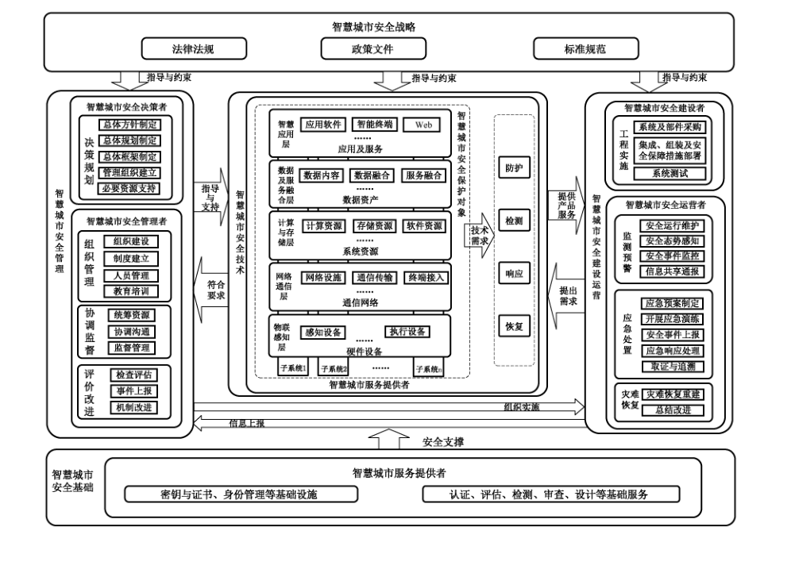
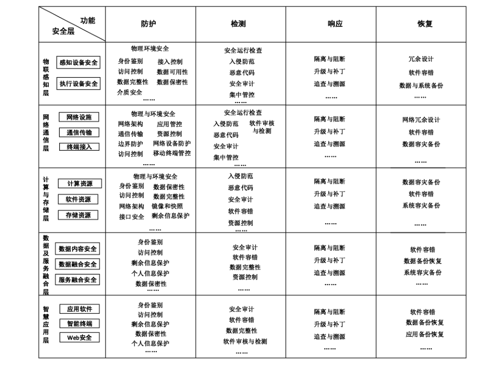

# GB/T 37971-2019 信息安全技术 智慧城市安全体系框架

> 来源：[GB/T 37971-2019 国家标准详情](https://openstd.samr.gov.cn/bzgk/std/newGbInfo?hcno=F665694F939CE7DF87D50741E39E6BDA)；封面发布日期：2019-08-30；实施日期：2020-03-01。
> 官方 PDF SHA-256：5b70dd52ac5d38951f81a14b93540e7b008ac4c3275f94bfb5bbb532303603b1。
> 转写说明：对照官方 PDF 全部 25 页的页面图像整理连续正文与附录，图 1 和图 C.1 保留原图并附文字结构；省略封面、目录、页眉、页脚和页码。正式引用请核对原标准页面。

## 前言

本标准按照 GB/T 1.1—2009给出的规则起草。

请注意本文件的某些内容可能涉及专利。本文件的发布机构不承担识别这些专利的责任。

本标准由全国信息安全标准化技术委员会（SAC/TC 260）提出并归口。

本标准起草单位：国家信息中心、中国电子技术标准化研究院、北京天融信网络安全技术有限公司、北京匡恩网络科技有限责任公司、杭州安恒信息技术有限公司、蓝盾信息安全技术有限公司、中国电子科技网络信息安全有限公司、启迪国信科技有限公司、电信科学技术研究院有限公司、中电长城网际系统应用有限公司、东软集团股份有限公司、华为技术有限公司、陕西省信息化工程研究院、普天信息技术有限公司、北京赛博兴安科技有限公司、北京知道创宇信息技术有限公司、山西百信信息技术有限公司、浙江省经济信息中心、陕西省网络与信息安全测评中心、中国互联网络信息中心、河南山谷网安科技股份有限公司、深信服科技股份有限公司、成都亚信网络安全产业技术研究院有限公司、北京京航计算通讯研究所、北京奇安信科技有限公司、北京创原天地科技有限公司、北京启明星辰信息安全技术有限公司、中国平安保险（集团）股份有限公司。

本标准主要起草人：张大江、毕晓宇、吕欣、韩晓露、李阳、王惠莅、范科峰、李娜、闵京华、毕钰、武传坤、周俊、石金、黄敏、雷晓锋、张勇、汤琦、刘汪洋、周晨松、许博希、陆宝华、陆希、叶润国、翟胜军、吴前锋、何山、王勃艳、傅瑜、左洪强、陈杨国、曾志峰、郭颖、朱晓鑫、李怡、杨向东、尚高峰、徐业礼、罗翔、刘东红、陈光杰、肖青海、张明敏、王峥、安高峰、蔡伟。

## 引言

智慧城市是运用物联网、云计算、大数据、空间地理信息集成等新一代信息技术，促进城市规划、建设、管理和服务智慧化的新理念和新模式，是新一代信息技术创新应用与城市转型发展深度融合的产物，是推动政府职能转变、推进社会管理创新的新手段和新方法，是城市走向绿色、低碳、可持续发展的本质需求。

本标准以信息通信技术（ICT）视角，在参考信息保障技术框架（IATF）、信息安全管理体系（ISMS）、防护/检测/响应/恢复（PDRR）和预警/保护/检测/响应/恢复/反击（WPDRRC）的安全模型、网际空间安全指南、关键基础设施网络安全框架、新型智慧城市评价指标体系、智慧城市技术参考框架以及我国信息安全领域标准的基础上，针对智慧城市保护对象和安全目标，从安全角色和安全要素的视角提出了体现智慧城市特点、具有可操作性的安全体系框架。

## 1 范围

本标准给出了智慧城市安全体系框架，包括智慧城市的安全保护对象、安全要素、安全角色及其相互关系。

本标准适用于智慧城市安全的规划、管理、建设、验收和运营，也可为其他智慧城市安全相关标准的制定提供依据和参考。

## 2 规范性引用文件

下列文件对于本文件的应用是必不可少的。凡是注日期的引用文件，仅注日期的版本适用于本文件。凡是不注日期的引用文件，其最新版本（包括所有的修改单）适用于本文件。

- GB/T 25069—2010 信息安全技术 术语

- GB/T 29246—2017 信息技术 安全技术 信息安全管理体系 概述和词汇

- GB/T 34678—2017 智慧城市 技术参考模型

- GB/T 37043—2018 智慧城市 术语

## 3 术语和定义

GB/T 25069—2010、GB/T 29246—2017和 GB/T 37043—2018界定的以及下列术语和定义适用于本文件。

### 3.1 智慧城市安全 smart city security

在智慧城市中对信息的保密性、完整性和可用性的保持，以及依此提供的应用与服务的安全。

### 3.2 关键信息基础设施 critical information infrastructure

公共通信和信息服务、能源、交通、水利、金融、公共服务、电子政务等重要行业和领域，以及其他一旦遭到破坏、丧失功能或者数据泄露，可能严重危害国家安全、国计民生、公共利益的信息设施。

### 3.3 智慧城市安全角色 smart city security role

参与智慧城市安全活动的相关方。

### 3.4 智慧城市安全决策者 smart city security decision maker

负责智慧城市安全战略规划和关键策略决策的实体。

### 3.5 智慧城市安全管理者 smart city security administrator

负责智慧城市信息安全组织建设、机制建设，以及协调监督的实体。

### 3.6 智慧城市安全建设者 smart city security implementor

负责智慧城市信息安全工程实施，部署智慧城市安全技术防护措施的实体。

### 3.7 智慧城市安全运营者 smart city security operator

负责智慧城市安全事件的监测、预警、响应和恢复的实体。

### 3.8 智慧城市服务提供者 smart city service provider

通过利用各种技术提供智慧城市产品和服务的实体。

### 3.9 智慧城市服务使用者 smart city service user

使用智慧城市产品和服务的实体。

> 注：智慧城市服务使用者包括政府部门、团体机构、企事业单位和个人。

## 4 缩略语

下列缩略语适用于本文件。

- API：应用程序编程接口（Application Programming Interface）
- APT：高级持续性威胁（Advanced Persistent Threat）
- ICT：信息通信技术（Information Communications Technology）
- Web：全球广域网（World Wide Web）

## 5 智慧城市安全概述

### 5.1 智慧城市面临的安全风险

智慧城市涵盖多个行业和多种信息系统，要素复杂、应用多样、相互作用、不断演化，具有设备泛在、数据异构、系统异构、应用异构、海量数据、数据汇聚与融合、数据跨域共享、高度协调运作等特征。这些特征使得智慧城市较之传统的信息系统面临更为复杂的安全风险。智慧城市安全的风险分析参见附录A。其中，A.3分析了智慧城市在物联感知层、网络通信层、计算与存储层、数据及服务融合层和智慧应用层所面临的安全技术风险。

### 5.2 智慧城市安全保护对象

智慧城市安全保护对象分为硬件设备、信息系统、数据资产和应用与服务。

硬件设备是智慧城市中具有独立工作能力的信息采集或处理设备，包括为智慧城市提供感知数据的终端设备、控制调节设备、通信设备、信息展示设备、服务终端等。

信息系统涉及关键信息基础设施以及为智慧城市提供智慧应用服务的系统与网络，包括城市公共通信、广播电视传输等基础信息网络，能源、金融、交通、教育、科研、水利、工业制造、医疗卫生、社会保障、公用事业等领域的信息系统，国家机关的信息系统，以及互联网应用系统等。智慧城市中的信息系统共享资源和能力（服务器、终端设备、网络、数据、应用等），通过信息系统的持续、有效运行为各类用户提供应用与服务。

数据资产是智慧城市网络收集、存储、传输、处理和产生的各种电子数据。

应用与服务是智慧城市服务提供者提供的应用程序和技术服务，包括智慧城市公共支撑与服务平台、各应用系统为智慧城市或其他应用系统提供的数据共享服务，以及智慧城市信息系统的数据服务和计算服务等。

### 5.3 智慧城市安全目标

围绕智慧城市安全保护对象，智慧城市安全决策者、智慧城市安全管理者、智慧城市安全建设者、智慧城市安全运营者、智慧城市服务提供者和智慧城市服务使用者等安全角色相互协作，实现以下安全目标：

a） 保证智慧城市信息系统安全运行，尤其是保证关键信息基础设施的可用性和可靠性；

b）保证政府部门、企事业单位、社会组织及个人的数据的真实性、保密性、完整性和可用性；

c） 保证智慧城市应用和服务的可用性、可靠性和可核查性；

d） 保证智慧城市数据资产的真实性、保密性、完整性、可用性和可靠性；

e） 保证智慧城市整体安全的合理性、鲁棒性和可扩展性。

### 5.4 智慧城市安全体系框架

智慧城市安全体系框架是实现智慧城市安全目标的参考模型，由智慧城市的安全保护对象、安全要素、安全角色及其相互关系组成，如图1所示。其中，安全要素包含安全战略、安全管理、安全技术、安全建设、安全运营和安全基础等方面。在智慧城市安全体系框架中，智慧城市安全角色履行各自职责、协同配合，满足安全要素的要求以保证智慧城市安全。

智慧城市各安全角色的活动都受智慧城市安全战略指导和约束。

智慧城市安全决策者和智慧城市安全管理者为智慧城市服务提供者、智慧城市安全建设者、智慧城市安全运营者提供指导和支持。

智慧城市安全建设者实施安全工程建设，监督智慧城市安全工程实施与安全措施部署过程，检查、评估、认证智慧城市服务提供者提供的应用和服务，对发现的安全风险与问题，及时向智慧城市安全决策者反馈。

智慧城市安全运营者通过技术手段监测智慧城市信息安全风险和威胁，向智慧城市管理者上报，并采取应急处置措施。

智慧城市服务提供者为智慧城市安全建设和运营提供产品与服务，同时还提供安全维护与技术支持。

智慧城市服务使用者与智慧城市服务提供者进行交互，直接或间接影响智慧城市业务的安全配置、规程、监测、监督、审核和追溯，需要遵循安全管理规则、提升安全意识和接受安全培训。

图 1 的文字结构：安全战略（法律法规、政策文件、标准规范）指导并约束安全管理、技术、建设与运营。安全管理包含决策规划、组织管理、协调监督、评价改进；安全技术覆盖物联感知、网络通信、计算与存储、数据及服务融合、智慧应用五层，并横向配置防护、检测、响应、恢复；安全建设与运营包括工程实施、监测预警、应急处置、灾难恢复；安全基础提供密钥与证书、身份管理等基础设施，以及认证、评估、检测、审查、设计等基础服务。

### 5.5 智慧城市安全角色

#### 5.5.1 智慧城市安全决策者

智慧城市安全决策者的职责包括但不限于：

a） 制定智慧城市安全总体方针；

b） 制定智慧城市安全总体规划；

c） 制定智慧城市安全总体框架；

d） 建立智慧城市安全管理协调组织；

e） 承诺必要的资源与资金支持。

#### 5.5.2 智慧城市安全管理者

智慧城市安全管理者的职责包括但不限于：

a） 针对智慧城市的异构、共享、跨域服务等特点完善智慧城市安全管理组织架构；

b） 制定智慧城市安全管理机制；

c） 制定智慧城市安全人才培养和安全意识教育计划；

d） 统筹协调智慧城市安全管理与监督工作；

e） 检查、评估智慧城市安全建设与运营工作；

f） 定期审核、改进智慧城市安全管理制度和流程；

g） 向智慧城市安全决策者报告智慧城市安全事件；

h） 为智慧城市安全建设者、智慧城市安全运营者和智慧城市服务提供者提供指导和必要支持。

#### 5.5.3 智慧城市安全建设者

智慧城市安全建设者的职责包括但不限于：

a） 实施智慧城市信息安全工程建设；

b） 部署有效的智慧城市安全防护措施；

c） 测试智慧城市信息工程建设安全建设方案；

d） 定期对智慧城市安全建设方案进行评审和改进；

e） 定期组织并配合主管部门的安全审查。

#### 5.5.4 智慧城市安全运营者

智慧城市安全运营者的职责包括但不限于：

a） 负责智慧城市安全运行与维护管理；

b） 监测智慧城市安全风险，分析安全态势；

c） 发现智慧城市安全事件和脆弱性，防范、阻断网络攻击；

d） 共享智慧城市安全威胁信息，及时通报智慧城市安全事件；

e） 制定、评估并修订智慧城市安全事件应急预案；

f） 定期开展智慧城市安全应急演练活动；

g） 应急处置智慧城市安全风险与安全事件；

h） 及时向上级管理部门报告安全威胁信息与安全事件；

i） 实现对恶意行为的取证和追踪溯源；

j） 保证灾后城市信息系统快速恢复正常运转状态；

k）有效控制智慧城市安全事件造成的负面影响。

#### 5.5.5 智慧城市服务提供者

智慧城市服务提供者的安全职责包括但不限于：

a） 设计开发安全产品与应用，并提供维护技术服务；

b） 为智慧城市安全运行提供信息安全基础服务；

c） 按照智慧城市安全管理策略部署安全技术措施，包括数据安全共享、跨域安全服务等；

d） 协助智慧城市安全建设者进行工程建设，提供安全产品、服务及技术服务支持；

e） 协助智慧城市安全运营者完成应急恢复及调查取证，提供安全产品、服务及技术服务支持。

#### 5.5.6 智慧城市服务使用者

智慧城市服务使用者的安全职责包括但不限于：

a） 合理使用智慧城市服务提供者提供的智慧应用和服务；

b） 向智慧城市服务提供者反馈合理的安全需求；

c） 负责所拥有的信息数据资产的安全管理，支持智慧城市业务安全配置、规程、监测、监督、审核、追溯及互操作等安全管理；

d） 定期安排具有安全评估资质的机构，对网络、信息系统和设备进行系统性安全评估，根据评估结果进行整改和安全修复；

e） 接受安全培训和指导。

### 5.6 智慧城市安全要素

智慧城市安全战略是智慧城市安全运行及网络安全治理的基础，指导和约束了智慧城市安全管理、技术、建设与运营活动。智慧城市安全战略主要包括法律法规、政策文件及标准规范。

智慧城市安全管理是智慧城市安全规划、管理、建设与运营有序进行的前提，智慧城市安全技术防护提供策略，组织实施智慧城市建设与运营。智慧城市安全管理主要包括决策规划、组织管理、协调监督和评价改进。

智慧城市安全技术是为建立智慧城市纵深防御体系，由智慧城市服务提供者研究、开发和设计的智慧产品和应用，在物联感知层、网络通信层、计算与存储层、数据及服务融合层以及智慧应用层五个层次分别部署安全技术防御措施，为智慧城市管理提供技术支持，为智慧城市建设与运营提供产品和服务，动态应对智慧城市安全风险，确保智慧城市在信息安全保护方面能够较快恢复到原有状态，保持系统结构和功能的能力。

智慧城市安全建设与运营主要包括智慧城市信息安全工程实施和智慧城市安全运营。智慧城市信息安全工程实施是指按照智慧城市安全总体规划和管理要求，实施智慧城市信息系统的开发、采购、集成、组建、配置及测试。智慧城市安全运营是指按照智慧城市安全总体规划和管理要求，对智慧城市信息系统运行状态的维护、监测，对安全事件的报告、应急处置、恢复，确保并维持智慧城市的各项业务安全有序地运行。

智慧城市安全基础为智慧城市安全体系运行提供基础设施和基础服务。智慧城市安全基础设施包括密钥与证书管理、身份管理、监测预警与通报、容灾备份和时间同步等方面的设施。智慧城市基础服务包括产品和服务的资质认证、安全评估、安全检测、安全审查以及咨询服务等。

## 6 智慧城市安全战略

智慧城市安全管理、安全技术、安全建设与运营和安全基础应符合法律法规、政策文件和标准规范的要求。智慧城市安全战略应包括但不限于以下要素：

a） 智慧城市安全治理体系。目的是对智慧城市安全活动参与方的责任进行界定，并对其活动进行约束、规范及监督。

b） 对智慧城市安全管理、安全技术、安全建设与运营和安全基础的政策指导。

c） 智慧城市安全标准规划。目的是研究、制定并实施具有区域特征、行业特性的智慧城市安全标准。

## 7 智慧城市安全管理

### 7.1 决策规划

智慧城市安全决策者应根据智慧城市面临的安全风险，制定符合智慧城市发展的安全总体规划和策略，明确安全工作机制、安全目标和安全职责。

智慧城市安全决策规划包括但不限于以下要素：

a） 安全总体要求，包括安全目标、安全保护对象等；

b） 安全治理要求；

c） 关键安全指标与优先级；

d） 安全管理、建设和运营的规划与策略；

e） 安全管理协调机制；

f） 安全建设资源规划；

g） 安全规划、策略与规程的评审和更新。

### 7.2 组织管理

智慧城市安全管理者应落实智慧城市安全规划与策略，完善组织架构，制定安全管理制度，开展安全意识教育和安全技术培训工作，对智慧城市安全建设项目给予管理和技术资源支持。

智慧城市安全组织管理包括但不限于以下要素：

a） 安全工作小组。按照安全管理角色设立岗位、配置人员，制定有效安全管理模式。

b） 安全管理、建设和运营工作的责任部门、重要岗位负责人和岗位职责。

c） 安全管理、建设与运营的策略机制。

d） 安全管理制度与规程实施细则，包括但不限于智慧城市技术相关的安全（系统、网络、数据、应用等）策略与制度、工程建设安全策略与流程、系统开发策略与制度、病毒防护策略与制度、智慧城市安全追责制度等。

e） 安全相关角色的重要岗位人员的招聘、录用、调岗、离岗、考核、选拔等管理制度。

f） 安全相关角色的重要岗位人员的责任与权限要求。

g） 安全专业人才计划和培训计划。

### 7.3 协调监督

智慧城市安全管理者应围绕智慧城市安全规划目标，以国家法律法规、政策文件和标准规范指导，制定智慧城市安全协调策略与机制，统筹协调智慧城市安全工作并监督智慧城市安全相关活动。

智慧城市安全协调监督包括但不限于以下要素：

a）- 协调管理的负责部门、负责人及岗位职责；

b） 安全协调管理和监督机制；

c） 与智慧城市安全建设与运营相关方的沟通机制；

d） 智慧城市安全建设与运营活动的合规检查机制；

e） 重大安全事件处罚制度。

### 7.4 评价改进

智慧城市安全管理者应根据评估检查等安全活动，向主管部门报告智慧城市安全管理、建设与运营过程中发现的安全风险与安全事件，有利于总体规划和策略持续改进。

智慧城市安全评价改进应包括但不限于以下要素：

a） 安全检查、评估、认证和调查取证机制及实施细则。

b） 安全建设评估和评价工作。检查各项指标达成情况，并对评价结果进行统计分析，对不符合智慧城市安全评估标准的指标进行调查分析，给出定性或定量的分析评估报告。

c） 定期审核。对智慧城市安全管理制度进行修订。

d） 持续改进。总结智慧城市安全管理、建设、验收和运营过程中的经验和教训，结合检测和评估过程中发现的风险，对智慧城市安全总体规划提出改进建议，持续提升智慧城市安全管理能力。

## 8 智慧城市安全技术

根据GB/T 34678—2017，智慧城市安全设计、建设和运营应包括但不限于以下技术要素：

a） 物联感知层

1） 感知设备和执行设备的监测和防护；

2） 感知设备和执行设备的身份鉴别；

3）感知设备和执行设备的访问控制；

4） 感知设备信息采集安全；

5） 执行设备的指令信息安全。

b） 通信网络层

1） 互联网、电信网、广播电视网、三网融合的公共网络和专用网络的网络设施安全；

2） 通信传输安全；

3） 网络接入安全；

4） 终端安全。

c） 计算与存储层

1） 智慧城市计算资源、软件资源及存储资源设备的威胁监测和防护措施；

2） 物理或虚拟计算资源的安全；

3） 物理或虚拟存储资源的安全；

4） 为上层数据和应用提供公共服务能力的基础软件安全，包括但不限于操作系统、数据库系统、中间件和资源管理软件的安全。

d） 数据及融合服务层

1） 数据内容、数据与服务融合资源的防护措施；

2） 智慧城市基础信息、共享交换信息、应用领域信息和互联网信息的存储安全；

3） 数据融合过程安全，包括数据采集与汇聚、数据融合与处理、数据挖掘分析，以及数据治理；

4） 智慧应用服务融合过程安全，包括服务聚集、服务管理、服务整合和服务使用。

e） 智慧应用层

1） 应用软件、智能终端、网站等的防护措施；

2） 智慧应用的可靠性和可扩展性。

对于智慧城市技术参考模型中各层的安全技术要求参见附录 B。智慧城市技术参考模型中各层与安全功能的对应关系参见附录C。

## 9 智慧城市安全建设与运营

### 9.1 工程实施

智慧城市安全建设者应围绕智慧城市安全目标，按照总体规划和规程，开展智慧城市安全工程实施工作，符合法律法规和标准要求，确保智慧城市信息安全工程与信息化工程同步建设，保证智慧城市信息系统和相关组件在采购、开发、组装、集成、调试、试运行以及运行过程满足安全要求，保证智慧城市安全工程建设过程操作规范、可追溯，所提供的安全服务水平可评估。

智慧城市安全工程实施应包括但不限于以下要素：

a） 安全工程实施、供应链保障、人员安全管理及合规性管理的策略和制度。

b） 安全管理的责任部门和责任人。

c） 安全保护对象、目标、等级、定级依据以及智慧城市安全建设方案的论证、审定和报备。

d） 安全需求分析和安全措施。

e） 供应链中相关方的责任与义务。

f） 政府部门信息安全防护要求。

g） 专业的智慧城市安全建设安全支撑服务团队、安全服务机制、人员安全管理制度。

h） 安全监督、审核与风险评估。

i） 关键系统、设备、组件等的配置信息的保存记录。

j） 产品和服务的备案机制。确保采用通过国家相关部门安全审查和资质认证的产品和服务。

k）项目实施进度和质量控制。

l） 安全工程实施的测试验收、交付以及等级测评。

### 9.2 监测预警

智慧城市安全运营者应围绕智慧城市安全目标，依据法律法规、政策文件和相关安全标准，建立智慧城市安全监测预警体系，监测智慧城市信息系统运行状态，发现智慧城市信息系统的脆弱性和安全风险，收集分析智慧城市安全事件信息，对安全风险及时报告和通报，按需发布智慧城市安全监测预警信息。

智慧城市安全监测预警应包括但不限于以下要素：

a） 按照《国家网络安全事件应急预案》的规定进行预警分级、监测预警、预警研判及预警响应发布与解除；

b） 网络和设备的监测监控；

c） 公共信息支撑平台等基础设施的监测监控；

d） 安全威胁信息交换系统和信息共享机制；

e） 安全漏洞和恶意代码识别、修补和防范机制；

f） 安全事件报告与通报机制；

g） 安全态势感知。

### 9.3 应急处置

智慧城市安全运营者应按照法律法规、政策文件和安全标准的要求，制定智慧城市安全事件应急预案，对不同级别的事件，明确启动条件、处理流程、恢复流程。部署安全保护措施，预防智慧城市安全事件的发生。在发生安全事件时，及时采取应急处置措施，向主管部门报告智慧城市重大安全事件。

智慧城市应急处置应包括但不限于以下要素：

a） 安全事件应急预案及其有效性评估；

b） 应急处置机制；

c） 应急演练；

d） 安全事件教育培训；

e） 应急指挥体系。

### 9.4 灾难恢复

在智慧城市安全事件发生后，智慧城市安全运营者应根据安全事件的影响程度和业务的优先级，采取措施确保智慧城市信息系统业务流程按照规划目标恢复。

智慧城市安全灾难恢复应包括但不限于以下要素：

a） 灾难恢复演练。

b） 业务信息、重要系统和数据资源的容灾备份。

c） 灾难恢复策略和流程。

d） 安全事件处理与恢复。实现快速协同处理，降低或控制城市信息安全事件的影响，及时恢复智慧城市信息系统正常的运转状态。

## 10 智慧城市安全基础

### 10.1 基础设施

智慧城市服务提供者应提供实现密码管理、证书管理、身份鉴别、监测预警与通报、容灾备份、时间同步等技术的基础设施，智慧城市安全管理、技术、建设和运营提供基础设施。

智慧城市安全基础设施应包括但不限于以下要素：

a） 符合国家密码管理机构规定的密码管理制度。

b） 密码技术相关的基础设施。

c） 国家密码管理主管部门批准使用的密码算法和产品。

d） 身份鉴别和信任服务机制。

e） 用户信息管理和用户隐私保护机制。

f） 智慧城市数字证书系统。管理证书申请、签发、使用、更新、存储、延期、恢复、撤销等活动。

g） 授时系统。保证关键信息基础设施系统时间安全、时钟精度以及时间同步的完整性。

h）基础设施的安全管理。

### 10.2 基础服务

智慧城市服务提供者应按照法律法规、政策文件和标准规范的相关要求，为智慧城市安全管理、建设和运营提供基础服务活动支撑。

智慧城市安全基础服务应包括但不限于以下要素：

a） 信息系统的安全检测和认证；

b） 信息安全产品和信息安全服务的检测和认证；

c） 信息安全产品和信息安全服务的准入与审查；

d） 安全评估、设计和咨询。

## 附录 A（资料性附录）智慧城市安全风险分析

### A.1 智慧城市安全战略风险

智慧城市安全战略风险包括但不限于：

a） 缺乏智慧城市安全管理、建设和运营等相关法规的责任认定和机制约束。

b） 智慧城市安全保护目标不清，定位不明。已有规划与智慧城市信息化建设和经济发展脱离，缺乏对城市文化的发扬和传承。

c） 缺乏智慧城市安全相关标准参考，例如，国家安全、关键信息基础设施安全等方面缺乏国家标准指导。

### A.2 智慧城市安全管理风险

智慧城市安全管理风险包括但不限于：

a） 战略规划在智慧城市信息化建设过程中，缺乏智慧城市安全顶层设计、总体规划与策略规程。

b） 协同管理

1） 在智慧城市信息化建设过程中，缺少安全角色与职责的定义；

2） 在跨部门协调处理过程中存在阻力，管理职责不清或无人负责；

3） 缺少统一协调管理机制，在破除信息壁垒、建立数据共享平台、实现跨部门和跨区域的数据交互过程中无章可循；

4） 智慧城市的网络环境比单一的信息系统更加复杂，传统的城市安全管理模式和防护手段已经滞后，缺乏完善的管理制度；

5） 缺乏对组织、人员和安全活动的监督管理机制，无法对智慧城市安全管理活动过程进行监控；

6） 缺乏统一的安全评估机制和有效的策略改进机制。

c） 安全意识

1） 智慧城市安全各角色，如，决策者、管理者、建设与运营者、服务提供者及服务使用者缺乏信息安全保护意识；

2） 智慧城市重要业务领域组织内部，操作人员缺乏安全意识和安全技术技能，存在人为操作错误及安全疏忽导致的安全事件；

3） 缺少安全事件的宣传教育活动，相关人员缺乏对已经发生的安全事件的深刻理解。

d） 安全检查

1） 智慧城市关键信息基础设施和网络设备缺乏严格的认证和准入机制。如果采用了未经严格准入认证的设备，这些设备可能被恶意植入后门或漏洞，将导致严重的安全隐患甚至整个网络被控制。

2） 关键信息基础设施中的网络和重要信息系统的设施的核心技术和关键产品技术安全可控率低，存在安全隐患。一旦被攻击者利用，将导致国家机密信息泄漏和网络中断或瘫痪等。

### A.3 智慧城市安全技术风险

#### A.3.1 物联感知层

物联感知层安全风险包括但不限于：

a） 感知设备数量巨大，分类众多，缺乏统一的安全标识和身份鉴别管理机制。攻击者可通过恶意放置假冒的设备，冒充合法的设备接入网络，非法接收和发送信息，导致网络信息泄漏。

b） 攻击者可利用物联感知层设备防御能力有限的特点，非法俘获感知设备，更换或破坏软硬件，非法控制节点信息接收和发送，篡改和未在节点信息对智慧城市信息系统甚至互联网进行攻击。

c） 攻击者可通过技术手段对感知设备进行监听，获取智慧城市敏感信息。

d） 物联感知层中采用的无线通信技术容易导致信息泄漏，攻击者可以利用这些漏洞对信息进行窃取和非法篡改。

e） 感知设备加密运算和存储能力有限，防御能力有限，容易成为攻击者的目标，实施拒绝服务攻击，使设备丧失运行能力。

f） 攻击者可通过无线电波干扰使得感知设备无法正常工作。

g） 在工业控制领域中的信息系统和网络设备生命周期较长，软件较少更新或不能及时安装补丁。

h） 由于关键信息基础设施系统的安全架构具有脆弱性，攻击者可挖掘控制器的安全防护薄弱点进行攻击，最终导致整个系统的瘫痪。

i） 攻击者对关键信息基础设施中的设备进行越权访问和非法远程访问。

j） 攻击者篡改关键信息基础设施中对执行设备的控制指令，将导致信息流的中断或设备故障，引发重大安全事故。

k）攻击者可利用关键信息基础设施系统中的设备存在的漏洞和后门，对执行设备非法控制或攻击。

#### A.3.2 网络通信层

网络通信层安全风险包括但不限于：

a） 智慧城市业务系统开放融合的需求使得关联系统之间的边界模糊化，由物理隔离方式转变力逻辑隔离方式，攻击者非法访问网络通信设备，监听重要数据信息；

b） 网络通信设备本身存在安全漏洞，攻击者可以通过利用这些安全漏洞对网络发起攻击；

c） 网络通信设备防护能力和计算能力有限，易被攻击者利用发起拒绝服务攻击；

d） 网络传输协议存在设计缺陷和漏洞，容易被攻击者挖掘利用，导致数据信息被窃听、劫持或篡改；

e） 网络深度融合使互联网病毒更容易转移和扩散，攻击这实施网络安全攻击的影响力和破坏力度更强；

f） 大多网络只部署了基础防护措施，但安全态势感知和防护能力不足，攻击者可利用新型威胁发起网络攻击；

g） 关键信息基础设施网络如果不能保证时间同步，可能直接影响到关键业务运行，使得攻击者有机会利用中间人攻击或拒绝服务等攻击，对网络中关键信息进行拦截、删除，或导致系统瘫痪、业务中断，甚至发生意外事故；

h） 关键信息基础设施系统中，网络设备硬件缺少物理保护、环境控制以及物理访问控制，容易导致设备损坏、数据和设备被窃取；

i） 关键信息基础设施系统中，网络设备配置没有存储或备份，网络安全架构安全性相对薄弱；

j）； 关键信息基础设施系统中，没有明确的网络边界或者缺乏正确的边界防护策略，导致攻击和病毒扩散；

关键信息基础设施系统中，网络设备物理端口缺少防护，移动介质中的病毒等可导致对整个系统的攻击；

l） 关键信息基础设施系统中网络设备缺少安全配置，缺少加密口令，易导致攻击者可以实施非授权连接对设备进行控制，破坏和监视网络系统中的操作和行为；

m）关键信息基础设施系统中，多采用专用控制与通信协议，这些协议无安全设计考虑，攻击者可以进行非法访问、数据被篡改以及发起重放攻击。

#### A.3.3 计算与存储层

计算与存储层的安全风险包括但不限于：

a） 计算资源基础设施安全缺乏物理安全防护；

b） 攻击者可以通过非法远程访问窃取云端数据；

c） 服务程序和平台组件可能因错误配置导致业务中断或者数据被破坏和泄漏；

d） 云平台界面和 API接口可能因错误配置导致业务中断或者数据被破坏和泄漏；

e） 虚拟化环境中一个安全风险点可能导致整个虚拟环境的安全风险；

f） 智慧城市公共信息服务平台发现风险能力和安全维护能力不足；

g） 平台软件的开发和交付未经第三方检测认证，易引入恶意代码导致安全风险；

h） 智慧城市公共信息服务平台的安全态势感知能力和应对新型威胁防护能力不足；

i） 城市数据集中存储在几个数据库中，攻击者对数据库的非法访问容易导致数据泄漏；

j） 智慧城市数据库管理系统授权管理员误操作可能导致安全控制机制失效；

k） 数据库管理系统软件需求规范或设计中的无意逻辑错误可能产生设计弱点或缺陷，恶意用户可能利用这些缺陷对评估对象进行安全攻击；

1） 恶意攻击者可通过修改数据库审计策略，使数据库审计功能停用或失效、审计记录丢失或被篡改，也有可能通过审计数据存储失效来阻止未来审计记录被存储，从而掩盖用户的操作；

m）关键信息基础设施中的系统平台缺乏正确的密码管理机制，存在不使用密码或使用弱口令现象；

n）关键信息基础设施中的系统平台不安装或升级系统补丁、入侵检测软件、防病毒软件，导致服务器被攻击，数据被窃取、修改或删除；

o） 关键信息基础设施系统中的系统平台可能存在后门，容易被攻击者利用对控制系统进行攻击；

p） 关键信息基础设施系统中，互联网安全风险容易引入生产网络云平台，攻击者可通过钓鱼网站和恶意软件获取重要敏感信息。

#### A.3.4 数据及服务融合层

数据及服务融合层的安全风险包括但不限于：

a） 政府部门的数据开放程度不够，不轻易共享给其他业务部门；各部门或行业数据与服务不开放，各自为政，形成了信息孤岛；

b） 数据来源真实性、时效性和准确性缺少安全保证；

c） 非结构化数据信息化程度不足，数据本身缺乏有效性；

d） 存在跨信息系统甚至跨行业、跨区域的非授权访问；

e） 数据共享前缺少脱敏处理，易导致数据的恶意关联和信息泄漏；

f） 数据来源广泛以及数据的多样性使得数据量巨大且数据结构复杂，远超越单个行业或企业的管理能力，数据处理和融合以及数据维护的工作量大，传统信息安全审计规则应用有限，很难进行统一监控审计；

g） 缺乏对数据有效的安全监管，存在数据滥用现象，数据控制权界限模糊；

h）多行业多业务交叉，多业务服务的逻辑风险叠加，逻辑错误可能导致业务服务瘫痪；

i） 业务系统架构不同、数据格式不同以及服务业务运行环境不同，缺乏标准的服务接口和应用管理；

j） 在大数据场景下变得越来越难以操作，易导致个人信息泄露；

k） 关键信息基础设施系统中，攻击者可通过木马病毒等获取国家重要敏感信息。

#### A.3.5 智慧应用层

智慧应用层安全风险包括但不限于：

a） 应用系统面临病毒、后门、木马、漏洞以及恶意软件安全风险，存在数据泄漏、被篡改以及远程控制风险；

b） 智能终端的漏洞、病毒和木马等会导致信息泄漏，甚至导致威胁通过网络向系统中扩散；

c） 多种智慧应用和网站的发展使得个人信息泄露风险极大；

d） 攻击者可在智慧应用服务与智慧城市信息管理平台以及与公共基础数据库和公共服务数据库之间的应用接口进行数据窃取或恶意篡改；

e） 网站入侵频发，重点网站中存在钓鱼网站，高危漏洞较多，存在内容篡改和数据泄露风险；

f） 用户账户弱口令和密码存在暴力破解风险；

g） 智慧应用中用户身份鉴别逻辑复杂度和难度提升，信息被盗将导致用户的个人隐私信息泄漏或数据失窃；

h） 网络监测和审计范围将扩展到大量的音视频数据内容，异常行为检测和判断更加困难；攻击者可将危害性的信息以音视频数据传播给公众，造成社会混乱和恐慌；

i） 在关键信息基础设施的相关系统中，攻击者可利用互联网中的攻击，针对城市关键信息基础设施系统中的漏洞实施有针对性的病毒、木马、恶意代码等攻击；

j） 关键信息基础设施系统面临着组织内部的攻击窃取系统数据；

k）在关键信息基础设施的相关系统中，攻击者可通过钓鱼网站、垃圾邮件和恶意软件通过攻击脚本和协议发起攻击；

l） 在关键信息基础设施的相关系统中，攻击者可通过损害系统文件、硬件驱动、关键控制过程、执行程序和控制设备发起攻击；

m）在关键信息基础设施的相关系统中，攻击者通过信息收集和网上欺诈等行为破坏关键信息基础设施业务系统。

### A.4 智慧城市安全建设与运营风险分析

智慧城市建设与运营风险包括但不限于：

a） 安全工程建设

1） 在智慧城市安全的建设过程中，“重功能、轻安全”“先建设，后安全”现象普遍存在。尤其是关键信息基础设施的安全建设方面，存在安全建设与信息化规划、建设、运行不同步。这导致在维护和运营过程中容易出现建设进程脱节，安全维护困难；

2） 智慧城市信息化建设过程中包括工程项目设计、采购、系统集成与设置、人员安全与管理、安全制度建设以及第三方管理多个阶段，目前缺乏对各阶段的监督、核查与存档机制，安全事件发生无法追溯。

b） 智能终端和网络用户数量的增加、数据来源广泛、数据的多样性、数据结构的复杂化，数据难于维护。

c） 缺乏城市整体风险态势感知和控制能力；多网络融合与多系统的交叉与迭代，业务逻辑处理的复杂度增高，难于检测安全问题。

d） 缺乏快速有效的安全事件处理和控制及溯源机制。

e） 缺乏系统的分级维护机制，一旦出现网络安全事件，可能会导致系统设计和流程更新、数据篡改、业务中断等，难以应对和控制风险影响。

f） 缺乏城市各部门之间联动的风险预警和应急处置机制；智慧城市中的信息系统超越了单个机构和组织的边界，成为社会化、协同化的开放系统，威胁信息可能在网络和系统之间进行信息传递和扩散。

g） 缺乏对城市安全建设的统筹规划以及完善的安全灾备机制。严重自然环境灾害会导致智慧城市信息系统瘫痪，严重影响城市管理和业务运行。

## 附录 B（资料性附录）智慧城市安全技术要求

### B.1 物联感知层

本层主要包括对智慧城市信息系统中的感知设备和执行设备防护、检测，对上述设备安全风险和威胁的响应处置，保证感知设备信息采集安全以及执行设备的指令信息安全，恢复设备及业务系统安全运行。

本层的安全技术要求包括但不限于：

a） 对感知设备、执行设备安全防护，防止未授权访问、入侵、窃取、损坏和干扰；

b） 保证感知设备的采集数据、传输信息的实时性、机密性和完整性；

c） 保证执行设备指令的实时性、完整性和可用性；

d） 建立统一的标识安全管理和身份鉴别机制，保证感知设备的合法接入；

e） 保证具有存储功能的感知设备的数据存储安全，保证数据的机密性、完整性和可用性；

f） 支持感知设备和执行设备安全事件可记录、可追溯；

g） 保证感知设备满足物理和环境安全、接入控制安全、访问控制、网络安全接入、资源控制、配置更新、数据安全、恶意入侵和代码防范以及建设与运维管理等安全要求。

### B.2 网络通信层

本层主要包括对智慧城市的互联网、电信网、广播电视网以及三网之间的融合的公共网络，以及一些专用网络的网络设施、通信传输以及终端接入等方面部署安全防护措施，检测其安全风险与威胁，并对其安全威胁响应处置，恢复智慧城市网络及系统安全运行。

本层的安全技术要求包括但不限于：

a） 根据智慧城市业务重要性划分网络安全域，进行分区分级管理，对不同网络分区采取不同安全级别的隔离防护措施；

b） 对智慧城市中不同网络或区域之间边界采取访问控制、安全审计、边界完整性检查、入侵防范、恶意代码防范等防护措施，对网络日志进行管理分析；网络或区域之间边界包括但不限于智慧城市中各行业应用系统之间以及各行业应用系统与公共支撑信息系统之间；

c） 保证跨部门、跨行业、跨系统传输数据的安全，保证数据的保密性、完整性、可用性；

d） 支持对网络设备、通信线路、传输数据、协议和移动终端等的安全防护与检测，避免未授权访问、干扰、窃听和损坏，保证网络通信的连续性和可靠性；

e） 建立对出境网络数据和流量的监测分析机制，对需要出境的网络数据和流量进行安全评估，对深层、复杂、隐蔽性监听等安全威胁建立有效的防御和处理机制；

f） 规定智慧城市关键网络的访问控制规则和控制粒度；对涉及城市关键信息基础设施网络的访问、数据操作和传输按照相关标准予以控制；

g） 各行业应用系统具备向智慧城市公共支撑与服务平台开放接口的功能，保证智慧城市应用接口安全使用、控制、分析和管理，安全地进行数据读取、修改、存储、删除；

h） 对网络整体运行状态、网络日志、安全风险和威胁信息进行统一管理。除了基础的网络防御措施外，还具备全网络安全态势检测、分析和防御能力，以及新型和高级威胁检测、分析、预警和防御能力，以防止 APT 攻击或 0Day 漏洞攻击等。

### B.3 计算与存储层

#### B.3.1 计算资源安全

本层的安全技术要求包括但不限于：

a） 确保智慧城市计算资源基础设施设于中国境内，保证城市服务数据和服务平台的安全；

b） 根据智慧城市公共信息服务支撑平台承载的业务系统重要程度或安全保护等级进行区域划分，并实现区域间访问控制、安全防护、安全检测，以及智慧城市用户间的网络资源隔离，资源安全；

c） 支持采用异构计算资源统一管理和安全接入；

d） 支持计算资源的数据与业务应用容灾备份；

e） 支持安全审计活动对智慧城市基础计算业务过程的影响最小化；

f） 对于涉及关键信息基础设施领域的计算资源，所采购的重要网络产品和服务通过国家网络安全审查；

g） 确保智慧城市计算资源具有业务处理冗余架构，保证系统的可用性及业务的连续性。

#### B.3.2 软件资源安全

本层的安全技术要求包括但不限于：

a） 对智慧城市计算与存储软件统一安全管理，包括使用权限管理、脆弱性监测、漏洞扫描、病毒木马及恶意程序的检测与监控等；

b） 建设统一的身份鉴别和管理系统，归口各类用户身份信息，限制不同类别用户对数据信息的访问能力及范围，确保服务和数据不被非法使用和访问；

c） 使用业界成熟的软件版本，软件供应商能提供有效的软件升级和维护服务；

d） 支持最小化安装原则，仅安装必要的组件和应用程序；

e） 支持智慧城市计算与存储层的软件数据备份功能。

#### B.3.3 存储资源安全

本层的安全技术要求包括但不限于：

a） 确保智慧城市存储资源基础设施设于中国境内，保证数据存储安全；

b） 确保智慧城市存储资源的高可靠性和高可用性；

c） 建立智慧城市数据存储架构和安全控制机制，确保对智慧城市数据存储系统具有加密、容错及容灾能力；

d） 采用虚拟化存储时满足不同租户间虚拟化存储空间的安全隔离，其他租户或者平台管理员非授权不能访问租户存储空间；

e） 存储资源管理平台支持恶意代码检测和处置的能力；

f） 保证智慧城市中建立、使用和维护数据库的数据库管理系统的安全，包括各行业应用系统数据库安全、智慧城市基础数据库安全以及上述数据库的实例安全；

g） 支持多种数据容灾备份方式，智慧城市关键数据存储采用高安全性的数据备份保护机制，提供数据异地备份的能力；

h）智慧城市基础数据库提供用户授权、身份鉴别、访问控制、数据库审计、数据库备份与恢复、数据加密、资源限制等多种安全控制措施确保数据安全；

i） 确保建立智慧城市关键业务数据库管理系统的软硬件设备位于中国境内。

### B.4 数据及服务融合层

#### B.4.1 数据内容安全

本层的安全技术要求包括但不限于：

a） 支持数据安全治理，明确智慧城市数据所有者以及最终责任人，经数据所有者授权，指定负责数据授权管理的责任人；

b）制定数据分类规则、数据管理策略，根据数据分类和管理策略对数据进行不同安全级别保护；

c） 制定数据访问策略，规定数据可被存放的地理区域及相关安全要求，明确数据可被访问的人员角色和操作权限，建立相关安全审计机制；

d） 建立数据调查取证体系，可提供取证基础数据，保证取证数据在收集、保存、分析及解释过程中的安全；

e） 由专门的业务部门负责数据的归档、更新、存储及使用的安全；

f） 涉及政府信息的数据应按照国家颁布的相关法规和条例执行；

g） 在跨部门、跨行业、跨系统数据交互时，应采取措施对数据传输进行安全控制和合规性分析。

#### B.4.2 数据及服务融合安全

本层的安全技术要求包括但不限于：

a） 智慧城市公共基础数据库和共享信息数据库的数据提供方保证数据的有效性和可用性；

b） 保证智慧城市公共信息和基础数据服务的有效性和可用性；

c） 提供智慧城市基础信息数据库的安全防护能力，能够满足数据机密性、完整性和可用性，并发控制、故障恢复的要求，并提供数据库审计功能；

d） 明确智慧城市公共信息和基础数据以及关键数据资产的拥有者，对数据访问的权限进行有效控制；

e） 提供数据和服务接口安全，允许采用密码技术保护数据和应用程序接口，对接口统一认证、配置，并进行安全控制；

f） 允许相关方（各行业应用系统和第三方审计者等）接入数据服务 API 接口读/写、管理或审计数据，支持多种身份鉴别机制；

g） 监管部门对数据服务提供商和运营商建立监督和检查机制，保证数据服务的安全可持续；

h）保证跨部门、跨行业、跨系统、跨区域之间数据交换和共享安全，根据数据交换和共享策略和合作协议部署保护措施，保证数据交换和共享的协议安全；

i） 对敏感信息共享进行合规性审计，共享前对必要的敏感信息进行脱敏保护，并满足导入、导出、共享披露、隐私合规与操作监控安全，必要时签署保密协议明确权利和责任，防止相关信息的恶意业务关联。

### B.5 智慧应用层安全

本层主要包括对应用软件、智能终端、网站等部署防护措施，检测其安全威胁，对其安全风险和威胁响应进行处置，恢复智慧城市智慧应用服务功能。

本层的安全技术要求包括但不限于：

a） 智慧城市的各项智慧应用设计和安全满足用户身份鉴别、自主访问控制、安全审计、用户数据完整性等安全等级要求；

b） 保证各行业应用系统与智慧城市公共信息服务平台的应用程序接口的安全；

c） 保证智慧城市各种应用服务的业务信息以及各行业应用系统与城市公共信息服务平台之间应用协议安全；

d） 对政府门户网站、电子邮件、信息系统、终端计算机、存储介质等进行防护；

e） 对涉及境外的产品和服务经过风险评估并满足安全控制要求；

f） 支持智慧城市应用服务监督监管和安全治理机制，保证业务应用系统和软件开发环境及数据环境的安全；

g） 为各项智慧应用建立统一的身份鉴别、访问控制、安全评估和安全审计机制，保证有效的权限管理和安全事件可追溯。

## 附录 C（资料性附录）智慧城市安全技术功能

### C.1 概述

智慧城市安全功能矩阵描述了智慧城市技术参考模型各层与安全功能的对应关系，如图C.1所示。

| 安全层 | 对象 | 防护 | 检测 | 响应 | 恢复 |
| --- | --- | --- | --- | --- | --- |
| 物联感知层 | 感知设备、执行设备 | 物理环境安全、身份鉴别、接入控制、访问控制、数据可用性、数据完整性、数据保密性、介质安全等 | 安全运行检查、入侵防范、恶意代码、安全审计、集中管控等 | 隔离与阻断、升级与补丁、追查与溯源等 | 冗余设计、软件容错、数据与系统备份等 |
| 网络通信层 | 网络设施、通信传输、终端接入 | 物理与环境安全、网络架构、应用管控、通信传输、资源控制、边界防护、网络设备防护、访问控制、移动终端管控等 | 安全运行检查、入侵防范、软件审核与检测、恶意代码、安全审计、集中管控等 | 隔离与阻断、升级与补丁、追查与溯源等 | 网络冗余设计、软件容错、数据容灾备份等 |
| 计算与存储层 | 计算资源、软件资源、存储资源 | 物理与环境安全、身份鉴别、数据保密性、访问控制、数据完整性、网络架构、镜像和快照、接口安全、剩余信息保护等 | 入侵防范、恶意代码、安全审计、软件容错、资源控制等 | 隔离与阻断、升级与补丁、追查与溯源等 | 数据容灾备份、软件容错、系统容灾备份等 |
| 数据及服务融合层 | 数据内容安全、数据融合安全、服务融合安全 | 身份鉴别、访问控制、剩余信息保护、个人信息保护、数据保密性等 | 安全审计、软件容错、数据完整性、资源控制等 | 隔离与阻断、升级与补丁、追查与溯源等 | 软件容错、数据备份恢复、系统容灾备份等 |
| 智慧应用层 | 应用软件、智能终端、Web 安全 | 身份鉴别、访问控制、剩余信息保护、数据保密性、个人信息保护等 | 安全审计、软件容错、数据完整性、软件审核与检测等 | 隔离与阻断、升级与补丁、追查与溯源等 | 软件容错、数据备份恢复、应用备份恢复等 |

物联感知层安全技术包括但不限于感知设备和执行设备的身份鉴别、访问控制、环境与机房与介质等安全防护、物理环境监控和运行状态监控等。

网络通信层安全技术包括但不限于用户密码、身份鉴别、接入认证、安全域划分和边界访问控制、传输中内容保护和网络入侵防护、网络行为和协议数据报文的入侵检测与设备监控、网络链路冗余和设备冗余、互联网、电信网和广播电视网络通信协议安全以及管网管线等线路保护。

计算与存储层安全技术包括但不限于操作系统软件安全和服务器主机安全，包括：用户密码、数字证书和口令等身份鉴别和身份管理、系统配置和内容访问权限控制、文件加密和恶意代码入侵防护、系统完整性漏洞扫描和主机检测、本地和远程数据与日志的备份。

数据及服务融合层安全技术包括但不限于数据及服务接口防护、数据库访问、数据访问行为检测与审计以及数据备份等。

智慧应用层安全技术包括但不限于账户、密码和口令等身份鉴别和身份管理、应用系统内置和数据的访问权限控制、Web 及邮件等安全防护、数据库源代码和应用系统日志等监测监控、应用程序、数据库及日志的备份。

通过对智慧城市安全技术模型中的安全功能概括，可以总结为防护、检测、响应和恢复几项功能要素。

### C.2 防护

利用现代密码技术对设备和用户进行身份鉴别，对网络、设备、数据和服务进行访问控制，采用防火墙等技术隔离外部入侵的边界防护，对关键信息基础设施、数据资产以及应用服务提供入侵防范和恶意代码防范措施。

### C.3 检测

采用渗透测试，恶意代码检测、入侵检测、漏洞扫描、源代码检测、接口检测等技术手段对智慧城市信息系统、网络、设备、平台及应用等进行安全检测，发现其安全风险与威胁，排查脆弱性。

安全审计是通过技术手段对上述智慧城市信息系统、网络、设备、平台、数据及应用等的安全相关活动的信息进行识别、记录、存储和分析，以及对审计数据的存储、分析和查阅等。

### C.4 响应

采取相应措施，一方面保证智慧城市中各信息系统在安全事件发生前具有充分准备，并通过技术手段对某些特征的收集、分析、隔离、限制或禁止异常的网络活动，抑制安全事件的发生。另一方面，在安全事件发生时，根据多方相关信息关联分析，明确攻击者、目标、手段等，及时对发现安全风险、安全威胁和弱点快速启动应急预案，及时采取处理措施，发布报警信息。

### C.5 恢复

采用多种容灾与备份机制，保证一旦发生安全事件，立即启动应急响应恢复机制实现系统还原，保证智慧城市关键业务以及各项应用和服务的连续性。同时提供安全事件的评估、反馈信息及攻击行为的再现和研究。

## 参考文献

- ［1］ ISO 37120:2014 Sustainable development of communities—Indicators for city services and quality of life

- ［2］ ISO/TR 37150:2014 Smart community infrastructures—Review of existing activities relevant to metrics

- ［3］ NIST Framework for Improving Critical Infrastructure Cybersecurity Version 1.0, February 12, 2014

- ［4］ PAS 180:2014,Smart cities—Vocabulary,BSI

- ［5］ PAS 181:2014,Smart city framework—Guide to establishing strategies for smart cities and communities,BSI

- ［6］ SSC-0100-rev-2,Smart Sustainable Cities—Analysis of Definitions,ITU-T FG SSC,ISO Focus+， Volume 4, No. 1,January 2013

- ［7］ SSC-0110, Technical Report on Standardization Activities and Gaps for SSC and suggestions to SG5,ITU-T FG SSC

- ［8］ SSC 162:Key performance indicators （KPIs） definitions for Smart Sustainable Cities, ITU-T/FG SSC
