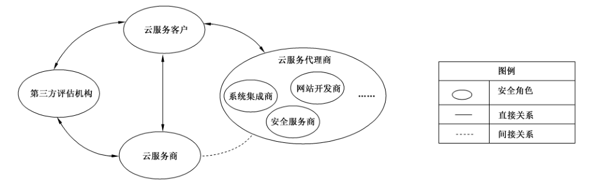

# GB/T 38249-2019 信息安全技术 政府网站云计算服务安全指南

> 来源：[GB/T 38249-2019 国家标准详情](https://openstd.samr.gov.cn/bzgk/std/newGbInfo?hcno=EAFF6699C3FEDF5DE8A2276713120136)；发布日期：2019-10-18；实施日期：2020-05-01。
> PDF SHA-256：6c32bb1ed0d58cda2d1756dea916080c5bfa78858d3143192d57ce0e26dae6c4。
> 转写说明：依据官方 PDF 渲染的全部 17 张页图逐页校正，保留图 1 原页裁切；省略封面、目录、页眉、页脚和页码，合并跨页段落。正式引用请核对官方原文。

## 前言

本标准按照 GB/T 1.1—2009给出的规则起草。

请注意本文件的某些内容可能涉及专利。本文件的发布机构不承担识别这些专利的责任。

本标准由全国信息安全标准化技术委员会（SAC/TC 260）提出并归口。

本标准起草单位：西安未来国际信息股份有限公司、阿里云计算有限公司、中国电子技术标准化研究院、四川大学、北京信息安全测评中心、国家信息技术安全研究中心、华为技术有限公司、杭州安恒信息技术有限公司、北京安信天行科技有限公司、北京京东尚科信息技术有限公司、深信服科技股份有限公司、北京时代远景信息技术研究院、中国电信集团有限公司、首都之窗、烽火科技集团有限公司、杭州迪普科技股份有限公司、广州赛宝认证中心服务有限公司、西北大学。

本标准主要起草人：刘贤刚、陈兴蜀、叶润国、王茜、史晨昱、刘俊河、白峰、张磊、张辉、石慧、沈锡镛、陈雪秀、赵章界、耿涛、周俊、钟金鑫、李媛、何明、刘国伟、江舟、孙骞、路琨、张月、王涛、李瑞涛、黄少青、许玉娜、庞思铭、齐蕙杰、贾思琦、周立勇、商涛、赵少敏。

## 引言

在大力推动政府网站选择云服务的背景下，云计算受到广泛的关注。在云计算服务模式下，在大多数传统信息安全问题依然存在的同时，还出现了一些新的安全风险。

GB/T 31167 提出了政府部门采用云计算服务的安全管理基本要求，以及云计算服务生命周期各阶段的安全管理和技术要求。

本标准则给出了政务网站采用云计算服务中各种参与角色的安全职责，细化了云服务商和云服务代理商的安全责任，可用于指导采用云计算服务的政府机构的网站安全保障建设。

## 1 范围

本标准给出了政府网站采用云计算服务过程中，在规划准备、部署迁移、运行管理、服务退出等阶段的安全技术措施和安全管理措施。

本标准适用于为采用云计算服务，特别是社会化云计算服务的政务网站提供建设与运营指导。

## 2 规范性引用文件

下列文件对于本文件的应用是必不可少的。凡是注日期的引用文件，仅注日期的版本适用于本文件。凡是不注日期的引用文件，其最新版本（包括所有的修改单）适用于本文件。

- GB/T 25069 信息安全技术 术语

- GB/T 31167 信息安全技术 云计算服务安全指南

- GB/T 31168 信息安全技术 云计算服务安全能力要求

- GB/T 31506—2015 信息安全技术 政府门户网站系统安全技术指南

## 3 术语和定义

GB/T 25069、GB/T 31167 界定的以及下列术语和定义适用于本文件。

### 3.1 云服务代理商 cloud service agent

负责支撑或协助云服务客户和其他云服务提供者之间进行协商的参与方。

> 注：包括网站开发商、系统集成商、安全服务商等。

### 3.2 政府网站 government website

政府机构为对外发布政务信息、提供在线服务、开展互动交流等而建立的网站。

> 注：包括为用户提供展示和交互功能的页面及生成和处理页面的应用程序、中间件等。

## 4 概述

### 4.1 安全角色

云服务客户采购和使用云计算服务的过程、参与的主要角色与关系见图1。

主要角色包括：

a） 云服务客户，是政府网站的所有者或运营者。

b） 云服务商，是为云服务客户提供政府网站相关云计算产品与服务的供应商，通常为法人实体。

c） 云服务代理商，是为云服务客户提供网站开发、网站迁移、网站部署、安全保障等服务的提供商，具体可分为网站开发商、系统集成商、安全服务商等，其中：

1） 网站开发商，为云服务客户提供云计算平台上网站开发服务，负责网站的系统架构、Web安全功能设计、代码实现及源代码安全、软件部署安全等；

2） 系统集成商，为云服务客户提供系统集成服务，可对迁移至云计算平台的政府网站提供网站建设、迁移、运维服务等；

3） 安全服务商，为政府网站提供安全保障服务，可提供安全咨询、网站安全建设规划、网站安全优化、网站安全监测防护、应急响应等服务。

d） 第三方评估机构，是对云服务商与云服务客户开展独立的安全评估，并取得相应评估资质的组织。

> 注：云服务商和云服务代理商可能是同一个法人实体，也可能是不同的法人实体。网站开发商、系统集成商、安全服务商可能是同一个法人实体，也可能是不同的法人实体。

### 4.2 云计算服务生命周期

政府网站采用云计算服务的过程分4个阶段：

a） 规划准备阶段，云服务客户对计划迁移至云计算平台的网站进行需求分析，根据分析结果选择服务商，签订服务合同，做好政府网站迁移至云的准备工作；

b） 部署迁移阶段，云服务客户负责组织网站迁移、切换、交付等工作，云服务商和云服务代理商配合迁移工作；

c） 运行管理阶段，云服务客户监督云服务商和云服务代理商履行合同规定的责任义务，对迁移至云计算平台的政府网站做好安全防范和监测工作，共同维护数据、业务及云计算环境的安全；

d） 服务退出阶段，云服务客户要求云服务商履行相关责任和义务，重点关注退出过程中数据和业务的安全。

## 5 规划准备

### 5.1 概述

规划准备阶段，云服务客户明确云计算的服务模式和部署模式，提出各项功能、性能及安全要求，明确参与各方的角色与安全职责，根据云计算服务和政府网站的特点进行安全需求分析，选择符合需求的云计算服务，与云服务商签订合同，并组织云服务商制定政府网站迁移至云计算平台的方案。

### 5.2 安全职责

#### 5.2.1 云服务客户

云服务客户是政府网站信息安全的责任主体，其在规划准备阶段的安全职责如下：

a） 根据政府网站的功能、性能及安全指标进行云计算服务的需求分析，确定采用云计算服务的数据和业务范围；

b）根据信息敏感程度、人员技能、业务需求的动态性等要素进行部署模式的选择；

c） 明确要求云服务商通过相关部门组织的云计算服务安全审查。

#### 5.2.2 云服务商

云服务商在规划准备阶段的安全职责如下：

a） 确保云计算平台符合云服务客户要求和 GB/T 31168相应等级的云计算服务安全能力，并通过有关部门组织的云计算服务安全审查；

b） 遵守党政机关计算机信息系统的信息安全政策规定及网络安全等级保护等相关标准要求，落实安全管理和防护措施；

c） 根据政府网站的安全需求，制定网站迁移至云计算平台的方案。

#### 5.2.3 云服务代理商

云服务代理商在规划准备阶段的安全职责如下：

a） 向云服务客户提供详细的服务内容清单，并明确相应的服务流程、安全责任划分等内容；

b） 在云服务客户的组织下，与云服务商就其提供的服务内容进行分工和责任区分，并通过服务协议或者合同等进行约束。

#### 5.2.4 第三方评估机构

第三方评估机构在规划准备阶段，可根据云服务客户的委托，对云服务商迁移方案的可行性及安全性进行评估。

### 5.3 需求分析

#### 5.3.1 政府网站梳理

在政府网站采用云计算服务之前，云服务客户对网站现有系统进行梳理，确定迁移的系统边界，形成网站现状梳理报告，梳理内容包括：

a） 政府网站系统的网络拓扑结构，包括：网络边界、网络设备型号、配置情况、使用情况、运维情况等；

b） 政府网站包含的应用系统，以及各应用系统的计算资源、存储资源、网络情况、基础软件配置情况、应用系统部署架构、高峰时段资源使用情况、系统运维情况、技术支撑情况等；

c） 系统数据备份及灾备系统情况，包括备份机制、备份策略等，进行数据备份恢复演练；

d） 有无特殊设备，如加密卡、网闸、视频卡等。

#### 5.3.2 政府网站迁移决策

云服务客户根据安全风险分析情况与现状梳理情况，做好政府网站迁移至云的决策分析，并形成决策报告，决策分析过程可考虑的因素有：

a） 参照网络安全等级保护定级指南等国家标准，对政府网站及数据重要性进行分类定级，全面系统评估采用云计算服务的安全风险；

b） 对于包含大量敏感信息和个人信息，以及直接影响党政机关运转和公众生活工作的关键业务，或者核心业务，在确保安全的前提下再考虑向云计算平台迁移；

c） 网络安全等级保护定级为四级及以上的政府网站不宜采用社会化云计算服务。

#### 5.3.3 资源需求

云服务客户要明确政府网站迁移至云的资源需求，包括计算资源、存储资源、网络资源等，合理申请网站系统资源。可针对政府网站业务临时性和周期性增加或减少的特点，要求云服务商根据访问需求动态分配资源并按照实际占用的资源支付使用费用。

#### 5.3.4 安全要求

##### 5.3.4.1 安全部署与隔离

云服务客户根据政府网站的网络安全等级保护定级情况确定相关技术和管理要求，制定外部和内部用户访问政府网站的访问控制策略、网站系统设备之间的访问策略、与政务外网和互联网间的数据共享交换策略。同时，调查了解云服务商为满足客户网站系统合规及安全控制策略提供的安全措施，包括物理、网络、主机、应用、数据和虚拟化等方面的安全措施，做好安全部署规划。

若云服务客户采用社会化云计算服务时，云服务商要做好系统边界的隔离，包括与其他租户业务系统、虚拟机、虚拟网络、虚拟存储之间的安全隔离。

迁移后的政府网站防护水平不低于迁移前的安全防护水平。

##### 5.3.4.2 Web 应用安全

迁移至云计算平台的政府网站可依据GB/T 31506—2015 的相关内容实施 Web 应用安全。

##### 5.3.4.3 域名安全

政府网站的域名安全要注意以下几点：

a） 选择主管部门批准的域名注册服务机构进行域名注册和域名托管，并进行域名信息报备；

b） 遵循国家有关监督审批流程开展域名变更、解析地址变更等工作；

c） 使用符合政府网站管理规定的域名；

d） 加强域名相关信息的管理，防止域名被恶意篡改。

##### 5.3.4.4 内容安全

云服务客户做好网站内容发布的审核和审批，确保发布的内容均属于可对外公开信息。

#### 5.3.5 需求报告

云服务客户根据5.3.1~5.3.4分析形成需求报告，需求报告包括：

a） 政府网站的安全保护等级要求、网站系统特定的安全要求；

b） 云服务商提供的技术接口支持等需求；

c） 云服务代理商提供的服务及产品等需求；

d） 采取的安全管理措施等需求。

> 注：可在决策报告中包括需求报告的内容。

#### 5.3.6 服务模式选择

云计算有 SaaS（软件即服务，Software as a Service）、PaaS（平台即服务，Platform as a Service）和IaaS（基础设施即服务，Infrastructure as a Service）三种主要服务模式。

云服务客户要参照 GB/T 31167相关要求，根据当地政策要求、不同服务模式的特点和自身网站系统的安全管理要求，结合自身技术能力、市场和技术成熟度等因素选择服务模式。

### 5.4 服务商选择

云服务客户可根据政府网站定级情况、云服务商提供的安全服务、增值服务、接入方式等情况对云服务商进行选择，并根据自身安全需求对云服务代理商进行选择，选择云服务商和云服务代理商考虑但不限于以下方面的因素：

a） 云服务商选择：

1） 按照国家或监管部门的要求选择通过安全审查的云计算服务；

2） 等级保护定级为三级及以上的政府网站优先选择通过增强级安全审查的云计算服务；

3） 优先选择提供符合云服务客户要求的安全监管接口的云服务商。

b） 云服务代理商选择：

1） 系统集成商要满足政府网站建设、维护的安全需求；

2） 网站开发商要满足政府网站软件开发的安全需求；

3） 安全服务商要满足政府网站安全服务能力需求。

### 5.5 合同签订

#### 5.5.1 服务合同

合同是明确云服务客户与云服务商、云服务代理商之间责任和义务的基本手段，云服务客户与云服务商、云服务代理商签订的服务合同要明确以下内容：

a） 与云服务商签订的合同：

  - 明确服务部署模式，划分双方安全责任边界，规范双方的安全权利义务；

  - 明确资产的所有权，资产包括云服务客户的业务系统在云计算平台上运行过程中产生的数据和文档；

  - 约定云计算退出服务条件及双方在退出阶段的责任；

  - 声明不使用有恶意代码的产品或假冒产品；

  - 可将服务水平协议和安全保密协议等作为合同附件；

  - 其他事宜。

b） 与云服务代理商签订的合同：

  - 明确相关方的安全责任边界、安全保密条款以及双方的安全权利义务等；

  - 明确不得窃取修改云服务客户数据；

  - 声明不得使用有恶意代码的产品或假冒产品；

  - 其他事宜。

#### 5.5.2 服务水平协议

服务水平协议（简称 SLA）约定云服务商向云服务客户提供的云计算服务的各项具体技术和管理指标，云服务客户与云服务商签订服务合同时，可将服务水平协议作合同的附件。服务水平协议重点描述的内容有：

a） 服务水平协议与服务需求对应，针对需求分析中给出的范围或指标，在服务水平协议中要给出明确参数；

b） 服务水平协议中对涉及的术语、指标等明确定义，防止因二义性或理解差异造成违约纠纷或客户损失。

#### 5.5.3 保密协议

根据云服务客户需求，可访问云服务客户信息或掌握云服务客户业务运行信息的服务商与其签订保密协议。对于能够接触云服务客户信息或掌握业务运行信息的服务商内部员工，与其签订保密协议。

### 5.6 云迁移方案

为确保政府网站顺利的迁移至云计算平台，云服务客户要与云服务商协商制定迁移方案，迁移方案涉及的内容有：

a） 至少包括人员和角色、迁移实施进度计划、回退策略等内容；

b）各服务商提供操作系统、数据库、中间件、应用系统和数据等方面的安全保障措施；

c） 云服务客户协调各相关方，做好敏感信息保护和备份、恢复等工作；

d） 明确云服务商提供的保障内容和必要的安全支持服务。

## 6 部署迁移

### 6.1 概述

云服务客户根据迁移方案所约定的内容，协调各服务商做好部署和迁移工作。

### 6.2 安全职责

#### 6.2.1 云服务客户

云服务客户在部署迁移阶段的安全职责如下：

a） 做好相关准备工作，组织云服务商、云服务代理商进行政府网站的部署迁移；

b） 在部署迁移工作完成后，督促云服务商进行安全测试，完成政府网站切换及试运行工作；

c） 更新安全管理制度，并制定安全应急预案。

#### 6.2.2 云服务商

云服务商在部署迁移阶段的安全职责如下：

a） 配合云服务客户完成对政府网站的部署迁移；

b） 负责云计算平台的安全，提供安全防护措施；

c） 在云计算平台的外部边界和内部关键边界上监视、控制和保护网络通信；

d） 根据云服务客户的要求，制定可审计事件清单，明确审计记录内容；

e） 根据云服务客户的要求制定相应的应急预案；

f） 建立完善的维护云计算平台设施和软件系统的相关规范制度，定期维护云计算平台设施和软件系统；

g） 对云计算平台进行配置管理，在系统生命周期内建立和维护云计算平台（包括硬件、软件、文档等）的基线配置和详细清单。

#### 6.2.3 云服务代理商

云服务代理商在部署迁移阶段的安全职责如下：

a） 与云服务商就服务内容、边界、交互等进行确认，确保云服务代理商不影响云计算平台的正常运行及其他云服务客户的正常使用云计算服务；

b） 网站开发商根据云服务客户的需求完成网站的安全功能开发，并协助系统集成商完成相关部署工作；

c） 系统集成商负责政府网站的迁移及安全部署，负责安全配置、整体安全功能联调等；

d） 安全服务商提供整个部署过程中的安全保障和网站安全建设，提供相关的安全产品及服务，并协助云服务客户与云服务商共同建立政府网站云计算服务安全保障体系。

#### 6.2.4 第三方评估机构

第三方评估机构根据云服务客户委托，配合政府网站的部署迁移工作，协助云服务客户进行安全符合性测试。在部署迁移完成后，对政府网站进行安全风险评估。

### 6.3 云迁移实施

#### 6.3.1 迁移准备

将政府网站迁移至云计算平台前，云服务客户协调各服务商做好相关准备，主要包括责任人和联系人、工具、产品、服务及相关资源，云服务客户的安全职责如下：

a） 通知相关业务部门迁移的时间计划及对业务的影响；

b）对政府网站进行数据备份，包括数据库、应用程序、重要配置以及操作系统等；

c） 对云服务商的安全防护措施进行调研，并结合现有安全防护措施，制定相应防护措施；

d） 对云服务商提供的虚拟主机、应用等进行安全检查，确保云服务资源的安全性；

e） 协同网站开发商做好政府网站软件功能实现的安全需求调研及确认工作；

f） 委托安全服务商提供所需的安全产品或服务；

g） 指导云服务商为云服务客户划分独立的安全域，并在网络边界处部署安全措施。

#### 6.3.2 应用迁移

云服务客户负责政府网站的迁移工作，各个服务提供商配合迁移工作。云服务客户安全职责如下：

a） 授权并配合系统集成商进行政府网站迁移实施的具体工作；

b） 授权并配合安全服务商在应用迁移过程中提供的安全保障服务；

c） 确保政府网站迁移完成后，网站能正常访问；

d） 对政府网站迁移后的变更进行严格监督和审核，以确认变更操作不会影响或降低政府网站的安全性。

#### 6.3.3 应用切换

完成政府网站迁移后，云服务客户对应用进行切换，制定切换方案明确切换顺序，云服务商、云服务代理商协助云服务客户做好切换测试、数据同步等安全保障工作。

#### 6.3.4 应用回退

根据云服务客户需求，云服务商制定政府网站迁移失败的回退方案。若发生政府网站迁移失败事件，云服务商与系统集成商协助云服务客户将网站恢复至初始状态，若无法回退至初始状态，云服务商与系统集成商配合使用备份数据进行相应的恢复工作。

#### 6.3.5 制度建设

由于政府网站迁移至云计算平台，云服务客户要对原有安全管理制度进行修订，明确相关人员的职责和权限，明确在具体运维中各方的具体工作。

#### 6.3.6 安全预案

根据云服务客户需求，云服务商按照“统一领导、规范管理、明确责任、分级负责、预防为主、加强监控”的原则制定安全预案，体现必要的保障措施和应急措施，以保障政府网站的正常运行，预案内容包括：

a） 保障措施：

1） 建立健全网络与信息安全管理预案，加强对网站网络信息的日常监测、监控，强化安全管理，对可能引发网络与信息安全事件的有关信息，进行收集、分析判断，发现有异常情况时，及时处理并逐级报告。

2） 备份网站文件和数据库。备份采用完全备份策略与部分备份策略相结合。

3） 定期进行网站文件和数据库备份恢复演练，确保备份数据的有效性。

4） 必要时启动网站信息安全24h 应急值班制度。一旦发生安全事件，立即启动应急预案，并立即将情况报告有关部门。属于重大事件或存在违法犯罪行为的，立即报告应急管理部门并向有关主管监管部门汇报情况。

5） 保持与其他服务商沟通渠道的畅通，确保在应急处理过程中遇到困难或问题时能及时获得相关服务商的技术支援。

b） 应急措施：网站出现非法信息或内容被篡改、系统软件遭到破坏性攻击、网站瘫痪，云服务商要立即向云服务客户报告，停止系统运行，启用备份系统；情况严重的，立即报告应急管理部门并向有关主管监管部门汇报情况。

### 6.4 云迁移交付

#### 6.4.1 网站试运行

网站试运行时，云服务客户的安全职责如下：

a） 根据政府网站运行情况，制定相应的试运行方案；

b） 自行或委托第三方评估机构模拟实际运行情况对政府网站进行全面的安全测试；

c） 加强试运行期间的安全监测，查看所有相关日志信息，以便能及时发现问题并进行整改；

d） 提高试运行期间的数据备份频率，以便出现问题时能尽可能的恢复丢失的数据。

#### 6.4.2 安全合规验收

云服务客户或委托第三方评估机构进行安全合规验收测评，根据验收目标和范围，结合政府网站云迁移方案对实施情况进行安全评估，云服务客户的安全职责如下：

a） 明确提出安全合规验收测试的要求；

b） 安全合规验收测试通过后，云服务客户在确认安全风险和隐患均得到有效控制后，方可正式开展政府网站的相关服务；

c） 安全测试通过后，云服务客户重新确定信息系统安全保护等级，形成信息系统安全保护等级定级报告并向相关监管部门进行报备。

#### 6.4.3 安全交付

完成政府网站的迁移，并通过安全合规验收测试后，各相关服务商提交给云服务客户相应的实施成果文档，包括但不限于如下成果文档：实施方案、资源清单、配置清单、使用手册和安全预案。

各相关服务商在完成相应的实施工作后，开展相关培训，确保政府网站正常运行。

## 7 运行管理

### 7.1 概述

运行管理阶段，云服务客户根据合同、规章制度和标准，对云服务商及其提供的云计算服务进行运行监管。同时，云服务客户要遵守政府信息安全的有关政策规定和标准，共同维护数据、业务及云计算环境的安全。

### 7.2 安全职责

#### 7.2.1 云服务客户

云服务客户在运行管理阶段的安全职责如下：

a） 建立云计算服务保密审查制度，指定机构和人员定期负责对迁移到云计算平台上的数据、业务进行保密审查，确保数据和业务不涉及国家秘密；

b） 在云服务商、云服务代理商处理信息安全事件过程中提供协助；

c） 督促云服务商对政府网站进行安全监测；

d） 督促云服务商制定应急预案；

e） 对云服务商所提供的云计算平台的重大变更进行监督管理，重大变更范围参考GB/T 31167中相关内容。

#### 7.2.2 云服务商

云服务商在运行管理阶段的安全职责如下：

a） 开展周期性的风险评估和监测，保证安全能力持续符合GB/T 31168 相关内容；

b） 严格履行合同规定中的责任和义务，遵守相关的安全管理政策和标准；

c） 接受监管部门组织的信息安全检查，包括必要的渗透测试、风险评估、安全审计等；

d） 保障云服务客户的数据和业务的机密性、完整性、可用性，以及互操作性、可移植性；

e） 持续开展对员工的安全和保密教育，自觉维护云服务客户的云计算服务安全；

f） 根据监测情况定期向云服务客户提供安全运行报告；

g） 制定应急预案及安全事件处置响应计划；

h）对信息系统运行状态（如中央处理器、内存、网络）进行监视，并能够对资源的非法越界发出警报；

i） 当有重大调整变更时，向云服务客户提前通知，并获得监管部门审核，同时评估可能对云服务客户造成的影响。

#### 7.2.3 云服务代理商

云服务代理商在运行管理阶段的安全职责如下：

a） 接受云服务客户对其提供的服务的持续监管；

b） 根据与云服务客户签订的合同，向云服务客户提供安全服务，并定期提供服务报告；

c） 确保在向云服务客户提供服务时，不影响云服务的运行及其他云服务客户的使用。

#### 7.2.4 第三方评估机构

在云计算服务运行过程中，第三方评估机构可根据云服务客户的要求，对云计算平台或政府网站进行安全评估。

### 7.3 安全防范

云服务商在运行阶段采取安全防范措施，确保云计算平台的安全，包括但不限于以下几种措施：

a） 建立安全事件处理计划，包括对事件的预防、检测、分析、控制、恢复、进行跟踪和记录；

b） 对网站访问行为进行监测，对攻击行为进行实时告警；

c） 采取安全措施提高网站安全防护能力，并记录相关日志；

d） 采取安全措施进行病毒防御，并及时升级病毒库。

### 7.4 安全监测

#### 7.4.1 概述

根据云服务客户需求，云服务商对网站的安全性进行实时监测，包括但不限于对网站资源可用性、网页内容、网站业务安全、网站环境安全的监测。

#### 7.4.2 可用性监测

对网站的资源可用性进行监测的措施有：

a） 对网站虚拟层资源状态进行监测，涉及计算资源、存储资源、网络资源等；

b） 定期进行网站的域名及 IP（互联网协议）合规性检测。

#### 7.4.3 网页内容监测

对网站内容信息进行监测的措施有：

a） 实时监测网站发布内容，发现有害信息进行告警和处置；

b） 利用网页防篡改系统并结合人工自检方式，或采用专业安全服务等方式，对网页内容篡改情况进行实时监测和处置。

#### 7.4.4 网站业务安全监测

对网站安全防护情况进行监测的措施有：

a） 利用网站木马、后门检测监控系统或采用安全服务等方式对网站系统进行实时监测和处置；

b） 定期对网站应用程序、操作系统及数据库进行脆弱性扫描；

c） 具备信息交换与情报共享机制，及时获知 0 Day 漏洞等未知威胁，并做好防护工作；

d） 对网站业务安全防护措施进行测评和检查。

#### 7.4.5 网站环境安全监测

对网站所在云计算环境的安全性进行实时监测的措施有：

a） 实时监测网站业务、网络状态，并对异常情况进行报警和处置；

b） 实时监测网站所在的云计算平台状态，并对异常情况进行报警和处置；

c） 对网站环境安全防护措施进行定期测评和检查。

### 7.5 应急响应

根据云服务客户需求，云服务商制定应急响应预案，并定期演练，确保在紧急情况下重要信息资源的可用性，包括：

a） 应急预案的制定要符合国家应急响应有关政策要求。应急预案至少包括总则、角色及职责、预防和预警机制、响应分级、处置流程、保障措施等内容。

b） 综合分析可能发生的各类安全事件，以及事件造成的影响，破坏程度和恢复周期等多方面因素，有针对性地制定、维护网站不同事件的应急预案，每两年至少开展各典型类别安全事件的应急演练一次。

c） 建立应急值班制度，在8h工作时间以外，安排专人通过电话、邮件等方式进行应急响应。遇到重大节日或敏感时期，安排24h值班，并定期进行信息报送。

d） 信息安全事件发生时，云服务商按照应急预案的要求及时组织应急处置并记录处置情况，必要时与云服务客户配合处置。

### 7.6 评估改进

云服务客户定期对迁移到云计算平台的政府网站进行安全检查和评估，并根据检查结果进行安全改进。云服务客户的安全职责如下：

a） 制定安全检查工作计划和安全检查方案；

b） 对检查结果进行汇总、分析，编制安全检查报告，根据安全检查结果，确定安全改进方案；

c） 制定业务连续性计划，包含业务影响分析、业务连续性风险评估、明确业务连续性团队、业务连续性测试与演练、业务连续性计划步骤；

d） 定期或者在迁移到云计算平台的政府网站发生重大变更后进行风险评估，云服务商可为风险评估活动提供必要的接口和材料，配合云服务客户进行风险评估；

e） 向云服务商告知评估结果，对涉及云计算平台的问题进行整改。

## 8 服务退出

### 8.1 概述

在退出云计算服务时，根据云服务客户需求，云服务商履行相关责任和义务，确保退出云计算服务阶段数据、业务的安全。

### 8.2 安全职责

#### 8.2.1 云服务客户

云服务客户在退出服务阶段的安全职责如下：

a） 提前做好应用系统和数据的备份；

b） 对云服务商返还的数据进行完整性验证，如将文档资料、数据、程序放在新的平台上验证；

c） 监督云服务商返还数据的过程，确保数据能够全部返还。

#### 8.2.2 云服务商

云服务商在退出服务阶段的安全职责如下：

a） 制定详细的移交清单，包括运行期间产生、收集的数据以及相关文档资料；

b） 彻底删除云服务客户数据信息及所有备份，对云服务客户的数据存储介质进行彻底清理；

c） 根据移交清单返还云服务客户数据信息（包括历史数据和归档数据）。

#### 8.2.3 云服务代理商

云服务代理商在服务退出阶段的安全职责如下：

a） 协助云服务客户进行政府网站的退出服务工作；

b）根据与云服务客户签订的服务协议、合同，向云服务客户交付相应的程序、数据、文档等；

c） 确保在服务退出后，彻底销毁云服务客户信息。

#### 8.2.4 第三方评估机构

在服务退出阶段，云服务客户可委托第三方评估机构对退出过程进行监督审计，第三方评估机构的安全职责如下：

a） 配合云服务客户对云服务商及云服务代理商的退出服务进行审计；

b） 在服务退出工作结束后，第三方评估机构配合云服务客户对云服务端进行安全测试，验证云服务商是否全面清除数据。

### 8.3 服务退出安全

#### 8.3.1 退出要求

合同到期或其他原因都可能导致云服务客户退出云计算服务，或将数据和业务转移到其他云计算平台，云服务客户采取以下措施确保退出服务过程的顺利实施，包括：

a） 云服务客户在与云服务商签订合同时提前约定退出条件，以及退出时云服务客户、云服务商的责任义务；

b）督促云服务商完整返还云服务客户数据；

c） 在将数据和业务退出后，确保业务的可用性和持续性；

d） 督促云服务商在云服务客户退出云计算服务后仍承担的责任及义务；

e） 督促云服务商对数据进行彻底清除。

#### 8.3.2 退出方案

在退出服务实施之前，云服务商制定退出服务方案，明确退出过程中的各角色职责分工，制定退出服务进度计划，并做好网站退出的各项保障工作。

#### 8.3.3 数据移交

从云计算平台迁移出的数据，不仅包括云服务客户移交给云服务商的数据和资料，还包括政府网站在云计算平台上运行期间产生、收集的数据以及相关文档资料，包括但不限于以下内容：数据文件、文档资料和其他数据。

#### 8.3.4 数据的完整性

云服务客户要对云服务商返还的数据完整性进行验证，具体措施有：

a） 云服务合同中就退出服务阶段移交数据清单进行约定，并对移交数据的类型、有效期进行明确；

b） 云服务商根据云服务客户需要，移交数据清单完整返还云服务客户数据信息，如历史数据和归档数据；

c） 通过业务系统验证数据信息的有效性和完整性。

#### 8.3.5 数据销毁

云服务客户退出云计算服务后，云服务商要安全处理云服务客户数据，承担相关的责任义务，云服务客户或委托第三方评估机构对数据删除过程进行监督，具体措施有：

a） 云服务商制定数据删除计划，监督数据删除过程，并对数据删除情况进行验证；

b） 根据云服务客户需求，云服务商按照合同要求保留云服务客户数据规定的时间，当云服务商收到云服务客户的书面授权后方可删除云服务客户数据信息；

c） 根据云服务客户需求，云服务商对存放云服务客户数据的存储介质进行清理，并对过程进行监督。

## 参考文献

- ［1］ GB/T 29245—2012 信息安全技术 政府部门信息安全管理基本要求

- ［2］ GB/T 32399—2015 信息技术 云计算 参考架构

- ［3］ GB/T 32400—2015 信息技术 云计算 概览与词汇

- ［4］ 国务院办公厅关于印发政府网站发展指引的通知（国办发〔2017〕47号）

- ［5］ 中央网信办关于印发〈国家网络安全事件应急预案〉的通知（中网办发文〔2017〕4号）

- ［6］ 关于加强党政部门云计算服务网络安全管理的意见（中网办发文〔2014〕14号）

- ［7］ 信息安全等级保护管理办法（公通字〔2007〕43号）

- ［8］ ISO/IEC 19086-1:2016 Information technology—Cloud computing—Service level agreement (SLA) framework—Part 1: Overview and concepts

- ［9］ NIST Special Publication 500-293 US Government Cloud Computing Technology Roadmap. June 2013

- ［10］ NIST Special Publication 800-146 Cloud Computing Synopsis and Recommendations, May 2012

- ［11］ NIST Special Publication 800-144 Guidelines on Security and Privacy in Public Cloud Computing, December 2011

- ［12］ NIST Special Publication 800-137 Information Security Continuous Monitoring for Federal Information Systems and Organizations. September 2011

- ［13］ AGIMO, Australia.A Guide to Implementing Cloud Services.September 2012

- ［14］ Federal Cloud Computing Strategy, February 2011
