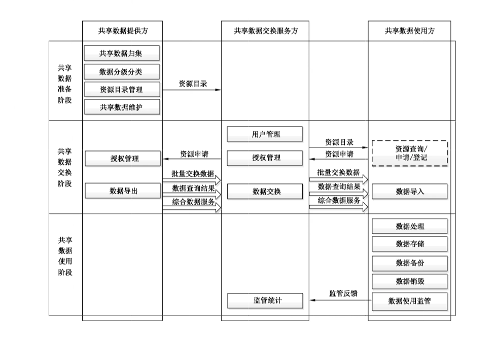
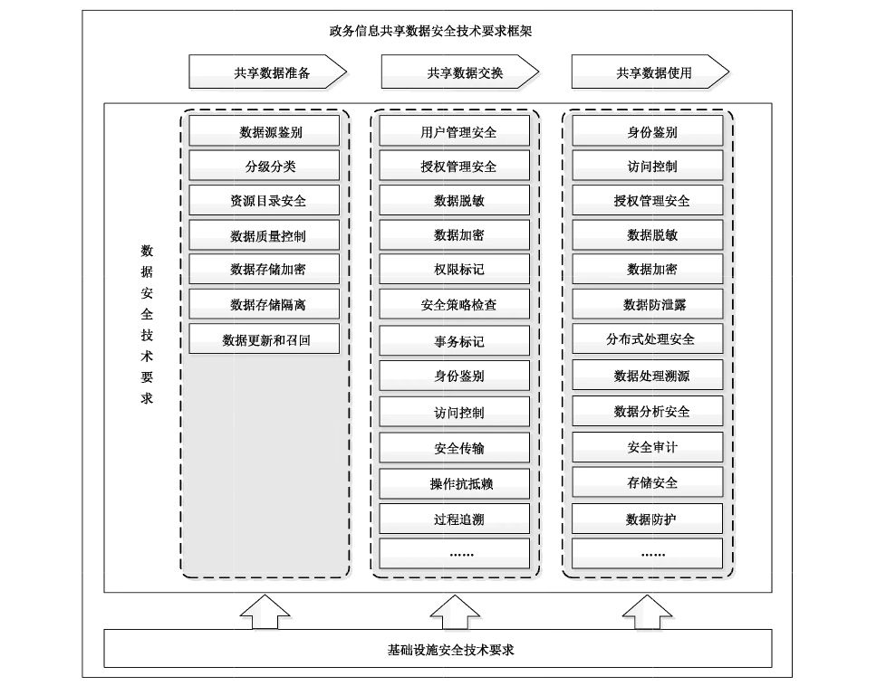
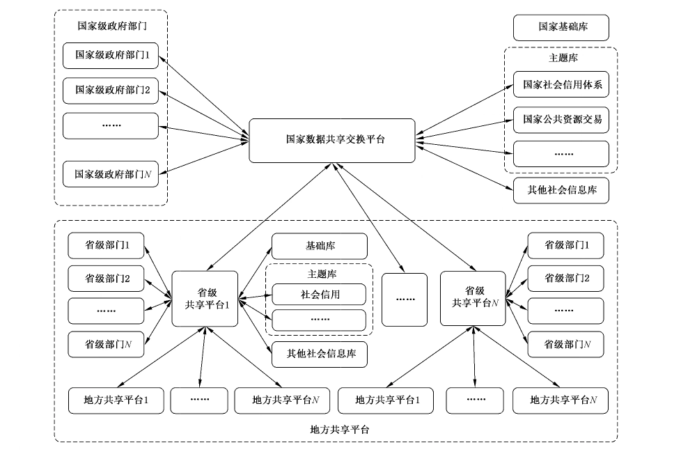
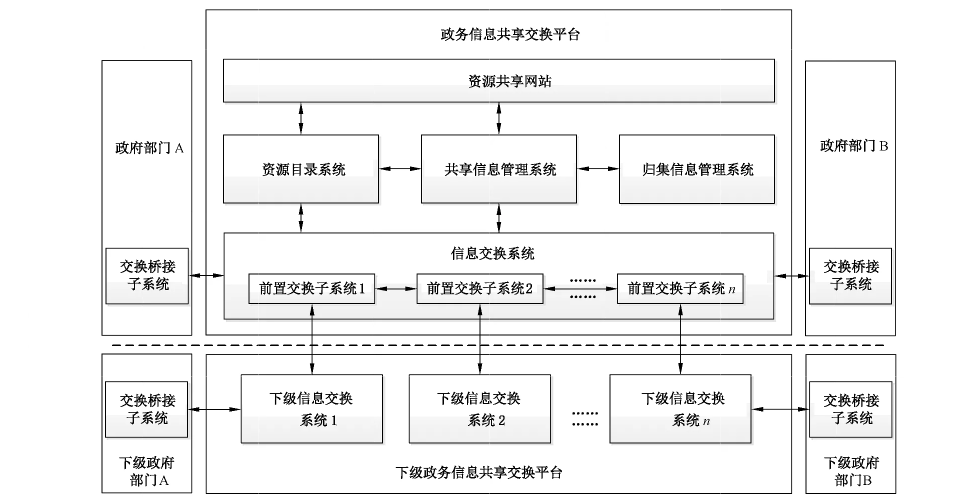
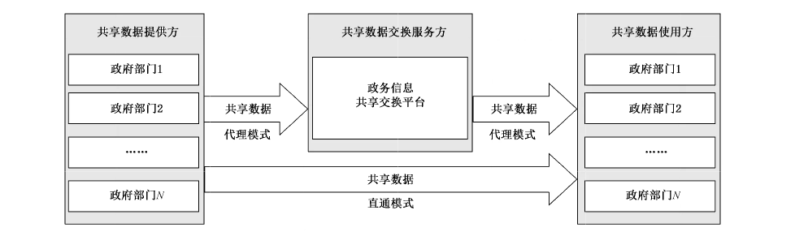
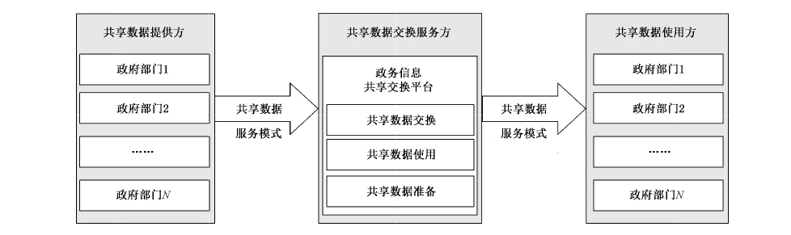

# GB/T 39477-2020 信息安全技术 政务信息共享 数据安全技术要求

> 来源：[GB/T 39477-2020 国家标准详情](https://openstd.samr.gov.cn/bzgk/std/newGbInfo?hcno=1C7D8CDD4B3EF8CA8C7822D99B76EA4F)；封面发布日期：2020-11-19；实施日期：2021-06-01。
> 官方 PDF SHA-256：62ee7896e743c55df89574273da4b7aa6c144da4d35d722bf616d1ceda09c213。
> 转写说明：逐页对照官方 PDF 的全部 22 个物理页渲染图像校核文字，保留 6 幅原图，合并跨页段落，省略封面、目录、页眉和页码。正式引用请核对官方原件。

## 前言

本标准按照GB/T1.1—2009给出的规则起草。

请注意本文件的某些内容可能涉及专利。本文件的发布机构不承担识别这些专利的责任。

本标准由全国信息安全标准化技术委员会（SAC/TC 260）提出并归口。

本标准起草单位：国家信息中心、深圳奥联信息安全技术有限公司、中国电子技术标准化研究院、公安部信息安全等级保护评估中心、国家保密科技测评中心、中国信息安全测评中心、国家信息技术安全研究中心、上海市大数据中心、清华大学、四川大学、中国电子科技网络信息安全有限公司、中国电子科技集团公司电子科学研究院、成都卫士通信息产业股份有限公司、全知科技（杭州）有限责任公司、亚信科技（成都）有限公司、北京安华金和科技有限公司、杭州数梦工场科技有限公司、陕西省信息化工程研究院、广东京信软件科技有限公司、北京信息安全测评中心、杭州美创科技有限公司。

本标准主要起草人：程朝辉、徐春学、罗海宁、焦迪、刘增益、曹虎、张岱、刘朝苹、于东升、裘薇、刘迎风、梁满、都婧、苗春卫、胡影、金涛、望娅露、颜亮、唐鸣、王晓航、王蒙蒙、李东访、宣淦森、张冰烨、李伟明、任飞、梁孟、张勇、李媛、胡国华、周健雄、杨苗苗、蔡毅、王振东、朱通、张琳、王晨、王平、陈哲、杨晶、蔡先勇、孙晖。

## 引言

为解决政务信息共享交换工作开展过程中数据泄露、数据滥用等问题，本标准制定政务信息共享交换过程的数据安全技术要求，指导政务信息共享交换数据安全体系建设，增强政务信息共享交换的数据安全保障能力。

## 1 范围

本标准提出了政务信息共享数据安全要求技术框架，规定了政务信息共享过程中共享数据准备、共享数据交换、共享数据使用阶段的数据安全技术要求以及相关基础设施的安全技术要求。

本标准适用于指导各级政务信息共享交换平台数据安全体系建设，规范各级政务部门使用政务信息共享交换平台交换非涉及国家秘密数据安全保障工作。

## 2 规范性引用文件

下列文件对于本文件的应用是必不可少的。凡是注日期的引用文件，仅注日期的版本适用于本文件。凡是不注日期的引用文件，其最新版本（包括所有的修改单）适用于本文件。

- GB/T 22239—2019 信息安全技术 网络安全等级保护基本要求

- GB/T 25069 信息安全技术 术语

- GB/T 31168—2014 信息安全技术 云计算服务安全能力要求

- GB/T 35273 信息安全技术 个人信息安全规范

- GM/T 0054 信息系统密码应用基本要求

## 3 术语和定义

GB/T 25069界定的以及下列术语和定义适用于本文件。

### 3.1 数据安全 data security

采用技术和管理措施来保护数据的保密性、完整性和可用性等。

### 3.2 政务信息共享 government information sharing

因履行职责需要使用其他政务部门政务信息资源和为其他政务部门提供政务信息资源的行为。

### 3.3 共享数据提供方 shared data provider

在政务信息共享过程中，为其他部门提供政务信息资源并且是资源责任主体的政务部门或组织机构。

### 3.4 共享数据交换服务方 data sharing service provider

在政务信息共享过程中，为各政务信息共享交换主体提供政务信息共享交换技术支持和服务的组织机构。

### 3.5 共享数据使用方 shared data consumer

在政务信息共享过程中，根据履行职责需要，使用其他部门共享资源的政务部门或组织机构。

### 3.6 资源目录 resource catalog

通过对政务信息资源依据规范的元数据描述，按照一定的分类方法进行排序和编码的一组信息。

> 注：资源目录是用来描述各个政务信息资源的特征，以便于对政务信息资源的检索、定位与获取。

### 3.7 敏感数据 sensitive data

由权威机构确定的受保护的信息数据。

> 注：敏感信息数据的泄露、修改、破坏或丢失会对人或事产生可预知的损害。

### 3.8 数据召回 data recall

因安全等原因对特定数据进行回收处理，数据使用方对标记为召回的数据进行销毁，并停止对数据使用的过程。

### 3.9 数据血缘关系 data lineage

数据在产生、处理、流转到消亡过程中，数据之间形成的可回溯的关联关系。

### 3.10 溯源信息 provenance information

数据处理过程中记录的可实现追踪数据来源的信息。

## 4 缩略语

下列缩略语适用于本文件。

APT：高级持续性威胁（Advanced Persistent Threat）

IP：因特网协议（Internet Protocol）

SSH：安全外壳协议（Secure Shell）

## 5 政务信息共享安全框架

### 5.1 政务信息共享交换业务模型

政务信息共享由共享数据提供方、共享数据交换服务方与共享数据使用方三方参与，由共享数据准备、共享交换和共享数据使用三个阶段组成。政务信息共享交换业务模型如图1所示。

共享数据提供方是共享数据权益主体，共享数据交换服务方是政务信息共享交换平台的建设和运维主体，共享数据使用方是共享数据使用的责任主体。政务信息共享交换平台的一般框架参见附录 A。

在共享数据准备阶段，共享数据提供方根据共享业务需求完成共享数据归集、数据分级分类后，形成资源目录并管理数据共享方式，持续进行共享数据维护，准备好以批量交换数据、提供数据查询服务、提供核验、统计、分析类综合数据服务等方式对外提供共享数据，构建共享数据更新和失效召回机制，对已失效的数据及时召回。共享数据提供方采用数据源鉴别、数据分级分类、资源目录管理和共享数据维护等技术手段完成共享数据准备，保证共享数据准确、完整、可用和来源真实。

在共享数据交换阶段，共享数据使用方利用政务信息共享交换平台进行共享数据查询，提出共享数据访问申请和登记。在共享数据交换服务方对资源访问申请进行审核并完成授权或者根据需要由共享数据提供方进行审批、共享数据交换服务方审核并完成授权后，共享数据提供方对准备好的共享数据进行数据导出，根据需要共享数据交换服务方提供数据交换服务，共享数据使用方获取并导入数据。共享数据交换服务方采用身份鉴别、访问控制、安全传输、过程追溯等技术手段，保证政务信息共享交换过程交换实体可信、数据传输安全、交换行为记录可追查。

在共享数据使用阶段，共享数据使用方在完成数据获取后，可进一步通过数据处理、数据存储、数据备份等数据服务机制构建政务信息资源，可在审核允许的使用方式和范围内，为其他部门提供综合数据共享服务，并根据管理要求对过期和召回的共享数据进行数据销毁，根据共享数据提供方的要求，对数据使用过程进行数据使用监测和反馈。共享数据使用方根据共享数据的安全要求，采用访问控制、数据加密、安全存储、安全销毁等技术手段保障数据使用安全。共享数据交换服务方对经过政务信息共享交换平台开展的数据共享业务，针对系统、业务、安全、数据使用监测反馈等内容进行监管统计，保证共享交换服务持续、稳定、可靠运行。

政务信息共享交换平台除了在共享数据提供方与使用方间提供数据共享交换服务外，也可经授权后，基于归集处理后的政务信息数据提供二次共享服务。政务信息共享交换模式以及政务信息共享交换平台多种业务模型的对应关系参见附录B。

### 5.2 政务信息共享数据安全技术要求框架

政务信息共享数据安全技术要求框架由数据安全技术要求和基础设施安全技术要求两部分组成。

政务信息共享数据安全技术要求框架如图2所示。

数据安全技术要求体系涵盖共享数据准备、共享数据交换和共享数据使用三个阶段中各功能集合所需的安全技术要求。

共享数据准备阶段的功能集合和对应的数据安全技术要求项目如下，以保证共享数据准备和维护过程中数据安全可控：

a） 共享数据归集：数据源鉴别；

b） 数据分级分类：分级分类；

c） 资源目录管理：资源目录安全；

d） 共享数据维护：数据质量控制、数据存储加密、数据存储隔离、数据更新和召回。

共享数据交换阶段的功能集合和对应的数据安全技术要求项目如下，以保证共享数据在交换过程中的保密性、完整性以及操作的不可否认性和可追溯性：

a） 用户管理：用户管理安全；

b） 授权管理：授权管理安全；

c） 数据导出：数据脱敏、数据加密、权限标记、安全策略检查；

d） 数据交换：事务标记、身份鉴别、访问控制、安全传输、操作抗抵赖、过程追溯、级联接口安全；

e） 数据导入：故障恢复、数据质量控制、数据分责。

共享数据使用阶段的功能集合和对应的数据安全技术要求项目如下，以实现共享数据使用过程的安全保护：

a） 数据处理：身份鉴别、访问控制、授权管理安全、数据脱敏、数据加密、数据防泄露、分布式处理安全、数据处理溯源、数据分析安全、安全审计；

b） 数据存储：存储安全、数据防护、数据加密、安全审计；

c） 数据备份：备份安全、保存与恢复；

d） 数据销毁：数据销毁安全；

e） 数据使用监管：使用监管安全。

基础设施安全技术要求明确了政务信息共享交换业务的基础网络、云平台、前置交换子系统和资源共享网站等方面的安全防护要求，为政务信息共享交换业务提供基础的安全保障支撑。

## 6 数据安全技术要求

### 6.1 共享数据准备安全要求

#### 6.1.1 共享数据归集

共享数据归集功能应满足数据源鉴别安全技术要求。共享数据提供方在归集共享数据过程中应采用身份鉴别、数据源认证等安全机制保障共享数据来源的真实性。

#### 6.1.2 数据分级分类

数据分级分类功能应满足分级分类安全技术要求。共享数据提供方对数据进行分级分类的安全要求包括：

a） 应按照政务信息资源分级分类相关要求对共享数据分级分类并进行标记，根据标记可对数据安全等级进行识别，并保留标记记录；

b） 应按照数据级别确定并实施所必要的安全管理策略和保障措施；

c） 应对共享数据分级分类的变更进行记录，并通知相关数据使用方；

d） 应按照数据级别明确使用方对共享数据的使用权限。

#### 6.1.3 资源目录管理

资源目录管理功能应满足资源目录安全技术要求。共享数据准备阶段对资源目录管理的安全要求包括：

<ol type="a">
<li>

共享数据提供方使用共享数据交换服务方提供的服务对资源目录进行管理，安全要求包括：

<ol>
<li>应按照数据类别或主题形成数据资源目录；</li>
<li>应定义资源目录对应数据资源的内容、安全分级与共享方式；</li>
<li>应对资源目录发布进行审核，检查资源目录的规范性、准确性；</li>
<li>应对目录对应的共享资源建立相应的安全管理策略，保障敏感数据在共享过程中的保密性和完整性；</li>
<li>应对资源目录共享类型变更、目录迁移等操作进行授权审计。</li>
</ol>

</li>
<li>

共享数据交换服务方提供的资源目录管理服务的安全要求包括：

<ol>
<li>应构建资源目录发布的审核机制，明确发布审核流程；</li>
<li>在资源目录发布过程中，应对共享数据提供方进行身份鉴别；</li>
<li>应对资源目录发布过程进行详细记录，包括发布日期和时间、发布人、审批人、发布资源详细内容等；</li>
<li>应保证资源目录在传输过程中信息的保密性和完整性。</li>
</ol>

</li>
</ol>

#### 6.1.4 共享数据维护

##### 6.1.4.1 数据质量控制

共享数据提供方在维护共享数据过程中应建立共享数据质量控制机制，对共享数据进行定期维护，保证所提供的共享数据完整准确、及时有效。

##### 6.1.4.2 数据存储加密

共享数据提供方在维护共享数据过程中可采用符合 GM/T 0054等国家相关标准规定的密码技术，对敏感数据进行加密存储保护。

##### 6.1.4.3 数据存储隔离

共享数据提供方在维护共享数据过程中对数据存储隔离的安全要求包括：

a） 应对数据存储环境进行分域分级设计；

b） 应根据数据重要性、量级、使用频率等因素将数据分域分级存储。

##### 6.1.4.4 数据更新和召回

共享数据提供方在维护共享数据过程中应具备共享数据更新和失效数据召回机制。

### 6.2 共享数据交换安全要求

#### 6.2.1 用户管理

用户管理功能应满足用户管理安全技术要求。共享数据交换服务方对政务信息共享交换用户管理的安全要求包括：

a） 应支持对用户进行角色分立管理，设立管理角色、审计角色及操作角色；

b） 应根据业务需求、管理范围、组织架构等设置访问控制策略，建立完整的用户管理机制，能够统一设置、统一注销、统一鉴别、统一授权、集中鉴权、集中审计；

c） 应实时将监测到的用户行为和数据、权限、岗位等进行相关性分析；

d） 应支持对特定数据的访问主体进行实时授权和取消授权的管理方式；

e） 应支持基于角色的用户分组，并支持对用户组整体管理。

#### 6.2.2 授权管理

授权管理功能应满足授权管理安全技术要求。共享交换过程中涉及的授权方（共享数据提供方、共享数据交换服务方）对授权管理的安全要求包括：

a） 应支持针对用户访问权限、数据操作权限、应用访问数据权限等维度的授权管理机制；

b） 应支持基于数据分级分类的多级授权和操作监管；

c） 应对权限范围外的数据、应用的尝试操作提出告警；

d） 应支持资源文件、库表、接口等各共享方式上不同粒度的权限控制；

e） 资源目录发布应获得授权，明确授权目的和范围，保留授权记录，并遵照授权执行；

f） 共享数据发布应获得授权，明确授权目的和范围，保留授权记录，并遵照授权执行；

g） 共享数据申请应获得授权，明确授权目的和范围，保留授权记录，并遵照授权执行；

h） 应遵循数据共享最小化原则，仅授权对业务必需的数据共享访问；

i） 应检查有条件共享数据的使用请求符合规定条件；

j） 应可设定授权的有效期并定期检查授权的有效性；

k） 应根据安全策略，生成共享数据访问授权凭证、安全配置信息，并将这些配置信息安全分发到信息交换系统。

#### 6.2.3 数据导出

##### 6.2.3.1 数据脱敏

共享数据提供方在数据导出过程中对数据脱敏的安全要求包括：

a） 应对敏感数据建立数据脱敏安全策略，并按照安全策略进行脱敏；

b） 应能根据应用需要保留敏感数据的原数据格式、属性或关联；

c） 应对数据脱敏操作过程进行记录，记录内容至少包括操作时间、操作人、操作对象等；

d） 宜提供敏感数据检查工具，对共享数据进行分析，发现敏感数据。

##### 6.2.3.2 数据加密

共享数据提供方在数据导出过程中可采用符合GM/T 0054 等国家相关标准规定的密码技术，对敏感数据加密保护后再导出。

##### 6.2.3.3 权限标记

共享数据提供方在数据导出过程中应标记使用方使用敏感数据的权限。

##### 6.2.3.4 安全策略检查

共享数据提供方在数据导出过程中应建立检查机制，保证共享数据安全策略正确配置与实施。

#### 6.2.4 数据交换

##### 6.2.4.1 事务标识

共享数据交换服务方在数据交换过程中应对每次数据交换指定唯一的交换事务标识。

##### 6.2.4.2 身份鉴别

共享数据交换服务方在数据交换过程中对身份鉴别的安全要求包括：

a） 应对数据交换两端进行用户身份鉴别或设备认证，保证数据交换两端身份的真实性；

b） 应采用如用户名/口令、一次性口令、数字证书、标识密码、生物特征等技术实现交换两端的用户身份鉴别；

c） 在交换敏感数据时，应对数据访问主体复合采用两种或两种以上鉴别技术进行身份鉴别；

d） 应采用数字证书、标识密码等方式实现设备认证；

e） 仅对通信端设备认证时，应确定被授权使用方与被认证设备间关系的真实性，应在多方数据交换时对各接入方进行交叉认证；

f） 应在安全周期范围内对交换两端定期重新认证；

g） 应使用安全协议完成身份鉴别过程，鉴别失败后应实施安全控制措施；

h） 宜在安全周期范围内对交换两端持续实时评估安全风险，并根据风险等级适时发起身份鉴别。

##### 6.2.4.3 访问控制

共享数据交换服务方在数据交换过程中对访问控制的安全要求包括：

a） 应检查对使用方数据交换操作的授权，并遵照授权策略执行访问控制，拒绝不符合授权的访问，保留授权检验记录；

b） 宜自动监视和控制远程访问会话，以检测非授权的访问行为。

##### 6.2.4.4 安全传输

共享数据交换服务方在数据交换过程中对传输的安全要求包括：

a） 应采用符合GM/T 0054等国家相关标准规定的密码技术，保证通信过程中数据的保密性和完整性；

b） 应具备监控数据传输过程的能力，发现问题时及时告警并进行阻断；

c） 应在数据交换不完整时清除传输缓存数据；

d） 应在交换完成后清除传输历史缓存数据；

e） 应定期检查或评估数据传输的安全性和可靠性。

##### 6.2.4.5 操作抗抵赖

共享数据交换服务方在数据交换过程中对操作抗抵赖的安全要求包括：

a） 在交换敏感数据时，应由数据提供方对发出数据和时间戳进行数字签名，数据使用方应校验数据提供方数字签名的合法性；

b） 在交换敏感数据时，应由数据使用方对接收到的数据进行确认，确认消息应包括交换事务标识、交换数据摘要、时间戳、数据使用方的数字签名，宜包括使用方对数据质量的确认，数据提供方应校验数据使用方数字签名的合法性。

##### 6.2.4.6 过程追溯

共享数据交换服务方在数据交换过程中对过程追溯的安全要求包括：

<ol type="a">
<li>应跟踪和记录数据交换过程，记录项包括数据格式记录、数据提供方记录、共享数据服务方记录、数据使用方记录等。</li>
<li>

数据格式记录应包括但不限于：

<ol>
<li>本次数据交换事务唯一性标识；</li>
<li>本次数据交换开始时间、结束时间。</li>
</ol>

</li>
<li>

数据提供方记录应包括但不限于：

<ol>
<li>数据提供方对交换数据的分级分类记录；</li>
<li>数据提供方对数据使用方的身份鉴别记录；</li>
<li>数据提供方对数据使用方的权限审核记录；</li>
<li>数据提供方进行数据封装的记录，包括封装过程记录和封装方式记录；</li>
<li>数据提供方交付记录；</li>
<li>前置系统删除缓存数据的记录。</li>
</ol>

</li>
<li>

共享数据服务方记录应包括但不限于：

<ol>
<li>数据传输身份核验记录；</li>
<li>数据传输过程记录，记录内容至少包括：端点标识、IP地址、数据长度、传输时间等；</li>
<li>若数据传输过程存在异常，应有异常记录、报警记录等。</li>
</ol>

</li>
<li>

数据使用方记录应包括但不限于：

<ol>
<li>数据使用方对数据提供方的身份鉴别记录；</li>
<li>数据使用方的接收状态记录；</li>
<li>数据使用方的数据质量认定记录。</li>
</ol>

</li>
<li>应记录敏感数据流转的全过程及异常访问追溯结果。</li>
<li>数据交换记录日志应保存6个月以上，并保证敏感数据交换记录日志的保密性。</li>
</ol>

##### 6.2.4.7 级联接口安全

共享数据交换服务方应采用符合GM/T 0054等国家相关标准规定的密码技术对共享交换系统间的级联接口进行安全防护，保障通过级联接口传递数据的保密性和完整性。

#### 6.2.5 数据导入

##### 6.2.5.1 故障恢复

共享数据使用方在共享数据导入过程中对故障恢复的安全要求包括：

a） 应具有数据导入过程保护和回退机制，保证获取过程中产生问题时能有效还原和恢复数据；

b） 应具有故障恢复后数据自动加载能力。

##### 6.2.5.2 数据质量控制

共享数据使用方在共享数据导入过程中对数据质量控制的安全要求包括：

a） 应检验数据的质量，包括对数据格式和接口提出统一要求，并对获取数据是否满足要求做出认定；

b） 应定义空缺值、内容冲突、不合规约束等数据源质量评价条件，并评价数据获取质量。

##### 6.2.5.3 数据分责

共享数据使用方在共享数据导入过程中，应对所获取的共享数据进行梳理，按照数据提供方对共享数据的分级分类建立数据资产清单，标记数据资产的责任主体。

### 6.3 共享数据使用安全要求

#### 6.3.1 数据处理

##### 6.3.1.1 身份鉴别

共享数据使用方在共享数据处理过程中对身份鉴别的安全要求包括：

a） 应对访问数据处理系统、服务器操作系统、数据库系统、备份系统的管理员进行身份鉴别；

b） 应建立用户口令长度、口令生存周期、口令复杂度等口令管理策略，保证基于口令的身份鉴别安全性；

c） 应对敏感数据或重要模块的操作复合采用两种或两种以上的鉴别技术进行身份认证。

##### 6.3.1.2 访问控制

共享数据使用方在共享数据处理过程中对访问控制的安全要求包括：

a） 应针对服务器系统、数据库系统等重要系统设置用户访问控制策略，为不同用户授予其完成各自承担任务所需的最小权限，限制超级管理员等默认角色；

b） 应及时清除系统中无用账号、默认账号，杜绝多人共用同一个系统账号的情况；

c） 用户和管理员账号应采用实名认证，实现追责溯源；

d） 应阻断对数据、应用、系统等的任何非授权访问，提出告警并记录审计日志；

e） 应限制对重要服务器的远程管理，若需要远程管理时应采用 SSH 等安全方式实现；

f） 应只开启业务所需的最少系统服务及端口，并定期核查。

##### 6.3.1.3 授权管理安全

共享数据使用方在共享数据处理过程中对授权管理的安全要求包括：

a） 应明确授权目的和范围，保留授权记录，并遵照授权执行；

b） 应采用技术措施防止数据受到未授权的使用；

c） 对敏感数据的使用应经过二次授权，并进行授权审计。

##### 6.3.1.4 数据脱敏

共享数据使用方在共享数据处理过程中对数据脱敏的安全要求包括：

a） 应根据不同的业务、应用、部门等采用不同的数据脱敏方式对数据处理过程中产生的敏感数据进行数据脱敏；

b） 应实现动态适配不同数据类型的数据脱敏机制；

c） 应建立对敏感数据脱敏有效性的评价机制，实现效果量化管理。

##### 6.3.1.5 数据加密

共享数据使用方在共享数据处理过程中应建立共享数据业务的数据透明加密处理能力。

##### 6.3.1.6 数据防泄露

共享数据使用方在共享数据处理过程中对数据防泄漏的安全要求包括：

a） 应按数据分级分类预先对每类数据设置访问策略、传播策略和传播范围等；

b） 应采取技术措施防止所有数据在未授权条件下的下载、复制、截屏等方式的数据输出，同时应采取措施防止敏感数据泄露；

c） 应禁止数据处理过程中调试信息的输出；

d） 应防止数据处理过程中日志记录数据的泄露。

##### 6.3.1.7 分布式处理安全

共享数据使用方在共享数据处理过程中对分布式处理的安全要求包括：

a） 应具有数据分布式处理每个计算节点和用户安全属性的周期性确认能力，保障分布式处理预定义安全策略的一致性；

b） 应建立分布式处理过程中不同数据副本节点的更新检测机制，实现节点数据拷贝的一致性。

##### 6.3.1.8 数据处理溯源

共享数据使用方在对共享数据处理过程中对数据处理溯源的安全要求包括：

a） 应支持溯源信息采集。采集信息包含但不限于以下内容：处理人员、处理系统IP地址、处理时间、处理方式等，且采集的信息溯源应能追踪到源数据；

b） 应支持溯源信息存储，存储时间至少6个月；

c） 应对关键溯源信息进行备份，并采取安全措施对溯源信息进行保护。

##### 6.3.1.9 数据分析安全

共享数据使用方在处理共享数据过程中应提供有效的网络安全分析和数据安全分析算法或工具，如恶意代码检测、网络取证分析、异常流量监测、安全情报分析、用户行为分析、数据校验校核等。

##### 6.3.1.10 安全审计

共享数据使用方在共享数据处理过程中对审计的安全要求包括：

a） 应对数据使用及处理全过程进行主体行为审计；

b） 应对数据库操作记录、系统日志进行主体行为审计；

c） 应跟踪和记录数据汇集、分发等过程信息，并支持数据溯源；

d） 应保存日志记录和审计报告至少6个月。

#### 6.3.2 数据存储

##### 6.3.2.1 存储安全

共享数据使用方在共享数据存储过程中对存储的安全要求包括：

a） 应对数据存储环境进行分域分级设计；

b） 应根据数据重要性、量级、使用频率等因素将数据分域分级存储；

c） 应对敏感数据分布式存储；

d） 宜对敏感数据设置在线双活或多活存储机制；

e） 应按照 GB/T 35273的要求存储个人信息，防止个人信息通过关联分析等技术手段被恢复；

f） 应在存储个人生物识别特征信息时，按照 GB/T 35273 的要求采用技术措施确保信息安全后再进行存储，例如仅存储个人生物识别特征信息的摘要；

g） 应建立数据冗余一致性校验策略。

##### 6.3.2.2 数据防护

共享数据使用方在共享数据存储过程中对数据防护的安全要求包括：

a） 应支持数据逻辑存储，满足不同数据类型、容量和用户的逻辑存储管理；

b） 应支持数据逻辑存储授权与操作；

c） 应建立分层的逻辑存储授权管理和授权操作规则，实现对数据逻辑存储结构的分层和分级保护；

d） 应对访问用户进行身份鉴别和权限控制，并对用户权限变更进行审核并记录；

e） 应为存储系统安全管理员提供用户标识与鉴别策略、数据访问控制策略，包括访问控制时效的管理和验证，以及接入数据存储的合法性和安全性认证；

f） 应严格限制批量修改、拷贝、下载等操作的权限；

g） 应提供控制机制限制获得访问权的用户将数据传递给非授权的用户；

h） 应对访问通道进行授权许可和访问方式限制；

i） 应建立敏感数据防护区域或敏感数据集群管控访问方式；

j） 应具备数据泄露的发现、阻断等安全机制；

k） 应进行数据血缘关系梳理，建立数字表字段级的上下游关系，建立不同数据源数据合并的分析、核对机制。

> 转写注：官方原版第 11 页（物理第 15 页）6.3.2.2 k）作“数字表字段级”，此处照录。

##### 6.3.2.3 数据加密

共享数据使用方在共享数据存储过程中对数据加密的安全要求包括：

a） 应对敏感数据采用加密技术，加密存储于数据库、文件系统和存储介质上；

b） 应根据需求对数据库采取整库加密、表加密、字段加密等方式；

c） 应采用符合 GM/T 0054等国家相关标准规定的密码技术；

d） 宜根据需求实现数据分级加密。

##### 6.3.2.4 安全审计

共享数据使用方在共享数据存储过程中对审计的安全要求包括：

a） 应对数据存储过程的身份鉴别、策略管理、备份作业、恢复作业等事件，以及管理员和用户的各类操作进行安全审计；

b） 审计记录至少应包括事件的日期和时间、事件类型、主体身份、事件内容、事件的结果（如成功或失败）等内容；

c） 应保证只有经过授权的人员才能查询和访问相应的审计记录，并且只有经过授权的管理员才能对审计记录进行检索，导出和删除操作；

d） 应保存日志记录和审计报告至少6个月。

#### 6.3.3 数据备份

##### 6.3.3.1 备份安全

共享数据使用方对共享数据进行备份的安全要求包括：

a） 应制定数据的备份策略和恢复策略，备份策略至少指明备份数据的放置场所、介质替换频率、数据离站运输方法、备份周期/频率、备份范围等；

b） 应具备本地数据备份与恢复功能，备份介质场外存放，敏感数据备份时应进行加密；

c） 应对敏感数据采取异地备份方式，利用通信网络将数据定时批量传送至备用场地，备份传输时应采用加密机制保护；

d） 应支持数据管理系统的系统级备份和回滚，应根据数据安全等级要求确定备份周期，最长不超过3个月；

e） 应具备验证备份数据可用性的能力。

##### 6.3.3.2 保存与恢复

共享数据使用方对共享数据进行保存和恢复的安全要求包括：

a） 对于原始数据、敏感数据应按国家法律规定期限保存，可以采用离线备份和归档方式保存；

b） 应根据数据安全等级要求确定故障应用系统应急接管的时间，最长不超过5 min；

c） 应设置数据恢复策略，结构化数据可采用数据库回滚方式，非结构化数据恢复可采用日志备份恢复和文件系统备份恢复相结合方式；

d） 数据管理系统备份应保存3个连续的版本以上，恢复可采用系统回滚方式；

e） 应具备将备份数据恢复到与备份对象不同的主机或目录中的功能，支持在虚拟机之间、物理机之间以及虚拟机与物理机之间的数据迁移；

f） 应支持选择不同备份时间点的备份数据进行恢复；

g） 应支持选择全部或部分备份数据进行恢复；

h） 在数据恢复过程中应进行数据完整性校验。

#### 6.3.4 数据销毁

数据销毁功能应满足数据销毁安全技术要求。共享数据使用方对共享数据销毁的安全要求包括：

a） 应建立符合数据销毁策略和管理制度的销毁审批机制，记录审批过程；

b） 应在销毁审批后以不可逆方式销毁数据内容；

c） 应对数据销毁处理过程相关的操作进行记录，以满足安全审计的要求。

#### 6.3.5 数据使用监管

数据使用监管功能应满足使用监管安全技术要求。在共享数据使用过程中，各方对数据使用监管的安全要求包括：

a） 共享数据提供方应基于国家相关法律法规对数据使用和分析处理的相关要求建立数据使用监管机制，约束数据使用方对共享数据的正当使用；

b） 共享数据使用方应对共享数据使用行为进行记录，并按照约定的数据使用规则进行行为模型或策略模型等匹配检查，对异常使用进行即时发现、告警并制止；

c） 共享数据使用方应建立数据使用反馈机制，对数据资产变化、访问行为、数据流向、数据敏感程度变化等向共享数据提供方或共享数据交换服务方进行反馈；

d） 共享数据交换服务方应对接收的共享数据使用方的数据使用监管反馈进行统计分析，对异常使用进行告警，并通过有效通知机制告知共享数据提供方。

## 7 基础设施安全技术要求

### 7.1 通用要求

支撑政务信息共享交换业务的基础网络、云平台系统、前置交换子系统、资源共享网站等基础设施的通用安全要求应符合 GB/T 22239—2019 中的第三级安全要求。

### 7.2 基础网络

除通用要求外，有共享交换需求的各部门局域网还应符合国家电子政务外网安全标准。

### 7.3 政务信息共享交换云平台

除通用要求外，政务信息共享交换云平台的安全要求还包括：

a） 应满足 GB/T 31168—2014 中的增强级安全要求；

b） 应对数据采集终端、数据源设备与政务信息共享交换云平台的边界进行认证；

c） 应实现政务信息共享交换云平台不同用户间的逻辑隔离；

d） 应对容器采用保护机制防止越权逃逸；

e） 应具备基于云平台的整体防护机制，包括防病毒、入侵防御、访问控制等；

f） 应提供对应用数据资源操作的安全审计，审计数据应隔离存放；

g） 应实现操作系统、数据库、网络设备等的防病毒、系统补丁集中管理；

h） 应具备对整个平台基础环境的实时安全监测、事件分析、威胁预警能力。

### 7.4 前置交换子系统

除通用要求外，前置交换子系统的安全要求还包括：

a） 应具备对数据交换过程管控的机制，实现实时监控，并对数据完整性、合法性等进行校验；

b） 应进行主机安全加固；

c） 应实现授权登录、系统鉴权、过程管控；

d） 应具备日志审计管理分析功能；

e） 应具备整体防护机制，包括防止病毒、渗透入侵、APT、恶意攻击等。

### 7.5 资源共享网站

除通用要求外，资源共享网站的安全要求还包括：

a） 应符合政府网站建设与管理规范、电子政务门户网站建设的相关标准要求；

b） 应保障网站应用安全、域名安全；

c） 应具备对网站的实时监控能力和应急响应机制；

d） 应具备对用户访问行为审计的能力。

## 附录 A（资料性附录）政务信息共享交换平台一般框架

政务信息共享交换平台作为政务信息资源共享交换的枢纽部署在国家电子政务外网公共区，为国家级政府部门及地方单位提供信息资源目录汇集管理、信息资源共享交换、业务协同应用支撑等服务。

政务信息共享交换平台由国家、省级、地市级等多级数据共享交换平台组成。如图A.1所示，各级共享交换平台横向对接所辖区域政务部门信息资源，纵向多级连通，形成横向联通、纵向贯通的数据共享交换体系。

如图A.2所示，政务信息共享交换平台与资源共享业务相关的业务核心系统包括：资源共享网站、资源目录系统、共享信息管理系统、信息交换系统以及归集信息管理系统。具体如下：

a） 资源共享网站是共享交换平台在政务外网上的门户，提供可共享数据展示、在线检索、资源申请等服务；

b） 资源目录系统提供政务信息资源的目录编辑、管理等功能；

c） 共享信息管理系统提供政务共享数据的共享接口管理、资源访问申请与请求审核等功能，并指派信息交换系统完成所需的信息交换；

d） 信息交换系统是支撑跨部门、跨区域、跨层级的信息共享及业务协同的服务系统。其围绕各类应用，满足部门间的信息汇聚和传递、在线实时信息的交换、部门间业务协同等需求。信息交换系统主要包括交换管理、交换传输、前置交换和交换桥接等部件；

e） 归集信息管理系统负责收集政务信息数据并进行集中管理，通过数据归集、数据清洗、数据分析、数据存储等数据服务机制构建政务信息资源基础库、主题库等，为各个部门提供综合数据共享服务能力。

## 附录 B（资料性附录）政务信息共享交换模式

政务信息共享交换有如下三种模式：

a） 直通模式：共享数据使用方通过政务信息共享交换平台的服务进行资源查询、定位后，向共享交换平台提出资源访问申请。共享交换平台对资源访问申请进行审核。在共享交换平台对资源访问申请完成授权或者根据需要由共享数据提供方完成授权后，资源数据从共享数据提供方直接传递到共享数据使用方。

b） 代理模式：共享数据使用方通过政务信息共享交换平台的服务进行资源查询、定位后，向共享交换平台提出资源访问申请。共享交换平台对资源访问申请进行审核。在共享交换平台对资源访问申请完成授权或者根据需要由共享数据提供方完成授权后，共享数据提供方将申请所需的数据传递到共享交换平台的信息交换系统并进一步传递给共享数据使用方。

c） 服务模式：政务信息共享交换平台从各共享数据提供方收集授权的资源数据后，进行数据处理，形成并存储各类基础库、主题库等资源数据。共享数据使用方通过共享交换平台的服务进行资源查询、定位后，向共享交换平台提出资源访问申请，然后共享交换平台对资源访问申请进行审核，审核通过后共享数据使用方通过授权的访问方式从共享交换平台获得资源数据。

政务信息共享交换的直通模式和代理模式用于将政务部门已有政务资源数据在共享交换平台的支撑下提供给共享数据使用方，共享交换平台不参与共享数据的加工、处理等环节。在直通模式下，数据不经过共享交换平台。在代理模式下，数据仅在必要情况下在交换系统中临时缓存，交换完成后缓存数据即被清除。在这两种模式下，政务信息共享交换平台主要参与共享数据交换阶段工作，遵循本标准对共享数据交换服务方在共享数据交换阶段的安全技术要求。这两类模式与5.1中的政务信息共享交换业务模型的对应关系如图 B.1。

在政务信息共享交换的服务模式下，政务信息共享交换平台的归集信息管理系统作为共享数据使用方通过信息交换系统从各共享数据提供方收集共享数据资源，进行数据处理，构建如政务信息资源基础库、主题库等共享数据，再为各个部门提供综合数据服务能力。在该模式下，政务信息共享交换平台采用信息交换系统进行数据收集，遵循本标准对共享数据交换服务方在共享数据交换阶段的安全技术要求；对归集数据的处理过程遵循本标准对共享数据使用方在共享数据使用阶段的安全技术要求；在对各个部门提供基于归集数据的共享数据服务时，遵循本标准对共享数据提供方在共享数据准备阶段的安全技术要求。服务模式与 5.1 中的政务信息共享交换业务模型的对应关系如图 B.2。

政务信息共享交换可采用不同的数据交换方式进行，包括但不限于如下典型方式：

a） 库表交换：是基于数据库表结构形式的政务信息交换方式，适用于大量历史数据的交换或适用数据增量更新频繁的数据共享交换场景；

b） 服务接口交换：是将数据服务封装成接口，供共享数据使用方调用，适用于小数据量、实时性要求较高的信息共享交换场景；

c） 资源文件交换：指通过文件交换的方式实现信息共享，适用于非结构化资源或更新频率比较缓慢的结构化资源的共享交换场景。

不同数据共享交换模式下对应的典型数据交换方式如表B.1所示。

**表 B.1 共享交换模式与数据交换方式对应关系**

| 直通模式 | 代理模式 | 服务模式 |
| --- | --- | --- |
| 库表交换、资源文件交换 | 服务接口交换 | 服务接口交换、库表交换、资源文件交换 |

## 参考文献

- ［1］ GB/T 21062.1—2007 政务信息资源交换体系 第1部分：总体框架

- ［2］ GB/T 21062.2—2007 政务信息资源交换体系 第2部分：技术要求

- ［3］ GB/T 21062.4—2007 政务信息资源交换体系 第4部分：技术管理要求

- ［4］ GB/T 21063.1—2007 政务信息资源目录体系 第1部分：总体框架

- ［5］ GB/T 21063.2—2007 政务信息资源目录体系 第2部分：技术要求

- ［6］ GB/T 21063.4 政务信息资源目录体系 第4部分：政务信息资源分类

- ［7］ GB/T 21063.6 政务信息资源目录体系 第6部分：技术管理要求

- ［8］ GB/T 35274—2017 信息安全技术 大数据服务安全能力要求

- ［9］ GB/T 37973—2019 信息安全技术 大数据安全管理指南

- ［10］ GB/T 37988—2019 信息安全技术 数据安全能力成熟度模型

- ［11］ 政务信息资源共享管理暂行办法.2016

- ［12］ 政务信息系统整合共享实施方案.2017

- ［13］ 政务信息资源目录编制指南（试行）.2017

- ［14］ NIST Special Publication 800-1500-4, NIST Big Data Interoperability Framework: Volume 4, Security and Privacy, September 2015

> 转写注：参考文献［14］的出版物编号在官方原版第 18 页（物理第 22 页）作“800-1500-4”，此处照录。
