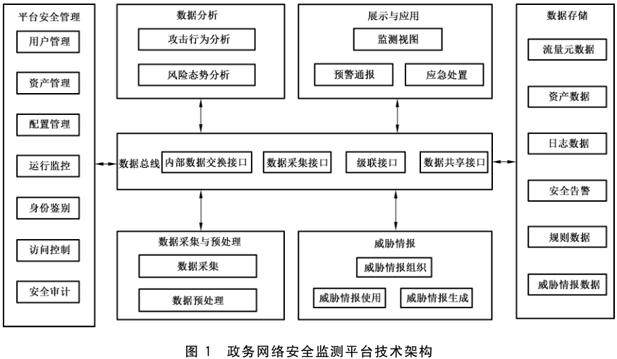
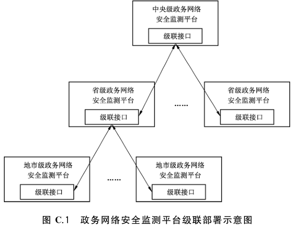
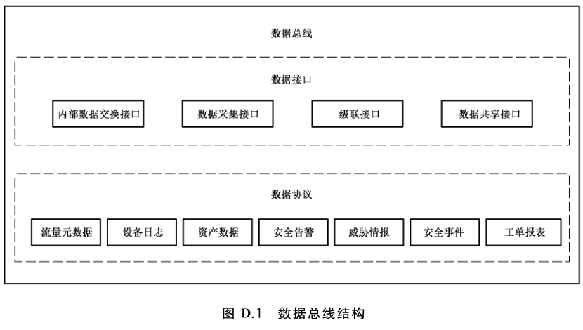

# GB/T 42583-2023 信息安全技术 政务网络安全监测平台技术规范

> 来源：[GB/T 42583-2023 国家标准详情](https://openstd.samr.gov.cn/bzgk/std/newGbInfo?hcno=056BA7363C8C3E4813D8930E4EB3DA56)；封面发布日期：2023-05-23；实施日期：2023-12-01。
> PDF SHA-256：4f4b8be8d3e8711505ca5c9b81e7e9e9abda2fda2cec70238a4bab931019aaf8。
> 根据官方 PDF 全 40 页图像逐页核对，合并分页为连续正文；页眉、页脚不计入正文。

## 前言

本文件按照 GB/T 1.1—2020《标准化工作导则 第1部分：标准化文件的结构和起草规则》的规定起草。

请注意本文件的某些内容可能涉及专利。本文件的发布机构不承担识别专利的责任。

本文件由全国信息安全标准化技术委员会（SAC/TC 260）提出并归口。

本文件起草单位：国家信息中心、北京国信京宁信息安全科技有限公司、公安部第三研究所、国家信息技术安全研究中心、中国信息安全测评中心、中国科学院信息工程研究所、亚信科技（成都）有限公司、华为技术有限公司、奇安信科技集团股份有限公司、北京微步在线科技有限公司、深信服科技股份有限公司、北京天融信网络安全技术有限公司、新华三技术有限公司、杭州安恒信息技术股份有限公司、北京奇虎科技有限公司、启明星辰信息技术集团股份有限公司、恒安嘉新（北京）科技股份公司、广东盈世计算机科技有限公司、浪潮云信息技术股份公司、北京中科全安技术有限公司、北京中测安华科技有限公司。

本文件主要起草人：禄凯、刘蓓、闫桂勋、程浩、赵睿斌、吴阿明、文博、袁志千、任卫红、吴宪、姚佳明、李娟、马红霞、王振蕾、杨清泽、王伟、张二明、薛锋、张宽、叶润国、安高峰、万晓兰、苏启波、张屹、杜宇、史帅、林延中、董树、贾博超、姚原岗。

## 1 范围

本文件规定了政务网络安全监测平台的通用技术要求、扩展技术要求以及测试评价方法。

本文件适用于政务网络安全监测平台的设计、建设、运维和测试评价。

## 2 规范性引用文件

下列文件中的内容通过文中的规范性引用而构成本文件必不可少的条款。其中，注日期的引用文件，仅该日期对应的版本适用于本文件；不注日期的引用文件，其最新版本（包括所有的修改单）适用于本文件。

- GB/T 25069 信息安全技术 术语

- GB/T 32924 信息安全技术 网络安全预警指南

## 3 术语和定义

GB/T 25069 和 GB/T 32924界定的以及下列术语和定义适用于本文件。

### 3.1 政务网络 government network

承载非涉密政务业务的专用网络。

> 注：包含基础网络，以及部署在基础网络之上的政务云、政务应用和政务数据等信息技术设施和资源，主要划分为政务广域网、政务城域网和政务局域网。

### 3.2 政务城域网 government metropolitan area network

同城各政务部门间实现互联互通的政务网络。

### 3.3 政务广域网 government wide area network

连接不同地区政务局域网或政务城域网，实现远程通信的政务网络。

### 3.4 安全监测平台 security monitoring platform

通过对网络流量、安全日志、威胁情报等数据进行实时采集、监测和分析，动态识别网络风险，发现攻击威胁、资产脆弱性以及安全事件，并进行预警通报和可视化展示的系统。

### 3.5 告警 alert

对网络安全要素进行分析，发现攻击或入侵时，平台自动向相关人员发出的通知。

### 3.6 预警 warning

针对即将发生或正在发生的网络安全事件或威胁，提前或及时发出的安全警示。

［来源：GB/T 32924—2016，3.5］

### 3.7 探针 probe

从被监测的网络或系统中，采集流量、日志等数据的一种部件或代理。

### 3.8 数据总线 data bus

实现平台中数据采集探针、存储、分析、展示与应用等各模块之间，以及与第三方平台之间数据共享和交换的功能模块。

### 3.9 威胁情报 threat intelligence

一种基于证据的知识，用于描述网络威胁信息、研判安全态势，支持安全事件响应和处置决策。

## 4 缩略语

下列缩略语适用于本文件。

| 缩略语 | 中文名称 | 英文全称 |
| --- | --- | --- |
| API | 应用程序接口 | Application Programming Interface |
| DNS | 域名系统 | Domain Name System |
| GIS | 地理信息系统 | Geographic Information System |
| HTTP | 超文本传输协议 | Hypertext Transfer Protocol |
| JSON | JS 对象简谱 | JavaScript Object Notation |
| SMTP | 简单邮件传输协议 | Simple Mail Transfer Protocol |
| URL | 统一资源定位系统 | Uniform Resource Locator |
| VPC | 虚拟私有云 | Virtual Private Cloud |

## 5 概述

### 5.1 平台技术架构

政务网络安全监测平台包括数据采集与预处理、数据存储、数据总线、数据分析、展示与应用、威胁情报和平台安全管理等基本功能模块，其技术架构如图1所示。

| 功能模块 | 图中组成 |
| --- | --- |
| 平台安全管理 | 用户管理、资产管理、配置管理、运行监控、身份鉴别、访问控制、安全审计 |
| 数据分析 | 攻击行为分析、风险态势分析 |
| 展示与应用 | 监测视图、预警通报、应急处置 |
| 数据总线 | 内部数据交换接口、数据采集接口、级联接口、数据共享接口 |
| 数据采集与预处理 | 数据采集、数据预处理 |
| 威胁情报 | 威胁情报组织、威胁情报使用、威胁情报生成 |
| 数据存储 | 流量元数据、资产数据、日志数据、安全告警、规则数据、威胁情报数据 |

图中平台安全管理、数据分析、展示与应用、数据采集与预处理、威胁情报、数据存储均与数据总线相连。

平台各功能模块实现的功能如下：

a） 数据采集与预处理：根据政务网络安全监测平台的监测范围和监测对象确定数据采集范围、采集对象和采集方式，并对采集的数据进行解析预处理，以供进一步深度关联分析；

b） 数据存储：对平台中不同类型和结构的数据进行存储；

c） 数据总线：实现平台中数据采集、存储、分析、展示与应用等各模块之间，以及与第三方平台之间数据共享和交换；

d） 数据分析：通过特征码匹配、关联分析、机器学习等数据分析技术识别网络攻击行为，分析风险态势；

e） 展示与应用：根据决策者、管理人员和运维人员不同的需求和关注重点，进行多维度的态势展示，并且支持预警通报和应急处置；

f） 威胁情报：为数据分析和事件处置提供决策支持信息，实现威胁情报数据组织、生成、使用和共享交换；

g） 平台安全管理：包括平台的用户管理、配置管理、运行监控、安全审计等，为平台其他功能模块提供集中管控机制。

### 5.2 平台监测范围和对象

政务网络安全监测平台的监测范围与政务部门或政务网络运营者管理的网络边界范围保持一致。

承载跨地区、跨部门应用的政务网络，其监测范围包括本地区/本部门政务网络，以及与之连接的政务广域网和政务城域网。

政务网络安全监测平台的监测对象包括基础网络、政务云、政务应用和政务数据等信息技术设施和资源。

> 注：政务部门托管或部署在公有云上的业务监测由托管单位或云服务商提供相应监测服务，政务网络安全监测平台通过数据共享接口获取相应监测数据进行分析、展示和应用。

### 5.3 技术要求分类

由于基础网络、政务云、政务应用以及政务数据等不同监测对象所面临的威胁不同（见附录A），安全监测需求和采用的技术不同，为便于实现对不同监测对象的共性化和个性化监测，安全监测技术要求分为通用要求和扩展要求。

通用要求针对监测对象的共性化监测需求提出，包括数据采集与预处理、数据存储、数据总线、数据分析、展示与应用、威胁情报、平台安全管理等。扩展要求针对政务云、政务应用或政务数据的个性化监测需求提出，是平台应进一步满足的技术要求。通用要求和扩展要求共同构成了政务网络安全监测平台的技术要求。

与网络安全等级保护工作相衔接，安全监测平台技术要求进一步分为基本要求和增强要求。等级保护三级以下的政务网络安全监测平台适用基本要求，等级保护三级（含）以上政务网络安全监测平台适用基本要求和增强要求。基本要求和增强要求的选择见附录 B。

在本文件中，黑体字部分表示增强要求。

## 6 安全监测通用要求

### 6.1 数据采集与预处理

#### 6.1.1 数据采集

本项要求包括。

a） 采集范围应覆盖监测范围内的通信网络、区域边界以及计算环境。采集点部署在核心交换节点、核心汇聚节点和移动接入点等关键节点。如果监测范围包括政务广域网或政务城域网，数据采集点应部署在政务广域网和政务城域网的核心交换节点、核心汇聚节点等关键节点。

b） 采集对象宜包括：网络流量、资产信息、威胁情报、脆弱性信息、知识案例数据、安全设备告警、安全日志等。

c） 平台应支持通过不同的方式采集流量、日志、资产、威胁情报等信息（探针部署可见附录C）：

1） 应支持部署流量探针，通过流量镜像的方式获取被监测的流量；

2） 应支持主动或被动采集日志；

3） 应支持主动扫描或网络流量检测方式发现资产，并支持手动或第三方导入、补全资产信息；

4） **应支持通过级联接口或数据共享接口采集第三方平台数据；**

5） **应支持主动扫描、手动或第三方导入，获取资产的脆弱性信息；**

6） 应支持接口更新或第三方导入威胁情报数据。

#### 6.1.2 数据预处理

本项要求包括：

a） 应具备数据解析规则、过滤规则和补全规则等，用于过滤、富化日志信息；

b） 应支持自定义数据预处理规则。

### 6.2 数据存储

本项要求包括：

a） 应支持对平台采集以及处理产生的数据进行分类存储，包括但不限于流量元数据、资产信息、日志数据、安全告警、威胁情报、安全事件、案例知识等数据；

b） 应支持对结构化数据、半结构化数据和非结构化数据进行存储；

c） 应支持自定义数据存储时间；

d） 应支持对身份鉴别、数据分析结果等重要数据进行加密存储；

e） 应支持配置数据保护策略，防止数据遭未经授权的读取、删除或修改；

f） **应支持数据迁移、数据的备份及恢复；**

g） **应支持数据存储节点扩展和负载均衡；**

h） **应支持当数据存储达到阈值时，发出报警信息。**

### 6.3 数据总线

#### 6.3.1 数据类型

应支持根据数据类型定义数据格式、数据协议和接口调用（见附录 D）。数据类型包括但不限于流量元数据、日志数据、资产信息、安全告警、威胁情报、安全事件、工单报表等。

#### 6.3.2 内部数据交换接口

应支持平台内部基本功能模块之间，通过接口进行数据调用、存储、分析、展示与应用。

#### 6.3.3 数据采集接口

应支持从不同类型的数据采集探针采集流量元数据、日志数据、资产信息、威胁情报等数据。

#### 6.3.4 级联接口

具有上下级联关系的平台之间通过级联接口进行数据共享和交换，本项要求包括：

a） 数据交互内容包括但不限于安全告警、预警信息、安全事件、威胁情报、工单报表、统计数据、知识案例等；

b）接口类型包括但不限于级联注册接口、数据上传接口、数据下发接口和数据查询接口等，相关示例见附录 E；

c） 应支持在数据传输过程中采用密码技术保证数据的完整性和保密性。

#### 6.3.5 数据共享接口

宜支持向第三方平台发送/接收数据，包括但不限于：安全告警、安全事件、预警信息、威胁情报等。

### 6.4 数据分析

#### 6.4.1 攻击行为分析

本项要求包括：

a） 应支持特征码匹配分析，能够识别恶意流量特征、恶意文件特征、恶意代码特征等；

b）应支持场景化分析，包括但不限于资产违规外连、账号异地登录、弱口令、数据库敏感操作等典型场景；

c） 宜支持基于攻击阶段、攻击特征相似度等维度的关联分析；

d） **应支持通过机器学习算法进行数据分析；**

e） **应支持对多源异构的安全大数据进行聚合或关联分析，发现攻击行为；**

f） **宜支持利用沙箱对可疑文件及 URL 进行静态或动态的分析检测；**

g） **宜支持关联威胁情报进行网络攻击行为特征分析和溯源分析；**

h） **宜支持 DNS 威胁检测，包括但不限于 DNS 协议漏洞检测、恶意域名解析检测、DGA 域名检测、DNS 隐蔽通道检测等。**

#### 6.4.2 风险态势分析

本项要求包括：

a） 应支持基于资产、威胁和脆弱性监测数据，对网络的整体安全态势进行分析；

b）应支持基于安全事件的威胁态势分析，安全事件包括但不限于有害程序事件、网络攻击事件、数据攻击事件、违规操作事件等；

c） 应支持基于资产的类型、分布、重要程度、资产脆弱性等信息，综合分析资产安全态势。

### 6.5 展示与应用

#### 6.5.1 监测视图

本项要求包括：

a） 应支持对网络整体安全态势的展示，展示方式包括GIS地图、雷达图、拓扑图、路径图等至少两种表现形式；

b） 应支持基于威胁类型、攻击次数、威胁来源、威胁目标、攻击路径等信息的威胁视图展示；

c） 应支持基于资产类型、分布、资产脆弱性、相关攻击事件等信息的资产安全视图展示；

d） 应支持基于事件类型、源IP、目的IP、受攻击资产、威胁等级、处置情况等信息的安全事件视图展示；

e） 应支持基于统计信息、实时信息、历史信息和变化趋势的展示方式，以及分角色展示方式。

#### 6.5.2 预警通报

本项要求包括：

a） 应支持基于数据分析结果和告警规则，实时产生分级别安全告警；

b）应支持按照设定的预警级别和预警流程发布预警信息，预警内容包括但不限于：预警类型、预警级别、威胁方式、涉及对象、影响程度、防范对策等；

c） 应支持按照设定的安全事件通报流程进行事件通报，通报内容包括但不限于事件类型、攻击源IP、目标IP、事件级别、事件分析、影响程度和处置建议等；

d） 应支持平台、邮件、短信、即时通信、文件等两种及以上预警和通报方式。

#### 6.5.3 应急处置

本项要求包括：

a） 应支持将安全告警或安全事件形成处置任务，并进行记录、跟踪和归档；

b） 应支持对安全告警或安全事件进行调查取证，包含告警溯源信息和关联的原始日志；

c） **应支持与第三方设备或平台联动，根据监测结果，协助实施动态访问控制等安全处置行动。**

### 6.6 威胁情报

#### 6.6.1 威胁情报组织

**本项要求包括：**

a） **应支持威胁情报分类存储和情报置信度评价分级，分类包括但不限于域名类、IP 类、文件类等（格式见附录 F）；**

b） **应支持威胁情报数据手动更新或者在线更新，更新频率不超过 24 h。**

#### 6.6.2 威胁情报共享使用

**本项要求包括：**

a） **应支持提供威胁情报数据查询和比对接口，供数据实时分析和批量查询；**

b） **应支持通过接口方式或文件导入/导出方式，实现与第三方平台的威胁情报共享交换和使用。**

#### 6.6.3 威胁情报生成

**本项要求包括：**

a） **应支持获取原始样本或数据，并对其进行归类、分析、加工、处理后生成威胁情报。**

b） **应支持自定义威胁情报标签；**

c） **应支持手动增加和删除威胁情报。**

### 6.7 平台安全管理

#### 6.7.1 用户管理

本项要求包括：

a） 应支持用户、用户组的增加、删除、修改、查询及分组管理；

b） 应支持划分不同的角色，并为不同角色分配权限。

#### 6.7.2 资产管理

本项要求包括：

a） 应支持记录资产的属性信息包括不限于资产名称、资产类型、资产 IP、所属业务系统、部署位置、资产负责人等信息；

b）应支持按照类型、部署位置、所属业务系统等属性对资产进行分组管理；

c） 应支持资产信息的增加、删除、查询、标记；

d） 应支持资产信息的批量导入、导出。

#### 6.7.3 配置管理

本项要求包括：

a） 应支持对用户账号和口令的配置管理，包括初次登录口令修改、账号锁定时间、口令有效期、登录尝试次数、口令长度和复杂度限制等；

b） 应支持平台各基本功能模块与唯一确定时钟进行自动同步，每天至少同步一次；

c） 应支持对平台安全策略、特征库、补丁等进行升级。

#### 6.7.4 运行监控

应支持实时监控平台设备运行状态，包括但不限于CPU 使用率、内存使用情况、磁盘使用情况、网络流量情况、设备产生的异常报警等。

#### 6.7.5 身份鉴别

本项要求包括：

a） 应对平台登录用户进行身份鉴别，身份鉴别信息应具有复杂度和定期更换要求；

b） 应采用密码技术保证身份鉴别信息在传输过程中的完整性和保密性；

c） **应采用两种或两种以上组合的鉴别技术对用户进行身份鉴别，且其中至少一种鉴别技术应使用密码技术来实现。**

#### 6.7.6 访问控制

本项要求包括：

a） 应向授权用户提供配置、查询和修改各种安全策略的功能；

b） 应向授权用户提供管理日志的功能，包括日志的存储、导出和备份等；

c） 应支持在用户远程管理方式下，限定远程管理端IP地址范围，并采取措施保证管理端与平台之间数据传输的保密性。

#### 6.7.7 安全审计

本项要求包括：

a） 应支持对每个用户的操作行为进行安全审计，包括但不限于：

1） 管理员的登录成功和失败；

2） 因身份鉴别尝试失败次数达到设定值导致的会话连接终止；

3） 对安全策略进行配置的操作；

4） 对管理用户进行增加、删除和属性修改的操作。

b） 审计记录应至少包括事件发生日期、时间、用户标识、事件类型、操作结果等信息。日期应精确到日，时间应精确到秒。

c） 应对审计记录进行保护，避免受到删除、修改或覆盖。

## 7 安全监测扩展要求

### 7.1 政务云安全监测

#### 7.1.1 数据采集与预处理

本项要求包括：

a） 应支持采集政务云的边界区域、VPC内部、VPC之间和管理区的流量，流量采集对计算节点及带宽资源的占用应以不影响云上政务业务系统的正常运行为基准；

b） 应支持通过6.1.1c）中提出的数据采集方法或对接政务云安全管理平台采集政务云的日志、资产等数据；

c） **应支持在政务云计算节点上部署探针，进行计算节点流量或日志数据的采集。**

#### 7.1.2 数据分析

本项要求包括：

a） 应支持对政务云边界区域和管理区的南北向流量的攻击行为分析和风险态势分析；

b）应支持对政务云 VPC内部、VPC 之间的东西向流量的攻击行为分析和风险态势分析。

#### 7.1.3 展示与应用

本项要求包括：

a） 应支持基于政务云平台维度、租户维度和 VPC维度的态势展示；

b）应支持政务云边界区域、VPC 内部、VPC之间和管理区的威胁态势和资产安全态势展示；

c） **应支持与政务云安全设备或云安全服务组件进行联动，自动完成应急处置任务。**

### 7.2 政务应用安全监测

#### 7.2.1 邮件监测

##### 7.2.1.1 数据采集与预处理

应支持在邮件系统出入口处部署邮件监测探针，进行 SMTP 等流量数据采集与预处理。

##### 7.2.1.2 数据分析

本项要求包括：

a） 应支持垃圾邮件识别，支持通过邮件头标识、非法发件域、垃圾主题、发件人黑名单、收件人字段缺失、IP黑名单等方式识别垃圾邮件；

b）应支持对邮件主题、正文内容通过语义识别进行检测，识别攻击特征和欺诈意图；

c） 应支持账号异常行为分析，支持对境内/境外异地登录，高频登录尝试、异常时间登录、邮箱服务器异常端口使用和异常通信行为等行为发现；

d） 应支持对邮箱账号弱口令、邮箱系统漏洞的脆弱性识别分析；

e） **宜支持对邮件多级嵌入 URL、隐藏链接等进行分析检测，能够识别恶意程序和漏洞利用；**

f） **宜支持对邮件附件进行安全分析检测，支持的附件类型包括可执行文件、PDF、Web 网页、压缩文件等其中一种或多种。**

##### 7.2.1.3 展示与应用

应支持恶意邮件、垃圾邮件实时告警，告警内容包括但不限于告警时间、告警类型、告警级别、邮件接收时间、邮件发送人、邮件标题等。

#### 7.2.2 网站监测

##### 7.2.2.1 数据采集与预处理

应支持部署网站专用探针，进行网站安全数据采集与预处理。

##### 7.2.2.2 数据分析

本项要求包括：

a） 应支持对网站可用性进行监测分析；

b）应支持对网站 DNS解析服务进行监测，及时发现域名劫持，域名解析失败等问题；

c） 应支持对网站攻击行为进行分析，包括但不限于网页篡改、网页挂马、敏感信息泄露等事件；

d） 应支持定期对网站系统漏洞进行扫描分析。

##### 7.2.2.3 展示与应用

应支持基于数据分析结果进行实时告警，告警内容包括但不限于告警类型、告警级别、网站标识、网站地址等。

#### 7.2.3 业务系统监测

##### 7.2.3.1 数据采集与预处理

应支持主动或被动采集业务系统安全日志数据。

##### 7.2.3.2 数据分析

本项要求包括：

a） 应支持业务行为分析，包括敏感信息页面调用异常、查询数据异常、账号使用异常等行为；

b） 应支持操作行为分析，包括同一业务高频操作、异常时间操作、数据库异常操作等行为；

c） 应支持访问行为分析，包括异常IP 地址登录、非正常时间段登录、短时多IP 登录、异常端口访问等行为；

d） 应支持资产变动分析，对业务系统资产的端口或服务变化情况进行监测分析。

##### 7.2.3.3 展示与应用

应支持根据数据分析结果实时告警，告警内容应包括但不限于告警类型、告警级别、受威胁的业务资产信息等。

### 7.3 政务数据安全监测

#### 7.3.1 数据采集与预处理

本项要求包括：

a） 应支持在关键节点部署流量探针，进行政务数据流量采集；

b） 应支持采用主动或被动方式采集数据库安全审计日志、数据安全设备日志等。

#### 7.3.2 数据分析

本项要求包括：

a） 应支持数据资产识别分析，包括自动发现数据资产、数据分类分级标记等；

b） 应支持数据异常行为分析，包括对数据库异常访问、异常操作行为、接口异常调用等进行分析；

c） 应支持数据接口脆弱性分析，包括参数可遍历、接口未鉴权、登录弱口令、口令明文传输等；

d） 应支持个人信息泄露分析，对个人信息泄露情况进行识别和分析；

e） **应支持对数据泄露情况进行溯源分析和取证。**

#### 7.3.3 展示与应用

本项要求包括：

a） 应支持对数据安全态势的展示，包括威胁统计、资产统计和脆弱性统计等；

b） 宜支持对数据流转或数据访问关系的展示；

c） 应支持对数据安全事件的告警，内容包括但不限于告警类型、告警级别、受影响数据资产信息等。

## 8 通用要求测试评价方法

### 8.1 数据采集与预处理

#### 8.1.1 数据采集

本项测试评价方法如下。

a） 测试方法：

1） 查阅相关文档或检查采集探针部署，确认平台的数据采集范围是否满足 6.1.1a）的要求；

2） 配置相关策略，指定采集对象如流量、日志、资产、威胁情报等；

3） 尝试以 6.1.1c）中所述的方式进行数据采集；

4） 检查平台能否对流量、日志、资产、威胁情报等数据进行采集。

b） 预期结果：采用6.1.1c）中所述的数据采集方式，平台采集流量、日志、资产、威胁情报等数据，采集范围满足 6.1.1a）的要求。

c） 结果判定：实际测试结果与相关预期结果一致则判定为符合，其他情况判定为不符合。

#### 8.1.2 数据预处理

本项测试评价方法如下。

a） 测试方法：

1） 审查文档并查验策略定制的机制，是否提供解析规则、过滤规则、补全规则；

2） 执行平台的自定义策略定制功能；

3） 验证自定义策略定制功能是否有效；

4） 查看日志或者数据库，验证数据是否进行了过滤、富化等处理。

b） 预期结果：平台提供了解析规则、过滤规则、补全规则，并能进行策略定制，数据按照规则处理后进行了过滤、富化。

c） 结果判定：实际测试结果与相关预期结果一致则判定为符合，其他情况判定为不符合。

### 8.2 数据存储

本项测试评价方法如下。

a） 测试方法：登录平台，查看平台的配置和数据库：

1） 查看是否对6.2a）中提到的数据进行分类存储；

2） 查看是否支持6.2b）中的存储类型；

3） 查看平台数据存储时间的设置，是否支持自定义；

4） 查看是否对身份鉴别、数据分析结果等重要数据进行了加密存储；

5） 查看策略配置，是否有6.2e）中提到的数据保护策略；

6） 查看是否支持数据迁移、存储数据的备份及恢复；

7） 查看是否支持节点扩展和负载均衡；

8） 尝试导入数据达到存储阈值，查看平台是否发出报警。

b） 预期结果：

1） 平台对6.2a）中提到的数据进行了分类存储；

2） 平台支持6.2b）中的存储类型；

3） 平台设置的数据存储时间能够满足《中华人民共和国网络安全法》以及行业主管部门的规定；

4） 平台对身份鉴别等重要数据进行了加密存储；

5） 平台具备6.2e）中提到的数据保护策略；

6） 平台支持数据迁移、存储数据的备份及恢复；

7） 平台支持节点扩展，支持负载均衡；

8） 数据存储达到阈值后，平台发出报警。

c） 结果判定：实际测试结果与相关预期结果一致则判定为符合，其他情况判定为不符合。

### 8.3 数据总线

#### 8.3.1 数据协议

本项测试评价方法如下。

a） 测试方法：审查文档，查看是否支持按照6.3.1中的数据类型定义数据格式、数据协议、接口调用规则。

b） 预期结果：文档按照 6.3.1中的数据类型定义了数据格式、数据协议、接口调用规则。

c） 结果判定：实际测试结果与相关预期结果一致则判定为符合，其他情况判定为不符合。

#### 8.3.2 内部数据交换接口

本项测试评价方法如下。

a） 测试方法：使用测试工具模拟内部数据交换，查验接口数据格式，查看平台内部基本功能模块之间是否能够通过接口进行数据调用、存储、分析、展示与应用。

b） 预期结果：平台内部基本功能模块之间，通过接口可以正常进行数据调用、存储、分析、展示与应用。

c） 结果判定：实际测试结果与相关预期结果一致则判定为符合，其他情况判定为不符合。

#### 8.3.3 数据采集接口

本项测试评价方法如下。

a） 测试方法：使用不同类型的数据采集探针，查看是否能够通过数据总线的数据采集接口采集到对应的数据。

b） 预期结果：通过数据采集接口可以从不同类型的数据采集探针中采集到流量元数据、日志数据、资产信息、威胁情报等数据。

c） 结果判定：实际测试结果与相关预期结果一致则判定为符合，其他情况判定为不符合。

#### 8.3.4 级联接口

本项测试评价方法如下。

a） 测试方法：以管理员身份登录平台管理界面：

1） 查看上下级平台之间传输的数据是否包含安全告警、预警信息、安全事件、威胁情报、工单报表、统计数据、知识案例等；

2） 查看平台级联接口的类型，是否包含级联注册接口、数据上传接口、数据下发接口和数据查询接口等类型；

3） 查看是否有对级联接口数据完整性验证和加密的设置；

4） 对级联平台间的流量进行抓包。

b） 预期结果：

1） 上下级平台之间传输的数据包含安全告警、预警信息、安全事件、威胁情报、工单报表、统计数据、知识案例等；

2） 平台级联接口的类型包含级联注册接口、数据上传接口、数据下发接口和数据查询接口等；

3） 平台有对级联接口数据完整性验证和加密的设置，且级联平台之间所有通信数据非明文。

c） 结果判定：实际测试结果与相关预期结果一致则判定为符合，其他情况判定为不符合。

#### 8.3.5 数据共享接口

本项测试评价方法如下。

a） 测试方法：使用测试工具模拟第三方平台，通过平台向测试工具发送安全告警、安全事件、预警信息、威胁情报等并反向发送相关信息，查看信息是否能够正常发送/接收。

b） 预期结果：

1） 与第三方系统/平台之间能够以接口方式进行数据交互；

2） 通过定制或使用内置的接口服务，能够实现与第三方平台的信息交换；

3） 接口提供和接收的数据可包含 6.3.5中提到的数据；

4） 接口功能包含6.3.4b）中提到的功能。

c） 结果判定：实际测试结果与相关预期结果一致则判定为符合，其他情况判定为不符合。

### 8.4 数据分析

#### 8.4.1 攻击行为分析

本项测试评价方法如下。

a） 测试方法：登录平台，查看平台的配置和规则库，验证平台内是否有：

1） 特征码匹配规则库；

2） 场景化分析模型；

3） 事件关联分析规则；

4） **基于机器学习的数据分析模型；**

5） **大数据分析模块；**

6） **沙箱安全分析模块；**

7） **威胁情报关联分析模块；**

8） **DNS 威胁检测模块。**

b） 预期结果：平台中包含相对应的规则或者模块功能。

c） 结果判定：实际测试结果与相关预期结果一致则判定为符合，其他情况判定为不符合。

#### 8.4.2 风险态势分析

本项测试评价方法如下。

a） 测试方法：登录平台，查看平台的配置和规则库，验证平台内是否有：

1） 整体安全态势分析模块；

2） 威胁态势分析模块；

3） 资产安全态势分析模块。

b） 预期结果：平台中包含相对应的模块功能。

c） 结果判定：实际测试结果与相关预期结果一致则判定为符合，其他情况判定为不符合。

### 8.5 展示与应用

#### 8.5.1 监测视图

本项测试评价方法如下。

a） 测试方法：访问平台大屏和管理界面，查看：

1） 是否能够通过GIS地图、雷达图、拓扑图、路径图等至少两种表现形式对网络整体安全态势进行展示；

2） 是否支持基于威胁类型、攻击次数、威胁来源、威胁目标、攻击路径等信息的威胁视图展示；

3） 是否支持基于资产类型、分布、资产脆弱性、相关攻击事件等信息的资产安全视图展示；

4） 是否支持基于事件类型、源IP、目的IP、受攻击资产、威胁等级、处置情况等信息的安全事件视图展示；

5） 是否支持基于统计信息、实时信息、历史信息和变化趋势的展示方式；

6） 是否对不同用户角色区分展示内容。

b） 预期结果：

1） 平台能按照6.5.1b）~d）中的形式要求对网络整体安全态势、威胁视图、资产安全视图、安全事件视图等进行展示；

2） 平台能以统计信息、实时信息、历史信息和变化趋势的展示方式进行展示；

3） 平台对不同用户角色展示内容有区分。

c） 结果判定：实际测试结果与相关预期结果一致则判定为符合，其他情况判定为不符合。

#### 8.5.2 预警通报

本项测试评价方法如下。

a） 测试方法：访问平台管理界面：

1） 触发告警，查看平台是否实时生成安全告警；

2） 尝试设定预警级别并发布预警；

3） 查看平台是否按照流程通报预警信息；

4） 尝试设定安全事件级别并发布通报；

5） 查看平台是否按照流程通报安全事件；

6） 查看是否支持平台、邮件、短信、即时通信等两种及以上预警和通报方式。

b） 预期结果：

1） 平台能够实时生成分级别的安全告警；

2） 可以手动设定预警级别；

3） 可以按照预警流程进行信息通报，包括6.5.2b）所描述的预警内容；

4） 可以手动设定安全事件级别；

5） 可以按照安全事件通报流程进行信息通报，包括6.5.2c）所描述的通报内容；

6） 支持平台、邮件、短信、即时通信等两种及以上预警和通报方式。

c） 结果判定：实际测试结果与相关预期结果一致则判定符合，其他情况判定为不符合。

#### 8.5.3 应急处置

本项测试评价方法如下。

a） 测试方法：访问平台管理界面：

1） 触发安全告警或安全事件，查看平台是否支持将安全告警或安全事件形成处置任务，并进行记录、跟踪和归档；

2） 触发安全事件，查看平台是否能对安全告警或安全事件进行调查取证；

3） **查看是否具备联动模块；**

4） **根据监测结果发布联动处置任务，与第三方设备或平台进行联动，查看是否实施了相应动作。**

b） 预期结果：

1） 平台对安全告警或安全事件形成了处置任务，并进行记录、跟踪和归档；

2） 平台支持对安全事件进行调查取证，包含告警溯源信息和关联的原始日志；

3） **平台具备联动模块；**

4） **平台按照处置任务实施了相应动作。**

c） 结果判定：实际测试结果与相关预期结果一致则判定为符合，其他情况判定为不符合。

### 8.6 威胁情报

#### 8.6.1 威胁情报组织

**本项测试评价方法如下。**

a） **测试方法：访问平台管理界面，查看：**

1） **是否对威胁情报进行了情报置信度评价分级和分类，并进行了域名类、IP 类、文件类等分类存储；**

2） **威胁情报更新功能。**

b） **预期结果：**

1） **平台对威胁情报进行了情报置信度评价分级和分类，并进行了域名类、IP 类、文件类等分类存储；**

2） **平台支持威胁情报数据手动更新或者在线更新，更新频率不超过 24 h。**

c） **结果判定：实际测试结果与相关预期结果一致则判定为符合，其他情况判定为不符合。**

#### 8.6.2 威胁情报共享使用

**本项测试评价方法如下。**

a） **测试方法：访问平台管理界面：**

1） **查看平台是否提供统一的 API 接口，尝试调用接口进行实时分析和批量查询；**

2） **尝试通过接口、文件导入/导出，实现与第三方平台的威胁情报共享交换和使用。**

b） **预期结果：**

1） **平台提供统一的 API 接口，通过接口调用可以进行数据实时分析和批量查询；**

2） **平台可以通过接口方式或文件导入/导出方式，实现与第三方平台的威胁情报共享交换和使用。**

c） **结果判定：实际测试结果与相关预期结果一致则判定为符合，其他情况判定为不符合。**

#### 8.6.3 威胁情报生成

**本项测试评价方法如下。**

a） **测试方法：**

1） **模拟威胁原始样本导入威胁情报模块，查看平台是否能够进行威胁情报挖掘生产；**

2） **尝试自定义威胁情报标签；**

3） **尝试手动增加和删除威胁情报。**

b） **预期结果：**

1） **平台能够进行威胁情报挖掘生产；**

2） **平台支持自定义威胁情报标签；**

3） **平台支持手动增加和删除威胁情报。**

c） **结果判定：实际测试结果与相关预期结果一致则判定为符合，其他情况判定为不符合。**

### 8.7 平台安全管理

#### 8.7.1 用户管理

本项测试评价方法如下。

a） 测试方法：以管理员身份登录平台管理界面：

1） 尝试 6.7.1a）中的操作；

2） 尝试划分不同角色；

3） 尝试对角色分配权限。

b） 预期结果：

1） 能够实现6.7.1a）中的操作；

2） 能够划分不同角色；

3） 能够分配角色权限。

c） 结果判定：实际测试结果与相关预期结果一致则判定符合，其他情况判定为不符合。

#### 8.7.2 资产管理

本项测试评价方法如下。

a） 测试方法：以管理员身份登录平台管理界面：

1） 查看平台资产属性信息；

2） 尝试按照类型、部署位置、所属业务系统等属性对资产分组；

3） 尝试增加、删除、查询、标记资产；

4） 尝试对资产进行批量导入、导出。

b） 预期结果：

1） 平台对资产属性信息进行了记录，包括6.7.2a）中的内容；

2） 能够对资产分组；

3） 能够增加、删除、查询、标记资产；

4） 能够对资产进行批量导入、导出。

c） 结果判定：实际测试结果与相关预期结果一致则判定为符合，其他情况判定为不符合。

#### 8.7.3 配置管理

本项测试评价方法如下。

a） 测试方法：访问平台管理界面：

1） 尝试配置6.7.3a）中要求的账号和口令配置项；

2） 查看是否设置了时间自动同步，查看同步间隔时间；

3） 尝试对安全策略、特征库、补丁等进行升级。

b） 预期结果：

1） 平台能够配置 6.7.3a）中要求的用户账号和口令配置项；

2） 平台支持时间自动同步，且同步间隔时间不超过 24 小时；

3） 能够对安全策略、特征库、补丁等进行升级。

c） 结果判定：实际测试结果与相关预期结果一致则判定为符合，其他情况判定为不符合。

#### 8.7.4 运行监控

本项测试评价方法如下。

a） 测试方法：以管理员身份登录平台管理界面，查看平台设备运行状态。

b） 预期结果：能够查看6.7.4中的平台设备运行状态信息。

c） 结果判定：实际测试结果与相关预期结果一致则判定为符合，其他情况判定为不符合。

#### 8.7.5 身份鉴别

本项测试评价方法如下。

a） 测试方法：

1） 若平台采用口令鉴别机制，尝试以用户身份设置弱口令，如空口令、纯数字等；

2） 若平台采用口令鉴别机制，以管理员身份登录平台管理界面，查看平台是否具有定期更换口令的设置；

3） 以管理员身份登录平台管理界面，查看是否有对身份鉴别信息传输数据完整性验证和加密的设置；

4） **以管理员身份登录平台管理界面，查看平台是否支持两种或两种以上组合的鉴别技术对用户身份进行鉴别，并且其中一种鉴别技术为密码技术。**

b） 预期结果：

1） 平台不支持用户弱口令的设置；

2） 平台具备定期更换口令的设置；

3） 平台具备对身份鉴别信息传输数据完整性验证和加密的设置；

4） **平台支持两种或两种以上组合的鉴别技术对用户身份进行鉴别，且其中一种鉴别技术为密码技术。**

c） 结果判定：实际测试结果与相关预期结果一致则判定为符合，其他情况判定为不符合。

#### 8.7.6 访问控制

本项测试评价方法如下。

a） 测试方法：

1） 以授权用户身份登录平台，尝试在授权范围内设置、查询和修改各种安全策略；

2） 以授权用户身份登录平台，尝试在授权范围内进行日志的存储、导出和备份等；

3） 若平台支持远程管理，以管理员身份登录平台管理界面，查看是否限定远程管理的IP地址范围；

4） 若平台支持远程管理，对远程管理的通信抓包。

b） 预期结果：

1） 授权用户可以在授权范围内设置、查询和修改各种安全策略；

2） 授权用户可以在授权范围内进行日志的存储、导出和备份等；

3） 平台限定了进行远程管理的IP地址范围；

4） 远程管理端与平台之间所有通信数据为非明文。

c） 结果判定：实际测试结果与相关预期结果一致则判定为符合，其他情况判定为不符合。

#### 8.7.7 安全审计

本项测试评价方法如下。

a） 测试方法：

1） 触发 6.7.7a）中的所有事件，审查生成的审计记录；

2） 审查平台的审计记录的内容是否包含了 6.7.7b）中要求的内容；

3） 尝试删除、修改或覆盖审计日志，查看是否能删除、修改或覆盖。

b） 预期结果：

1） 平台对6.7.7a）中的所有事件形成记录；

2） 平台的审计记录至少包含了 6.7.7b）中要求的内容；

3） 审计记录无法删除、修改或覆盖。

c） 结果判定：实际测试结果与相关预期结果一致则判定符合，其他情况判定为不符合。

## 9 扩展要求测试评价方法

### 9.1 政务云安全监测

#### 9.1.1 数据采集与预处理

本项测试评价方法如下。

a） 测试方法：

1） 查阅相关文档或查看探针部署，查看平台的数据采集范围；

2） 检查平台能否对流量、日志、资产等数据进行采集；

3） 开启流量探针，同时运行业务系统，查看流量采集对计算节点及业务带宽的资源占用比例；

4） **访问云计算节点，查看探针能否采集流量或日志数据。**

b） 预期结果：

1） 平台采集范围对政务云的边界区域、VPC 内部、VPC之间和管理区的网络做到了全覆盖；

2） 平台能对流量、日志、资产等数据等进行采集；

3） 流量采集对计算节点及业务带宽的资源占用不超过10%或对业务系统的正常运行不产生影响；

4） **探针能够采集流量或日志数据。**

c） 结果判定：实际测试结果与相关预期结果一致则判定为符合，其他情况判定为不符合。

#### 9.1.2 数据分析

本项测试评价方法如下。

a） 测试方法：模拟对云平台的攻击，以管理员身份登录平台管理界面，查看是否有以云平台南北向和东西向流量为维度的分析功能。

b） 预期结果：平台及时告警，具备从云平台南北向和东西向流量为维度出发，对攻击行为和风险态势进行分析的功能。

c） 结果判定：实际测试结果与相关预期结果一致则判定为符合，其他情况判定为不符合。

#### 9.1.3 展示与应用

本项测试评价方法如下。

a） 测试方法：

1） 访问平台管理界面，查看是否具备政务云平台维度、租户维度和VPC 维度的态势展示功能；

2） 访问平台管理界面，查看是否具备政务云边界区域、VPC内部、VPC之间和管理区的威胁态势和资产安全态势展示功能；

3） **触发安全告警，访问平台管理界面查看是否具备联动模块，并通过配置处置任务与云安全设备或云安全服务组件联动，查看是否执行了处置动作。**

b） 预期结果：

1） 具备政务云平台维度、租户维度和 VPC维度的态势展示功能；

2） 具备政务云边界区域、VPC内部、VPC 之间和管理区的威胁态势和资产安全态势展示功能；

3） **平台具备联动模块，可配置联动策略，并按照处置任务执行相应动作。**

c） 结果判定：实际测试结果与相关预期结果一致则判定为符合，其他情况判定为不符合。

### 9.2 政务应用安全监测

#### 9.2.1 邮件监测

##### 9.2.1.1 数据采集与预处理

本项测试评价方法如下。

a） 测试方法：访问邮件系统，查看邮件监测探针是否能够采集 SMTP 流量；

b） 预期结果：能够采集访问邮件系统的 SMTP 流量。

c） 结果判定：实际测试结果与相关预期结果一致则判定为符合，其他情况判定为不符合。

##### 9.2.1.2 数据分析

本项测试评价方法如下。

a） 测试方法：登录平台，查看平台的配置和规则库，验证平台内是否有：

1） 垃圾邮件识别模块；

2） 语义识别检测模块；

3） 账号异常行为分析模块；

4） 脆弱性识别模块；

5） 欺诈邮件识别模块；

6） **多级嵌入式 URL 和隐藏链接分析模块；**

7） **附件分析模块。**

b） 预期结果：平台中包含相对应的规则或者模块，并且满足7.2.1.2中的分析功能要求。

c） 结果判定：实际测试结果与相关预期结果一致则判定为符合，其他情况判定为不符合。

##### 9.2.1.3 展示与应用

本项测试评价方法如下。

a） 测试方法：触发邮件告警，登录平台查看安全告警。

b） 预期结果：平台监测到恶意邮件、垃圾邮件后，实时告警，告警内容包括但不限于告警时间、告警类型、告警级别、邮件接收时间、邮件发送人、邮件标题。

c） 结果判定：实际测试结果与相关预期结果一致则判定为符合，其他情况判定为不符合。

#### 9.2.2 网站监测

##### 9.2.2.1 数据采集与预处理

本项测试评价方法如下。

a） 测试方法：访问、攻击网站，查看网站专用探针是否能够进行网站安全数据采集。

b） 预期结果：网站专用探针能够采集网站安全数据。

c） 结果判定：实际测试结果与相关预期结果一致则判定为符合，其他情况判定为不符合。

##### 9.2.2.2 数据分析

本项测试评价方法如下。

a） 测试方法：登录平台，查看平台的配置和规则库，验证平台内是否有：

1） 网站可用性监测分析模块；

2） DNS 解析服务监测分析模块；

3） 网站攻击行为监测分析模块；

4） 网站系统漏洞扫描分析模块。

b） 预期结果：平台中包含相对应的规则或者模块，并且满足7.2.2.2中的分析功能要求。

c） 结果判定：实际测试结果与相关预期结果一致则判定为符合，其他情况判定为不符合。

##### 9.2.2.3 展示与应用

本项测试评价方法如下。

a） 测试方法：攻击网站，查看平台告警结果。

b） 预期结果：平台实时告警，告警内容包括但不限于告警类型、告警级别、网站标识、网站地址。

c） 结果判定：实际测试结果与相关预期结果一致则判定为符合，其他情况判定为不符合。

#### 9.2.3 业务系统监测

##### 9.2.3.1 数据采集与预处理

本项测试评价方法如下。

a） 测试方法：访问、攻击业务系统，查看是否能够采集业务系统安全日志数据。

b） 预期结果：平台能够采集业务系统安全日志数据。

c） 结果判定：实际测试结果与相关预期结果一致则判定符合，其他情况判定为不符合。

##### 9.2.3.2 数据分析

本项测试评价方法如下。

a） 测试方法：登录平台，查看平台的配置和规则库，验证平台内是否有：

1） 业务行为分析模块；

2） 操作行为分析模块；

3） 访问行为分析模块；

4） 资产变动分析模块。

b） 预期结果：平台中包含相对应的规则或者模块，并且满足7.2.3.2中的分析功能要求。

c） 结果判定：实际测试结果与相关预期结果一致则判定为符合，其他情况判定为不符合。

##### 9.2.3.3 展示与应用

本项测试评价方法如下。

a） 测试方法：攻击业务系统，查看平台告警结果。

b） 预期结果：平台根据识别结果进行实时告警，告警内容包括但不限于告警类型、告警级别、受威胁的业务资产信息等。

c） 结果判定：实际测试结果与相关预期结果一致则判定为符合，其他情况判定为不符合。

### 9.3 政务数据安全监测

#### 9.3.1 数据采集与预处理

本项测试评价方法如下。

a） 测试方法：通过网络传输政务数据，查看平台：

1） 是否能够采集政务数据相关的流量；

2） 是否能够采集数据库安全审计日志、数据安全设备日志。

b） 预期结果：平台能对相关的流量、日志等进行采集。

c） 结果判定：实际测试结果与相关预期结果一致则判定为符合，其他情况判定为不符合。

#### 9.3.2 数据分析

本项测试评价方法如下。

a） 测试方法：登录平台，查看平台的配置和规则库，验证平台内是否有：

1） 数据资产识别分析模块；

2） 数据异常行为分析模块；

3） 数据接口脆弱性分析模块；

4） 个人信息泄露分析模块；

5） **数据泄露溯源分析和取证功能。**

b） 预期结果：平台中包含相对应的模块或功能，并且满足7.3.2中的分析功能要求。

c） 结果判定：实际测试结果与相关预期结果一致则判定为符合，其他情况判定为不符合。

#### 9.3.3 展示与应用

本项测试评价方法如下。

a） 测试方法：

1） 访问平台管理界面，查看是否具备对数据安全态势的展示；

2） 访问平台管理界面，查看是否具备对数据流转或数据访问关系的展示；

3） 触发安全告警，查看平台告警结果。

b） 预期结果：

1） 具备数据安全态势展示功能；

2） 具备数据流转或数据访问关系展示功能；

3） 平台实时告警，告警内容包括但不限于告警类型、告警级别、受影响数据资产信息等。

c） 结果判定：实际测试结果与相关预期结果一致则判定为符合，其他情况判定为不符合。

## 附录 A（资料性）政务网络面临的主要安全威胁

政务网络面临的主要安全威胁见表 A.1。

**表 A.1 政务网络面临的主要安全威胁**

| 监测对象 | 主要安全威胁 |
| --- | --- |
| 基础网络 | 网络覆盖范围广、区域结构复杂，网络接入点多，攻击暴露面大，容易遭受来自互联网或其他政务部门的网络攻击，以及网络内部产生的横向攻击，如漏洞利用、网络扫描窃听、拒绝服务、流量劫持、APT 攻击、信息破坏等 |
| 政务云 | 云平台资源共享，系统和数据集中部署，容易遭受外部攻击，以及 VPC 间和 VPC 内部横向攻击，如资源滥用和恶意使用、数据破坏、数据丢失、拒绝服务、内部人员恶意行为等 |
| 政务应用 | 政务应用种类繁多，逻辑复杂，接口暴露面大，漏洞问题突出，特别是邮件系统、网站系统和跨地区跨部门业务系统等用户访问量大，防护薄弱容易成为攻击目标，面临网络钓鱼、网页篡改、暗链植入、漏洞利用等威胁 |
| 政务数据 | 政务数据量大、涵盖公共数据、个人信息和法人数据，数据重要性和敏感度高，共享数据平台接口复杂，访问量大，容易遭受数据篡改、假冒、泄漏、窃取、丢失、错误等数据损害威胁 |

## 附录 B（资料性）政务网络安全监测平台技术要求划分

政务网络安全监测平台技术要求划分如表 B.1 所示。

**表B.1 政务网络安全监测平台等级划分表**

| 要求类别 | 技术领域 | 具体要求 | 基本级对应章条号 | 增强级对应章条号 |
| --- | --- | --- | --- | --- |
| 通用要求 | 数据采集与预处理 | 数据采集 | 6.1.1a）～c）3） | 6.1.1 |
| 通用要求 | 数据采集与预处理 | 数据预处理 | 6.1.2 | 6.1.2 |
| 通用要求 | 数据存储 | — | 6.2a）～e） | 6.2 |
| 通用要求 | 数据总线 | 数据类型 | 6.3.1 | 6.3.1 |
| 通用要求 | 数据总线 | 内部数据交换接口 | 6.3.2 | 6.3.2 |
| 通用要求 | 数据总线 | 数据采集接口 | 6.3.3 | 6.3.3 |
| 通用要求 | 数据总线 | 级联接口 | 6.3.4 | 6.3.4 |
| 通用要求 | 数据总线 | 数据共享接口 | 6.3.5 | 6.3.5 |
| 通用要求 | 数据分析 | 攻击行为分析 | 6.4.1a）～c） | 6.4.1 |
| 通用要求 | 数据分析 | 风险态势分析 | 6.4.2 | 6.4.2 |
| 通用要求 | 展示与应用 | 监测视图 | 6.5.1 | 6.5.1 |
| 通用要求 | 展示与应用 | 预警通报 | 6.5.2 | 6.5.2 |
| 通用要求 | 展示与应用 | 应急处置 | 6.5.3a）～b） | 6.5.3 |
| 通用要求 | 威胁情报 | 威胁情报组织 | — | 6.6.1 |
| 通用要求 | 威胁情报 | 威胁情报共享使用 | — | 6.6.2 |
| 通用要求 | 威胁情报 | 威胁情报生成 | — | 6.6.3 |
| 通用要求 | 平台安全管理 | 用户管理 | 6.7.1 | 6.7.1 |
| 通用要求 | 平台安全管理 | 资产管理 | 6.7.2 | 6.7.2 |
| 通用要求 | 平台安全管理 | 配置管理 | 6.7.3 | 6.7.3 |
| 通用要求 | 平台安全管理 | 运行监控 | 6.7.4 | 6.7.4 |
| 通用要求 | 平台安全管理 | 身份鉴别 | 6.7.5a）～b） | 6.7.5 |
| 通用要求 | 平台安全管理 | 访问控制 | 6.7.6 | 6.7.6 |
| 通用要求 | 平台安全管理 | 安全审计 | 6.7.7 | 6.7.7 |
| 扩展要求 | 政务云安全监测 | 数据采集与预处理 | 7.1.1a）～b） | 7.1.1 |
| 扩展要求 | 政务云安全监测 | 数据分析 | 7.1.2 | 7.1.2 |
| 扩展要求 | 政务云安全监测 | 展示与应用 | 7.1.3a）～b） | 7.1.3 |
| 扩展要求 | 政务应用安全监测 | 邮件监测 | 7.2.1.1、7.2.1.2a）～d）、7.2.1.3 | 7.2.1 |
| 扩展要求 | 政务应用安全监测 | 网站监测 | 7.2.2 | 7.2.2 |
| 扩展要求 | 政务应用安全监测 | 业务系统监测 | 7.2.3 | 7.2.3 |
| 扩展要求 | 政务数据安全监测 | 数据采集与预处理 | 7.3.1 | 7.3.1 |
| 扩展要求 | 政务数据安全监测 | 数据分析 | 7.3.2a）～d） | 7.3.2 |
| 扩展要求 | 政务数据安全监测 | 展示与应用 | 7.3.3 | 7.3.3 |

> 注：等级保护三级以下的政务网络安全监测平台满足本表中的基本级要求，等级保护三级（含）以上的政务网络安全监测平台满足本表中的基本级和增强级要求。

## 附录 C（资料性）平台部署结构

政务网络安全监测平台一般由前端数据采集探针、后台分析与展示系统以及可实现相关技术要求的软硬件系统组成。其中，探针的类型及其部署方式为：

a） 流量探针：旁路部署在核心交换或者重要业务区域汇聚交换，通过流量镜像进行数据采集；

b） 日志探针：对安全设备、主机、业务系统等日志信息进行采集：

1） 安全设备日志：与平台之间网络路由可达，采集安全设备的设备日志数据、安全告警等信息，可对接SOC等统一日志存储平台；

2） 主机日志：部署在主机系统内，采集主机防恶意软件事件、防火墙事件、入侵防御事件、完整性监控、系统事件等日志信息；

3） 业务系统日志：与平台之间网络路由可达，采集业务系统的登录日志、系统操作日志等信息；

c） 资产探针：路由可达部署在网络环境中，采集网络中的资产信息；

d） 脆弱性扫描探针：路由可达部署在网络环境中，采集网络中资产、业务的脆弱性信息。

平台可采用级联部署方式，如图C.1所示。

中央级政务网络安全监测平台通过级联接口连接多个省级政务网络安全监测平台，省级平台再通过级联接口连接多个地市级政务网络安全监测平台。

## 附录 D（资料性）数据总线结构

数据总线实现：

a） 内部各功能模块之间的数据交互；

b） 不同类型的数据采集探针的数据格式统一化；

c） 上下级平台之间的数据级联对接；

d） 与第三方平台之间的数据对接。

数据总线结构如图 D.1 所示。

| 层级 | 内容 |
| --- | --- |
| 数据接口 | 内部数据交换接口、数据采集接口、级联接口、数据共享接口 |
| 数据协议 | 流量元数据、设备日志、资产数据、安全告警、威胁情报、安全事件、工单报表 |

数据总线共享和交换的数据主要包括流量元数据、设备日志、资产信息、安全告警、威胁情报、安全事件、工单报表等。数据总线的接口包括内部数据交换接口、数据采集接口、级联接口和数据共享接口。

## 附录 E（资料性）接口示例

### E.1 级联注册

接口描述：

级联注册时采用下级主动向上级提交申请的方式进行注册，上级提供接口接收下级注册申请信息，下级注册时需向上级申请注册证书，利用证书对注册数据进行二次加密传输。

接口类型：http

接口示例：

~~~text
{
  "areaLevel": 1
  "areaName": "新疆"
  "nodeCode": "111111"
  "ip": "192.168.1.1"
  "port": "8888"
  "requestIp": ".xxx.xxx.xxx"
  "preNodeCode": "000000"
  "isOther": 0
}
~~~

返回示例：

~~~text
{
  "code": 200,
  "msg": "成功"
}
~~~

### E.2 安全事件上报

接口类型：kafka 通道或 http

向上级 kafka 中放入或 http 接口上报，数据结构如下（此数据为加密前数据）：

~~~text
{
  "id": 123456689,
  "alarmName": "测试威胁名称",
  "eventType": "事件类型",
  "alarmGrade": 1,
  "alarmDesc": "测试123",
  "alarmTime": "2019-09-04 10:51:03",
  "srcIp": "192.168.12.2",
  "dstIp": "192.168.2.12",
  "createTime": "2019-09-04 7:51:03",
  "domainName": "xxx",
  "fileHash": "xxx",
  "influence": "事件影响评估说明",
  "disposal": "处置结果",
  "reportUser": "事件上报联系人",
  "reportPhone": "上报人员联系方式",
  "threatenedAssets": [{
    "assetsIP": "192.168.12.1",
    "assetsName": "网御防火墙",
    "assetsType": "防火墙",
    "assetsUser": "张三",
    "assetsApplication": "OA系统"
    "assetsAddress": "大数据机房",
    "assetsDepartment": "信息中心"
  }],
  "attachment": [
    {"fileName": "附件1", "filePath": "/aaa/bbb/ddd"},
    {"fileName": "附件2", "filePath": "/aaa/bbb/ccc"}
  ],
  "origNodeCode": "660000"
}
~~~

### E.3 预警通报下发

接口类型：http

下级平台定时向上级平台请求获取最新的预警通报信息。

接口示例：

~~~text
{
  "startTime": "2021-03-07 14:27:14",
  "endTime": "2021-03-08 14:27:14",
  "pageIndex": 1,
  "pageSize": 10
}
~~~

http 接口返回示例（此数据为加密前数据）：

~~~text
{
  "id": 11,
  "startTime": "2020-02-03 14:20:39",
  "noticeName": "通报1",
  "noticeType": "类型",
  "noticeDesc": "描述",
  "attachment": "[{\"fileName\":\"附件1\",\"filePath\":\"/aaa/bbb/ddd\"},{\"fileName\":\"附件2\",\"filePath\":\"/aaa/bbb/ccc\"}]",
  "startNodeCode": "000000",
  "targetNodeCode": "111111",
  "createTime": "2020-02-03 14:27:14",
  "reserver": "XXXX",
  "insertTime": "2020-02-03 14:27:14"
}
~~~

### E.4 案例知识查询

接口类型：http

接口示例：

~~~text
{
  "titleKeyWord": "",
  "startTime": "2019-01-01 00:00:00",
  "endTime": "2020-03-01 00:00:00",
  "currentPage": 1,
  "maxResult": 100
}
~~~

接口返回示例：

~~~text
{
  "code": 200,
  "msg": "成功",
  "data": {
    "records": [
      {
        "id": 1224215409460965377,
        "caseTitle": "案例1",
        "content": "222",
        "keyProperty": null,
        "createMan": null,
        "attachment": "[{\"fileName\":\"附件1\",\"filePath\":\"/aaa/bbb/ddd\"},{\"fileName\":\"附件2\",\"filePath\":\"/aaa/bbb/ccc\"}]",
        "reserver": null,
        "createTime": "2020-02-03 14:17:53"
      },
      {
        "id": 1224215409460965376,
        "caseTitle": "案例2",
        "content": "222",
        "keyProperty": null,
        "createMan": null,
        "attachment": "[{\"fileName\":\"附件1\",\"filePath\":\"/aaa/bbb/ddd\"},{\"fileName\":\"附件2\",\"filePath\":\"/aaa/bbb/ccc\"}]",
        "reserver": null,
        "createTime": "2020-02-03 14:17:53"
      }
    ],
    "total": 2,
    "size": 100,
    "current": 1,
    "orders": [],
    "searchCount": true,
    "pages": 1
  }
}
~~~

## 附录 F（资料性）政务网络安全监测平台威胁情报数据格式

政务网络安全监测平台域名类、IP 类以及文件类威胁情报格式如表 F.1～表 F.3 所示。

**表 F.1 域名类威胁情报格式**

| 序号 | 字段名称 | 中文名称 | 字段说明 | 字段长度 | 是否必选 | 说明 |
| --- | --- | --- | --- | --- | --- | --- |
| 1 | code | 状态 | 字符 | 10 | 是 | 返回状态码 |
| 2 | msg | 描述 | 字符 | 128 | 是 | 返回出错信息 |
| 3 | id | 情报 ID | 字符 | 32 | 是 | 唯一 id |
| 4 | ioc | IOC 内容 | 字符 | 256 | 是 | IOC 具体内容 |
| 5 | ioc_type | IOC 类型 | 字符 | 32 | 是 | IOC 的种类 |
| 6 | intel_type | 情报类型 | 字符 | 128 | 是 | IOC 的威胁种类 |
| 7 | ip | 域名解析 IP | 字符 | 128 | 否 | 域名解析对应的 IP，包含历史的解析 IP，最多 5 条。仅作为参考信息，不作为检测项，包括时间、对应 IP |
| 8 | platform | 平台名称 | 字符 | 16 | 是 | 默认为 All，有确切的受感染平台信息则提供具体平台名称 |
| 9 | confidence | 可信度 | 整数 | 4 | 是 | C2 类可信度一般在 75～85，75 以上代表可信度高，正式发布的 C2 均在此分数以上 |
| 10 | severity | 威胁级别 | 字符 | 8 | 是 | 默认为 high |
| 11 | tags | 情报标签 | 字符 | 128 | 否 | 提供病毒家族、类型、攻击团伙、攻击事件等信息，通过固定规则可拼接成 URL，访问微步威胁分析平台的具体说明信息 |
| 12 | timestamp | 时间戳 | 整数 | 20 | 是 | 新建 IOC 时间，参考国家标准时间 |
| 13 | related_sample | 关联样本 | 字符 | 4 096 | 否 | HASH、SHA256 格式 |
| 14 | resolves | 解析状态 | 布尔值 | 1 | 否 | 0 为域名不可解析，1 为可解析 |
| 15 | whois | 注册人信息 | 字符 | 1 024 | 否 | 该 IOC 的 whois 信息 |
| 16 | APT | APT 组织 | 布尔值 | 1 | 是 | 是否为 APT |
| 17 | industry | 行业 | 字符 | 128 | 否 | 相关行业 |
| 18 | protocol | 网络协议 | 整数 | 16 | 否 | IP protocol number |
| 19 | Application protocol | 应用协议 | 字符 | 32 | 否 | 通信使用的应用协议 |
| 20 | url | 统一资源定位符 | 字符 | 512 | 否 | 通信连接的具体 URL 地址 |
| 21 | level | 主机类型 | 整数 | 1 | 否 | 主机类型，包括：0：防弹主机；1：hacked 主机；2：主机服务；3：FastFlux；4：未知 |
| 22 | tlp | 分发限制 | 整数 | 1 | 是 | 3：该情报不能共享，仅限指明的接收者本人；2：该情报只能在接收者组织内部共享，但只限于需要知情者；1：该情报可以在特定组织和社区内共享，但不能公开发布或在互联网公布；0：该情报可被自由分享，仅受版权规范约束 |
| 23 | port | IP 开放端口 | 整数 | 8 | 否 | 端口 |
| 24 | ssl | 证书 | 字符 | 512 | 否 | 如果是 HTTPs，相应 SSL 证书的指纹 |
| 25 | source_name | 情报源 | 字符 | 32 | 是 | 情报来源名称 |

**表 F.2 IP 类威胁情报格式**

| 序号 | 字段名称 | 中文名称 | 字段说明 | 字段长度（字节） | 是否必选 | 说明 |
| --- | --- | --- | --- | --- | --- | --- |
| 1 | code | 状态 | 字符 | 10 | 是 | 状态码 |
| 2 | msg | 描述 | 字符 | 128 | 是 | 返回出错信息 |
| 3 | ip | IP 地址 | 字符 | 16 | 是 | IP 地址 |
| 4 | type | 信誉标签 | 字符 | 160 | 是 | IP 信誉标签 |
| 5 | source_name | 情报源 | 字符 | 32 | 是 | 情报来源名称 |
| 6 | id | 情报 ID | 字符 | 32 | 是 | 唯一 id |
| 7 | confidence | 可信度 | 整数 | 4 | 是 | 75 以上代表可信度高 |
| 8 | tags | 情报标签 | 字符 | 128 | 否 | 提供病毒家族、类型、攻击团伙、攻击事件等信息 |
| 9 | timestamp | 时间戳 | 整数 | 20 | 是 | 新建 IOC 时间，参考国家标准时间 |
| 10 | tlp | 分发限制 | 整数 | 1 | 是 | 3：该情报不能共享，仅限指明的接收者本人；2：该情报只能在接收者组织内部共享，但只限于需要知情者；1：该情报可以在特定组织和社区内共享，但不能公开发布或在互联网公布；0：该情报可被自由分享，仅受版权规范约束 |
| 11 | data_type | 数据类型 | 字符 | 16 | 是 | 数据类型 |
| 12 | location | 地理位置 | JSON | 1 024 | 否 | 仅限 IP 查询显示（非必填）：country：国家；province：省；city：城市；lat：纬度；lng：经度 |
| 13 | asn | 自治系统号 | 字符 | 32 | 否 | 自治系统号 |

**表 F.3 文件类威胁情报格式**

| 序号 | 字段名称 | 中文名称 | 字段说明 | 字段长度（字节） | 是否必选 | 说明 |
| --- | --- | --- | --- | --- | --- | --- |
| 1 | code | 状态 | 字符 | 10 | 是 | 返回状态码 |
| 2 | md5 | 文件 MD5 | 字符 | 64 | 是 | |
| 3 | md5Condition | md5 包含关系 | 字符 | 32 | 是 | 包含 4 种枚举值，分别是 contains、contains not、is、is not，分别表示包含、不包含、等于、不等于 |
| 4 | alertName | 告警名称 | 字符 | 255 | 否 | |
| 5 | etime | 发布时间 | 字符 | 64 | 否 | 格式：年-月-日 时：分：秒 |
| 6 | risk | 风险等级 | 字符 | 32 | 否 | 风险等级：Critical：严重；High：高；Medium：中；Low：低 |
| 7 | maliciousType | 威胁类型 | 字符 | 2048 | 否 | 多个之间以“，”分隔 |
| 8 | killchain | 攻击链 | 字符 | 64 | 否 | general：混合功能远控端，或者未能明确；connect：受控后上报；download：下载恶意软件组件；c2：命令控制通道；dataleak：连接数据放置功能的服务器 |
| 9 | confidence | 可信度 | 整数 | 4 | 是 | 75 以上代表可信度高 |
| 10 | maliciousFamily | 恶意家族 | 字符 | 2048 | 否 | 多个之间以“，”分隔 |
| 11 | campaign | 攻击事件/团伙 | 字符 | 128 | 否 | |
| 12 | targeted | 定向攻击 | 字符 | 32 | 否 | 是否为定向攻击，枚举值为“是”和“否” |

## 参考文献

- ［1］ GB/T 20986—2023 信息安全技术 网络安全事件分类分级指南

- ［2］ GB/T 22239—2019 信息安全技术 网络安全等级保护基本要求

- ［3］ GB/T 28448—2019 信息安全技术 网络安全等级保护测评要求

- ［4］ GB/T 37002—2018 信息安全技术 电子邮件系统安全技术要求

- ［5］ TC260-PG—20212A 网络安全标准实践指南—数据分类分级指引

- ［6］ T/CIIA 007—2020 政务网络安全监测平台数据总线结构规范
