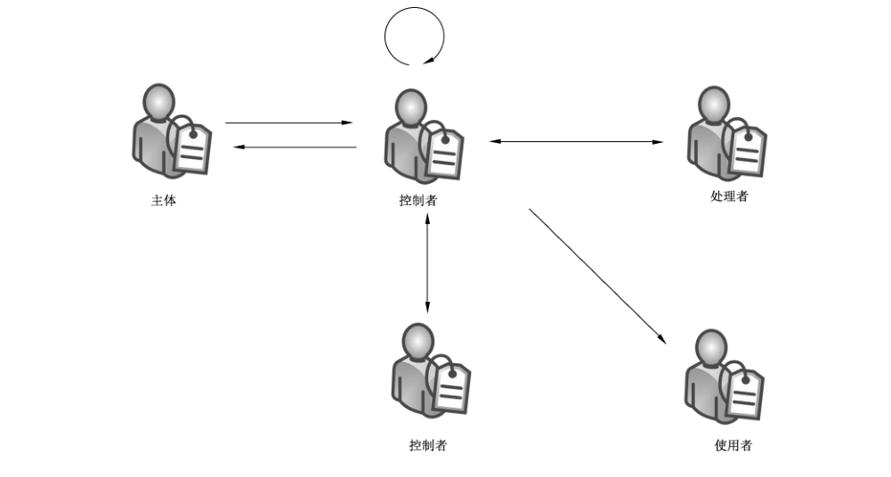
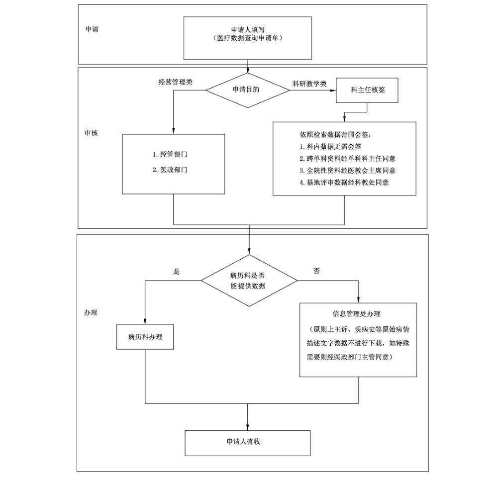

# GB/T 39725-2020 信息安全技术 健康医疗数据安全指南

> 来源：[GB/T 39725-2020 国家标准详情](https://openstd.samr.gov.cn/bzgk/std/newGbInfo?hcno=239351905E7B62A7DF537856738247CE)。
> PDF SHA-256：b60740d13d41c78c973e031a8840b53b0db6fcba18c40c97609c6292e7411654。
> 转写说明：逐页对照官方 PDF 的 69 页图像校核文字、跨页表格和 2 幅图示；合并跨页内容，省略封面、目录、页眉和页码。发布日期：2020-12-14；实施日期：2021-07-01。正式引用请核对官方原件。

## 前言

本标准按照 GB/T 1.1—2009给出的规则起草。

本标准由全国信息安全标准化技术委员会（SAC/TC 260）提出并归口。

本标准起草单位：清华大学、北京清华长庚医院、中国网络安全审查技术与认证中心、中电数据服务有限公司、中国电子技术标准化研究院、上海市儿童医院、深圳市腾讯计算机系统有限公司、山东国数爱健康大数据有限公司、东软集团股份有限公司、零氪科技（北京）有限公司、阿里巴巴（北京）软件服务有限公司、泰康保险集团股份有限公司、中国平安保险（集团）股份有限公司、北京邮电大学、四川大学、中国信息安全测评中心、北京天融信网络安全技术有限公司、上海市方达律师事务所、中国软件评测中心、中南大学、启明星辰信息技术集团股份有限公司、中国中医科学院、湖南科创信息技术股份有限公司、奇安信科技集团股份有限公司、陕西省信息化工程研究院、北京数字认证股份有限公司、中电长城网际系统应用有限公司、颐信科技有限公司、浙江蚂蚁小微金融服务集团股份有限公司、北京协和医院。

本标准主要起草人：金涛、刘海一、王建民、董家鸿、左晓栋、张剑、刘贤刚、屈劲、于广军、赵冉冉、袁耀文、傅兴良、杨浩、来子祺、苏凌云、叶晓俊、陶蓉、于惊涛、马诗诗、王枞、殷晋、付嵘、王龑、张毅、姚建伟、陈先来、谢安明、文天才、肖国荣、周亚超、郭颖、张勇、宋玲娓、闵京华、洪延青、程瑜琦、王昕、孟晓阳、罗妍。

## 引言

健康医疗数据包括个人健康医疗数据以及由个人健康医疗数据加工处理之后得到的健康医疗相关数据。随着健康医疗数据应用、“互联网+医疗健康”和智慧医疗的蓬勃发展，各种新业务、新应用不断出现，健康医疗数据在全生命周期各阶段均面临着越来越多的安全挑战，安全问题频发。由于健康医疗数据安全事关患者生命安全、个人信息安全、社会公共利益和国家安全，为了更好地保护健康医疗数据安全，规范和推动健康医疗数据的融合共享、开放应用，促进健康医疗事业发展，特制定健康医疗数据安全指南。

## 1 范围

本标准给出了健康医疗数据控制者在保护健康医疗数据时可采取的安全措施。

本标准适用于指导健康医疗数据控制者对健康医疗数据进行安全保护，也可供健康医疗、网络安全相关主管部门以及第三方评估机构等组织开展健康医疗数据的安全监督管理与评估等工作时参考。

## 2 规范性引用文件

下列文件对于本文件的应用是必不可少的。凡是注日期的引用文件，仅注日期的版本适用于本文件。凡是不标注日期的引用文件，其最新版本（包括所有的修改单）适用于本文件。

- GB/T 22080—2016 信息技术 安全技术 信息安全管理体系 要求
- GB/T 22081—2016 信息技术 安全技术 信息安全控制实践指南
- GB/T 22239—2019 信息安全技术 网络安全等级保护基本要求
- GB/T 25069 信息安全技术 术语
- GB/T 31168 信息安全技术 云计算服务安全能力要求
- GB/T 35273 信息安全技术 个人信息安全规范
- GB/T 35274—2017 信息安全技术 大数据服务安全能力要求
- GB/T 37964—2019 信息安全技术 个人信息去标识化指南
- ISO 80001 整合医疗设备的网络风险管理的应用（Application of risk management for IT-networks incorporating medical devices）

## 3 术语和定义

GB/T 25069界定的以及下列术语和定义适用于本文件。

### 3.1 个人健康医疗数据 personal health data

单独或者与其他信息结合后能够识别特定自然人或者反映特定自然人生理或心理健康的相关电子数据。

> 注：个人健康医疗数据涉及个人过去、现在或将来的身体或精神健康状况、接受的医疗保健服务和支付的医疗保健服务费用等，参见附录 A。

### 3.2 健康医疗数据 health data

个人健康医疗数据以及由个人健康医疗数据加工处理之后得到的健康医疗相关电子数据。

示例：经过对群体健康医疗数据处理后得到的群体总体分析结果、趋势预测、疾病防治统计数据等。

### 3.3 健康医疗专业人员 health service professional

经政府或行业组织授权有资格履行特定健康医疗工作职责的人员。

示例：医生。

### 3.4 健康医疗服务 health service

由健康医疗专业人员或专业辅助人员提供的对健康状况有影响的服务。

### 3.5 健康医疗数据控制者 health data controller

能够决定健康医疗数据处理目的、方式及范围等的组织或个人。

示例：提供健康医疗服务的组织、医保机构、政府机构、健康医疗科学研究机构、个体诊所等。

### 3.6 健康医疗信息系统 health information system

以计算机可处理的形式采集、存储、处理、传输、访问、销毁健康医疗数据的系统。

### 3.7 受限制数据集 limited data set

经过部分去标识化处理，但仍可识别相应个人并因此需要保护的个人健康医疗数据集。

示例：从健康医疗数据中删除与个人及其家属、家庭成员和雇主直接相关的标识。

> 注：受限制数据集可在未经个人授权的情形下用于科学研究、医学/健康教育、公共卫生目的。

### 3.8 治疗笔记 notes of treatment

健康医疗专业人员在提供健康医疗服务过程中记录的观察、思考、方案探讨、结论等内容。

> 注：治疗笔记具有知识产权属性，其知识产权归健康医疗专业人员和/或其单位所有。

### 3.9 披露 disclosure

将健康医疗数据向特定个人或组织进行转让、共享，以及向不特定个人、组织或社会公开发布的行为。

### 3.10 临床研究 clinical research

以患者或健康人为研究对象，由医疗机构、学术研究机构和/或医疗健康相关企业发起的，以探索疾病原因、预防、诊断、治疗和预后为目的的科学研究活动。

> 注：临床研究属于医学研究的一个分支。

### 3.11 完全公开共享 completely public sharing

数据一旦发布，很难召回，一般通过互联网直接公开发布。

［GB/T 37964—2019，定义3.12］

### 3.12 受控公开共享 controlled public sharing

通过数据使用协议对数据的使用进行约束。

［GB/T 37964—2019，定义3.13］

### 3.13 领地公开共享 enclave public sharing

在物理或者虚拟的领地范围内共享，数据不能流出到领地范围外。

［GB/T 37964—2019，定义 3.14］

## 4 缩略语

下列缩略语适用于本文件。

ACL：访问控制列表（Access Control Lists）

API：应用程序接口（Application Programming Interface）

APP：应用（Application）

DNA：脱氧核糖核酸（DeoxyriboNucleic Acid）

EDC：电子数据采集（Electronic Data Capture）

GCP：临床试验规范标准（Good Clinical Practice）

HIS：医院信息系统（Hospital Information Systems）

HIV：艾滋病病毒（Human Immunodeficiency Virus）

HL7：医疗第七层（Healthcare Level 7）

ID：身份标识（Identity）

IP：互联网协议（Internet Protocol）

IPSEC：网际协议安全（Internet Protocol Security）

LDS：受限制数据集（Limited Data Set Files）

PIN：个人识别号码（Personal Identity Number）

PUF：公用数据集（Public Use Files）

RIF：可标识数据集（Research Identifiable Files）

RNA：核糖核酸（RiboNucleic Acid）

SQL：结构化查询语言（Structured Query Language）

TLS：传输层安全（Transport Layer Security）

USB：通用串行总线（Universal Serial Bus）

VPN：虚拟专用网络（Virtual Private Network）

XSS：跨站点脚本（cross-site scripting）

## 5 安全目标

健康医疗数据控制者宜采取合理和适当的管理与技术保障措施，以达到以下目标：

a） 确保健康医疗数据的保密性、完整性和可用性；

b） 确保健康医疗数据使用和披露过程的合法性和合规性，保护个人信息安全、公众利益和国家安全；

c） 确保健康医疗数据在符合上述安全要求的前提下满足业务发展需求。

## 6 分类体系

### 6.1 数据类别范围

健康医疗数据可以分为：

a） 个人属性数据是指单独或者与其他信息结合能够识别特定自然人的数据。

b） 健康状况数据是指能反映个人健康情况或同个人健康情况有着密切关系的数据。

c） 医疗应用数据是指能反映医疗保健、门诊、住院、出院和其他医疗服务情况的数据。

d） 医疗支付数据是指医疗或保险等服务中所涉及的与费用相关的数据。

e） 卫生资源数据是指那些可以反映卫生服务人员、卫生计划和卫生体系的能力与特征的数据。

f） 公共卫生数据是指关系到国家或地区大众健康的公共事业相关数据。

各类数据具体内容如表1所示。在卫生信息领域使用的数据元、数据集、值域代码等相关标准可参考附录B。

**表1 健康医疗数据类别与范围**

| 数据类别 | 范围 |
| --- | --- |
| 个人属性数据 | 1）人口统计信息，包括姓名、出生日期、性别、民族、国籍、职业、住址、工作单位、家庭成员信息、联系人信息、收入、婚姻状态等； 2）个人身份信息，包括姓名、身份证、工作证、居住证、社保卡、可识别个人的影像图像、健康卡号、住院号、各类检查检验相关单号等； 3）个人通讯信息，包括个人电话号码、邮箱、账号及关联信息等； 4）个人生物识别信息，包括基因、指纹、声纹、掌纹、耳廓、虹膜、面部特征等； 5）个人健康监测传感设备 ID 等。 |
| 健康状况数据 | 主诉、现病史、既往病史、体格检查（体征）、家族史、症状、检验检查数据、遗传咨询数据、可穿戴设备采集的健康相关数据、生活方式、基因测序、转录产物测序、蛋白质分析测定、代谢小分子检测、人体微生物检测等。 |
| 医疗应用数据 | 门（急）诊病历、住院医嘱、检查检验报告、用药信息、病程记录、手术记录、麻醉记录、输血记录、护理记录、入院记录、出院小结、转诊（院）记录、知情告知信息等。 |
| 医疗支付数据 | 1）医疗交易信息，包括医保支付信息、交易金额、交易记录等； 2）保险信息，包括保险状态、保险金额等。 |
| 卫生资源数据 | 医院基本数据、医院运营数据等。 |
| 公共卫生数据 | 环境卫生数据、传染病疫情数据、疾病监测数据、疾病预防数据、出生死亡数据等。 |

### 6.2 数据分级划分

根据数据重要程度、风险级别以及对个人健康医疗数据主体可能造成的损害和影响的级别进行分级，可将健康医疗数据划分为以下5级：

a）第1级：可完全公开使用的数据。包括可以通过公开途径获取的数据，例如医院名称、地址、电话等，可直接在互联网上面向公众公开。

b）第2级：可在较大范围内供访问使用的数据。例如不能标识个人身份的数据，各科室医生经过申请审批可以用于研究分析。

c） 第3级：可在中等范围内供访问使用的数据，如果未经授权披露，可能对个人健康医疗数据主体造成中等程度的损害。例如经过部分去标识化处理，但仍可能重标识的数据，仅限于获得授权的项目组范围内使用。

d） 第4级：在较小范围内供访问使用的数据，如果未经授权披露，可能会对个人健康医疗数据主体造成较高程度的损害。例如可以直接标识个人身份的数据，仅限于参与诊疗活动的医护人员访问使用。

e） 第5级：仅在极小范围内且在严格限制条件下供访问使用的数据，如果未经授权披露，可能会对个人健康医疗数据主体造成严重程度的损害。例如特病种（例如艾滋病、性病）的详细资料，仅限于主治医护人员访问且需要进行严格管控。

### 6.3 相关角色分类

针对特定数据特定场景，相关组织或个人可划分为以下四类角色。对任何组织或个人，围绕特定数据，在特定场景或特定的数据使用处理行为上，其只能归为其中一个角色。

a） 个人健康医疗数据主体（以下简称“主体”）：个人健康医疗数据所标识的自然人。

b） 健康医疗数据控制者（以下简称“控制者”）：详见定义3.5，判断组织或个人能否决定健康医疗数据的处理目的、方式及范围，可以考虑：

1） 该项健康医疗数据处理行为是否属于该组织或个人履行某项法律法规所必需；

2） 该项健康医疗数据处理行为是否该组织或个人行使其公共职能所必需；

3） 该项健康医疗数据处理行为是否由该组织或个人自行或与其他组织或个人共同决定；

4） 该项健康医疗数据处理行为是否由相关个人或者政府授权该组织或个人。

共同决定一项数据使用处理行为的目的、方式及范围等的组织或个人，为共同控制者。

c） 健康医疗数据处理者（以下简称“处理者”）：代表控制者采集、传输、存储、使用、处理或披露其掌握的健康医疗数据，或为控制者提供涉及健康医疗数据的使用、处理或者披露服务的相关组织或个人。常见的处理者有：健康医疗信息系统供应商、健康医疗数据分析公司、辅助诊疗解决方案供应商等。

d） 健康医疗数据使用者（以下简称“使用者”）：针对特定数据的特定场景，不属于主体，也不属于控制者和处理者，但对健康医疗数据进行利用的相关组织或个人。

### 6.4 流通使用场景

基于不同角色之间的数据流动，数据流通使用场景可分为以下6类，如图1所示。

a） 主体-控制者间数据流通使用；

b） 控制者-主体间数据流通使用；

c） 控制者内部数据流通使用；

d） 控制者-处理者间数据流通使用；

e） 控制者间数据流通使用；

f） 控制者-使用者间数据流通使用。

### 6.5 数据开放形式

数据公开共享类型可划分为完全公开共享、受控公开共享、领地公开共享，对应的去标识化要求不同，按照GB/T 37964—2019的规定处理。常见的数据开放形式及其适用的公开共享类型详见表2。

**表2 常见数据开放形式**

| 开放形式 | 说明 | 适用公开共享类型 |
| --- | --- | --- |
| 网站公开 | 统计概要类数据或经匿名处理后的数据，向大众开放，可自行下载分析 | 完全公开共享 |
| 文件共享 | 由数据系统生成文件并推送至 SFTP 接口设备或应用系统，或采用移动介质进行共享 | 受控公开共享 |
| API 接入 | 系统之间通过请求响应方式提供数据，由数据系统提供实时或准实时面向特定用户的数据服务应用接口，需求方系统发起请求，数据系统返回所需数据，例如通过 WebService 接口 | 受控公开共享 |
| 在线查询 | 在数据系统提供的功能页面上查询相关数据 | 完全公开共享（匿名查询）；受控公开共享（用户查询） |
| 数据分析平台 | 提供系统环境、分析挖掘工具以及去标识后的样本数据或模拟数据。平台用户共享或者专用硬件和数据资源，可以部署自有数据和数据分析算法，可以查询权限内的数据和分析结果。平台所有原始数据不能导出；分析结果的输出、下载必须经审核通过后才能对外输出 | 领地公开共享 |

## 7 使用披露原则

控制者在使用或披露健康医疗数据的过程中，宜遵循以下原则：

a） 控制者在使用或披露个人健康医疗数据时，宜告知主体并获得主体的授权（以下b）中情况除外）；所有告知宜使用通俗易懂的语言，并且包含要披露或使用的数据内容、数据的接收方、数据的用途以及使用方式、数据使用期限、数据主体权利以及控制者采取的保护措施等具体信息。使用或披露个人健康医疗数据不能超出个人授权范围。因业务需要，确需超出范围使用或披露的，宜再次征得主体同意。

b） 控制者在没有获得主体的授权，在以下情况可以使用或披露相应个人健康医疗数据：

1） 向主体提供其本人健康医疗数据时；

2） 治疗、支付或保健护理时；

3） 涉及公共利益或法律法规要求时；

4） 受限制数据集用于科学研究、医学/健康教育、公共卫生目的时；

在上述情况下，控制者可依靠法律法规要求、职业道德、伦理和专业判断来确定哪些个人健康医疗数据允许被使用或披露。

c） 控制者宜获得主体授权才能使用或披露个人健康医疗数据进行市场营销活动，但控制者与主体之间进行面对面的营销沟通除外。用于市场营销活动的授权宜以合理方式提示主体，并让其充分知悉，明确、自主做出同意。该授权宜是独立的，不宜作主体获得任何公共服务、医疗服务的前置条件或者捆绑于其他服务条款之中。控制者在取得授权的同时，宜书面告知主体其有权随时撤销该授权。

d） 主体（或其授权代表）有权访问其个人健康医疗数据或要求披露其数据，控制者宜按其要求披露相应个人健康医疗数据。

e） 主体有权复查并获得其个人健康医疗数据的副本，控制者宜提供，例如通过文件共享或者在线查询方式提供。

f） 主体发现控制者所持有的该主体的个人健康医疗数据不准确或不完整时，控制者宜为其提供请求更正或补充信息的方法。

g） 主体有权对控制者或其处理者使用或披露数据的情况进行历史回溯查询，最短回溯期为六年。

h） 主体有权要求控制者在诊断、治疗、支付、健康服务等过程中限制使用或披露其个人健康医疗数据，以及限制向相关人员披露信息，控制者没有义务同意上述限制请求；但一旦同意，除非法律法规要求以及医疗紧急情况下，控制者宜遵守约定的限制。

i） 控制者可以使用治疗笔记用于治疗，在进行必要的去标识化处理后，可以在未经个人授权的情况下使用或披露治疗笔记进行内部培训和学术研讨。

j） 控制者宜制定、实施合理的策略与流程，将使用和披露限制在最低限度。

k） 控制者宜确认处理者的安全能力满足安全要求，并签署数据处理协议后，才能让处理者为其进行数据处理，处理者宜按照控制者的要求处理数据，未经控制者许可，处理者不能引入第三方协助处理数据。

l） 控制者向政府授权的第三方控制者提供数据前，宜获得加盖政府公章的相关文件，数据提供后，数据安全责任以及传输通道的安全责任由第三方控制者承担。

m）控制者在确认数据使用的合法性、正当性和必要性，并确认使用者具备相应数据安全能力，且使用者签订了数据使用协议并承诺保护受限制数据集中的个人健康医疗数据后，可将受限制数据集用于科学研究、医疗保健业务、公共卫生等目的；使用者只能在协议约定的范围内使用数据并承担数据安全责任，在使用数据完成后，宜按照控制者要求归还、彻底销毁或者进行其他处理。未经控制者许可，使用者不能将数据披露给第三方。

n） 如果控制者针对个人健康医疗数据汇聚分析处理之后得到了不能识别个人的健康医疗相关数据，该数据不再属于个人信息，但其使用和披露宜遵守国家其他相关法规要求。

o） 控制者因为学术研讨需要，需要向境外提供相应数据的，在进行必要的去标识化处理后，经过数据安全委员会讨论审批同意，数量在250条以内的非涉密非重要数据可以提供，否则宜提请相关部门审批。

p） 不涉及国家秘密、重要数据或者其他禁止或限制向境外提供的数据，经主体授权同意，并经数据安全委员会讨论审批同意，控制者可向境外目的地提供个人健康医疗数据，累计数据量宜控制在250条以内，否则宜提请相关部门审批。

q） 控制者不宜将健康医疗数据在境外的服务器中存储，不托管、租赁在境外的服务器。

r） 控制者对外进行数据合作开发利用时，宜采用“数据分析平台”开放形式，对数据使用披露进行严格管控。

## 8 安全措施要点

### 8.1 分级安全措施要点

可以根据数据保护的需要进行数据分级，对不同级别的数据实施不同的安全保护措施，重点在于授权管理、身份鉴别、访问控制管理。例如，从个人信息安全风险角度划分的数据分级和安全措施要点如表3所示。医生调阅场景下的数据分级及安全措施详见11.1。临床研究场景下的数据分级及安全措施详见11.3。

**表3 从个人信息安全风险出发的数据分级与安全措施要点**

| 数据分级 | 数据特点 | 适用场合 | 特征与案例 | 安全措施要点 |
| --- | --- | --- | --- | --- |
| 第1级 | 业务要求：可公开发布 数据内容：某些统计值 数据使用者：大众 | 公告 | 需要公众了解，例如剩余床位信息、剩余可就诊号源信息 | 是否可以公开需要评审 |
| 第2级 | 业务要求：不需要识别个人 数据内容：一般人口信息、各类医疗、卫生服务信息 数据使用者：科研教育等人员 | 管理、研究、教育与统计分析 | 不需要识别个人，例如病例分析、各类病种分布统计、流行病研究、疾病队列研究等。场景举例：临床研究、医学健康教育、药品/医疗器械研发 | 宜进行去标识化处理，通过协议或领地公开共享模式管控，宜确保数据的完整性和真实性 |
| 第3级 | 业务要求：服务对象个人可识别，周边人不易识别 数据内容：部分个人可识别信息或代码，与其他信息内容分离，例如张××、排队序号等 数据使用者：局部小范围人群 | 服务对象告知 | 在公开场合通知服务对象，例如门诊叫号、检查叫号、体检服务叫号等 | 个人信息需部分遮蔽，环境与接收人数量受到限制 |
| 第4级 | 业务要求：必须准确识别个人 数据内容：包含完整准确的个人健康医疗数据 数据使用者：比较小范围人员，有审计和保护隐私义务 | 个性化服务与管理 | 必须准确识别个人，例如针对个人的医疗服务、卫生健康服务、传染病管控、基因组测序等。场景举例：医院互联互通、远程医疗、健康传感数据管理、移动应用、商业保险对接 | 由于涉及个人标识信息，环境与接收人宜严格管控，宜高标准保证数据完整性和可用性 |
| 第5级 | 业务要求：特殊疾病诊疗所必须 数据内容：特殊病种详细资料 数据使用者：极小范围人员，有审计、有保密义务 | 特殊疾病诊疗 | 疾病极其敏感，例如艾滋病等 | 严格的身份鉴别、访问控制等措施 |

### 8.2 场景安全措施要点

基于数据流通使用场景的不同，各角色在健康医疗数据使用过程中所涉及的安全环节与责任不同，由此决定了各角色需要满足的安全控制要求不同。各角色在不同应用场景和安全环节宜承担的安全责任和安全措施要点如表4所示，针对常见场景需要重点关注的安全措施详见第11 章。

**表4 数据使用安全责任与安全措施要点**

| 场景分类 | 安全环节 | 安全责任与安全措施要点 | 场景与用户举例 |
| --- | --- | --- | --- |
| 主体-控制者间数据流通 | 采集安全 | 控制者：采集数据知情同意 | 场景举例：医生调阅、健康传感、移动应用 主体：个人 控制者：医疗机构、科研机构、医保机构、商业保险公司、健康服务企业 |
| 主体-控制者间数据流通 | 传输安全 | 控制者：加密、存储介质管控 |  |
| 主体-控制者间数据流通 | 存储安全 | 控制者：境内存储、加密、分类分级、去标识化、备份恢复、存储介质管控 |  |
| 控制者-主体间数据流通 | 传输安全 | 控制者：加密、存储介质管控 | 场景举例：患者查询 主体：个人 控制者：医疗机构 |
| 控制者-主体间数据流通 | 使用安全 | 控制者：身份鉴别、访问控制、敏感数据控制 |  |
| 控制者内部数据使用 | 收集安全 | 控制者：收集数据知情同意、审批 | 场景举例：内部数据使用 控制者：医疗机构 |
| 控制者内部数据使用 | 处理安全 | 处理者：去标识化、权限管理、质量管理、元数据管理 |  |
| 控制者内部数据使用 | 使用安全 | 控制者：审批授权、身份鉴别、访问控制、审计 |  |
| 控制者内部数据使用 | 存储安全 | 控制者：境内存储、加密、分类分级、去标识化、备份恢复、存储介质管控 |  |
| 控制者-处理者间数据流通 | 传输安全 | 控制者：传输前的审查、评估、授权；加密、审计、流量控制、存储介质管控 处理者：数据传输加密、传输方式控制 | 场景举例：医疗器械维护 控制者：医疗机构、政府机构 处理者：科研机构、健康医疗信息服务企业、医疗器械厂商 |
| 控制者-处理者间数据流通 | 处理安全 | 处理者：去标识化、权限管理、质量管理、元数据管理、审计 |  |
| 控制者-处理者间数据流通 | 存储安全 | 控制者：境内存储、加密、分类分级、去标识化、备份恢复、存储介质管控、管理处理者数据存储过程 处理者：境内存储、加密、分类分级、去标识化、备份恢复、存储介质管控、销毁机制 |  |
| 控制者间数据流通 | 传输安全 | 控制者 A：对接安全、加密、审计、流量控制、存储介质管控 控制者 B：对接安全、加密、审计、流量控制、存储介质管控 | 场景举例：互联互通、远程医疗 控制者：政府机构、医疗机构、医保机构 |
| 控制者间数据流通 | 使用安全 | 控制者 A：审批授权、身份鉴别、访问控制、审计 控制者 B：审批授权、身份鉴别、访问控制、审计 |  |
| 控制者间数据流通 | 存储安全 | 控制者 A：境内存储、加密、分类分级、去标识化、备份恢复、存储介质管控、销毁机制 控制者 B：境内存储、加密、分类分级、去标识化、备份恢复、存储介质管控、销毁机制 |  |
| 控制者-使用者间数据流通 | 传输安全 | 控制者：传输前的审查、评估、授权；加密、审计、流量控制、存储介质管控 | 场景举例：商业保险对接、临床研究、二次利用 控制者：医疗机构 使用者：商业保险公司、科研机构 |
| 控制者-使用者间数据流通 | 使用安全 | 使用者：审批授权、身份鉴别、访问控制、审计 |  |
| 控制者-使用者间数据流通 | 存储安全 | 控制者：境内存储、加密、分类分级、去标识化、备份恢复、存储介质管控、管理使用者数据存储过程 使用者：境内存储、加密、分类分级、去标识化、备份恢复、存储介质管控、销毁机制 |  |

> 注：在数据实际应用场景中，存在一个控制者对应多个流通使用场景的情况，此时需参照多个数据流通使用场景实施安全措施。

### 8.3 开放安全措施要点

不同数据开放形式均宜：

a） 遵循“最少必要原则”；

b） 数据开放的目的、内容、使用方等经过数据安全委员会审批，确保符合合法性、正当性和必要性的要求；

c） 根据使用目的尽可能地去标识化；

d） 明确数据开发和使用目的、使用方需要承担的安全责任、安全措施等，并签署相应的协议；

涉及出境的宜依规进行安全评估，涉及重要数据的宜依规进行评估审批。

此外，不同数据开放形式还需要满足的安全措施要点详见表5所示。

**表5 不同数据开放形式安全措施要点**

| 数据开放形式 | 安全措施要点 |
| --- | --- |
| 网站公开 | 公开数据宜经过数据安全委员会审批 |
| 文件共享 | 1）宜采用密码技术保障数据完整性和可追溯性； 2）宜对文件的大小、内容、生成时间等进行审计； 3）通过移动介质传输的数据宜采用具有加密或访问控制的移动介质方案 |
| API 接入 | 1）宜采用口令、密码技术、生物技术等鉴别技术对接入用户进行身份鉴别； 2）宜采用校验技术或密码技术保证通信过程中的数据完整性，并通过加密等方式保证数据在传输过程中的保密性，加密技术的选择宜考虑应用场景、数据规模、效率要求等方面； 3）宜对 API 的调用情况进行日志审计，包括但不限于调用方、调用时间、调用接口名称、调用结果等； 4）宜采取 WEB 安全措施防止 SQL 注入、XSS、爆破密码等攻击措施 |
| 在线查询 | 1）匿名可查询的数据经过数据安全委员会审批，确保不涉及个人信息、重要数据等； 2）宜采用口令、密码技术、生物技术等鉴别技术对查询用户进行身份鉴别； 3）宜采用校验技术或密码技术保证通信过程中的数据完整性，并通过加密等方式保证数据在传输过程中的保密性，加密技术的选择宜考虑应用场景、数据规模、效率要求等方面； 4）宜对查询的数据量、查询次数和查询时间进行审计，形成异常报告； 5）宜对批量查询操作进行监控，发现高频查询及时告警； 6）宜采取 WEB 安全措施防止 SQL 注入、XSS、爆破密码等攻击措施 |
| 数据分析平台 | 1）任何分析结果的导出宜经过数据安全委员会审批； 2）宜对平台的访问进行权限管理，包括访问权限和数据使用权限； 3）数据分析平台的数据操作宜具备留痕和溯源功能； 4）导出数据或者结果留存备案待审计 |

## 9 安全管理指南

### 9.1 概述

控制者为实现第5章所述安全目标，宜按照 GB/T 22080—2016 要求，参照第6章进行数据分类分级和场景分析，分析健康医疗数据安全面临的风险，有针对性地采取安全措施，并对实施措施后的效果进行检查，持续改进。

控制者可参照附录C建立数据使用管理办法，参照附录 D对数据申请进行审批，参照附录E与处理者（使用者）签署数据处理（使用）协议，参照附录F进行自查。

### 9.2 组织

宜建立完善的组织保障体系，组织架构中至少包括健康医疗数据安全委员会和健康医疗数据安全工作办公室，以确保做好健康医疗数据安全管理工作，并形成相应的文档记录，包括但不限于：

a） 建立健康医疗数据安全委员会（简称委员会），对健康医疗数据安全工作全面负责，讨论决定健康医疗数据安全重大事项，委员会宜：

1） 包含组织高层管理人员和各业务口负责人等；

2） 涵盖信息安全、伦理、法律、统计、审计、保密等相关专业人员；

3） 由组织最高负责人担任主任委员；

4） 可依托现有的伦理委员会、院务会等，不必重新建立；

5） 协调配置健康医疗数据安全工作必要的人力、物力、资金等资源，例如基于权限分离的原则，配备安全管理员、安全审计员、系统管理员等；

6） 负责审核健康医疗数据安全策略、风险评估方案、合规评估方案、风险处置方案和应急处置方案；

7） 负责审核数据安全相关规章制度（例如数据使用审批流程）；

8） 负责审核去标识化策略和流程；

9） 定期召开工作会议，建议每月至少召开一次。

b） 建立健康医疗数据安全工作办公室，指定专人（例如数据安全官）负责健康医疗数据安全日常工作：

1） 负责落实执行健康医疗数据安全委员会的各项决定，并向委员会报告工作；

2） 负责制定、维护和更新健康医疗数据安全策略、风险评估方案、合规评估方案、风险处置方案和应急处置方案；

3） 负责建立、维护和更新数据安全相关规章制度；

4） 负责制定、维护和更新数据使用审批流程，以及去标识化策略和流程；

5） 梳理业务流程及涉及的健康医疗信息系统和数据，并进行安全风险分析和合规分析，提出健康医疗数据安全工作建议；

6） 形成并管理好元数据结构，形成符合业务流程的数据和系统供应链结构；

7） 负责人员的数据安全教育与培训，确保相关人员具备相应数据安全能力；

8） 至少每年对健康医疗数据安全工作进行全面自查，并做出整改建议；

9） 审计健康医疗数据使用情况，并适时调整改进安全措施；

10） 监测预警健康医疗数据安全状态，并适时调整改进安全措施。

### 9.3 过程

#### 9.3.1 规划

规划阶段主要工作如下，各项工作宜形成相应文档记录。

a） 界定健康医疗数据安全工作范围，确定工作目标，建立工作计划；

b） 建立健康医疗数据安全策略并通告全组织；

c） 建立健康医疗数据安全相关规章制度并通告全组织；

d） 建立健康医疗数据安全风险评估方案和合规评估方案；

e） 梳理健康医疗数据相关业务及涉及的系统和数据；

f） 识别健康医疗数据安全风险并评估影响；

g） 识别健康医疗数据安全合规风险点并评估影响；

h） 针对风险建立风险处置方案；涉及数据使用披露的，宜按照第7章“使用披露要求”处置；涉及网络和系统安全的，宜按照 GB/T 22081—2016、GB/T 22239—2019进行处置；涉及基础安全和数据服务安全的，宜按照 GB/T 35274—2017 进行处置；涉及云计算安全的，宜按照GB/T 31168进行处置；

i） 评审并通过风险处置方案；

j） 建立数据安全应急处置方案。

#### 9.3.2 实施

实施阶段主要工作如下，各项工作宜形成相应文档记录。

a） 健康医疗数据使用和披露过程中，各个环节宜严格执行既定数据安全相关规章制度、安全策略和流程；

b） 实施风险处置方案，包括实施选定的安全措施；

c） 配备适当的资源，包括人力、物力、资金，支撑安全工作开展；

d） 开展必要的信息安全教育和培训；

e） 对开展的信息安全工作和投入信息安全工作的各项资源实施有效地管控；

f） 针对信息安全事件采取有效应对措施。

#### 9.3.3 检查

检查阶段主要工作如下，各项工作宜形成相应文档记录。

a） 监控健康医疗数据安全相关工作过程，例如安全措施实施过程；

b） 定期评审风险处置方案的实施有效性，包括评估相应措施在实施后剩余风险的可接受程度等；

c） 定期检查健康医疗数据使用披露是否符合第7章“使用披露要求”；

d） 定期检查是否按照第10章进行了安全技术工作和去标识化工作；

e） 检查过程纳入组织的内部管理；

f） 根据情况实施自查，或是请第三方机构进行检查。

#### 9.3.4 改进

改进阶段主要工作如下，各项工作宜形成相应文档记录。

a） 针对监控或检查结果改进安全措施，包括采取预防性措施，或是调整可能影响健康医疗数据安全的业务活动内容；

b） 建立整改计划，并按计划实施。

### 9.4 应急处置

应急处置主要工作如下，各项工作宜形成相应文档记录。

a） 建立应急预案，包括启动应急预案的条件、应急处理流程、系统恢复流程、事件报告流程、事后教育和培训等内容。宜对网络安全应急预案定期进行评估修订，每年至少组织1次应急演练。

b） 宜指定专门数据安全应急支撑队伍、专家队伍，保障安全事件得到及时有效处置。

c） 宜制定灾难恢复计划，确保健康医疗信息系统能及时从网络安全事件中恢复，并建立安全事件追溯机制。

d） 在数据安全事件发生后，宜按应急预案进行处置；事件处置完成后及时按规定向安全保护工作部门书面报告事件情况，内容宜至少包括：事件描述、原因和影响分析、处置方式等信息。

e）宜根据检测评估、监测预警中发现的安全问题及处置结果开展综合评估，必要时重新开展风险识别，并更新安全策略。

## 10 安全技术指南

### 10.1 通用安全技术

控制者宜按照 GB/T 22081—2016、GB/T 22239—2019、GB/T 31168 和 GB/T 35274—2017等做好数据安全管理工作。

a） 宜对承载健康医疗数据的信息系统和网络设施以及云平台等进行必要的安全保护。

b）宜针对数据生命周期内的各项活动，包括数据采集、数据传输、数据存储、数据处理、数据交换、数据销毁等实施数据安全措施，以降低安全风险，保障数据安全。

c） 宜围绕规划、开发、部署、运维等系统生命周期各阶段特点，对数据平台与应用采取必要的安全措施，建立安全的数据管理基础设施，降低数据平台与应用运行安全风险，保障业务连续性。

d） 宜对健康医疗数据进行分类分级管理，制定、实施合理的策略与流程，将使用和披露限制在最低限度。

e） 宜实施身份鉴别、访问控制、安全审计、入侵防范、恶意代码防范、介质使用管理等安全措施。

f） 宜确保数据质量满足业务需求，实施备份恢复，剩余信息保护等安全措施。

g） 宜采用密码技术保证数据在采集、传输和存储过程中的完整性、保密性、可追溯性；使用介质传输的，宜对介质实施管控。

h） 存储个人生物识别信息时，宜采用技术措施处理后再进行存储，例如仅存储个人生物识别信息的摘要。

i） 密码技术使用宜符合国家密码管理相关要求。

j） 宜符合重要数据管理、关键信息基础设施安全管理等政策的相关通用要求。

### 10.2 去标识化

控制者宜按照 GB/T 37964—2019开展去标识化工作，去标识化的数据宜应用于受控公开共享或领地公开共享（控制者完全控制的环境），宜通过数据使用协议约定数据使用目的、方式、期限、安全保障措施等。去标识化策略、流程和结果宜由数据安全委员会审批。数据应用于临床研究和医药/医疗研发时，相关要求如下：

a） 宜去除个人属性数据中可唯一识别到个人的信息或披露后会给个人造成重大影响的信息，例如：姓名；身份证/驾照等证件号；电话号码、传真、电子邮件；医疗保险号、病历档案号、账户；生物识别信息（指纹、声音等与应用目的无关的信息）；照片；爱好、信仰等。

b） 个人属性数据中可间接关联到个人的信息，宜进行泛化、转换等处理，例如：

1） 单位、地址、邮政编码等信息，如果单位信息或与其他信息组合后覆盖的人群在2万人以上，可以保留单位信息；如果地址信息包括省（直辖市）、市（县）、街道（乡镇）或与其他信息组合后覆盖的人群在2万人以上，可以保留，否则宜去除街道（乡镇），保证组合覆盖的人群在2万人以上；如果邮编信息或与其他信息组合覆盖的人群在2万以上，可以保留，否则宜将邮编低位设置为‘0’，保证可以覆盖的人群在2万以上。

2） 对具体年龄进行泛化处理，例如给出一个年龄范围。例如：38岁可以转换成30~40岁，确保同区域内满足相同年龄条件的人数在2万人以上。

3） 生日及其他所有日期信息，例如：入院时间、出院时间，只能具体到年，或者进行时间漂移处理。

c） 宜删除医护人员姓名以及其他身份标识信息。

d） 数据集中所有属性值相同的人数最低宜在5人以上。

e） 对需要追溯到患者的情况，宜由控制者内部建立患者代码索引。

f） 去标识化过程中使用的各种参数配置，例如时间漂移范围、患者代码索引、各种个人代码生成规则等宜严格保密，仅限于控制者内部专人管理。

g） 在需要进行重标识确定主体时，宜由控制者内部专人处理，处理过程严格保密。

h）宜禁止使用者参与去标识化相关工作。

i） 宜签署数据使用协议，约束数据的使用目的、期限以及数据保护措施等。

j） 在受控公开共享模式下，使用者宜记录数据使用情况，并接受控制者审计。

相关示例如表6所示。卫生信息数据元的标识符类别及建议的去标识化方法可参考附录G。

**表6 去标识化示例**

| 属性 | 去标识化方法建议 | 适用数据 |
| --- | --- | --- |
| 姓名 | 建议删除或置空 | 受试者姓名、医生姓名、研究者姓名、家庭成员姓名 |
| 联系方式 | 建议删除或置空或泛化。例如：住址只具体到市县级，隐藏县级以下地址 | 个人电话号码、邮箱、账号、住址 |
| 日期 | 建议采用“时间偏移方法”、转换法或泛化，例如：为不同研究项目定义不同的随机偏移量，通过日期时间 + 或 - 随机偏移量进行数据扰动，以实现数据的去标识化。 例如：入院日期 2018-01-01 + 随机偏移量 100 = 入院日期：2018-04-11。出院日期 2018-04-01 + 随机偏移量 100 = 出院日期：2018-07-10。出院日期 - 入院日期 = 90 天。通过该方法可以保证数据去标识化的同时保证计算逻辑正确。 转换法即用其与其他日期运算得到结果来替换，例如住院天数。 泛化只保留年月，甚至只保留年 | 医疗应用数据中能通过数据分析关联到个人的时间信息：例如入院日期、出院日期、手术日期等 |
| 出生日期 | 建议删除、置空或者替换为年龄 | 出生日期 |
| 年龄 | 建议采用“数据泛化”方法。例如：年龄 ≤89 或者 >89；年龄区间 <25、25～29、30～34、……、85～89、>89。注：>89 不能再继续细分 | 年龄 |
| 号码 | 建议删除或置空。如需要利用号码的唯一性进行逻辑分析，例如通过身份证号判断多份病历是否属于同一个人的场景，可采用基于原数据的随机化产生唯一标识进行替换。如需要利用邮编等隐含地理信息的号码，可采用扰动和泛化方法进行处理，例如：原始邮编记录 100080，去标识化后 100\*\*\* | 身份证号、社保卡号、工作证号、居住卡号 |
| 医疗机构内部所用号码 | 建议置换或删除。通过这些号码进行逻辑分析而需要保留的，可采用基于原数据的随机化产生唯一标识进行替换。如不需要这些号码进行逻辑分析，则删除这些号码 | 检验结果报告单号、检查报告单号、住院号、门（急）诊号等 |

## 11 典型场景数据安全

### 11.1 医生调阅数据安全

#### 11.1.1 概述

适用于医生在提供健康医疗服务过程中调阅相应患者数据的场景。医生所在的组织承担控制者角色，患者承担主体角色。

#### 11.1.2 重点安全措施

##### 11.1.2.1 数据分级

医生调阅场景下，数据可分为默认级、告知级、授权级，分别对应6.2中的第2级、第3级、第4级。

默认级资料，例如检验检查名称、就诊医院、就诊科室等。告知级资料，例如检验检查报告、手术记录、出院小结等小结报告类资料。授权级资料，例如住院详细病历等。此外，涉及特殊病种、特殊身份的资料均需授权或告知。

##### 11.1.2.2 角色定义

医生按职能范围可分为诊疗医生、本科室非诊疗组医生、其他科室医生等，按职称可分为住院医师、主治医师、主任医师等，不同角色的调阅权限不同，角色定义明晰，方可进行下一步的权限分配。

原则上，宜按所在科室、职称、诊疗组来定义角色类型。

a） 科室即不同诊疗科室，按照医院科室划分，例如消化科、心脏外科。

b） 职称表征医生的专业性及上下级关系，例如住院医师、主治医师、主任医师。

c） 诊疗组即科室内部的诊疗组划分，视医院科室的具体划分而定，不同诊疗组之间的患者管辖相对独立，例如普外科内部分为胃肠诊疗组、肝胆胰诊疗组等，若科室内部未划分则无需定义。

在医院互联互通场景下，医院需向汇聚中心上传科室组织架构情况（上下级关系及诊疗组），形成权限组。权限组的调整可下放到科室主任，上级医生可动态调配下级医生的诊疗组归属（考虑到诊疗组可能变动频繁，不增加医生工作负担），医院医务科负责日常审计。当人事状态或诊疗状态发生变更时，角色宜随之更新。

##### 11.1.2.3 数据标注

将数据按分级、颗粒度标注：

a）标注数据的分级，即定义标识符、特病种、特就诊身份，以供后期与相应角色的权限匹配。

1） 标识符：例如：姓名；身份证/驾照等证件号；电话号码、传真、电子邮件；医疗保险号、病历档案号、账户；生物识别信息（指纹、视网膜、声音、基因等）；照片；爱好、信仰等。

2） 特殊病种：性生殖相关疾病、传染性疾病、心理疾病、恶性肿瘤、遗传性疾病、肛门疾病、罕见病、其他不治之症等8类疾病。

3） 特殊身份：婴幼儿、孕产妇、恶性肿瘤患者等。

b） 标注特殊病种相关数据的颗粒度，不同详细程度资料的隐私级别不同，颗粒度分为以下三类。

1） 概要级资料：例如检验检查名称、就诊医院、就诊科室等。

2） 摘要级资料：例如检验检查报告、手术小结、住院小结、用药情况等小结报告类资料。

3） 详细级资料：例如住院详细病历等。

##### 11.1.2.4 权限分配

将医生的科室、职称、诊疗组与数据分级、颗粒度匹配：

a） 对于普通病种的资料，权限范围内医生均可调阅。

b） 对于特殊病种的资料，不同职称医生的权限不同。

c） 对于传染性疾病，考虑保护医务人员的原则，默认向接诊医护人员披露。

d） 每个医生仅可调阅自身管辖范围内患者的数据，上级医师可查看下级医师管辖范围内的患者数据。

权限分配示例如表7所示，同一医生满足多种角色时，其权限取并集。

**表7 角色权限示例表**

| 角色 | 权限 |
| --- | --- |
| 科室医生 | 仅可调阅本科室患者数据 |
| 住院医师 | 仅可调阅普通病种资料及概要级特病种资料 |
| 主治医师 | 仅可调阅普通病种资料及摘要级特殊病种资料 |
| 主任医师 | 可调阅普通病种资料及详细级特殊病种资料 |
| 诊疗组 | 仅可调阅本诊疗组管辖范围内患者资料，不可调阅本科室其他诊疗组内患者资料 |

##### 11.1.2.5 身份鉴别

调阅时需进行身份鉴别，方式包括账号口令、基于数字证书的身份认证、生物特征（例如人脸、指纹等）识别认证等多因素结合的认证方式。需限制访问时间、地点，非院内IP 调阅、非工作时间调阅为异常调阅。调阅后无动作一定时间（例如10 min）后账号自动退出，屏幕自动锁屏。

##### 11.1.2.6 数据调阅

数据调阅时，宜考虑患者知情同意，例如调阅患者在其他机构的数据时，通过患者手机扫码授权。

调阅系统需具备异常行为感知能力，建立监控系统，达到能够追踪异常源头的效果，用来追踪完整访问轨迹。报警方式包括提供现场报警、手机短信、邮件等方式，异常行为达到一定级别后能够触发权限锁定功能。报警内容包括异常调阅用户的IP、时间、账号、访问内容，并能够进行自动阻断。同时制定应急预案等。重点关注处理结果和处理率。调阅日志保存时间宜不少于6个月，定期审核调阅日志，并对敏感数据及特殊身份患者的调阅记录进行审计。

### 11.2 患者查询数据安全

#### 11.2.1 概述

适用于患者通过在线方式查询其本人健康医疗数据的场景。患者承担主体角色。

#### 11.2.2 重点安全措施

##### 11.2.2.1 身份识别

患者通过在线系统查询其健康医疗数据，首次注册需关联实名制手机后通过实名制手机和手机验证码登录。考虑子女代替年老父母等查询信息需要，账号可绑定子女手机（上传身份证或户口本扫描件即可或由系统后台认证），监护人代替未成年人查询信息等情况，仿照处理。

完成注册后，个人需设置账号与密码，系统宜对密码复杂度有一定要求，包括定期更改密码等。

##### 11.2.2.2 信息查询

为防止账户被他人冒用，造成个人信息大量泄漏，系统宜对可查询信息进行适当限制。例如HIV、肝炎等敏感检查结果不予显示。默认仅可查询三个月内相关检查检验报告、用药情况等信息。

##### 11.2.2.3 操作权限

系统宜对个人的操作权限进行合理设置，权限包括另存、复制、打印、下载等。个人进行相应操作时，页面宜显示用户须知，例如告知患者下载后数据的信息安全义务在于其本人等，提示个人注重信息保护，同时重点语句突出显示（例如标红）。

##### 11.2.2.4 传输安全

宜采用校验技术或密码技术保证个人健康医疗数据在传输过程中的保密性、完整性，加密方法的选择宜考虑应用场景、传输方式、数据规模、效率要求等。设备宜默认开启数据加密功能。

### 11.3 临床研究数据安全

#### 11.3.1 概述

临床研究一般是在学术性的医学中心、研究机构或者医疗科研机构进行，其过程主要包括临床试验的方案设计、组织实施、监查、核查、检查，以及数据的采集、记录、维护、统计、分析总结和报告等。

临床研究主要包括以下类型：

a） 按临床数据获取方法区分：回顾性临床研究和前瞻性临床研究；

b）按研究目的区分：临床基础研究、临床应用研究和临床路径研究；

c） 按产品获准上市与否区分：产品上市前研究和产品上市后研究。

以产品上市获批为目的的临床试验的数据安全，请按照相关主管部门规定执行，不属于本标准范畴。

基于真实世界数据的临床研究是根据在日常医疗实践中收集的病人医疗数据及产品使用效果进行临床研究。

人工智能（包括深度学习）技术可以应用于医疗健康领域，提供辅助决策、健康咨询、辅助提高健康医疗服务及健康保险理赔效率、质量及专业水平，在产品研发和验证阶段，如果需要涉及患者及相应群体的数据，本质上也属于临床研究的范畴。

#### 11.3.2 涉及的相关方

临床研究主要涉及的相关方及其扮演的角色如下：

a） 临床研究主要涉及的相关方有：

1） 申办者：负责临床研究的发起、管理和提供临床研究财务支持的个人、组织或者机构，例如：医疗机构、学术研究机构或健康医疗相关企业。

2） 临床研究机构：具有资质的临床试验医疗机构，例如：医疗机构。

3） 研究者：在临床研究机构中负责实施临床试验的人。如果临床研究机构是由一组人员实施试验的，则该组的负责人是研究者，也称主要研究者，主要研究者在多中心临床研究中负责协调参加各中心研究者工作。

4） 受试者：参加临床研究，并作为研究用药品或临床研究的接受者，例如：患者、健康受试者。

5） 伦理委员会：由生物医学领域和伦理学、法学、社会学等领域的专家和非本机构的社会人士中遴选产生，人数不宜少于7人，并且宜有不同性别的委员；宜建立伦理审查工作制度或操作规程，保证伦理审查过程的独立、客观、公正。伦理委员会职责是保护受试者合法权益，维护受试者尊严，促进生物医学研究规范开展。伦理委员会宜采取相关利益冲突防范机制，保证伦理审查工作的独立性。

6） 监查员：由申办者任命并对申办者负责的具备相关知识的人员，其任务是监查和报告试验的进行情况和核实数据。

7） 核查员：受申办者委托对临床试验项目进行核查的人员。

b） 在不同类型的临床研究中，相关方扮演的角色不同：

1） 对回顾性临床研究而言，申办者根据需要，从临床研究机构获得既往数据从事医药/医疗产品和诊疗方案研究。在这个过程中，临床研究机构、申办者共同承担控制者的角色，受试者是主体。

2） 在前瞻性临床研究过程中，申办者和临床研究机构合作，根据具体研究目的，确认需要采集的数据类型，对采集的受试者医疗数据进行研究。在这个过程中申办者和医疗机构共同承担控制者的角色，受试者是主体。

3） 在临床路径研究中，学术研究机构或健康医疗相关企业和医疗机构及相关医护人员合作，收集了解医疗机构的临床路径及医护人员对临床路径的认识。在这个过程中，学术研究机构或健康医疗相关企业扮演控制者的角色，相关医护人员是主体。如果在该研究中，医疗机构是发起者，医疗机构也承担控制者的角色。

4） 在产品上市后研究中，申办者与临床研究机构合作，根据研究目的确认需要采集的数据类型，收集相关数据研究产品的质量和治疗/诊断效果。在这个过程中，申办者和医疗机构共同承担控制者的角色，受试者是主体。

5） 在基于真实世界数据的临床研究中，申办者和临床研究机构合作，根据具体研究目的，从临床研究机构获得医疗实践中产生的受试者医疗数据进行研究。在这个过程中申办者和医疗机构共同承担控制者的角色，受试者是主体。

#### 11.3.3 涉及的数据

临床研究涉及的数据可能包括但不限于人口统计信息、健康状况数据、医疗应用数据、医疗支付数据等。

相关主管部门对基因数据的安全有专门规定，所以本标准不涉及基因数据安全。

#### 11.3.4 重点安全措施

##### 11.3.4.1 概述

任何涉及人的医学研究都宜得到相应伦理委员会的批准。对于符合免除知情同意的情况，可经过伦理委员会批准后免除知情同意。同时鉴于新产品、新诊疗方案开发和产品实际质量和有效性验证的目的，在不影响科研目的的前提下，对数据实施去标识化处理。

如需要追溯到个人的情况，宜按照相关法律法规和标准，例如《临床试验数据管理工作技术指南》和GB/T 35273 等，建立数据保密及患者隐私保护制度。

临床研究机构和申办者通过合同/协议等形式约定数据使用范围，明确数据保密及隐私保护合同/协议双方的责任和义务。

临床研究数据安全包括数据权限控制、个人信息去标识化、数据加密等，宜遵循医疗行业的伦理规范和网络安全等级保护规范，仅使用所需的最小数据集，同时进行访问审计。

a） 对不同权限用户进行权限配置，不同角色不同科室的用户可以查看不同范围的内容，提供业务所需最小数据集。各数据权限拥有不同的数据浏览与检索权限，包括全院层级数据、科室层级数据、所在医疗组层级数据的浏览与检索。

b） 对于病历进行去标识化处理，保护患者隐私与信息安全。可选择对患者的姓名、年龄、性别、手机号、身份证号、电话号码、住址、家庭成员、职业等标识信息进行去标识化。

c） 对于数据导出有完整的审批流程并对审批记录进行存档、管理。

d） 遵循医疗行业的伦理规范和网络安全等级保护规范，提供业务所需最小数据集，同时进行访问审计。

##### 11.3.4.2 伦理审查和知情同意

在正式研究开始之前，申办者宜准备研究计划，叙述研究目的合法性依据，包括：研究内容、目的、涉及的数据类型、数据数量和预期结果，将研究计划报相关医疗机构的伦理委员会审批。涉及人类遗传资源收集的，同时宜向有关部门申报批准。

临床研究原则上都需要受试者知情同意。对于研究型医疗机构在患者就诊时可以采用广泛知情同意（Broad Consent）方式，使患者授权其个人健康医疗数据在去标识化前提下用于未来的临床研究中。

对于临床路径研究，由于不涉及个人健康医疗数据，所以不需要获得主体知情同意，也不需要得到伦理委员会批准。

例外和豁免情况如下：

a） 临床研究征得知情同意的例外：

1） 对于产品上市后研究，以验证产品安全性和有效性为目的，在数据去标识化的前提下，相关申办者不需要获得受试者知情同意；

2） 申办者出于公共利益开展统计或学术研究所必要，且其对外提供学术研究或描述的结果时，对结果中所包含的个人信息进行去标识化处理的，不需要获得受试者知情同意。

b） 以下情况可以向伦理委员会申请知情同意豁免：

1） 受试者可能遭受的风险不超过最低限度；

2） 豁免征得受试者的知情同意并不会对受试者的权益产生负面影响；

3） 对于回顾性研究，已无法追溯到患者，或获取受试者知情同意代价太高，在数据去标识化的前提下，可以申请知情同意豁免；

4） 对于回顾性研究，主体已签署知情同意书，范围包含现有范围，在数据去标识化的前提下，可以申请知情同意豁免。

##### 11.3.4.3 数据分级

临床研究场景下，可分为公用数据集（PUF）、受限制数据集（LDS）、可标识数据集（RIF），分别对应6.2中的第1级、第3级、第4级。PUF 主要是汇总概要级的数据；LDS 涉及患者级别的受保护数据，但身份标识数据被加密或泛化；RIF 则包含患者的身份标识数据。隐私级别越高，对数据应用范围、用途要求越严格。

##### 11.3.4.4 数据采集

临床研究数据采集实施的原则：

a） 研究者或其指定的代表在数据收集之前要先确定元数据的格式和内容，并对元数据有必要的描述信息；研究者或其指定的代表需要将所收集的数据内容、用途、共享计划或数据不共享说明提交给监查员；监查员需要确定所收集的健康医疗数据的责任人，并对其进行收编归档，如碰到人员调动等情况，需要及时变更数据的责任人。

b） 研究者或其指定的代表需与受试者签署相关协议并说明有关临床试验的详细情况：使受试者了解，参加试验及在试验中的个人数据均属保密；伦理委员会、药品监督管理部门或申办者在工作需要时，按规定可以查阅参加试验的受试者资料等。

c） 数据可以通过多种方式进行接收，例如传真、邮寄、可追踪有保密措施的快递、监查员亲手传递、网络录入或其他电子方式。数据接收过程宜有相应记录，以确认数据来源和数据是否已被接收。提交到健康医疗信息系统时宜保护受试者标识信息的安全性。数据录入流程宜明确该试验的数据录入要求。一般使用的数据录入方式包括：双人双份录入，带手工复查的单人录入或直接采用电子数据采集（EDC）方式。采用 EDC方式采集宜保证EDC软件设计符合研究要求的安全规范，包含但不限于个人信息去标识化、数据加密等功能。

d） 临床试验受试者的个人隐私宜得到充分的保护，对基本人口学资料进行去标识化处理。个人隐私的保护措施在设计数据库时就宜在技术层面考虑，在不影响数据的完整性和不违反临床实验质量管理规范（GCP）的条件下尽可能不收集个人标识信息，例如数据库不宜包括受试者的全名，而宜以特定代码指代。

##### 11.3.4.5 数据传输

主要涉及临床研究机构和申办者之间的数据传输，宜采取以下安全措施保护数据：

a） 确定临床研究数据的传输方法，包括但不限于：专线、互联网线路、VPN 等链路上，采用 TLS、IPSEC等安全传输方式；若采用离线传输方式，例如：光盘、优盘等可移动存储介质，数据宜加密，加密数据和密钥分开存储，宜有数据导入导出和介质交接记录。

b） 确保数据传输的保密性、完整性，宜采用密码技术保证通信过程中敏感信息或整个数据集不被窃取、不被篡改。

c） 确保数据的完整性、有效性和正确性。在进行数据核查之前，宜列出详细的数据核查计划，数据核查包括但不限于以下内容：确定原始数据被正确、完整地导入到数据库中，检查缺失数据，查找并删除重复导入的数据，核对某些特定值的唯一性（例如受试者 ID）。

d） 端口安全，不宜使用未通过审批的对外端口，不宜改变已经审批通过的对外服务端口的服务。

数据存储类服务严禁对外开放端口。

e） 实施访问控制，按照临床研究电子系统的用户身份及其归属的用户组的身份来允许、限制或禁止其对系统的登录或使用，或对系统中某项信息资源项的访问、输入、修改、浏览。

##### 11.3.4.6 数据存储

原则上，患者知情同意书和患者代码索引由医疗机构保存，健康医疗相关企业只能获得去标识化后的数据。数据存储阶段可采取的安全措施如下：

a） 建议临床研究申办者在数据存储阶段采取以下安全措施保护数据安全：

1） 如果患者知情同意书和患者代码索引以纸质形式记录，宜在物理保存上加锁，由专人负责；如果患者知情同意书和患者代码索引以数字形式记录，数据宜加密并建立访问控制机制，加密数据和密钥宜分别存储；

2） 其他数据宜建立访问控制机制，推荐使用加密机制，加密数据和密钥宜分开存储；

3） 宜对数据进行完整性验证，保证数据的完整性及不被篡改；

4） 在研究结束后，宜对数据每5年做一次安全和使用审查，如果没有必要继续保存，需对数据进行匿名化或删除，如果匿名化后的数据属于重要数据范畴，按国家相关规定处理；

5） 确保数据服务的可用性。制定数据备份及恢复策略，定期进行数据备份，建立介质存取、验证和转储管理制度。

b） 建议医疗机构在数据存储阶段采取以下安全措施保护数据安全：

1） 通过密码技术等方式实施完整性控制，确保健康医疗数据是准确的、完整的，并为其提供针对非法修改的保护机制；

2） 临床试验所有过程宜产生准确和完整的记录，且清晰可读，便于回顾，生成过程的数据（含元数据）与结果数据需归档保存，在回顾数据时，能够从最后的结果追溯到原始数据；

3） 中间过程的数据宜以合适的方式例如版本升级等形式加以保存，不宜覆盖原有过程记录；

4） 宜制定数据备份及恢复策略，定期进行数据备份，建立介质存取、验证和转储管理制度，并按介质特性对备份数据进行每年不少于1次的定期恢复的有效性验证；

5） 对于公有云上的临床研究信息共享系统，宜采取必要的验证和加密处理，要对临床研究信息共享系统进行访问授权控制，确保数据访问的安全性。宜对传输到临床研究信息共享系统的数据进行加密存储，同时宜确保临床研究信息共享系统数据的灾备。对于院内私有云存储的数据，要通过网闸、网络隔离等方式，保证院内网络环境与公网环境的隔离，并限制移动存储设备（例如光盘、U盘）的使用。

##### 11.3.4.7 数据使用

临床研究数据使用时，宜采取以下措施：

a） 利用数据库管理数据，宜确保数据管理过程可追溯。数据库锁定是为防止对数据库文档进行无意或未授权的更改，而取消数据库编辑权限。数据库锁定过程和时间宜有明确的文档记录，对于盲法临床试验，数据库锁定后才可以揭盲。如果对数据库锁定和开锁过程进行记录和控制，数据库开锁的流程宜至少包括：通知项目团队；给出要进行的更改内容、更改原因以及更改日期；并由主要研究者、数据管理人员和统计分析师等人员共同签署。

b）第一次的数据录入以及每一次的更改、删除或增加，其稽查轨迹都宜保留在临床研究数据库系统中。稽查轨迹宜包括更改的日期、时间、更改人、更改原因、更改前数据值、更改后数据值。

此稽查轨迹宜被系统保护，不宜任何人为的修改和编辑。稽查轨迹记录宜存档并可查询。

c） 数据宜在去标识化后进行使用，宜支持患者信息去标识化设置，例如去除患者姓名、家庭地址、身份证号、手机号码、联系人姓名、联系人电话等。

d） 建立数据权限管理机制，包括授权查看、授权使用、可查看的数据、可使用的数据。

e） 临床试验中所有观察结果和发现都宜加以核实，以保证数据的可靠性，确保临床试验中各项结论来源于原始数据。在数据处理的每一阶段宜采取质量控制，以保证所有数据的可靠性和数据处理的正确性。

f） 多中心试验场景下数据宜实施集中管理与分析，并宜满足数据传输安全各项条件。

g） 建立数据访问控制机制，例如只有被授权的角色可以访问被授权的数据对象。

h）数据传输宜使用加密技术、身份验证技术和数据完整性校验技术保证数据以安全的方式传输给指定的对象。

i） 宜为主要研究者、数据管理员、统计分析师等不同角色的不同人员设置不同的账号且赋予不同的权限。

##### 11.3.4.8 数据发布和共享

研究者或相应研究机构在对数据进行发布和共享的时候，宜：

a） 对健康医疗数据形成共享说明，包括：数据限制性访问说明、隐私及保密协议说明、科研数据用途说明等。

b）搭建科研数据共享平台，对不同级别的数据进行评估，确定不同的共享规范和访问控制权限。

c） 对共享和发布的健康医疗数据建立可溯源体系，做到可以分析审计跟踪溯源数据。

d）对数据的利用、存储、传输、访问控制等要遵守共享说明或相关合同的规定。

e） 政府预算资金资助形成的科研数据按照开放常态、不开放为例外的原则，由主管部门组织编制科学数据资源目录，有关目录和数据宜及时接入国家数据共享交换平台，面向社会和相关部门开放共享。国家法律法规有特殊规定的除外。

f） 对于公益性科学研究需要使用的科研数据，研究者宜无偿提供。确需收费的，宜按照规定程序和非营利原则制定合理的收费标准，向社会公布并接受监督。对于因经营性活动需要使用科研数据的，当事人双方宜签订有偿服务合同，明确双方的权利和义务。

g） 科研数据的使用者宜遵守知识产权相关规定，在论文发表、专利申请、专著出版等工作中注明使用和参考引用的科研数据。

##### 11.3.4.9 审计管理

临床研究数据使用宜采取如下审计措施：

a） 审计内容宜包括人员审计、管理审计、技术审计（系统、网络、操作、日志审计等）；

b） 任何操作，包括登录、创建、修改和删除记录的行为，都宜自动生成带有时间标记的审计记录，包括但不限于修改时间、修改原因、修改内容、修改人及签名等信息，并可供审计；

c） 宜制定和部署健康医疗信息系统活动审计政策，重点对健康医疗数据的访问及操作的合规性进行审计，确定必要的审计控制范围和需要审计的数据；

d） 宜制定适当的标准操作流程，确定异常报告所需的审计跟踪数据和监视程序的类型；

e） 审计记录宜安全存储并实施访问控制，只允许授权人员能够查看相关记录，保存的内容需反映临床医学研究整个过程。

### 11.4 二次利用数据安全

#### 11.4.1 概述

适用于第三方（政府部门、科研人员、企业等）出于非营利性目的申请对健康医疗数据的二次利用（使用目的与数据被收集时的使用目的不同），涉及数据量大，包含可识别身份的信息，但无法联系主体或联系主体成本过高的情况。用于提供医疗、医疗费用支付等患者本人服务或其他法律法规规定的数据使用和临床研究数据使用不在此范围。

涉及的相关方包括数据汇聚中心和第三方，其中数据汇聚中心（医疗机构、区域卫生信息平台、医联体、学术平台等）为控制者，第三方为使用者。

#### 11.4.2 重点安全措施

##### 11.4.2.1 数据准备

控制者宜明确数据资源目录，并提供数据描述，展示可供二次利用的数据资源及申请信息，包括数据信息（变量、样本量、年份）、申请条件与范围、数据清洗处理成本、数据使用要求与责任，并提供少量样本数据或修饰后数据下载。对于生物组学数据，根据组学类型的不同，制作不同的数据包。

控制者宜进行数据分类分级，并标签化，同时可以按隐私级别分为三大类，包括无标识数据集、受限制数据集以及可标识数据集，分别对应6.2的第2级、第3级、第4级。无标识数据集主要是汇总概要级的信息，例如年度某疾病的统计数等群体数据；受限制数据集涉及患者级别的受保护信息，但身份标识符被删除、加密或泛化；可标识数据集则包含患者的身份识别信息，例如部分研究需要使用患者的地址、户籍类型、基因组学数据提供的基因型信息等。对于隐私级别越高以及可能会给主体造成的影响和损害越大或者是可能会影响国家安全或公共安全的数据集，相应的申请者资质要求、申请流程、审批程序也宜更严格。

##### 11.4.2.2 数据申请

控制者宜对数据申请者的身份进行限制。例如科研目的的使用，限定申请者为研究人员（有一定级别的课题支撑）、在其研究领域有丰富经验和专业知识（有相应职称及高水平论著支撑）、社会信用达到A级等。

对申请渠道进行限制。建议以单位的名义申请，单位宜提前做好审核工作，申请者需提供单位审核意见，需单位负责人签字盖章等。

控制者宜规范数据使用的目的，仅可用于非营利性目的，包括科学研究、数据创新大赛、人工智能大赛等。如对于科学研究目的，申请者宜有一定级别的课题立项，且课题符合伦理，申请提取的数据内容宜与研究主题紧密相关，满足最少必要原则。控制者有必要对申请人的历史申请记录进行核查，防止数据分批分期泄露。

##### 11.4.2.3 数据审批

控制者宜成立数据安全委员会（或第三方独立审批），审批人员宜专业，构成合理。建议建立审批专家库，专家按专业随机抽取。制定数据安全委员会章程、数据审批流程，每次审批数据有审核记录，并对敏感数据的审批情况进行审计，定期开会总结审批合理性。

宜制定科学、定性或定量的数据申请审批判别指标。例如可依据表8示例进行考量，制定数据审批评分表。

**表8 数据审批判别指标示例**

| 维度 | 判别指标举例 |
| --- | --- |
| 合法性、正当性 | 是否符合相关法规要求 |
| 数据申请与数据需求一致性 | 数据使用中是否会应用所申请的数据，控制超范围申请，保障最少必要的数据需要 |
| 数据使用价值 | 数据本身价值（数据量、涉及病种等）、数据应用价值（社会效益等） |
| 数据泄漏风险 | 影响人数、涉及病种、患者损失等 |
| 提供数据成本 | 提取、清洗、去标识化、传递所耗费的人力物力等 |

##### 11.4.2.4 去标识化

结合数据申请者需求，宜对数据进行相应的去标识化工作，完成后进行重标识检测。需要注意审查实际开展去标识化等具体工作团队的资质。制定保护患者隐私的去标识化规则，例如定义姓名等标识符。需满足最小计数原则，例如去标识化后满足相同描述的人数不少于5，如果某医院本年度诊断为宫颈癌的患者仅4 名，计数小于5，则“宫颈癌”需泛化。

##### 11.4.2.5 数据传输

传输前，控制者与申请者需签署数据使用协议，约定双方权责、申请者对数据的保护措施或策略、数据泄露的应急方案、数据使用期限等。

不同级别数据的传递方式不同，无标识数据集可采取加密邮件、加密USB 或其他可移动设备（仅特定电脑可使用）等方式。受限制数据集和可标识数据集由于涉及患者部分个人标识信息，可采取数据本地操作、虚拟桌面远程访问（在该系统进行分析，仅审批下载统计分析结果）、数据沙箱等方式。

##### 11.4.2.6 数据销毁

申请者在数据使用结束后书面通知控制者，在约定的使用期限后30天内销毁，并提供销毁的书面证明，数据使用衍生结果公开发表需注明数据来源于控制者。控制者对数据销毁情况作核查。

### 11.5 健康传感数据安全

#### 11.5.1 概述

健康传感数据是指通过健康传感器采集的，在软件支持下感知、记录、分析，与被采集者健康状况相关的，应用于医疗服务和健康生活的一切数据。例如：监测诊疗数据（血氧饱和度、血压、血糖、心率、睡眠）；行为情绪数据（跑步距离、行走轨迹、步数、消耗能量、锻炼时长）；环境数据（紫外线指数、污染指数、温度、湿度、噪声）。

涉及的相关方包括个人、医疗机构、医保机构、商业保险公司、健康服务企业、信息系统服务商等。

a） 主体：佩戴健康传感设备的人员。

b） 控制者：使用健康传感设备采集健康医疗数据的机构包括但不限于医疗机构、医保机构、健康服务企业。

c） 处理者：为控制者提供服务的机构，包括但不限于信息系统服务商。

#### 11.5.2 重点安全措施

##### 11.5.2.1 隐私保护

在隐私保护方面：

a） 使用和披露健康传感数据宜征得主体同意；

b） 健康传感数据集成之后宜向主体说明应用目的和共享对象。

##### 11.5.2.2 采集安全

在数据采集方面：

a） 健康传感设备宜支持用户认证，确保合法的控制和使用健康传感设备，用户认证手段包括但不限于虹膜识别、指纹识别、密码技术。

b）采集控制措施，用户可开启或关闭数据采集，可选择上传的内容。

c） 如果健康传感设备通过网络向终端应用传输采集的健康数据，宜支持节点认证机制。

##### 11.5.2.3 传输安全

宜采用校验技术或密码技术保证个人健康医疗数据在传输过程中的保密性、完整性，加密方法的选择宜考虑应用场景、传输方式、数据规模、效率要求等。设备宜默认开启数据加密功能。

##### 11.5.2.4 存储安全

在数据存储方面：

a） 采用电子签名及时间戳等技术来保证数据的完整性和可追溯性。

b） 确保数据可用性。制定数据备份及恢复策略，定期进行数据备份，建立介质存取、验证和转储管理制度。通过高性能、可扩展的数据库服务确保各类业务对数据获取服务的性能要求。

c） 建立远程控制措施，一旦设备被窃或丢失，可自行选择删除设备中存储的数据。

d） 健康传感设备宜支持个人健康数据的存储加密。

##### 11.5.2.5 使用安全

在数据使用方面：

a） 建立数据访问认证和授权机制。建立完善的身份认证以及基于角色的权限控制，严格区分不同用户角色对数据访问的权限。合理、精细的定义角色权限，避免不必要的、超过角色合法职责之外的授权。

b） 对健康传感数据的使用活动进行审计，重点对健康医疗数据的访问及操作的合规性进行审计，确定必要的审计控制范围和需要审计的数据。宜采取相应技术手段，保证审计日志的完整性。

### 11.6 移动应用数据安全

#### 11.6.1 概述

移动应用是指通过网络技术为个人提供在线健康医疗服务（例如在线问诊、在线处方）或健康医疗数据服务的移动应用程序（例如个人电子健康档案）。符合医疗器械定义的应用，由医疗机构使用的用于现场健康医疗服务的应用［例如协助医生采集患者在院内（门、急诊，住院）的诊疗信息］，不在本节范畴之内。

所涉及的相关方主要是应用发布者。应用发布者是指与个人签订应用软件使用许可协议的主体，可以是政府机构、医疗机构、医保机构、商业保险公司、科研机构、医药企业、医疗器械厂商、健康服务企业、数据服务企业或其他独立民事主体。

在移动应用的前端主要涉及主体和控制者，在移动应用的后端，主要可能涉及控制者、处理者和使用者。

#### 11.6.2 重点安全措施

##### 11.6.2.1 数据采集

在数据采集方面：

a） 应用发布者宜制定隐私政策，参照 GB/T 35273；

b） 在具体采集个人信息包括个人健康医疗数据时明示所要采集的信息并征得用户同意。

##### 11.6.2.2 访问控制

在数据访问控制方面：

a） 提供一种在会话级别安全地验证用户的方法（例如，口令，口令短语，PIN，质询短语、基于数字证书的身份认证方法），并且在系统最初建立身份时或者有迹象表明身份可能已被泄露时（例如，多个口令失败）还可利用其他方法或技术进一步验证用户的身份；

b） 访问用户信息仅限于那些需要了解信息以便操作、维护、开发或改进应用程序的授权员工或承包商；

c） 使用合适的身份验证方法来验证用户身份；

d） 找回或重置口令时宜验证目标用户的身份；

e） 应用程序内的访问宜限于该个人特定角色所需的内容；

f） 宜对提供和取消访问的措施进行记录存档；

g） 远程访问或特权访问宜要求双因素身份验证以降低未经授权访问的风险。

##### 11.6.2.3 传输安全

采用校验技术或密码技术保证个人健康医疗数据在传输过程中的保密性、完整性，加密方式的选择宜考虑应用场景、传输方式、数据规模、效率要求等。

##### 11.6.2.4 存储安全

在数据存储方面：

a） 提供并使用管理、物理和技术保护措施来保护用户信息免遭未经授权的泄露或访问；

b） 定期备份应用程序数据；

c） 如果使用可移动介质存储健康医疗数据和个人身份标识信息，则宜对存储在介质上的数据进行加密，以防止数据受到未经授权的访问；

d） 存储个人生物识别信息时，宜采用技术措施处理后再进行存储，例如仅存储个人生物识别信息的摘要。

##### 11.6.2.5 应用安全

在数据应用方面：

a） 涉及通过界面展示个人属性数据、健康状况数据、医疗应用数据、医疗支付数据等敏感的个人健康医疗数据时，应用发布者宜对需展示的数据采取去标识化处理等措施，以降低在展示环节泄露的风险；

b） 与应用程序相关的信息系统宜具有防病毒软件和机制，应用程序环境及时同步安全补丁；

c） 如果任何第三方供应商服务被用作应用程序的一部分，则宜对相应的第三方进行信息安全风险评估；

d） 涉及移动支付的，遵守相关数据安全要求。

### 11.7 商业保险对接安全

#### 11.7.1 概述

购买商业保险的主体，在定点医疗机构就医时，除医保费用报销范围外，涉及其他的医疗费用，且在商业险责任范围内的，经其授权同意，商业保险公司通过与医疗机构建立连接的医疗信息系统，及时掌握主体的就诊治疗情况及发生的费用相关信息，从而根据商业保险公司的核赔规则自动进行支付结算等理赔业务。在医疗机构与商业保险公司建立连接时，宜在医疗信息系统对接前、对接中与对接后三个阶段实施有效的安全措施确保健康医疗数据的安全。

#### 11.7.2 涉及的相关方

此场景适用于医疗机构与商业保险公司建立合作，医疗机构的医院信息系统（HIS）等医疗信息系统与商业保险公司的系统双方建立系统对接与数据传输的场景。

此场景涉及的相关方如下：

a） 医疗机构：依法定程序设立的从事疾病诊断、治疗活动的卫生机构，作为控制者；

b） 商业保险公司：销售保险合约、提供风险保障的公司，作为使用者。

#### 11.7.3 涉及的数据

本场景中涉及的健康医疗数据分为：

a） 个人属性数据，可能包括但不限于姓名、性别、证件号、证件类型、出生日期、电话/手机号码、职业、现住址、婚姻状况等。

b） 健康状况数据，可能包括但不限于主诉、现病史、既往史、输血史、过敏史、预防接种史、个人史、家族史、婚姻生育史、生命体征、体格检查结果、辅助检查结果、就诊历史、检查报告、检验报告，基因组、蛋白组、转录组、疾病基因组、药物基因组、代谢组、病源微生物组数据，包括样本、序列、家族遗传分析、特异位点分析结果、功能分析测定结果等。

c） 医疗应用数据，可能包括但不限于：

1） 药品及诊疗服务信息：通用名称（主要成分名）、商品名称、剂型、规格、单价、数量、金额、医疗目录类型、医疗目录类别、医疗目录类别名称、医疗目录类型名称、自付比例等；

2） 医疗服务信息：医疗类别、社保机构；

3） 病案首页信息：住院次数、联系人姓名、联系人与本人关系、联系人电话、门急诊诊断（名称＋疾病编码）、入院途径、入院时情况、入院科别、入院病室、转科科别、入院诊断（名称＋疾病编码、入院后确诊日期、出院日期、出院科别、出院病室、出院诊断（名称＋疾病编码）、实际住院天数、出院情况、损伤中毒的外部原因、损伤中毒的外部原因编码、病理疾病编码、病理号、病理诊断、是否手术、输血品种、输血数量、癌症分期、颅脑损伤患者入院后昏迷时间、日常生活能力评定、科主任、主治医师、住院医师等；

4） 手术信息：手术名称、麻醉方式等。

d） 医疗支付数据：可能包括但不限于发票号（业务标识码）、住院号、医保类型、住院起始日期、住院截止日期、住院天数、住院次数、结算单（不区分医院、全年）、合计金额、本年度统筹基金的累计支付、报销比例、缴款日期、支付账户类型、支付账户金额、收费类别代码、收费类别名称、项目收费金额。

e） 卫生资源数据：可能包括但不限于医院名称、医院等级、医院类别等。

#### 11.7.4 重点安全措施

##### 11.7.4.1 对接前

各相关方宜做好相应工作。

a） 医疗机构：

1） 评估商业保险公司的资质，针对与商业保险公司进行数据对接的方案进行安全评估；

2） 通过合同/协议等形式约定与商业保险公司针对所披露的健康医疗数据各自承担的安全责任，以保障健康医疗数据的保密性、完整性、抗抵赖性和可用性；

3） 建立衡量合同履行情况和终止合同的流程，定期进行安全评估，建立衡量合同履行情况的标准；

4） 在向商业保险公司披露健康医疗数据前，宜确定将用于保护健康医疗数据的传输方法（例如系统接口、传输加密等方式），并明确将用于支持传输安全策略的相关工具和安全技术，同时宜明确向商业保险公司披露健康医疗的信息内容与范围，包括健康医疗数据的使用范围、健康医疗数据的种类、健康医疗数据的使用方式、健康医疗数据的使用期限等；

5） 通过合同/协议等形式要求商业保险公司获取主体的明确授权，并基于业务需要的最小化原则进行健康医疗数据的采集和使用；

6） 宜要求商业保险公司所属信息系统对接参与人员签署保密协议；

7） 医疗机构在信息系统对接上线前宜进行充分的安全测试、安全扫描及评审。

b） 商业保险公司：

1） 宜评估医疗机构的资质及级别；

2） 宜取得医疗机构相关数据的披露授权，授权内容宜包括：获取数据的时间范围、数据的种类或字段、数据使用范围、数据使用方式、数据使用期限等信息，且是由主体与医疗机构进行书面授权或用户直接发起的电子授权；

3） 对接方案宜双方共同进行安全评估，评估通过才可执行；

4） 宜符合国家、监管机关和对接双方的安全要求，确保披露数据的安全性。

##### 11.7.4.2 对接中

在数据传输、使用、存储阶段，宜做好如下工作。

a） 数据传输：

1） 双方宜在专线、VPN等链路上，采用数据加密或链路加密等安全传输方式，确保健康医疗数据在传输过程中的保密性；

2） 双方通过密码技术等方式实施完整性控制，确保通过网络传输的健康医疗数据的完整性；

3） 双方宜对涉及健康医疗数据传输的医疗信息系统的登录用户进行身份鉴别；

4） 双方宜对医疗信息系统与数据源、建模工具以及外围相关的医疗信息系统的数据传输建立数据同步管理模块，对数据同步范围、进度进行监控管理和记录，防止数据在传输过程中丢失和被篡改，需建立数据丢失重传策略。若数据传输异常发生后，由处理者技术人员评估影响程度，知会医院医保，共同分析异常原因，制定修复方案，恢复数据传输；

5） 双方宜对传输操作进行分权管理，即设置不同岗位人员进行数据服务器访问控制列表（ACL）设置、加密数据传输、密钥传输与管理、数据获取导入及验证等操作；

商业保险公司与医疗机构的数据环境无专线的，建议采用加密移动数据存储介质传输数据，且商业保险公司宜对加密移动数据存储介质的操作和使用进行分权管理，即设置不同岗位的人员进行加密移动数据存储介质一次性临时密钥生成、加密移动介质数据拷入、数据服务器访问控制列表（ACL）设置、加密移动介质中的加密健康医疗数据拷出上传等操作。

b） 数据使用：

1） 双方宜为不同角色访问健康医疗数据制定适当的访问控制规则、访问权限和限制，授权策略和信息的分发宜遵循“最小授权”“职责分离”“角色分离”“默认拒绝”等原则；

2） 双方宜对涉及通过界面展示环节（例如信息系统展示、打印等）的健康医疗数据，在不影响相关业务开展的情况下，采取去标识化处理等措施，降低其在展示环节的泄露风险；

3） 商业保险公司使用者宜提交健康医疗数据使用申请，申请需包括：健康医疗数据使用合作内容，数据范围、使用数据时间；

4） 商业保险公司宜审核健康医疗数据使用申请的有效性、可行性，并制定相关实施方案；审核通过后需建立符合申请审批的数据接口；

5） 商业保险公司宜在安全、合法的情况下，通过系统提供的专用接口，进行健康医疗数据的使用；

6） 商业保险公司宜对使用者进行合法性校验。

c） 数据存储：

1） 商业保险公司数据中心宜基于国家标准设计与建设，并通过监管机构审核认证，原始数据全量存储至历史数据库，经数据去标识化后形成去标识结果数据；

2） 商业保险公司宜对数据平台设置数据冗余与数据副本（不少于3份），保证存储系统可用性，避免单点故障，确保数据存储可用性；

3） 商业保险公司宜通过安全加密技术，确保健康医疗数据在健康医疗信息系统中数据存储的保密性；

4） 商业保险公司宜通过安全哈希或其他保护措施，保证健康医疗数据在健康医疗信息系统中数据存储的完整性；

5） 商业保险公司宜定期进行数据备份，备份介质场外存放，配备灾难恢复所需的通信线路，建立介质存取、验证和转储管理制度，按介质特性对备份数据进行定期的有效性验证，保证健康医疗数据在健康医疗信息系统中数据存储的可用性。

##### 11.7.4.3 对接后

数据使用结束后宜进行数据销毁：

a） 商业保险公司宜根据业务需求明确健康医疗数据的使用期限；健康医疗数据使用完毕后，确保通过安全措施（例如：消磁等措施）实现安全销毁，防止数据被恢复或有备份数据没有销毁，造成数据的泄露；

b） 商业保险公司使用移动介质进行数据传输的，数据传输结束后，宜对移动介质采取数据分区低级格式化，利用无关数据将该分区写满并再次低级格式化的方式进行数据销毁。

### 11.8 医疗器械数据安全

#### 11.8.1 概述

具有联网或存储功能的医疗器械数据安全主要涉及器械生产、使用和维护三个环节。

人工智能（包括深度学习）辅助决策医疗器械软件属于医疗器械的范畴。

#### 11.8.2 涉及的相关方

医疗器械生产涉及的主要相关方是医疗器械厂商和关联供应商。

医疗器械使用主要涉及医疗机构器械操作人员，需要访问数据的医护人员，需要输出的目标系统和患者。

医疗器械远程维护涉及的相关方包括：远程维护人员、医疗器械厂商、医疗机构、医疗机构医疗器械操作人员及患者。

在生产研发环节，医疗器械厂商作为供应商宜使器械提供必要的数据安全能力，以满足医疗机构数据安全的需求。

在器械使用环节，医疗机构扮演控制者的角色，患者是数据主体。

在器械维护环节，患者扮演主体的角色，医疗机构扮演控制者的角色，医疗器械厂商根据和医疗机构签署的医疗器械维护合同，扮演处理者的角色。

#### 11.8.3 涉及的数据

不同的医疗器械可能涉及不同的数据，例如影像系统可能涉及患者的影像和影像诊断报告，检验系统可能涉及患者的检验检查报告和检验结果。

除此以外，医疗器械为了维护的目的，还宜保存器械的维护历史记录。维护历史记录包括：维护的内容、维护的原因、维护的时间、维护的操作人员。

为了维护的目的，操作人员可能需要获得日志信息。

#### 11.8.4 重点安全措施

##### 11.8.4.1 概述

医疗器械厂商宜与医疗机构签署维护合同，约定双方的权利和义务，并宜按照 GB/T 35273 和医疗安全准则 ISO 80001，进行数据安全评估。

如果在医疗器械维护过程中涉及个人数据，原则上不需要获得主体同意，如果需要将涉及的数据用于其他目的，宜获得主体同意。

医疗器械使用中的数据安全属于医疗机构内部数据安全范畴，不属于本节范畴。

##### 11.8.4.2 研发生产过程

医疗器械厂商在产品研发过程中，宜参照相关的国际、国家标准和技术报告，进行医疗器械网络安全能力建设，医疗器械厂商可根据具体医疗器械的产品特性考虑其网络安全能力要求的适用性。

医疗器械厂商宜在随机文件中给出产品安全能力说明。

具体安全措施包括：

a） 当设备在进行网络数据传输时，宜使用节点认证的方式（例如：白名单、用户名口令、数字证书等）；当设备预期在公用网络进行数据传输时，宜提供确保传输过程中健康医疗数据保密性的手段。

b） 若健康医疗数据可以被导出，尤其是包含了可能识别患者身份的隐私信息，宜提供保护其隐私性的手段，例如去标识化。

c） 产品宜提供适当的技术手段用于防止未授权用户登录，包括但不限于用户名口令、生物特征识别、USB 密钥设备、射频身份识别卡。

d） 若产品能够进行健康医疗数据的本地存储，宜提供手段以使得系统软件故障恢复后发生故障前存储的健康医疗数据可获得，并宜提供健康医疗数据的备份和/或归档、恢复的手段。

e） 如适用，在紧急情况下，用户能通过紧急访问直接完成产品的预期医疗用途，而无需进行身份验证。

f） 产品能够通过在设备上创建审计跟踪来记录和检查用户的行为。审计记录不宜被修改或删除。宜保证审计记录的安全，只有授权用户才可以访问。需要追踪的行为至少宜包括：身份认证；健康医疗数据的查询、增加、删除、修改；健康医疗数据的本地导入、导出；通过网络的健康医疗数据的发送或接收；紧急访问。每个行为宜至少包括的属性有日期、时间、用户、事件、事件是否成功。

g） 如提供工作站，医疗器械厂商宜对产品实施系统加固，在保证预期用途的前提下，保证安全性的最大化，防止非授权用户获得系统控制权限或敏感信息。如不提供工作站，宜提供系统加固措施或建议。加固方式至少包括：防火墙设置；端口关闭；服务禁用；快捷键封闭；操作系统、应用软件漏洞补丁安装。

h） 产品软件中不宜设置后门、恶意代码或隐蔽信道。

##### 11.8.4.3 器械维护过程

###### 11.8.4.3.1 数据采集

医疗器械厂商进行远程维护，可能会读取器械的维护记录和日志报告，分析医疗器械失败原因；也可能读取医疗器械产生的数据，分析应用的安全性和有效性。

在此阶段，宜建立以下安全措施：

a） 建立安全远程接入机制：建立维护人员授权访问机制，只有经过安全认证的维护人员才可以远程访问被授权的医疗器械；根据需要建立安全链接获取维护记录和日志信息；

b） 数据隐私保护：如果需要导出医疗器械产生的数据，分析应用的安全性和有效性；如果数据涉及个人信息，宜对数据进行去标识化处理；

c） 基于角色和位置的访问控制：不同职能的维护人员可能需要访问不同的医疗器械信息，建议进一步强化只有来自特定公司的特定维护人员可以访问；

d） 应用信息安全：通过远程桌面访问应用信息宜得到医疗器械操作人员或医疗机构工作人员的授权。

###### 11.8.4.3.2 维护操作

为保证医疗器械安全可靠工作，维护人员可进行的操作及采取的安全措施如下：

a） 维护人员可进行以下操作：

1） 进行性能验证测试，获得测试结果；

2） 医疗器械自检；

3） 医疗器械校准；

4） 医疗器械系统补丁、软件重装或版本更新。

b） 宜采取以下安全措施：

1） 建立安全远程接入机制：建立维护人员授权访问机制，只有经过安全认证的维护人员才可以远程访问被授权的医疗器械；

2） 基于角色和位置的访问控制：不同职能的维护人员可能需要访问不同的医疗器械信息，建议进一步强化只有来自特定公司的特定维护人员才可以访问；

3） 宜得到医疗器械操作人员授权。

###### 11.8.4.3.3 数据保存

医疗器械厂商采集医疗器械的维护记录和日志报告。建议医疗器械厂商在数据存储阶段采取以下安全措施保护数据安全。

在医疗器械厂商端：

a） 建立基于角色的访问控制机制，只有被授权维护人员才可以访问数据；

b） 宜对数据进行完整性验证，保证数据的完整性及不被篡改。

###### 11.8.4.3.4 数据使用

医疗器械厂商在数据使用阶段建立以下安全措施：

a） 建立基于角色的数据访问控制机制，只有被授权的角色可以访问被授权的数据对象，维护人员只能访问指定产品的维修记录和日志信息；

b） 数据传输宜使用加密技术、身份验证技术和数据完整性校验技术保证数据以安全的方式传输给指定的对象；

c） 建立安全审计制度，记录人、程序在什么时间、地点、场景访问了什么数据，记录安全事件。

###### 11.8.4.3.5 组织管理

医疗器械厂商在数据使用阶段建立以下组织管理措施：

a） 建立安全策略、规程和管理流程；

b） 定期进行安全风险评估和管理；

c） 制定和执行安全运维；

d） 制定应急管理策略并定期演练；

e） 确定安全责任；

f） 对员工进行安全管理、安全培训和考核。

## 附录 A（资料性附录）个人健康医疗数据范围

个人健康医疗数据包括但不限于：

a） 提供健康医疗服务时登记的个人信息。

b） 出于健康医疗目的，例如治疗、支付或保健护理等，分配给个人的唯一标识号码或符号等。

c） 在向个人提供健康医疗服务过程中采集的有关个人的任何数据，例如既往病史、社会史、家族史、症状和生活方式等各类病历记载的数据。

d）来自身体部位或身体物质，例如组织、体液、血、尿、便、气体，以及 DNA、RNA、蛋白质等生物大分子、代谢小分子、肠道微生物等检查或检验的结果数据。

e） 可穿戴设备采集的与个人健康相关的数据，并且该种数据：

1） 本身或者明显为健康医疗相关数据；

2） 或是由传感器采集的，并且可以单独或者与其他数据结合用来对可穿戴设备的用户的健康状况或者疾病风险进行判断的数据；

3） 或是可穿戴设备采集的数据并且为对用户的健康状况或者疾病风险进行判断后的结论；

4） 或是通过可穿戴设备相连的 APP或者系统进行提供的，并非可穿戴设备使用者另行提供的。

f） 接受的健康医疗服务相关数据，例如检验检查医嘱、诊断、操作、药物、医疗效果等。

g） 为个人提供健康医疗服务的服务者身份数据。

h） 关于个人的支付或医保相关数据。

i） 医学科研相关数据，例如临床研究病例数据、生物样本库、全基因组等多种生物组学测序结果、医学相关队列研究结果等。

j） 公共卫生与预防医学数据，例如疾控中心、公共卫生管理部门收集的疾病卫生监测个人数据。

k）妇幼保健数据，例如妇幼保健院、医疗卫生机构等收集的妇幼保健服务与健康管理数据。

## 附录 B（资料性附录）卫生信息相关标准

### B.1 卫生信息标准

卫生信息标准详见表 B.1。

**表 B.1 卫生信息标准**

| 标准类别 | 标准编号 | 标准名称 |
| --- | --- | --- |
| 基础类 | WS 218—2002 | 卫生机构（组织）分类与代码 |
| 基础类 | WS/T 303—2009 | 卫生信息数据元标准化规则 |
| 基础类 | WS/T 304—2009 | 卫生信息数据模式描述指南 |
| 基础类 | WS/T 305—2009 | 卫生信息数据集元数据规范 |
| 基础类 | WS/T 306—2009 | 卫生信息数据集分类与编码规则 |
| 基础类 | WS/T 370—2012 | 卫生信息基本数据集编制规范 |
| 基础类 | WS/T 482—2016 | 卫生信息共享文档编制规范 |
| 数据元 | WS 363.1—2011 | 卫生信息数据元目录 第1部分：总则 |
| 数据元 | WS 363.2—2011 | 卫生信息数据元目录第2部分：标识 |
| 数据元 | WS 363.3—2011 | 卫生信息数据元目录 第3部分：人口学及社会经济学特征 |
| 数据元 | WS 363.4—2011 | 卫生信息数据元目录 第4部分：健康史 |
| 数据元 | WS 363.5—2011 | 卫生信息数据元目录 第5部分：健康危险因素 |
| 数据元 | WS 363.6—2011 | 卫生信息数据元目录 第6部分：主诉与症状 |
| 数据元 | WS 363.7—2011 | 卫生信息数据元目录 第7部分：体格检查 |
| 数据元 | WS 363.8—2011 | 卫生信息数据元目录 第8部分：临床辅助检查 |
| 数据元 | WS 363.9—2011 | 卫生信息数据元目录 第9部分：实验室检查 |
| 数据元 | WS 363.10—2011 | 卫生信息数据元目录 第10部分：医学诊断 |
| 数据元 | WS 363.11—2011 | 卫生信息数据元目录 第11部分：医学评估 |
| 数据元 | WS 363.12—2011 | 卫生信息数据元目录 第12部分：计划与干预 |
| 数据元 | WS 363.13—2011 | 卫生信息数据元目录 第13部分：卫生费用 |
| 数据元 | WS 363.14—2011 | 卫生信息数据元目录 第14部分：卫生机构 |
| 数据元 | WS 363.15—2011 | 卫生信息数据元目录 第15 部分：卫生人员 |
| 数据元 | WS 363.16—2011 | 卫生信息数据元目录 第16 部分：药品、设备与材料 |
| 数据元 | WS 363.17—2011 | 卫生信息数据元目录 第17部分：卫生管理 |
| 值域代码 | WS 364.1—2011 | 卫生信息数据元值域代码 第1部分：总则 |
| 值域代码 | WS 364.2—2011 | 卫生信息数据元值域代码 第2部分：标识 |
| 值域代码 | WS 364.3—2011 | 卫生信息数据元值域代码 第3部分：人口学及社会经济学特征 |
| 值域代码 | WS 364.4—2011 | 卫生信息数据元值域代码 第4部分：健康史 |
| 值域代码 | WS 364.5—2011 | 卫生信息数据元值域代码 第5部分：健康危险因素 |
| 值域代码 | WS 364.6—2011 | 卫生信息数据元值域代码 第6 部分：主诉与症状 |
| 值域代码 | WS 364.7—2011 | 卫生信息数据元值域代码 第7部分：体格检查 |
| 值域代码 | WS 364.8—2011 | 卫生信息数据元值域代码 第8部分：临床辅助检查 |
| 值域代码 | WS 364.9—2011 | 卫生信息数据元值域代码 第9部分：实验室检查 |
| 值域代码 | WS 364.10—2011 | 卫生信息数据元值域代码 第10部分：医学诊断 |
| 值域代码 | WS 364.11—2011 | 卫生信息数据元值域代码 第11 部分：医学评估 |
| 值域代码 | WS 364.12—2011 | 卫生信息数据元值域代码 第12部分：计划与干预 |
| 值域代码 | WS 364.13—2011 | 卫生信息数据元值域代码 第13部分：卫生费用 |
| 值域代码 | WS 364.14—2011 | 卫生信息数据元值域代码 第14部分：卫生机构 |
| 值域代码 | WS 364.15—2011 | 卫生信息数据元值域代码 第15 部分：卫生人员 |
| 值域代码 | WS 364.16—2011 | 卫生信息数据元值域代码 第16部分：药品、设备与材料 |
| 值域代码 | WS 364.17—2011 | 卫生信息数据元值域代码 第17部分：卫生管理 |
| 值域代码 | WS 446—2014 | 居民健康档案医学检验项目常用代码 |
| 数据集 | WS 365—2011 | 城乡居民健康档案基本数据集 |
| 数据集 | WS 371—2012 | 基本信息基本数据集 个人信息 |
| 数据集 | WS 372.1—2012 | 疾病管理基本数据集 第1部分：乙肝患者管理 |
| 数据集 | WS 372.2—2012 | 疾病管理基本数据集 第2部分：高血压患者健康管理 |
| 数据集 | WS 372.3-2012 | 疾病管理基本数据集 第3部分：重性精神疾病患者管理 |
| 数据集 | WS 372.4—2012 | 疾病管理基本数据集 第4部分：老年人健康管理 |
| 数据集 | WS 372.5—2012 | 疾病管理基本数据集 第5部分：2型糖尿病病例管理 |
| 数据集 | WS 372.6—2012 | 疾病管理基本数据集 第6 部分：肿瘤病例 |
| 数据集 | WS 373.1—2012 | 医疗服务基本数据集 第1部分：门诊摘要 |
| 数据集 | WS 373.2—2012 | 医疗服务基本数据集 第2部分：住院摘要 |
| 数据集 | WS 373.3—2012 | 医疗服务基本数据集 第3部分：成人健康体检 |
| 数据集 | WS 374.1—2012 | 卫生管理基本数据集 第1部分：卫生监督检查与行政处罚 |
| 数据集 | WS 374.2—2012 | 卫生管理基本数据集 第2部分：卫生监督行政许可与登记 |
| 数据集 | WS 374.3—2012 | 卫生管理基本数据集 第3部分：卫生监督监测与评价 |
| 数据集 | WS 374.4—2012 | 卫生管理基本数据集 第4部分：卫生监督机构与人员 |
| 数据集 | WS 375.1—2012 | 疾病控制基本数据集 第1部分：艾滋病综合防治 |
| 数据集 | WS 375.2—2012 | 疾病控制基本数据集 第2部分：血吸虫病病人管理 |
| 数据集 | WS 375.3—2012 | 疾病控制基本数据集 第3部分：慢性丝虫病病人管理 |
| 数据集 | WS 375.4—2012 | 疾病控制基本数据集 第4部分：职业病报告 |
| 数据集 | WS 375.5—2012 | 疾病控制基本数据集 第5部分：职业性健康监护 |
| 数据集 | WS 375.6—2012 | 疾病控制基本数据集 第6部分：伤害监测报告 |
| 数据集 | WS 375.7—2012 | 疾病控制基本数据集 第7部分：农药中毒报告 |
| 数据集 | WS 375.8—2012 | 疾病控制基本数据集 第8部分：行为危险因素监测 |
| 数据集 | WS 375.9—2012 | 疾病控制基本数据集 第9部分：死亡医学证明 |
| 数据集 | WS 375.10-2012 | 疾病控制基本数据集 第10部分：传染病报告 |
| 数据集 | WS 375.11—2012 | 疾病控制基本数据集 第11 部分：结核病报告 |
| 数据集 | WS 375.12—2012 | 疾病控制基本数据集 第12 部分：预防接种 |
| 数据集 | WS 375.13—2017 | 疾病控制基本数据集 第13 部分：职业病危害因素监测 |
| 数据集 | WS 375.14—2016 | 疾病控制基本数据集 第14 部分：学校缺勤缺课监测报告 |
| 数据集 | WS 375.15—2016 | 疾病控制基本数据集 第15 部分：托幼机构缺勤监测报告 |
| 数据集 | WS 375.18—2016 | 疾病控制基本数据集 第18 部分：疑似预防接种异常反应报告 |
| 数据集 | WS 375.19—2016 | 疾病控制基本数据集 第19部分：疫苗管理 |
| 数据集 | WS 375.20—2016 | 疾病控制基本数据集 第20部分：脑卒中登记报告 |
| 数据集 | WS 375.21—2016 | 疾病控制基本数据集 第21 部分：脑卒中病人管理 |
| 数据集 | WS 375.22—2016 | 疾病控制基本数据集 第22部分：宫颈癌筛查登记 |
| 数据集 | WS 375.23—2016 | 疾病控制基本数据集 第23部分：大肠癌筛查登记 |
| 数据集 | WS 376.1—2013 | 儿童保健基本数据集 第1部分：出生医学证明 |
| 数据集 | WS 376.2—2013 | 儿童保健基本数据集 第2部分：儿童健康体检 |
| 数据集 | WS 376.3—2013 | 儿童保健基本数据集 第3部分：新生儿疾病筛查 |
| 数据集 | WS 376.4—2013 | 儿童保健基本数据集 第4部分：营养性疾病儿童管理 |
| 数据集 | WS 376.5—2013 | 儿童保健基本数据集 第5部分：5岁以下儿童死亡报告 |
| 数据集 | WS 377.1—2013 | 妇女保健基本数据集 第1部分：婚前保健服务 |
| 数据集 | WS 377.2—2013 | 妇女保健基本数据集 第2部分：妇女常见病筛查 |
| 数据集 | WS 377.3—2013 | 妇女保健基本数据集 第3部分：计划生育技术服务 |
| 数据集 | WS 377.4—2013 | 妇女保健基本数据集 第4部分：孕产期保健服务与高危管理 |
| 数据集 | WS 377.5—2013 | 妇女保健基本数据集 第5部分：产前筛查与诊断 |
| 数据集 | WS 377.6—2013 | 妇女保健基本数据集 第6 部分：出生缺陷监测 |
| 数据集 | WS 377.7—2013 | 妇女保健基本数据集 第7部分：孕产妇死亡报告 |
| 数据集 | WS 445.1—2014 | 电子病历基本数据集 第1部分：病历概要 |
| 数据集 | WS 445.2-2014 | 电子病历基本数据集 第2部分：门（急）诊病历 |
| 数据集 | WS 445.3-2014 | 电子病历基本数据集第3部分：门（急）诊处方 |
| 数据集 | WS 445.4—2014 | 电子病历基本数据集 第4部分：检查检验记录 |
| 数据集 | WS 445.5—2014 | 电子病历基本数据集 第5部分：一般治疗处置记录 |
| 数据集 | WS 445.6—2014 | 电子病历基本数据集 第6部分：助产记录 |
| 数据集 | WS 445.7—2014 | 电子病历基本数据集 第7部分：护理操作记录 |
| 数据集 | WS 445.8—2014 | 电子病历基本数据集 第8部分：护理评估与计划 |
| 数据集 | WS 445.9—2014 | 电子病历基本数据集 第9部分：知情告知信息 |
| 数据集 | WS 445.10-2014 | 电子病历基本数据集 第10部分：住院病案首页 |
| 数据集 | WS 445.11—2014 | 电子病历基本数据集 第11 部分：中医住院病案首页 |
| 数据集 | WS 445.12—2014 | 电子病历基本数据集 第12 部分：入院记录 |
| 数据集 | WS 445.13—2014 | 电子病历基本数据集 第13 部分：住院病程记录 |
| 数据集 | WS 445.14—2014 | 电子病历基本数据集 第14部分：住院医嘱 |
| 数据集 | WS 445.15—2014 | 电子病历基本数据集 第15 部分：出院小结 |
| 数据集 | WS 445.16—2014 | 电子病历基本数据集 第16 部分：转诊（院）记录 |
| 数据集 | WS 445.17-2014 | 电子病历基本数据集 第17 部分：医疗机构信息 |
| 数据集 | WS537-2017 | 居民健康卡数据集 |
| 数据集 | WS 538—2017 | 医学数字影像通信基本数据集 |
| 数据集 | WS 539-2017 | 远程医疗信息基本数据集 |
| 数据集 | WS 540-2017 | 继续医学教育管理基本数据集 |
| 数据集 | WS 541-2017 | 新型农村合作医疗基本数据集 |
| 数据集 | WS 542—2017 | 院前医疗急救基本数据集 |
| 数据集 | WS/T 598.1—2018 | 卫生统计指标 第1部分：总则 |
| 数据集 | WS/T 598.2—2018 | 卫生统计指标 第2部分：健康状况 |
| 数据集 | WS/T 598.3—2018 | 卫生统计指标 第3部分：健康影响因素 |
| 数据集 | WS/T 598.4—2018 | 卫生统计指标 第4部分：疾病控制 |
| 数据集 | WS/T 598.5—2018 | 卫生统计指标 第5部分：妇幼保健 |
| 数据集 | WS/T 598.6—2018 | 卫生统计指标 第6 部分：卫生监督 |
| 数据集 | WS/T 598.7—2018 | 卫生统计指标 第7部分：医疗服务（含中医） |
| 数据集 | WS/T 598.8—2018 | 卫生统计指标 第8部分：药品与材料供应保障 |
| 数据集 | WS/T 598.9—2018 | 卫生统计指标 第9部分：医疗保障新农合 |
| 数据集 | WS 599.1—2018 | 医院人财物运营管理基本数据集 第1部分：医院人力资源管理 |
| 数据集 | WS 599.2—2018 | 医院人财物运营管理基本数据集 第2部分：医院财务与成本核算管理 |
| 数据集 | WS 599.3—2018 | 医院人财物运营管理基本数据集 第3部分：医院物资管理 |
| 数据集 | WS 599.4—2018 | 医院人财物运营管理基本数据集 第4部分：医院固定资产管理 |
| 共享文档规范 | WS/T 483.1—2016 | 健康档案共享文档规范 第1部分：个人基本健康信息登记 |
| 共享文档规范 | WS/T 483.2—2016 | 健康档案共享文档规范 第2部分：出生医学证明 |
| 共享文档规范 | WS/T 483.3—2016 | 健康档案共享文档规范 第3部分：新生儿家庭访视 |
| 共享文档规范 | WS/T 483.4—2016 | 健康档案共享文档规范 第4部分：儿童健康体检 |
| 共享文档规范 | WS/T 483.5—2016 | 健康档案共享文档规范 第5部分：首次产前随访服务 |
| 共享文档规范 | WS/T 483.6—2016 | 健康档案共享文档规范 第6部分：产前随访服务 |
| 共享文档规范 | WS/T 483.7—2016 | 健康档案共享文档规范 第7部分：产后访视 |
| 共享文档规范 | WS/T 483.8—2016 | 健康档案共享文档规范 第8部分：产后42天健康检查 |
| 共享文档规范 | WS/T 483.9—2016 | 健康档案共享文档规范 第9部分：预防接种报告 |
| 共享文档规范 | WS/T 483.10—2016 | 健康档案共享文档规范 第10部分：传染病报告 |
| 共享文档规范 | WS/T 483.11—2016 | 健康档案共享文档规范 第11 部分：死亡医学证明 |
| 共享文档规范 | WS/T 483.12—2016 | 健康档案共享文档规范 第12部分：高血压患者随访服务 |
| 共享文档规范 | WS/T 483.13—2016 | 健康档案共享文档规范 第13 部分：2型糖尿病患者随访服务 |
| 共享文档规范 | WS/T 483.14—2016 | 健康档案共享文档规范 第14部分：重性精神疾病患者个人信息登记 |
| 共享文档规范 | WS/T 483.15—2016 | 健康档案共享文档规范 第15 部分：重性精神疾病患者随访服务 |
| 共享文档规范 | WS/T 483.16—2016 | 健康档案共享文档规范 第16部分：成人健康体检 |
| 共享文档规范 | WS/T 483.17—2016 | 健康档案共享文档规范 第17 部分：门诊摘要 |
| 共享文档规范 | WS/T 483.18—2016 | 健康档案共享文档规范 第18部分：住院摘要 |
| 共享文档规范 | WS/T 483.19—2016 | 健康档案共享文档规范 第19部分：会诊记录 |
| 共享文档规范 | WS/T 483.20—2016 | 健康档案共享文档规范 第20部分：转诊（院）记录 |
| 共享文档规范 | WS/T 500.1—2016 | 电子病历共享文档规范 第1部分：病历概要 |
| 共享文档规范 | WS/T 500.2—2016 | 电子病历共享文档规范 第2部分：门（急）诊病历 |
| 共享文档规范 | WS/T 500.3-2016 | 电子病历共享文档规范 第3部分：急诊留观病历 |
| 共享文档规范 | WS/T 500.4—2016 | 电子病历共享文档规范 第4部分：西药处方 |
| 共享文档规范 | WS/T 500.5—2016 | 电子病历共享文档规范 第5部分：中药处方 |
| 共享文档规范 | WS/T 500.6—2016 | 电子病历共享文档规范 第6部分：检查报告 |
| 共享文档规范 | WS/T 500.7—2016 | 电子病历共享文档规范 第7部分：检验报告 |
| 共享文档规范 | WS/T 500.8—2016 | 电子病历共享文档规范 第8部分：治疗记录 |
| 共享文档规范 | WS/T 500.9—2016 | 电子病历共享文档规范 第9部分：一般手术记录 |
| 共享文档规范 | WS/T 500.10—2016 | 电子病历共享文档规范 第10部分：麻醉术前访视记录 |
| 共享文档规范 | WS/T 500.11—2016 | 电子病历共享文档规范 第11 部分：麻醉记录 |
| 共享文档规范 | WS/T 500.12—2016 | 电子病历共享文档规范 第12部分：麻醉术后访视记录 |
| 共享文档规范 | WS/T 500.13—2016 | 电子病历共享文档规范 第13部分：输血记录 |
| 共享文档规范 | WS/T 500.14—2016 | 电子病历共享文档规范 第14部分：待产记录 |
| 共享文档规范 | WS/T 500.15—2016 | 电子病历共享文档规范 第15 部分：阴道分娩记录 |
| 共享文档规范 | WS/T 500.16—2016 | 电子病历共享文档规范 第16 部分：剖宫产记录 |
| 共享文档规范 | WS/T 500.17—2016 | 电子病历共享文档规范 第17部分：一般护理记录 |
| 共享文档规范 | WS/T 500.18—2016 | 电子病历共享文档规范 第18部分：病重（病危）护理记录 |
| 共享文档规范 | WS/T 500.19—2016 | 电子病历共享文档规范 第19部分：手术护理记录 |
| 共享文档规范 | WS/T 500.20—2016 | 电子病历共享文档规范 第20部分：生命体征测量记录 |
| 共享文档规范 | WS/T 500.21—2016 | 电子病历共享文档规范 第21部分：出入量记录 |
| 共享文档规范 | WS/T 500.22—2016 | 电子病历共享文档规范 第22部分：高值耗材使用记录 |
| 共享文档规范 | WS/T 500.23—2016 | 电子病历共享文档规范 第23 部分：入院评估 |
| 共享文档规范 | WS/T 500.24—2016 | 电子病历共享文档规范 第24部分：护理计划 |
| 共享文档规范 | WS/T 500.25—2016 | 电子病历共享文档规范 第25 部分：出院评估与指导 |
| 共享文档规范 | WS/T 500.26—2016 | 电子病历共享文档规范 第26 部分：手术同意书 |
| 共享文档规范 | WS/T 500.27—2016 | 电子病历共享文档规范 第27部分：麻醉知情同意书 |
| 共享文档规范 | WS/T 500.28—2016 | 电子病历共享文档规范 第28部分：输血治疗同意书 |
| 共享文档规范 | WS/T 500.29—2016 | 电子病历共享文档规范 第29部分：特殊检查及特殊治疗同意书 |
| 共享文档规范 | WS/T 500.30—2016 | 电子病历共享文档规范 第30部分：病危（重）通知书 |
| 共享文档规范 | WS/T 500.31—2016 | 电子病历共享文档规范 第31部分：其他知情告知同意书 |
| 共享文档规范 | WS/T 500.32—2016 | 电子病历共享文档规范 第32 部分：住院病案首页 |
| 共享文档规范 | WS/T 500.33—2016 | 电子病历共享文档规范 第33 部分：中医住院病案首页 |
| 共享文档规范 | WS/T 500.34—2016 | 电子病历共享文档规范 第34部分：入院记录 |
| 共享文档规范 | WS/T 500.35—2016 | 电子病历共享文档规范 第35 部分：24 小时内入出院 |
| 共享文档规范 | WS/T 500.36—2016 | 电子病历共享文档规范 第36 部分：24小时内入院死亡记录 |
| 共享文档规范 | WS/T 500.37—2016 | 电子病历共享文档规范 第37 部分：住院病程记录首次病程记录 |
| 共享文档规范 | WS/T 500.38-2016 | 电子病历共享文档规范 第38部分：住院病程记录日常病程记录 |
| 共享文档规范 | WS/T 500.39-2016 | 电子病历共享文档规范 第39部分：住院病程记录上级医师查房记录 |
| 共享文档规范 | WS/T 500.40-2016 | 电子病历共享文档规范 第40部分：住院病程记录疑难病例讨论记录 |
| 共享文档规范 | WS/T 500.41—2016 | 电子病历共享文档规范 第41 部分：住院病程记录交接班记录 |
| 共享文档规范 | WS/T 500.42—2016 | 电子病历共享文档规范 第42部分：住院病程记录转科记录 |
| 共享文档规范 | WS/T 500.43—2016 | 电子病历共享文档规范 第43 部分：住院病程记录阶段小结 |
| 共享文档规范 | WS/T 500.44—2016 | 电子病历共享文档规范 第44 部分：住院病程记录抢救记录 |
| 共享文档规范 | WS/T 500.45—2016 | 电子病历共享文档规范 第45 部分：住院病程记录会诊记录 |
| 共享文档规范 | WS/T 500.46—2016 | 电子病历共享文档规范 第46 部分：住院病程记录术前小结 |
| 共享文档规范 | WS/T 500.47—2016 | 电子病历共享文档规范 第47 部分：住院病程记录术前讨论 |
| 共享文档规范 | WS/T 500.48—2016 | 电子病历共享文档规范 第48部分：住院病程记录术后首次病程记录 |
| 共享文档规范 | WS/T 500.49-2016 | 电子病历共享文档规范 第49部分：住院病程记录出院记录 |
| 共享文档规范 | WS/T 500.50-2016 | 电子病历共享文档规范 第50部分：住院病程记录死亡记录 |
| 共享文档规范 | WS/T 500.51—2016 | 电子病历共享文档规范 第51 部分：住院病程记录死亡病例讨论记录 |
| 共享文档规范 | WS/T 500.52—2016 | 电子病历共享文档规范 第52 部分：住院医嘱 |
| 共享文档规范 | WS/T 500.53—2016 | 电子病历共享文档规范 第53部分：出院小结 |
| 技术类标准 | WS/T 447—2014 | 基于电子病历的医院信息平台技术规范 |
| 技术类标准 | WS/T 448—2014 | 基于健康档案的区域卫生信息平台技术规范 |
| 技术类标准 | WS/T 449—2014 | 慢性病监测信息系统基本功能规范 |
| 技术类标准 | WS/T 450—2014 | 新型农村合作医疗信息系统基本功能规范 |
| 技术类标准 | WS/T 451—2014 | 院前医疗急救指挥信息系统基本功能规范 |
| 技术类标准 | WS/T 452—2014 | 卫生监督业务信息系统功能规范 |
| 技术类标准 | WS/T 501—2016 | 电子病历与医院信息平台标准符合性测试规范 |
| 技术类标准 | WS/T 502—2016 | 电子健康档案与区域卫生信息平台标准符合性测试规范 |
| 技术类标准 | WS/T 517—2016 | 基层医疗卫生信息系统基本功能规范 |
| 技术类标准 | WS/T 526—2016 | 妇幼保健信息系统基本功能规范 |
| 技术类标准 | WS/T 529—2016 | 远程医疗信息系统基本功能规范 |
| 技术类标准 | WS/T 543.1—2017 | 居民健康卡技术规范 第1部分：总则 |
| 技术类标准 | WS/T 543.2—2017 | 居民健康卡技术规范 第2部分：用户卡技术规范 |
| 技术类标准 | WS/T 543.3-2017 | 居民健康卡技术规范 第3部分：用户卡应用规范 |
| 技术类标准 | WS/T 543.4—2017 | 居民健康卡技术规范 第4部分：用户卡命令集 |
| 技术类标准 | WS/T 543.5—2017 | 居民健康卡技术规范 第5部分：终端技术规范 |
| 技术类标准 | WS/T 543.6—2017 | 居民健康卡技术规范 第6部分：用户卡及终端产品检测规范 |
| 技术类标准 | WS/T 544—2017 | 医学数字影像中文封装与通信规范 |
| 技术类标准 | WS/T 545—2017 | 远程医疗信息系统技术规范 |
| 技术类标准 | WS/T 546—2017 | 远程医疗信息系统与统一通信交互规范 |
| 技术类标准 | WS/T 547—2017 | 医院感染管理信息系统基本功能规范 |
| 技术类标准 | WS/T 548—2017 | 医学数字影像通信（DICOM）中文标准符合性测试规范 |
| 技术类标准 | WS/T 596—2018 | 人口死亡信息登记系统基本功能规范 |
| 技术类标准 | WS/T 597—2018 | 医学数字影像虚拟打印信息交互规范 |

### B.2 相关代码国家标准

经常使用的代码相关国家标准详见表 B.2。

**表B.2 相关代码国家标准**

| 标准编号 | 标准名称 |
| --- | --- |
| GB/T 14396—2016 | 疾病分类与代码 |
| GB/T 15657—1995 | 中医病证分类与代码 |
| GB/T 16751.1—1997 | 中医临床诊疗术语 疾病部分 |
| GB/T 16751.2—1997 | 中医临床诊疗术语 证候部分 |
| GB/T 16751.3—1997 | 中医临床诊疗术语 治法部分 |
| GB/T 2261.1—2003 | 个人基本信息分类与代码 第1部分：人的性别代码 |
| GB/T 2261.2—2003 | 个人基本信息分类与代码 第2部分：婚姻状况代码 |
| GB/T 2261.3—2003 | 个人基本信息分类与代码 第3部分：健康状况代码 |
| GB/T 2261.4—2003 | 个人基本信息分类与代码 第4部分：从业状况（个人身份）代码 |
| GB/T 2261.5—2003 | 个人基本信息分类与代码 第5部分：港澳台侨属代码 |
| GB/T 2261.6—2003 | 个人基本信息分类与代码 第6部分：人大代表、政协委员代码 |
| GB/T 2261.7—2003 | 个人基本信息分类与代码 第7部分：院士代码 |
| GB/T 2659—2000 | 世界各国和地区名称代码 |
| GB/T 3304—1991 | 中国各民族名称的罗马字母拼写法和代码 |
| GB/T 4761—2008 | 家庭关系代码 |

## 附录 C（资料性附录）数据使用管理办法示例

### 第一章 总则

第一条 为规范数据使用流程，根据国家相关法律法规及相关规定，特制定本办法。

第二条 制定本办法所参考的主要法律法规及办法指南包括《中华人民共和国网络安全法》《中华人民共和国保守国家秘密法》《关于国家秘密载体保密管理的规定》《科学数据管理办法》《关于促进和规范健康医疗大数据应用发展的指导意见》《卫生工作中国家秘密范围的规定》《教育工作中国家秘密及其密级具体范围的规定》《中华人民共和国计算机信息系统安全保护条例》《信息安全等级保护管理办法》《国家健康医疗大数据标准、安全和服务管理办法》《卫生行业信息安全等级保护工作的指导意见》《信息安全技术 大数据安全管理指南》《信息安全技术 个人信息安全规范》《信息安全技术 个人信息去标识化指南》《信息安全技术 信息安全风险评估规范》《信息安全技术 数据出境安全评估指南》《个人信息和重要数据出境安全评估办法》《人类遗传资源采集、收集、买卖、出口、出境审批行政许可服务指南》《医疗机构病历管理规定》《涉及人的生物医学研究伦理审查办法》《人口健康信息管理办法（试行）》《涉及人的临床研究伦理审查委员会建设指南》《加强医疗卫生行风建设“九不准”》《关于加强医疗卫生机构统方管理的规定》等。

第三条 本办法决策主体为数据安全委员会，执行机构为数据安全工作办公室，申请主体为需要申请数据使用的项目组和个人（详见第二章）。原则上申请人为项目负责人，申请人对所有申请数据的安全使用全权负责，即申请人应保证其本人及其项目组成员对申请数据均有信息安全及数据保密义务、承担由于数据及信息安全问题造成的所有不良后果。

第四条 本办法中的数据资源包括但不限于 HIS、LIS、PACS等健康医疗信息系统产生的业务数据。

第五条 本办法制定原则为“促进利用、规范流程、安全可控、明确责任”。在确保数据安全的前提下，按照国家数据使用相关法律法规，结合医疗、教学、科研工作实际，本着责权利一致原则，推进数据资源管理与利用。

第六条 本办法涉及单位如下：

（一）本单位。

（二）数据提供单位。

（三）数据申请使用单位及个人。

### 第二章 组织管理与职责

第七条 数据使用管理工作机构设置

成立数据安全委员会，下设数据安全工作办公室执行推进。

1. 数据安全委员会组成如下：

主任委员：1名

副主任委员：2名

委员：若干名

秘书：1名

（建议：委员会主任委员由一把手兼任，副主任委员由相关分管领导兼任，委员由临床研究管理部、党委保密委、伦理办公室、国有资产管理部、审计处、成果转化部、部分临床科室等部级领导组成，秘书由大数据中心常务副主任兼任。）

2. 数据安全工作办公室组成如下：

组长：大数据中心主任

副组长：大数据中心平台工作组组长（兼安全管理员）

成员：若干

第八条 数据使用管理机构职责

（一）数据安全委员会职责

1.界定数据使用范围及数据使用权限；

2.审批及决策数据使用相关流程；

3.审批不同来源科研数据的去标识化、加密方案；

4.审批科研成果发表规范；

5.审批本单位科研数据项目申请；

6.审批涉及外单位科研数据项目申请；

7.审批涉及外单位科研数据合作研究申请；

8.其他需要研究与决策的问题。

（二）数据安全工作办公室职责

1.按数据安全委员会要求编制及修订数据使用工作流程；

2.负责初审数据使用申请单位提交的材料；

3.负责收集与汇总数据使用及合作需求，定期上报数据安全委员会；

4.定期组织数据使用及合作审批工作会议；

5.审批不涉及外单位的自研项目数据使用申请；

6.审批数据使用账号申请；

7.负责将审批同意的相应数据移交给申请方或监督申请方在安全环境内使用；

8.负责建立并管理数据的存储和使用环境，确保数据采集、存储和使用各环节的安全保密；

9.数据使用及安全工作的日常协调；

10.完成数据安全委员会交办的其他工作。

### 第三章 数据申请及审批流程

第九条 申请单位申请使用相关数据的，应提出明确的使用目的和范围，经数据安全工作办公室初审通过后，将相关资料提交数据安全委员会审批。

第十条 数据原则只在单位内部安全环境中使用，数据通过端到端的推送传输方式，原则上不得使用移动存储介质传输。信息中心负责对申请数据进行去标识化处理或安全认定。数据原则上只与有相应资质的境内单位开展合作研究。在未获得政府行业主管或监管部门批准合作项目批文的情况下，数据不予境外单位（含外国组织和个人以及在我国注册的外商独资企业和中外合资、合作企业）使用。在未获得政府行业主管或监管部门批准同意的情况下，数据不能出境。

第十一条 数据使用申请及审批流程

（一）不涉及外单位的自研项目（不与外单位合作使用）

1.申请单位申请使用数据，应向数据安全工作办公室提交下列申请材料，所有材料一式三份。

（1）数据使用申请表；

（2）项目批准文件、委托函、任务书或其他能够说明使用目的的相关文件；

（3）经办人有效身份证明（身份证或工作证）及复印件。

2.数据安全工作办公室对材料进行初审。初审不通过，将材料退回申请单位；初审通过，将材料提交数据安全委员会审批。

3.数据安全委员会对申请进行集体决议，超过三分之二委员表决同意，视为审批通过，由表决同意的全体委员会签。

4.数据安全委员会审批通过后，申请人将材料一式二份分别交由数据安全工作办公室和数据提供单位。数据使用申请人与数据提供单位签署保密协议，由数据提供单位负责数据安全移交。

（二）涉及境内单位的合作项目（与境内有相关资质的其他合作单位使用）

1.申请单位申请使用数据，应向数据安全工作办公室提交下列申请材料，所有材料一式三份。

（1）数据使用申请表；

（2）项目批准文件、委托函、任务书、合作协议或其他能够说明使用目的的相关文件；

（3）境内合作单位数据安全能力证明材料；

（4）经办人有效身份证明（身份证或工作证）及复印件。

2.数据安全工作办公室对材料进行初审。初审不通过，将材料退回申请单位；初审通过，将材料提交数据安全委员会审批。

3.数据安全委员会对申请进行集体决议，超过三分之二委员表决同意，视为审批通过，由表决同意的全体委员会签。

4.数据安全委员会审批通过后，申请人将材料一式二份分别交由数据安全工作办公室和数据提供单位。数据使用申请人与数据提供单位签署保密协议，由数据提供单位负责数据安全移交。

（三）涉及境外单位的合作项目（与境外其他合作单位使用，含外国组织和个人以及在我国注册的外商独资企业和中外合资、合作企业）

1.申请单位应向数据安全工作办公室提交下列申请材料，所有材料一式三份。

（1）数据使用申请表；

（2）国家行政主管部门批准合作项目批文；

（3）外方身份证明材料；

（4）外方单位数据安全能力证明材料；

（5）经办人有效身份证明及复印件。

2.数据安全工作办公室对材料进行初审。初审不通过，将材料退回申请单位；初审通过，将材料提交数据安全委员会审批。

3.数据安全委员会对申请进行集体决议，超过三分之二委员表决同意，视为审批通过，由表决同意的全体委员会签。

4.数据安全委员会审批通过后，申请人将材料一式二份分别交由数据安全工作办公室和数据提供单位。数据使用申请人与数据提供单位签署保密协议，由数据提供单位负责数据安全移交。

### 第四章 数据移交及使用流程

第十二条 数据原则上只在大数据中心、信息中心或其他单位内部安全环境中移交和使用，数据通过端到端的推送传输方式，原则上不得使用移动存储介质传输。数据提供单位负责划出项目专用安全应用环境，信息中心负责对申请数据进行去标识化处理、对移交使用进行安全技术支撑。如数据提供单位不具备相关能力，可向数据安全工作办公室提出申请，由办公室报数据安全委员会协调。

第十三条 申请单位在确定项目数据使用人员后向数据安全工作办公室提交数据使用账号申请，获批后原则上只能在数据提供单位提供的专用安全应用环境中使用所申请的数据。

第十四条 数据使用账号申请及审批流程

1.数据使用人员申请账号，应向数据安全工作办公室提交下列申请材料，所有材料一式三份。

（1）数据使用账号申请表；

（2）账号申请人员有效身份证明（身份证或工作证）及复印件。

2.数据安全工作办公室对材料进行初审。初审不通过，将材料退回申请单位；初审通过，将材料提交数据安全委员会审批。

3.数据安全委员会对申请进行集体决议，超过三分之二委员表决同意，视为审批通过，由表决同意的全体委员会签。

4.审批通过后，将材料一式二份分别交由数据安全工作办公室和数据提供单位。由数据提供单位开通专用安全应用环境中相应账号及权限，数据提供单位负责对数据使用全过程进行安全管控。

第十五条 项目结束或数据申请使用期满，账号自动注销，如果要继续使用，需重新申请。在项目进行过程中，若账号使用人员发生变更，需提前以书面形式告知数据安全工作办公室。

### 第五章 附则

第十六条 本办法自发布之日起执行，由数据安全委员会负责解释和修订。

## 附录 D（资料性附录）数据申请审批示例

### D.1 医疗数据查询传签流程示例

医疗数据查询传签流程图示例见图 D.1。

### D.2 医院数据使用申请表示例

医院数据使用申请表示例见表 D.1。

**表 D.1 医院数据使用申请表示例**

本单编号：________

申请人：________；申请科室：________

申请人电话：________；申请人邮箱：________

需要日期：________；申请日期：________

目的说明：________

科研教学类数据：

- □ 科内数据：科主任签名：________
- □ 跨科别数据：科主任→相关科室科主任签名：________
- □ 医学部 & 中心数据：科主任→医学部及中心部长签名：________
- □ 全院数据：科主任→医教会主席签名：________
- □ 基地评审数据：科主任→科教处签名：________

经营管理类数据：

- □ 经管组→医院经管主管签名：________
- □ 医政组→医政组一级主管签名：________

主诉、现病史等原始病情描述文字数据：

- □ 部门主管→医院行政主管签名：________

数据时间范围：____年____月____日—____年____月____日

查询诊断/手术名称，建议附 ICD 编码：________

查询数据内容：

□ 一、病历科可查询数据项目（病历科联系电话×××××）

1. 门诊、急诊：病历号、就诊号、姓氏、性别、看诊日期、医师、第一诊断名称、全部诊断名称、第一诊断排名、全部诊断排名。
2. 住院：病历号、就诊号、姓名、性别、年龄、入院日期、入院科室、出院时间、出院科室、出院病区、离院方式、住院天数、来源、主治医师、第一诊断名称、全部诊断名称、有创操作及手术名称。

□ 二、信息处辅助查询其他内容：________

备注说明：________

申请人声明：□ 同意不同意遵守下列各事项

1. 在使用数据或发表时，不因任何理由侵犯个人隐私权及泄漏医院之业务机密，亦不作为营利目的使用。

2. 遵守数据仅拷贝于必要之工作电脑，且不以任何方式将数据文件提供给参与本研究以外之他人使用。

3. 数据文件仅提供给共同参与之研究人员，申请人负责监督其遵守本1、2之规定，申请人愿意担负连带保证责任，如违反上述规定所致一切后果，由申请人负全部责任。

4. 数据不允许出境，若有出境需求，必须以签呈形式获得院务会批准。

申请人签字：________

## 附录 E（资料性附录）数据处理使用协议模板

### E.1 概述

当控制者需要引入处理者帮助或者代为处理数据，或者将数据披露给使用者使用时，宜通过协议明确各方责任及相应要求。E.2 给出了控制者-处理者间数据处理协议模板，E.3 给出了控制者-使用者间的数据使用协议模板。

### E.2 数据处理协议模板

**协议主体条款**

甲方：【公司名称】（以下简称“数据控制者”）

乙方：【公司名称】（以下简称“数据处理者”）

**数据使用目的、方式及范围：**

1）目的：为实现“【 】项目”（以下简称合作项目）的合作目的，数据控制者需委托数据处理者提供健康医疗数据处理服务，就该等健康医疗数据的提供和处理事宜，在本协议中做出特别说明。

2） 范围：本数据处理协议条款适用于出于合作项目的合作目的，数据处理者从数据控制者处收集、获取及产生的任何健康医疗数据的处理、使用和保护。

**数据使用条款**

基于本协议，数据处理者仅可将从数据控制者接收到的数据用于履行本协议的目的，包括：

1）【根据实际情况填写】

**保密以及数据保护义务条款**

1） 数据备份。数据处理者同意在提供服务必要之时或收到数据控制者通知时为已录入信息系统的健康医疗数据创建备份。数据处理者应采取一切必要措施，确保备份过程的保密性。

2） 确保数据安全。数据处理者应采取技术措施和其他必要措施，确保数据安全性、保密性、可获得性、隐私性，防止健康医疗数据在提供本协议项下所述及本数据安全条件项下要求的服务所需的所有操作过程中发生任何泄露、损坏或丢失。如发生任何实际或潜在的数据泄露、损坏或丢失，数据处理者应立即采取补救措施并立即通知数据控制者。

3） 确保健康医疗数据的保密性和安全性。数据处理者应对在履行职责时所知晓的所有健康医疗数据严格保密，不得向任何第三方非法泄露、出售或提供。此外，数据处理者应防止数据处理者员工盗取或以其他方式非法获取任何健康医疗数据，向第三方出售、提供任何健康医疗数据，或以其他方式非法使用健康医疗数据。

**定义**

1） 本数据处理合同条款中的个人健康医疗数据，指单独或者与其他信息结合能够识别特定自然人或者反映特定自然人生理或心理健康的相关数据，涉及个人过去、现在或将来的身体或精神健康状况、接受的医疗保健服务和支付的医疗保健服务费用等。健康医疗数据包括个人健康医疗数据以及由个人健康医疗数据加工处理之后得到的健康医疗相关数据。

**基本义务**

1） 数据控制者义务，数据控制者同意并保证：

a） 健康医疗数据的处理（包括转移本身）已在并且将在不违反所适用的相关法律法规的情况下进行；

b） 在健康医疗数据处理服务的过程中，指导数据处理者只处理由数据控制者传输的健康医疗数据，并且会遵守所适用的数据保护法律以及本合同；

c） 数据控制者将依照适用的数据保护法律的要求在技术和组织安全措施方面提供充分的保障，防止健康医疗数据受意外事件或是非法损毁或是意外丢失、更改、未经授权公开或访问，以及所有非法形式数据处理，尤其是将健康医疗数据传输至数据处理者的过程。

2） 数据处理者义务，数据处理者同意并保证：

a） 其会遵守数据控制者的指示和遵守本合同的约定处理由数据控制者提供的健康医疗数据。

如果因任何原因不能够保证遵守，其应当及时将缺乏实施能力的情况告知数据控制者，在此情形下，数据控制者应当有权及时终止数据传输行为以及/或者终止本数据处理协议。

b） 它有理由认为其应当遵守的法律法规、应履行的合同义务或法律规定中出现的变化导致履行其对合同条款的承诺和义务造成的实质上不利的影响妨碍了其履行数据控制者的指示，一经发现，其应当及时告知数据控制者，在此情况下，数据控制者应当有权终止数据传输并且/或者终止合同。

c） 它在处理传输的健康医疗数据之前已经配置了相应技术和组织安全保障措施，并应将相关证明材料提供给数据控制者。

d） 它将会及时告知数据控制者以下内容：①除非法律禁止，所有执法机关有法律约束力的要求披露健康医疗数据的请求，例外情形有刑法中的禁止泄露机密性执法调查；

②任何意外或是未授权的访问；

③任何直接由数据主体发出的尚未响应的请求。

e） 迅速妥善处理数据控制者请求的与其处理的健康医疗数据相关的问题，并且遵守监管机构对于处理被传输数据的相关建议。

f） 应数据控制者的要求提交其审理本合同所指应由数据控制者实施的或是由相应专业资质的独立检查机构应实施的，相应数据处理活动的数据处理设施，并受到保密义务的约束，由数据控制者选择实施方式，并在可实现的情况下，与监管机构订立相应协议。

g） 根据数据主体的要求，提供合同副本，或是任何现有的第三方处理合同副本，除非该条款或是合同包含了商业信息，数据处理者可以选择删除该商业信息，或者在数据主体不能从数据控制者方得到合同副本时提供安全措施的主要描述。

h） 在第三方进行数据处理的情形中，数据处理者应当提前通知数据控制者，并在此之前获得数据控制者的事前书面同意。

i） 保证第三方数据处理者会遵守本合同约定进行数据处理。

j） 根据合同约定及时发送任何现存第三方处理者的合同副本给数据控制者。

**下游数据处理者**

1） 未经数据控制者事先书面同意，数据处理者不得转包其代表数据控制者实施的任何数据处理行为。对于数据控制者同意签订转包合同的，数据处理者应通过合同或者其他方式确保对于第三方处理者的义务应当与数据处理者在本协议下所承担的义务相一致。

**数据处理服务终止后的义务**

1） 双方同意，在数据处理服务终止后，数据处理者以及下游数据处理者，基于数据控制者的选择，应当返还所有传输的健康医疗数据及其副本，或者应当销毁所有健康医疗数据，并且应向数据控制者证明其已经完成了销毁，除非法律明确规定数据处理者不应返还或销毁被传输的全部或者部分健康医疗数据。在此情况下，数据处理者以及下游数据处理者应对被传输的健康医疗数据保证其承担保密义务，并且不应将被传输的健康医疗数据用于其他目的。

2） 数据处理者以及下游数据处理者保证，基于数据控制者以及/或者其监管机构的请求，它将会提交它的数据处理设施以完成对它的设施进行的审计。

### E.3 数据使用协议模板

**数据使用条款**

1） 数据使用者希望使用受限制数据集进行公共卫生研究、科学研究和/或医疗保健业务（“目的”），并且该等使用的计划以及实现其目的所需的数据（例如：诊断结论，性别和年龄）在本协议附件 A中列出。除本协议项下数据使用者使用该等受限制数据集应仅用于实现任何一项或者多项目以外，数据使用者同意遵循所适用法律、法规和独立审核小组对分析所提出的要求。独立审核小组确定的要求（如果有）在附件 B中列出。

2） 在向数据使用者披露受限制数据集前，数据控制者应根据国家法律法规以及相关的国家标准对数据使用者要求的数据进行去标识化处理，并且该等去标识化的过程应至少去除如下的个人标识信息。数据控制者内部参与去标识化的个人须来自独立的部门，不得有与本协议有关的人员参与。

个人标识信息种类：姓名、工作单位、地址（工作地址或者住宅地址）、手机号码、邮箱（工作邮箱或者私人邮箱）、银行账号、支付宝账号、微信账号、社保账号、身份证号码、医院住院卡账号、驾驶证账号、车牌号码、个税号码、IP 地址、手机 Device ID、生物可识别信息（用于识别目的，例如指纹、声纹等）、人脸照片。

3） 基于本协议，数据使用者不得将接收到的数据用于协议外的其他任何目的，包括但不限于：

a） 对数据集中个体进行重标识；

b） 与外部数据集或信息进行关联。

**保密以及数据保护义务条款**

1） 数据使用者同意仅将数据控制者保密信息以及受限制数据集用于实现目的以及其他相关的义务。未经数据控制者的事前书面允许，数据使用者不得将根据本协议或者在履行本协议过程中获得的受限制数据集以及数据控制者保密信息再进一步披露给任何第三方。数据使用者可以将数据控制者保密信息以及受限制数据集传输作数据使用的一部分、代表数据使用者或为其提供服务的处理者，但该等传输仅在数据控制者出具书面确认，并且数据使用者确保该等处理者至少受到与本协议中的保密规定同等约束的情况下才被允许。

2） 本条第1）款规定的保密义务和使用限制不适用于如下数据：

a） 除违反本协议外，已公开或可公开获得的数据；

b） 数据使用者可以证明其数据控制者在依据本协议进行披露之前数据使用者已拥有或独立开发的数据；

c） 数据使用者从非法律上禁止披露此类数据的第三方收到的数据；

d） 法律要求数据使用者披露，前提是数据控制者被告知任何此类要求，并有足够的时间寻求保护令或对要求进行其他修改。

3） 除非获得数据控制者的事先书面同意，数据使用者同意其不会尝试重新标识或关联数据集中包含的主体。此外，数据使用者同意不尝试重新标识研究中的参与者以及其他根据本协议提供的数据可被识别的人（包括但不限于临床研究人员和参与者的亲属）。数据使用者进一步同意不以可能导致标识任何个人的方式将数据与其他数据源相结合。本条规定的义务在本协议到期终止或解除后继续有效并无限期延长。

4）本条的义务在本协议终止后的6年内有效，法律另有规定的，以法律规定的保存期限为准。

5） 数据使用者同意使用合适、适当并且必要的安全措施来防止任何未经授权的使用或披露受限制数据集以及数据控制者的保密信息，包括但不限于：

a） 实施管理、物理和技术保护措施，合理适当地保护其代表数据控制者处理、接收、维护或传输的受限制数据集和数据控制者保密信息的保密性、完整性和可用性；

b） 确保其任何分包商或者供应商（如果有并且事先得到控制者允许）同意实施合理和适当的保护措施来保护此类信息；

c） 其他法律法规或者国家标准要求使用者（包括任何其分包商或者供应商）应采取的管理、物理和技术保护措施。

6） 数据使用者同意，如果在使用受限制数据集的过程中发现任何数据泄露事件，将立即通知数据控制者。数据使用者同意数据控制者可以对数据泄露事件采取措施，包括通知监管机构或医疗服务提供者，或以其他方式对数据泄露事件进行处理。

7） 数据使用者同意，如果在使用或披露受限制数据集的过程中违反本条所列数据保护义务，导致数据控制者遭受侵权指控、处罚或其他不利后果的，数据使用者应向数据控制者赔偿其因此承担的全部损失、成本、支出（包括合理的法律支出）或责任等。

8） 数据控制者有权在如下的任何情形下单方终止本协议：

a） 数据使用者违反本协议的规定；

b） 数据使用者因为未采取相应的管理、物理和技术保护措施导致数据泄露或者导致被政府调查或者行政处罚；或者

c） 数据使用者在使用受限制数据集的过程中发生了数据泄露事件。

9） 双方承认并同意，向数据使用者提供受限制数据集的前提条件是本协议具有完全效力。因此，在本协议终止后，双方同意数据控制者将不再向数据使用者提供受限制数据集，并且数据使用者将不会继续使用该等受限制数据集。本协议终止后，数据使用者同意及时返还或销毁所有受限制数据集以及数据控制者保密信息（包括数据使用者已向其处理者及其供应商披露的任何受限制数据集）。如果无法返还或销毁部分或全部受限制数据集，数据使用者将继续将本协议的保护范围扩展至未归还或销毁的此类受限制数据集信息。本协议项下的任何到期或终止后，该条义务将继续有效。

**协议附件**

附件 A：受限制数据集使用计划

【备选条款：附件 B：独立审核小组要求】

## 附录 F（资料性附录）健康医疗数据安全检查表

表 F.1 给出了健康医疗数据安全检查表，可用于控制者进行健康医疗数据安全工作自查。“是”和“否”分别表示是否采取了相应的安全控制措施，“备注”用于记录未采取相应安全措施的替代方案或整改计划或者不适用情况说明等。

**表 F.1 健康医疗数据安全检查表**

| 安全措施 | 是 | 否 | 备注 |
| --- | --- | --- | --- |
| 使用披露 |  |  |  |
| 非医疗目的使用数据，是否获得主体同意？ |  |  |  |
| 非医疗目的使用，获取主体授权，是否明确了用途、使用的方式、到期日期、法定权利、以及控制者采取的保护措施等具体信息？ |  |  |  |
| 非医疗目的使用数据是否限定在与个人授权的用途具有直接或合理关联的范围内？ |  |  |  |
| 超出授权范围使用数据，是否再次征得主体同意？ |  |  |  |
| 未经个人主体授权的受限制数据是否仅限于科学研究、医学/健康教育、公共卫生或医疗保健操作目的？ |  |  |  |
| 未经个人主体授权的受限制数据使用是否经过了相关委员会审批？ |  |  |  |
| 未经个人主体授权的受限制数据使用是否严格限制在有权使用人员范围？ |  |  |  |
| 进行市场营销活动的数据使用是否获得了个人主体授权？ |  |  |  |
| 市场营销活动的数据使用是否书面告知个人主体相关权利例如撤销授权？ |  |  |  |
| 是否将市场目的的数据使用授权独立，未作为主体获得任何公共服务、医疗服务或者捆绑于其他的服务条款之中？ |  |  |  |
| 是否应主体要求披露其相关信息？ |  |  |  |
| 是否提供了允许主体或其授权代表访问其数据的方式？ |  |  |  |
| 是否提供了允许主体复查并获得其数据副本的方式？ |  |  |  |
| 是否为主体提供请求更正或补充信息的方法？ |  |  |  |
| 是否提供了允许主体回溯查询其数据使用披露情况的方式？ |  |  |  |
| 是否支持主体最少回溯6年查询其数据使用披露情况？ |  |  |  |
| 和个人主体关于数据访问使用另有约定的，是否按照约定执行？除非法律法规要求以及医疗紧急情况。 |  |  |  |
| 未经个人授权使用治疗笔记用于内部培训或学术研讨，是否进行了必要的去标识化处理？ |  |  |  |
| 引入处理者代为或帮助处理数据是否确认其具备相应数据安全能力？ |  |  |  |
| 引入处理者代为或帮助处理数据是否通过协议对数据处理相关工作进行了约定，包括明确了安全责任？ |  |  |  |
| 数据处理结束是否确认处理者未留存数据？ |  |  |  |
| 向政府授权的第三方控制者传送数据前，是否获得加盖政府公章的相关文件？ |  |  |  |
| 数据使用申请审批中是否确认了数据使用的合法性、正当性和必要性？ |  |  |  |
| 数据使用申请审批中是否确认了相应数据安全能力？ |  |  |  |
| 数据交付第三方使用是否通过协议约定了目的、安全责任和安全要求？ |  |  |  |
| 数据使用结束后是否确认数据已彻底销毁？ |  |  |  |
| 数据聚合结果的发布是否经过数据安全委员会审批？ |  |  |  |
| 境外传送数据是否经过了数据安全委员会评审或者得到个人主体授权？ |  |  |  |
| 境外传送数据是否确保其不属于重要数据或涉密数据？ |  |  |  |
| 境外传送数据是否限定在250条以内？ |  |  |  |
| 境外传送数据是否仅限于个人主体授权或者学术研讨？ |  |  |  |
| 境外传送数据必要时是否提请相关部门审批？ |  |  |  |
| 不能识别个人的健康医疗数据使用是否符合重要数据管理相关要求？ |  |  |  |
| 是否确定数据没有存储在境外的服务器上？ |  |  |  |
| 是否确定没有租赁，托管境外的服务器？ |  |  |  |
| 生物识别信息的存储是否经过了处理，例如只存储了摘要？ |  |  |  |
| 健康医疗数据的传输是否进行了加密处理？ |  |  |  |
| 使用介质进行健康医疗数据传输的，是否对介质使用进行了管控？ |  |  |  |
| 涉及人类遗传资源数据的，是否经过了相关部门审批？ |  |  |  |
| 涉密数据是否符合涉密信息系统分级保护的管理规定和技术标准？ |  |  |  |
| 安全技术 |  |  |  |
| 是否对健康医疗数据进行分类分级管理？ |  |  |  |
| 数据的分级和分类是否经过委员会审批或专家评审？ |  |  |  |
| 是否制定并实施了合理的策略和流程，将使用和披露限制在最低限度？ |  |  |  |
| 承载健康医疗数据的信息系统和网络设施以及云平台是否实施了必要的安全措施？ |  |  |  |
| 是否按照数据生命周期相关的数据活动提出了各阶段的安全保护要求？ |  |  |  |
| 是否对登录的用户进行身份标识和鉴别，身份标识具有唯一性，鉴别信息具有复杂度要求并定期更换？ |  |  |  |
| 是否具有登录失败处理功能，配置并启用结束会话、限制非法登录次数和当登录连接超时自动退出等相关措施？ |  |  |  |
| 当进行远程管理时，是否采取了必要措施，防止鉴别信息在网络传输过程中被窃听？ |  |  |  |
| 是否对登录的用户分配了账户和权限？ |  |  |  |
| 是否重命名或删除默认账户，修改默认账户的默认口令？ |  |  |  |
| 是否及时删除或停用多余的、过期的账户，避免共享账户的存在？ |  |  |  |
| 是否授予管理用户所需的最小权限，实现管理用户的权限分离？ |  |  |  |
| 是否启用安全审计功能，并覆盖到每个用户，对重要的用户行为和重要安全事件进行审计？ |  |  |  |
| 审计记录是否包括事件的日期和时间、用户、事件类型、事件是否成功及其他与审计相关的信息？ |  |  |  |
| 是否对审计记录进行保护，定期备份，避免受到未预期的删除、修改或覆盖等？ |  |  |  |
| 是否基于可信根对计算设备的系统引导程序、系统程序、重要配置参数和应用程序等进行可信验证，并在检测到其可信性受到破坏后进行报警？ |  |  |  |
| 是否遵循最小安装的原则，仅安装需要的组件和应用程序？ |  |  |  |
| 是否关闭了不需要的系统服务、默认共享和高危端口？ |  |  |  |
| 是否通过设定终端接入方式或网络地址范围对通过网络进行管理的管理终端进行限制？ |  |  |  |
| 是否提供数据有效性检验功能，保证通过人机接口输入或通过通信接口输入的内容符合系统设定要求？ |  |  |  |
| 是否能发现可能存在的已知漏洞，并在经过充分测试评估后，及时修补漏洞？ |  |  |  |
| 是否安装防恶意代码软件或配置具有相应功能的软件，并定期进行升级和更新防恶意代码库？ |  |  |  |
| 是否采用校验技术保证重要数据在传输过程中的完整性？ |  |  |  |
| 是否提供重要数据的本地数据备份与恢复功能？ |  |  |  |
| 是否提供异地数据备份功能，利用通信网络将重要数据定时批量传送至备用场地？ |  |  |  |
| 是否保证鉴别信息所在的存储空间被释放或重新分配前得到完全清除？ |  |  |  |
| 是否仅采集和保存业务必需的用户个人信息？ |  |  |  |
| 是否禁止未授权访问和非法使用用户个人信息？ |  |  |  |
| 采购的云服务是否通过了云安全审查？ |  |  |  |
| 自建云是否按云安全审查标准进行了安全保护？ |  |  |  |
| 是否按照规划、开发、部署到运维的系统生命周期各阶段特点采取了必要的安全管控措施？ |  |  |  |
| 是否采用密码技术保证数据在传输和存储过程中的保密性？ |  |  |  |
| 密码技术使用是否符合国家密码管理相关要求？ |  |  |  |
| 数据出境是否进行了出境安全评估？ |  |  |  |
| 是否满足重要数据管理、关键信息基础设施安全管理等政策的相关通用要求？ |  |  |  |
| 去标识化 |  |  |  |
| 去标识化数据是否只应用于受控公开共享或领地公开共享？ |  |  |  |
| 领地公开共享的安全环境是否得到评估确认？ |  |  |  |
| 是否通过数据使用协议约定数据使用目的、期限等？ |  |  |  |
| 去标识化策略、流程和结果是否由数据安全委员会审批？ |  |  |  |
| 是否去除可以唯一识别到个人的信息或披露后会给患者造成重大影响的信息？ |  |  |  |
| 模糊化后仍有医学意义的数据是否进行了模糊化处理，例如泛化？ |  |  |  |
| 是否删除医护人员姓名以及其他身份标识信息？ |  |  |  |
| 数据集中所有属性值相同的人数是否最低在5人以上？ |  |  |  |
| 对需要追溯到患者的情况，是否由控制者内部建立患者代码索引？ |  |  |  |
| 去标识化过程中使用的各种参数配置，例如时间漂移范围、患者代码索引、各种个人代码生成规则等是否严格保密，仅限于控制者内部专人管理？ |  |  |  |
| 在需要进行重标识确定主体时，是否只能由控制者内部专人处理，处理过程严格保密？ |  |  |  |
| 去标识化数据使用者是否没有参与去标识化相关工作？ |  |  |  |
| 在受控公开共享模式下，数据使用者是否具备数据使用情况审计的能力，并接受控制者审计？ |  |  |  |
| 安全管理 |  |  |  |
| 是否建立健康医疗数据安全委员会并对健康医疗数据安全工作全面负责，讨论决定健康医疗数据安全重大事项？ |  |  |  |
| 委员会是否包含组织高层管理人员和各业务口负责人？ |  |  |  |
| 委员会是否涵盖信息安全、伦理、法律、统计、审计、保密等相关专业人员？ |  |  |  |
| 委员会负责人是否由组织最高负责人担任？ |  |  |  |
| 委员会是否每月至少开1次会？ |  |  |  |
| 数据安全相关规章制度是否由委员会负责审核？ |  |  |  |
| 数据使用及去标识化的策略流程是否由委员会进行确认审核？ |  |  |  |
| 是否指定专人负责健康医疗数据安全日常工作？ |  |  |  |
| 是否有明确的健康医疗数据安全工作范围界定？ |  |  |  |
| 是否有明确的健康医疗数据安全工作目标和计划？ |  |  |  |
| 是否建立了健康医疗数据安全策略？ |  |  |  |
| 是否建立了数据安全相关规章制度？ |  |  |  |
| 是否建立了数据使用审批流程？ |  |  |  |
| 相关机构、负责人、策略、制度、流程等是否通告全组织？ |  |  |  |
| 是否进行了必要的元数据管理？ |  |  |  |
| 是否进行了数据或系统供应链管理？ |  |  |  |
| 是否明确了去标识化的策略和流程？ |  |  |  |
| 是否建立了健康医疗数据安全风险评估方案？ |  |  |  |
| 是否梳理清楚健康医疗数据相关业务及涉及的系统和数据？ |  |  |  |
| 是否可以识别健康医疗数据安全风险并评估影响？ |  |  |  |
| 是否评审并通过风险处置方案？ |  |  |  |
| 是否配备了适当的资源，包括人力、物力、资金，支撑健康医疗数据安全工作开展？ |  |  |  |
| 是否开展必要的信息安全教育、培训和考核？ |  |  |  |
| 是否对开展的信息安全工作和投入信息安全工作的各项资源实施有效的管控？ |  |  |  |
| 是否针对信息安全事件有有效应对措施？ |  |  |  |
| 对选定的安全措施的实施过程是否有监管流程？ |  |  |  |
| 是否定期评审风险处置方案实施的有效性，包括评估实施相应安全措施后剩余风险的可接受程度等？ |  |  |  |
| 是否根据情况定期实施自查，或是请第三方检查机构进行检查？ |  |  |  |
| 自查每年是否至少全面覆盖1次？ |  |  |  |
| 是否将检查过程纳入监管？ |  |  |  |
| 是否会根据检查结果建立针对性的整改计划，并按计划实施？ |  |  |  |
| 是否制定应急预案，应急预案包括启动应急预案的条件、应急处理流程、系统恢复流程、事件报告流程、事后教育和培训等内容？ |  |  |  |
| 是否对网络安全应急预案定期进行评估修订？ |  |  |  |
| 是否每年至少组织1次应急演练？ |  |  |  |
| 是否有专门的网络安全应急支撑队伍及专家队伍，保障安全事件得到及时有效处置？ |  |  |  |
| 是否制定灾难恢复计划，确保健康医疗信息系统能及时从网络安全事件中恢复，并建立安全事件追溯机制？ |  |  |  |
| 如果发生网络安全事件，是否按应急预案进行处置？ |  |  |  |
| 如果发生网络安全事件，事件处置完成后是否及时按规定向主管监管部门书面报告事件情况，内容至少包括：事件描述、原因和影响分析、处置方式等信息？ |  |  |  |
| 是否就健康医疗数据使用情况进行审计，并适时调整改进安全措施？ |  |  |  |
| 是否监测预警数据安全状态，并实施调整改进安全措施？ |  |  |  |

## 附录 G（资料性附录）卫生信息数据元去标识化示例

针对 WS 363—2011 和 WS 371—2012 给出的数据元，标识符类别以及建议的去标识化方法可参考表 G.1 示例。

**表 G.1 卫生信息数据元去标识化示例**

| 数据元标识符（DE） | 数据元名称 | 标识类型 | 建议的去标识化方法 |
| --- | --- | --- | --- |
| DE01.00.007.00 | 个人信息表编号 | 直接标识符 | 删除或置空 |
| DE01.00.009.00 | 城乡居民健康档案编号 | 直接标识符 | 删除或置空 |
| DE01.00.014.00 | 住院号 | 直接标识符 | 删除或置空 |
| DE01.00.021.00 | 居民健康卡号 | 直接标识符 | 删除或置空 |
| DE01.00.022.00 | 医保卡号 | 直接标识符 | 删除或置空 |
| DE02.01.008.00 | 传真号码 | 直接标识符 | 删除或置空 |
| DE02.01.009.04 | 户籍地址-乡（镇、街道办事处） | 直接标识符 | 删除或置空 |
| DE02.01.009.04 | 现住地址-乡（镇、街道办事处） | 直接标识符 | 删除或置空 |
| DE02.01.009.04 | 地址-乡（镇、街道办事处） | 直接标识符 | 删除或置空 |
| DE02.01.009.05 | 户籍地址-村（街、路、弄等） | 直接标识符 | 删除或置空 |
| DE02.01.009.05 | 现住地址-村（街、路、弄等） | 直接标识符 | 删除或置空 |
| DE02.01.009.05 | 地址-村（街、路、弄等） | 直接标识符 | 删除或置空 |
| DE02.01.009.06 | 户籍地址-门牌号码 | 直接标识符 | 删除或置空 |
| DE02.01.009.06 | 现住地址-门牌号码 | 直接标识符 | 删除或置空 |
| DE02.01.009.06 | 地址-门牌号码 | 直接标识符 | 删除或置空 |
| DE02.01.010.00 | 本人电话号码 | 直接标识符 | 删除或置空 |
| DE02.01.010.00 | 联系人电话号码 | 直接标识符 | 删除或置空 |
| DE02.01.012.00 | 电子邮箱地址 | 直接标识符 | 删除或置空 |
| DE02.01.030.00 | 身份证件号码 | 直接标识符 | 删除或置空 |
| DE02.01.039.00 | 本人姓名 | 直接标识符 | 删除或置空 |
| DE02.01.039.00 | 联系人姓名 | 直接标识符 | 删除或置空 |
| DE08.10.007.00 | 工作单位名称 | 准标识符 | 删除或置空 |
| DE09.00.061.00 | 卫生事件名称 | 准标识符 | 删除或置空 |
| DB02.01.005.01 | 出生日期 | 准标识符 | 采用“时间偏移方法”或转换法或泛化 |
| DB02.01.005.02 | 出生日期时间 | 准标识符 | 采用“时间偏移方法”或转换法或泛化 |
| DE02.01.001.00 | 参加工作日期 | 准标识符 | 采用“时间偏移方法”或转换法或泛化 |
| DE02.01.003.00 | 常住地址户籍标志 | 准标识符 | 泛化 |
| DE02.01.009.03 | 户籍地址-县（区） | 准标识符 | 泛化 |
| DE02.01.009.03 | 现住地址-县（区） | 准标识符 | 泛化 |
| DE02.01.009.03 | 地址-县（区） | 准标识符 | 泛化 |
| DE02.01.035.00 | 死亡日期 | 准标识符 | 采用“时间偏移方法”或转换法或泛化 |
| DE02.01.047.00 | 户籍地址邮政编码 | 准标识符 | 泛化 |
| DE02.01.047.00 | 现住地址邮政编码 | 准标识符 | 泛化 |
| DE02.10.067.00 | 外伤发生日期时间 | 准标识符 | 采用“时间偏移方法”或转换法或泛化 |
| DE04.50.001.00 | ABO 血型代码 | 准标识符 | 转换 |
| DE04.50.010.00 | Rh 血型代码 | 准标识符 | 转换 |
| DE05.01.022.00 | 过敏源 | 准标识符 | 转换 |
| DE05.01.034.00 | 确诊日期 | 准标识符 | 采用“时间偏移方法”或转换法或泛化 |
| DE05.10.006.00 | 残疾情况代码 | 准标识符 | 转换 |
| DE06.00.050.00 | 建档日期 | 准标识符 | 采用“时间偏移方法”或转换法或泛化 |
| DE06.00.095.03 | 手术/操作日期时间 | 准标识符 | 采用“时间偏移方法”或转换法或泛化 |
| DE09.00.059.00 | 卫生事件发生地点 | 准标识符 | 泛化 |
| DE09.00.060.00 | 卫生事件发生日期 | 准标识符 | 采用“时间偏移方法”或转换法或泛化 |
| DE01.00.001.00 | 报告卡编码 | 准标识符 | 删除或转换 |
| DE01.00.002.00 | 报卡类别代码 | 准标识符 | 删除或转换 |
| DE01.00.003.00 | 标本编号 | 准标识符 | 删除或转换 |
| DE01.00.004.00 | 病案号 | 准标识符 | 删除或转换 |
| DE01.00.005.00 | 病理号 | 准标识符 | 删除或转换 |
| DE01.00.006.00 | 医学证明编号 | 准标识符 | 删除或转换 |
| DE01.00.007.00 | 个人信息表编号 | 准标识符 | 删除或转换 |
| DE01.00.008.00 | 记录表单编号 | 准标识符 | 删除或转换 |
| DE01.00.009.00 | 健康档案编号 | 准标识符 | 删除或转换 |
| DE01.00.010.00 | 门诊号 | 准标识符 | 删除或转换 |
| DE01.00.012.00 | 系统内部标识 | 准标识符 | 删除或转换 |
| DE01.00.013.00 | 预防接种卡编号 | 准标识符 | 删除或转换 |
| DE01.00.014.00 | 住院号 | 准标识符 | 删除或转换 |

## 参考文献

- ［1］ GB/T 31722—2015 信息技术 安全技术 信息安全风险管理

- ［2］ ISO 27799:2016 Health informatics—Information security management in health using ISO/IEC 27002

- ［3］ 国家卫生健康委医学伦理专家委员会办公室、中国医院协会.涉及人的临床研究伦理审查委员会建设指南（2019版）.http://www.cha.org.cn/plus/view.phpaid=15896,2019年10月29日.

- ［4］ 国家互联网信息办公室.儿童个人信息网络保护规定.http://www.cac.gov.cn/2019-08/23/c_1124913903.htm,2019年10月1日.

- ［5］ 国家互联网信息办公室.个人信息出境安全评估办法（征求意见稿）.http://www.moj.gov.cn/news/content/2019-06/13/zlk_3225812.html,2019年6月13日.

- ［6］ 中华人民共和国国务院.中华人民共和国人类遗传资源管理条例.http://www.gov.cn/zhengce/content/2019-06/10/content_5398829.htm,2019年6月10日.

- ［7］ 国家互联网信息办公室.数据安全管理办法（征求意见稿）.http://www.moj.gov.cn/news/content/2019-05/28/zlk_235861.html,2019年5月28日.

- ［8］ 国家药品监督管理局医疗器械技术审评中心.关于公开征求《深度学习辅助决策医疗器械软件审评要点（征求意见稿）》意见的通知.https://www.cmde.org.cn/CL0004/18639.html,2019年2月1日.

- ［9］ U.S. Department of Health & Human Services, Security Rule Guidance Material, https://www.hhs.gov/hipaa/for-professionals/security/guidance/index.html, 2018.10.31.

- ［10］ 国家卫生健康委员会，国家中医药管理局.关于印发互联网诊疗管理办法（试行）等3个文件的通知.2018年7月17日.

- ［11］ 国家卫生健康委员会.国家健康医疗大数据标准、安全和服务管理办法（试行）.2018年7月12日.

- ［12］ European union.General Data Protection Regulation, 2018.5.25.

- ［13］ 中华人民共和国国务院办公厅.国务院办公厅关于促进“互联网＋医疗健康”发展的意见.http://www.gov.cn/zhengce/content/2018-04/28/content_5286645.htm， 2018年04月28日.

- ［14］ Data in the EU: Commission steps up efforts to increase availability and boost healthcare data sharing, http://europa.eu/rapid/press-release_IP-18-3364_en.htm, 2018.4.25.

- ［15］中华人民共和国国务院办公厅.科学数据管理办法.http://www.gov.cn/zhengce/content/2018-04/02/content_5279272.htm,2018年3月17日.

- ［16］ 国家药品监督管理局医疗器械技术审评中心.医疗器械临床试验设计指导原则.https://www.cmde.org.cn/CL0112/6937.html,2018年1月4日.

- ［17］ 何晓琳.健康医疗可穿戴设备数据安全与隐私保护问题研究［D］.北京协和医学院，2017.

- ［18］ 赵新蓉.在健康数据助推健康产业发展环境下医疗数据安全开放应用框架研究［D］.北京协和医学院，2017.

- ［19］ 中华人民共和国全国人民代表大会常务委员会.中华人民共和国网络安全法，2017年6月1日.

- ［20］ 全国信息安全标准化技术委员会秘书处.关于开展国家标准《信息安全技术 数据出境安全评估指南（草案）》征求意见工作的通知.https://www.tc260.org.cn/front/postDetail.htmlid=20170527173820,2017年5月27日.

- ［21］ 国家互联网信息办公室.个人信息和重要数据出境安全评估办法（征求意见稿）.http://www.cac.gov.cn/2017-04/11/c_1120785691.htm,2017年4月11日.

- ［22］ 国家药品监督管理局医疗器械技术审评中心.医疗器械网络安全注册技术审查指导原则.https://www.cmde.org.cn/CL0112/6108.html,2017年3月28日.

- ［23］ 国家卫生计生委办公厅.国家中医药管理局办公室.电子病历应用管理规范（试行）.2017年2月15日.

- ［24］ 国家卫生和计划生育委员会.“十三五”全国人口健康信息化发展规划，2017年1月24日.

- ［25］ 中共中央 国务院印发《“健康中国 2030”规划纲要》.http://www.gov.cn/zhengce/2016-10/25/content_5124174.htm，2016年10月25日.

- ［26］ 国家卫计委.涉及人的生物医学研究伦理审查办法.http://www.gov.cn/gongbao/content/2017/content_5227817.htm,2016年12月1日.

- ［27］ 国家食品药品监督管理总局.总局关于发布临床试验数据管理工作技术指南的通告.https://www.cfdi.org.cn/resource/news/8011.html,2016年7月27日.

- ［28］ 国家食品药品监督管理总局.总局关于发布药物临床试验数据管理与统计分析的计划和报告指导原则的通告，https://www.cfdi.org.cn/resource/news/8012.html,2016年7月27日.

- ［29］ 国家食品药品监督管理总局.总局关于发布临床试验的电子数据采集技术指导原则的通告， https://www.cfdi.org.cn/resource/news/8013.html,2016年7月27日.

- ［30］ 中华人民共和国国务院办公厅.国务院办公厅关于促进和规范健康医疗大数据应用发展的指导意见，http://www.gov.cn/zhengce/content/2016-06/24/content_5085091.htm，2016年06月24日.

- ［31］ 国家食品药品监督管理局，国家卫生和计划生育委员会.医疗器械临床试验质量管理规范.https://www.cmde.org.cn/CL0020/5511.html,2016年6月1日.

- ［32］ 中华人民共和国科学技术部.关于发布《人类遗传资源采集、收集、买卖、出口、出境审批行政许可事项服务指南》的通知.http://www.most.gov.cn/tztg/201507/t20150703_120547.htm,2015年07月03日.

- ［33］ Office of the National Coordinator for Health Information Technology （ONC）， Guide to Privacy and Security of Electronic Health Information,https://www.healthit.gov/sites/default/files/pdf/privacy/privacy-and-security-guide.pdf, 2015.4.

- ［34］ Article 29 Working Party a letter that responds to a request of the European Commission to clarify the scope of the definition of health data in connection with lifestyle and wellbeing apps.https://ec.europa.eu/justice/article-29/documentation/other-document/files/2015/20150205_letter_art29wp_ec_health_data_after_plenary_annex_en.pdf, 2015.2.5.

- ［35］ 国家卫生和计划生育委员会，国家中医药管理局.关于加强医疗卫生机构统方管理的规定， 2014年11月20日.

- ［36］ 国家卫生和计划生育委员会.国家卫生计生委关于推进医疗机构远程医疗服务的意见， 2014年8月21日.

- ［37］ ANSI/HL7 PRIVECLASSSYS, HL7 Healthcare Privacy and Security Classification System （HCS），Release 1, 2014.8.8.

- ［38］ 国家卫生和计划生育委员会，人口健康信息管理办法（试行），2014年5月5日.

- ［39］ 国家卫生和计划生育委员会、国家中医药管理局.国家卫生计生委、国家中医药管理局关于印发加强医疗卫生行风建设“九不准”的通知，2013年12月26日.

- ［40］ 国家卫生计生委，国家中医药管理局.医疗机构病历管理规定.2013年11月20日.

- ［41］ 中华人民共和国全国人民代表大会常务委员会.中华人民共和国消费者权益保护法.http://www.npc.gov.cn/npc/xinwen/2013-10/26/content_1811773.htm,2013年10月25日.

- ［42］ 中华人民共和国工业和信息化部.电信和互联网用户个人信息保护规定.http://www.miit.gov.cn/n1146285/n1146352/n3054355/n3057724/n3057729/c4700145/content.html,2013年9月1日.

- ［43］ 中华人民共和国全国人民代表大会常务委员会.中华人民共和国精神卫生法.http://www.gov.cn/flfg/2012-10/26/content_2253975.htm,2013年5月1日.

- ［44］ 全国人民代表大会常务委员会.全国人民代表大会常务委员会关于加强网络信息保护的决定.http://www.gov.cn/jrzg/2012-12/28/content_2301231.htm,2012年12月28日.

- ［45］ 中华人民共和国卫生部.卫生部关于印发《卫生行业信息安全等级保护工作的指导意见》的通知.http://www.gov.cn/gzdt/2011-12/09/content_2016113.htm,2011年12月09日.

- ［46］ 中华人民共和国卫生部.健康体检管理暂行规定.http://www.gov.cn/zwgk/2009-08/21/content_1398269.htm,2009年8月5日.

- ［47］ NIST SP 800-66 Rev. 1, An Introductory Resource Guide for Implementing the Health Insurance Portability and Accountability Act （HIPAA） Security Rule, 2008.10.

- ［48］ 中华人民共和国国务院.艾滋病防治条例.http://www.gov.cn/ziliao/flfg/2006-02/12/content_186324.htm,2006年3月1日.

- ［49］ 全国人民代表大会常务委员会.中华人民共和国传染病防治法.http://www.gov.cn/banshi/2005-08/01/content_19023.htm,2004年12月1日.

- ［50］ 全国人民代表大会常务委员会.中华人民共和国居民身份证法.http://www.npc.gov.cn/wxzl/gongbao/2011-12/30/content_1686368.htm,2004年1月1日.

- ［51］ 中华人民共和国全国人民代表大会常务委员会.中华人民共和国执业医师法.http://www.gov.cn/banshi/2005-08/01/content_18970.htm,1999年5月1日.

- ［52］ 全国人民代表大会常务委员会.中华人民共和国母婴保健法.http://www.npc.gov.cn/wxzl/gongbao/2000-12/05/content_5004627.htm,1995年6月1日.

- ［53］ 中华人民共和国国务院.医疗机构管理条例.http://www.gov.cn/banshi/2005-08/01/content_19113.htm,1994年9月1日.

- ［54］ 中华人民共和国卫生部.性病防治管理办法.http://www.gov.cn/banshi/2005-08/02/content_19262.htm,1991年8月12日.
