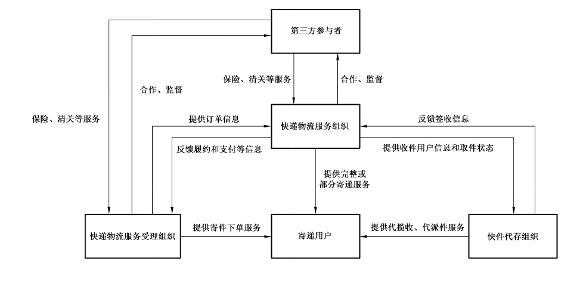
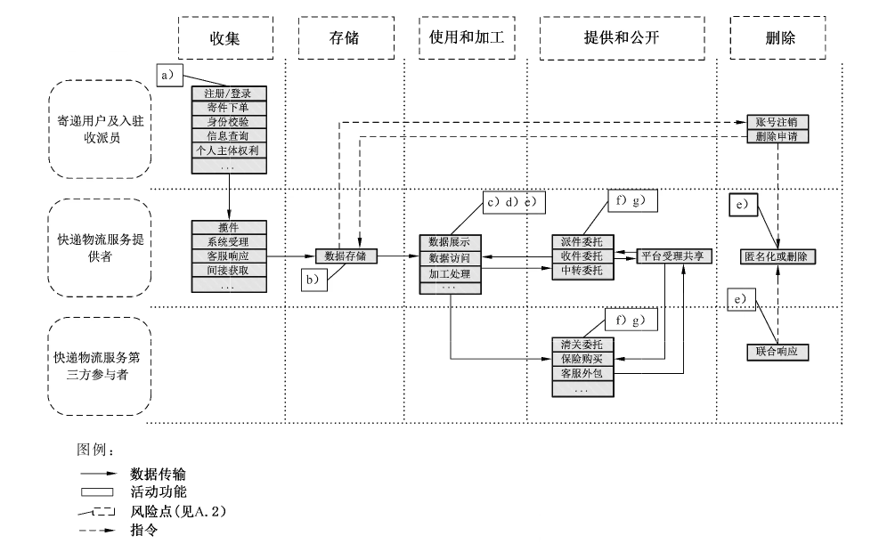

# GB/T 42013-2022 信息安全技术 快递物流服务数据安全要求

> 来源：[GB/T 42013-2022 国家标准详情](https://openstd.samr.gov.cn/bzgk/std/newGbInfo?hcno=CDBCE8F2E4CDE60A86092361A8796178)；封面发布日期：2022-10-12；实施日期：2023-05-01。
> 官方在线预览截图 SHA-256：9de21776a546b19e248e6e40b328329b13b7c69e8d164f19588b28e5000c00db。
> 转写说明：逐页对照官方在线预览的 21 页图像校核文字，保留 2 幅原图，合并跨页段落，省略封面、目录、页眉和页码。正式引用请核对官方原件。

## 前言

本文件按照GB/T1.1—2020《标准化工作导则 第1部分：标准化文件的结构和起草规则》的规定起草。

请注意本文件的某些内容可能涉及专利。本文件的发布机构不承担识别专利的责任。

本文件由全国信息安全标准化技术委员会（SAC/TC 260）提出并归口。

本文件起草单位：顺丰速运有限公司、中国电子技术标准化研究院、北京大学、中国邮政速递物流股份有限公司、北京京东振世信息技术有限公司、浙江菜鸟供应链管理有限公司、苏宁易购集团股份有限公司、中电长城网际系统应用有限公司、中国信息通信研究院、西安邮电大学。

本文件主要起草人：刘玉霞、上官晓丽、周晨炜、谢安明、胡影、林崖冰、黎琳、杨玉冰、王超、严少敏、洪小崇、王涛、闵京华、杨青、赵新强、张瑾、王姣、王森、张林、郭琦、吴剑锋、黄琳、康琼、符薇、刘佳、曹京、荆伟、张勇。

## 1 范围

本文件规定了快递物流服务收集、存储、传输、使用、加工、提供、公开、删除、出境等数据处理活动的安全要求。

本文件适用于快递物流服务提供者规范数据处理活动，也可为监管部门、第三方评估机构对快递物流服务数据处理活动进行监督、管理、评估提供参考。

## 2 规范性引用文件

下列文件中的内容通过文中的规范性引用而构成本文件必不可少的条款。其中，注日期的引用文件，仅该日期对应的版本适用于本文件；不注日期的引用文件，其最新版本（包括所有的修改单）适用于本文件。

- GB/T 25069 信息安全技术 术语

- GB/T 35273—2020 信息安全技术 个人信息安全规范

- GB/T 37988 信息安全技术 数据安全能力成熟度模型

- GB/T 39335 信息安全技术 个人信息安全影响评估指南

- GB/T 41391—2022 信息安全技术 移动互联网应用程序（App）收集个人信息基本要求

- GB/T 41479 信息安全技术 网络数据处理安全要求

## 3 术语和定义

GB/T 25069、GB/T 35273—2020界定的以及下列术语和定义适用于本文件。

### 3.1 快递物流服务 express logistics service

在承诺的时限内快速完成的邮件快件寄递服务。

注1：本文件中所称快递物流服务不包括道路货物运输服务。

注2：涉及从接收用户订单开始直到将物品送达用户为止的完整活动，通常包括下单、揽件、封装、中转、派件等服务环节。

［来源：GB/T 27917.1—2011,2.1，有修改］

### 3.2 寄递用户 sender and addresser

使用快递物流服务（3.1）的个人或组织。

> 注：包括寄件用户和收件用户，本文件中简称“用户”。

### 3.3 快递物流服务提供者 express logistics service provider

快递物流服务组织（3.4）、快递物流服务受理组织（3.6）、快件代存组织（3.7）的统称。

> 注：本文件中简称“提供者”。

### 3.4 快递物流服务组织 express logistics service organization

在中国境内依法注册的，提供快递物流服务（3.1）的企业及其加盟企业、代理企业。

［来源：GB/T 27917.1—2011,2.2，有修改］

### 3.5 快件 express item

由快递物流服务组织（3.4）依法递送的信件、包裹、印刷品等的统称。

［来源：GB/T 10757—2011,5.2.1，有修改］

### 3.6 快递物流服务受理组织 express logistics service acceptance organization

为寄递用户（3.2）提供寄件下单、订单受理转交、快件信息查询等服务的组织。

> 注：本文件中简称“服务受理组织”。快递物流服务受理组织向快递物流服务组织提供订单信息，由快递物流服务组织完成邮件快件的寄递。

### 3.7 快件代存组织 express deposit organization

通过智能快件箱（3.13）、智能信包箱（3.14）、快递服务站等方式向寄递用户（3.2）提供代揽收、代派件服务的组织。

### 3.8 快递物流服务第三方参与者 express logistics service third-party participant

除快递物流服务提供者（3.3）和寄递用户（3.2）之外的快递物流服务（3.1）的参与主体。

### 3.9 收派员 courier

从事上门揽收和投递快件（3.5）工作的人员。

［来源：GB/T 27917.1—2011，4.2.1，有修改］

### 3.10 快递物流服务数据 express logistics service data

快递物流服务提供者（3.3）在提供快递物流服务（3.1）过程中收集和产生的数据。

> 注：主要包括用户数据和业务数据，不包括提供者内部管理经营数据。

### 3.11 快件路由信息 express item tracking information

快件（3.5）在寄递过程主要环节的流转信息。

> 注：通常包括处理时间、处理场所、处理状态和处理结果等。

### 3.12 智能服务终端 smart service terminal

支持音频、视频、数据传输等多媒体功能的、用于信息处理的智能设备。

> 注：快递物流服务中常见的智能服务终端包括智能快件箱、智能信包箱、无人车、无人机、智能穿戴设备、收派移动作业终端等。其中，收派移动作业终端包括提供者自有收派移动作业终端（如收派巴枪）以及安装有收派业务App的内部人员个人智能手机。

### 3.13 智能快件箱 intelligent self-express service machine

设立在公共场合，可供快递物流服务组织（3.4）和寄递用户（3.2）投递、提取快件的自助服务设备。

［来源：YZ/T 0133—2013,3.1，有修改］

### 3.14 智能信包箱 intelligent mail & parcel locker

应用信息技术控制与管理，通过密码验证、电子验证、生物识别和其他身份识别方式进行操作，供用户接收邮件和快件的智能服务终端。

［来源：GB/T 24295—2021,3.1］

## 4 缩略语

下列缩略语适用于本文件：

OTP：动态口令（One-Time Password）

## 5 概述

### 5.1 快递物流服务业务组成

快递物流服务数据处理活动主要围绕着快递物流服务的业务功能开展，包括：用户的注册、寄件、收件、快件信息查询等；提供者的揽件、中转、清关、派送等。

快递物流服务涉及的相关方包括快递物流服务提供者、寄递用户，以及快递物流服务第三方参与者。其中，快递物流服务提供者包括快递物流服务组织、快递物流服务受理组织，以及快件代存组织；快递物流服务第三方参与者主要接受快递物流服务提供者委托，处理快递物流服务中的清关、保险、客服等特定事项的组织。快递物流服务参与主体交互示意图见图1。

快递物流服务数据处理活动及安全风险见附录 A。

### 5.2 快递物流服务数据范围

本文件中快递物流服务数据范围包括：

a） 用户数据：快递物流服务提供者在提供快递物流服务过程中收集和产生的个人用户数据和企业用户数据，如收寄件人姓名、地址、联系电话、企业账号信息、企业通信信息等；

b） 业务数据：快递物流服务提供者在提供快递物流服务过程中处理的各类业务经营相关的数据，如寄递物品及费用数据、配送数据、签收数据、营业场所数据、财务数据、营销运营数据等。

## 6 基本要求

快递物流服务提供者数据安全的基本要求如下：

a） 数据处理活动应遵守 GB/T 41479中规定的要求；

b）个人信息处理活动应遵守 GB/T 35273—2020中规定的要求，快递物流 App 个人信息收集活动应遵守 GB/T 41391—2022 中规定的要求；

c） 应按照有关要求和标准进行数据分类分级保护，识别快递物流服务涉及的核心数据、重要数据、一般数据，对不同级别的数据采取不同的保护措施；

注1：国家建立数据分类分级保护制度，按照数据对国家安全、公共利益或者个人、组织合法权益的影响和重要程度，将数据分为核心数据、重要数据、一般数据。

注2：附录B给出了快递物流服务重要数据识别参考规则及数据分类示例。

d） 应识别快递物流服务涉及的一般个人信息、敏感个人信息，对个人信息进行标识和分类管理；

e） 应履行互联网平台运营者义务，如个人信息保护独立监督、制定公平公正的平台规则、隐私政策披露、平台内经营者管理、发布个人信息保护社会责任报告等；

f） 快递物流服务提供者的数据安全能力应至少符合 GB/T 37988二级能力要求；

g） 应结合数据处理活动的实际情况，按照有关国家标准定期开展数据安全风险评估；

h） 应在开展对个人权益有重大影响的个人信息处理活动前，按照 GB/T 39335 进行个人信息保护影响评估；

注3：对个人权益有重大影响的个人信息处理活动，包括但不限于处理敏感个人信息、利用个人信息进行自动化决策、委托处理个人信息、向其他个人信息处理者提供个人信息、公开个人信息、向境外提供个人信息等。

i）应按照有关国家标准，在快递物流服务信息系统规划建设时开展个人信息安全工程实践，同步规划、同步建设、同步使用个人信息保护措施；

j） 快递物流服务的信息系统应符合国家网络安全等级保护相关标准要求。

## 7 数据收集

### 7.1 收集个人信息

快递物流服务提供者收集个人信息应在满足 GB/T 35273—2020中 5.1、5.2、5.3的要求基础上，遵守以下要求：

a） 通过 App 收集必要个人信息应符合 GB/T 41391—2022中 A.8规定；

注 1：GB/T 41391—2022 附录 A 给出了常见类型 App 必要个人信息范围，快递物流类 App 的必要个人信息范围对应“A.8 邮件快件寄递类”。

b） 扩展业务功能收集个人信息应由用户可选提供，且应限于实现处理目的的最小范围，常见扩展业务功能收集的个人信息范围及使用要求见附录C；

c） 提供揽收或代揽收快件服务时，不应通过收集寄件用户身份证件照片的方式进行寄件用户身份校验及身份信息登记；

注2：例如快件代存组织通过快递服务站方式提供代揽收服务时，服务人员使用个人智能手机对寄件用户身份证件进行拍摄和保存。

d） 快递物流 App 不应在启动后，且用户还未使用任何邮件快件寄递相关业务功能时，提前向用户申请位置权限。

### 7.2 申请系统权限

快递物流 App 不应申请与 App业务功能无关的系统权限，系统权限申请范围及使用要求见附录D。

### 7.3 告知同意

快递物流服务提供者收集个人信息告知同意应在满足 GB/T 35273—2020 中 5.4、5.5、5.6 的要求基础上，遵守以下要求：

a） 用户使用寄递服务时，提供者应在收集个人信息前告知用户提供者的名称、联系方式，个人信息的处理目的、处理方式，收集的个人信息种类、保存期限，用户行使权利的方式和程序，并取得用户同意；

b）用户进行寄递服务实名认证时，提供者应向用户明示依据的法律法规具体规定，并且所收集的个人信息应仅用于完成实名认证目的。

## 8 数据存储和传输

### 8.1 数据存储

快递物流服务提供者存储数据，应在满足 GB/T 35273—2020中6.2、6.3、6.4要求的基础上，遵守以下要求：

a） 应对用户的个人身份信息、电话号码、地址等敏感个人信息采用加密等安全措施进行存储；

b） 个人信息存储期限应为实现个人信息处理目的所必需的最短时间，超出保存期限应对个人信息进行删除或匿名化处理，法律法规另有规定的除外；

c） 如超出个人信息保存期限，但法律、行政法规规定的保存期限未届满，或者删除个人信息从技术上难以实现的，应停止除存储和采取必要的安全保护措施之外的处理；

d） 应对智能服务终端采集的个人信息进行离线存储，保存期限宜小于30天；

e） 应对智能服务终端中离线存储的个人信息及取件验证码进行加密；

f） 应建立提供者自有智能服务终端的失效设备资产列表，并对失效设备存储的业务数据进行删除。

### 8.2 数据传输

快递物流服务提供者传输数据，应在满足 GB/T 35273—2020中6.3要求的基础上，遵守以下要求：

a） 向其他个人信息处理者通过系统接口传输敏感个人信息时，应至少使用白名单（IP、域名等）方式进行控制，同时应使用数字签名、OAuth（开放授权）等方式对调用的信息系统进行鉴权；

b） 通过互联网传输及线下途径传输用户个人身份信息、电话号码、地址等时，应在传输前进行数据加密，并使用安全通道进行传输。

## 9 数据使用和加工

### 9.1 数据展示

快递物流服务提供者展示用户个人信息，应在满足 GB/T 35273—2020中7.2要求的基础上，遵守以下要求：

a） 应对快递运单中的用户姓名、电话号码进行去标识化处理；在不影响寄递业务开展的情况下，宜对地址进行去标识化处理；

b） 收派移动作业终端上安装的收派业务 App，应仅展示由其揽件或派件的用户个人信息，且展示的用户个人身份信息和电话号码应进行去标识化处理。因派送服务无法正常开展，确需查看未经去标识化处理的数据时，应在展示界面中采用数字水印技术；

c） 供提供者内部人员使用的业务系统中，应对用户个人身份信息、地址、电话号码等进行去标识化处理。因派送服务正常开展，确需查看未经去标识化处理的信息时，应在展示界面中采用数字水印技术。

> 注：提供者内部人员通常包括提供者入驻收派员、客服人员、仓管人员、财务人员、报关人员等。

### 9.2 数据访问

快递物流服务提供者对用户个人信息的访问控制，应在满足 GB/T 35273—2020中7.1要求的基础上，遵守以下要求：

a） 应通过建立审批流、限制数据访问范围等措施，限制批量查询、导出用户个人身份信息、电话号码、地址等的操作功能；

b）对于通过线上系统查询用户个人身份信息、电话号码、地址等的操作，在用户或内部人员登录时，应采用双因素认证或OTP（或同级别的认证）进行身份校验，或使用不同于用户登录的验证方式进行二次校验；

注1：涉及数据查询操作的业务场景通常限于客户服务、快件进行集散和转运、仓库管理等。

c） 应根据内部人员的服务范围或服务对象分配其最小所需数据访问权限；

注2：例如地区业务人员仅能查询本地区服务的运单信息，收派员仅能查询其服务范围的运单信息，客服人员仅能基于用户咨询、查阅、投诉等请求查询相关信息。

d） 用户通过线下渠道（客服热线或快递物流服务运营场所）查询用户个人身份信息、电话号码、地址等时，应在提供查询服务前对查询人进行身份校验，同时记录查询内容，并根据预先设置的信息查询规则反馈相应信息，信息查询反馈规则见附录E；

e） 应对使用快件信息查询服务的用户进行身份校验，在用户通过身份校验前仅向其提供通过运单号查询快件路由信息的服务，且展示的快件路由信息中不应包含用户姓名、个人身份信息、电话号码、地址等；在用户通过身份校验后，向其提供的查询服务应限于其作为寄件用户或收件用户的运单、快件路由、费用等信息；

f） 应通过系统外呼等功能，降低内部人员对用户电话号码的访问范围及访问频率；

注3：即采用系统外呼功能，代替通过查询用户明文电话号码后手动输入用户电话号码联系用户的方式，实现客服、入驻收派员等内部人员与用户的语音联系。

g） 应采取端口管控、物理设备锁等防撬起措施，防止攻击者通过设备端口（包括 USB端口、蓝牙等）或拆除智能服务终端后访问存储模块，提取设备上的数据；

h）提供者自有智能服务终端应支持远程设备锁屏、远程数据擦除、后台强制退出登录等功能，并确保相关功能在终端设备丢失时能够激活；

i） 收派移动作业终端上安装的收派业务App，宜支持远程擦除本地业务数据功能。

### 9.3 数据导出

快递物流服务提供者进行数据导出，应遵守以下要求：

a） 应对数据导出操作权限进行管控，确保业务场景设置数据导出权限的必要性；

b）对于通过线上系统导出用户个人身份信息、电话号码、地址等的操作，在内部人员登录时，应采用双因素认证或 OTP（或同级别的认证）进行身份校验，或使用不同于登录的验证方式进行二次校验；

注1：涉及数据导出操作的业务场景通常限于财务对账等。

c） 应对敏感数据外发权限进行管控，并对敏感数据的外发操作进行监控，必要时进行阻断。

注2：如限制电子邮件外发权限、USB写权限、终端共享权限等数据外发权限，限制涉及数据上传权限的应用软件和网站，以及通过终端和网络数据防泄密工具，实时监控内部人员外发敏感数据的行为，对疑似违规外发敏感数据的行为及时阻断等。

### 9.4 个性化推荐

快递物流服务提供者利用个人信息和个性化推送算法向用户提供信息，应满足以下要求：

a） 允许用户自主选择是否使用个性化推荐相关功能；

b）提供易于理解、便于访问和操作的一键关闭个性化推荐、拒绝接受定向推送信息，以及重置、修改、调整针对其个人特征的定向推送参数的功能；

c） 提供删除定向推送信息服务过程中收集和产生的个人信息的功能，法律、行政法规另有规定或者与用户另有约定的除外。

### 9.5 日志记录与审计

快递物流服务提供者进行日志记录与审计，应遵守以下要求。

a） 当日志数据中包含用户个人身份信息、电话号码、地址等时，应对用户个人身份信息、电话号码、地址等进行去标识化处理。

b） 记录的日志类型应包括但不限于：

1） 登录日志：包括收派员、客服等人员成功登录或失败登录，正常退出、超时退出的活动；

2） 用户管理日志：包括收派员、客服等人员账号口令的修改和重置等活动；

3） 敏感数据操作日志：包括用户、内部人员等的敏感数据新增、查询、修改、导出、解密、删除等操作。

c） 应对具备处理用户个人身份信息、电话号码、地址等权限的账号的操作进行日志审计，及时发现异常操作并处置。

d） 应对跨服务范围、非工作时间、非工单触发等情况下处理用户个人身份信息、电话号码、地址等的操作进行日志审计，及时发现异常操作并处置。

e） 应对批量查询、导出用户个人身份信息、电话号码、地址等的操作进行日志审计和监控，及时发现异常操作并处置。

## 10 数据提供和公开

快递物流服务提供者公开数据、向第三方提供数据，应在满足 GB/T 35273—2020中9.2~9.4要求的基础上，遵守以下要求。

a） 应向用户告知数据接收方的名称或者姓名、联系方式，个人信息的处理目的、处理方式，处理的个人信息种类、保存期限，用户行使权利的方式和程序，并取得用户单独同意。

b） 向关联公司提供数据时，应与关联公司签署严格的商业秘密保护协议或数据处理协议等，约定其数据处理活动的安全要求。

c） 快递物流服务提供者之间的数据共享，应遵守以下要求：

1） 服务受理组织向快递物流服务组织提供寄递服务订单时，提供的数据应仅限于寄件用户和收件用户的姓名、地址、电话号码和寄递物品信息；

2） 快递物流服务组织向服务受理组织共享服务订单的履约信息、支付信息时，应仅提供服务受理组织涉及订单范围的信息；

3） 快递物流服务组织与服务受理组织处理快递物流服务纠纷时，应仅提供必要的身份信息及纠纷处理所需信息；

4） 快递物流服务组织委托代存组织进行快件派送或揽收时，应仅提供收件用户的姓名、地址、电话号码或快件的取件状态；

5） 快件代存组织向快递物流服务组织反馈快件的签收信息时，应仅提供快递物流服务组织涉及的快件范围的信息。

d） 因兼并、重组、破产等原因需要转移数据的，应明确数据转移方案，数据接收方应继续履行相关数据安全保护义务。

## 11 数据删除

快递物流服务提供者删除数据，应遵守以下要求：

a）保存数据删除的有关记录，记录内容包括但不限于删除的数据类型、方式、时间、责任人等；

b）个人信息删除满足 GB/T 35273—2020中8.3的要求。

## 12 数据出境

快递物流服务提供者开展国际快递物流服务时，将国际快递运单信息传输至境外国家/地区的关联公司、快递物流服务组织、提供者业务合作伙伴，构成数据出境。提供者数据出境应遵守以下要求：

a） 不涉及国际寄递服务的，寄递用户个人身份信息、姓名、电话号码、地址不应传输至境外；涉及国际寄递服务的，寄件用户个人身份信息也不应传输至境外；境外仅需查询的，数据不应在境外存储；

b）出境数据应仅限于提供国际快递物流服务所需的必要数据，如配送信息、清关信息等；

c） 应建立个人信息出境记录，包括但不限于出境时间、数据类型、数量、目的地；

d） 根据业务发展和运营情况，每年应自行或委托第三方机构对数据出境至少进行一次数据出境风险评估；

e） 如境外快递物流服务分包给第三方，应对第三方数据处理活动的合规程度及安全风险进行评估；

f） 应采取必要措施，确保用户的个人信息在境外得到与境内同等水平的保护。

> 注：例如采取运单信息加密传输、定期评估审计接收方的安全能力水平、签订数据处理协议/条款等措施。

## 13 个人信息主体权利

快递物流服务提供者在响应用户个人信息主体权利请求时，应在满足 GB/T 35273—2020中第8章要求的基础上，遵守以下要求。

a） 应对个人信息主体权利请求人进行身份校验。

注1：例如使用账号、运单信息、账号绑定手机号码、收寄件用户电话号码、手机动态验证码等信息进行身份校验。

b） 应保存所有请求的响应记录。

c） 应支持通过系统功能实现部分个人信息主体权利，包括但不限于：

1） 用户对寄递服务所使用的个人信息（如联系方式、地址等）的查询和更正权利；

2） 对已授权的个人信息保护政策、快件路由信息推送、广告推送功能等撤回同意的权利；

3） 用户对已提供的个人信息的删除权利。

d） 个人信息主体权利涉及由第三方协助实现时，提供者应确保与第三方制定权利请求响应机制，并在与第三方签订的协议中明确第三方的相关义务。

e） 应提供便捷的账号注销功能，同时提供注销提醒或注销协议，告知执行注销操作对用户可能造成的影响，并在注销后的15个工作日内对其个人信息进行删除或匿名化处理。如确需设置注销条件，则注销条件应在合理范围内，包括：

1） 账号存在未处理完毕的交易或纠纷，包括但不限于运单在途、清关、转运等；

2） 账号下拥有财产权益，用户明示自愿放弃相关财产权益除外。

注2：可能造成影响包括但不限于会员账号注销表示自愿放弃会员权益和虚拟资产；会员帐号、结算帐号等关联帐号，注销其中某项，将导致服务不可用或质量下降；会员账号注销后不可恢复。

注3：提供者如设置注销删除等待期（如15个工作日），用户在提交注销申请后的等待期内可撤销申请，并可通过重新注册复原相关个人账号信息和相关个人服务记录，超过等待期将永久删除。

## 14 快递物流服务典型业务场景数据安全保护

### 14.1 收派员收派服务

#### 14.1.1 身份校验

快递物流服务提供者校验收派员身份应遵守以下要求：

a） 应对收派员开展快递收派工作时使用的智能服务终端设定设备锁屏口令，并在收派员登录设备时验证使用者身份是否终端所有者；

b） 应采用帐号口令等方式，在收派员使用收派业务 App等涉及个人信息访问的系统前进行身份校验。

#### 14.1.2 访问控制

快递物流服务提供者进行收派员访问控制，应遵守以下要求：

a） 应仅允许收派员查看本人的揽件、派件信息；

b） 应限制收派员仅能够查询15天内的历史收派件信息。

#### 14.1.3 数据查阅

快递物流服务提供者为收派员提供数据查询功能，应遵守以下要求：

a） 收派员进行快件收派时，用户个人身份信息、电话号码等个人信息应采取去标识化处理后展示，收派员联系客户时，应通过收派业务 App 集成号码保护方案实现一键呼叫或短信发送；

> 注：号码保护方案包括但不限于虚拟号码、短信通知平台等。

b）收派员与用户联系的录音应统一指定路径保存，如需调取应通过相应流程审批。

### 14.2 智能快件箱与智能信包箱

#### 14.2.1 视频监控

智能快件箱、智能信包箱安装视频监控设备采集相关视频监控信息，应满足以下要求：

a） 智能快件箱、智能信包箱视频监控范围不应超出实现监控服务目的所需的最小范围；

b） 应设置显著的提示标识，提示用户已进入视频监控范围；

c） 应采取如基于角色或基于任务的访问控制模型，防止视频监控信息被非授权访问、篡改、删除；

d） 智能快件箱、智能信包箱提供者应保存视频监控信息查阅记录，包括查阅人员、查阅目的、查阅对象、查阅时间等记录；

e） 所收集的个人图像应仅用于维护公共安全的目的，取得个人单独同意的除外。

#### 14.2.2 硬件设备安全

智能快件箱、智能信包箱硬件设备的安全应满足以下要求：

a） 智能快件箱、智能信包箱提供者应采用设备锁等方式，防止向第三方暴露智能快件箱、智能信包箱硬件设备外部接口；

b） 当智能快件箱、智能信包箱硬件设备与第三方应用系统传输数据涉及个人身份信息、电话号码、地址等时，应在传输前进行数据加密，并使用安全通道进行传输。

### 14.3 收派移动作业终端

#### 14.3.1 数据存储安全

收派移动作业终端数据存储，应在满足8.1要求的基础上，满足以下要求：

a） 当收派移动作业终端完成与服务端信息同步后，应立即删除终端离线存储的个人身份信息、电话号码、地址等；

b）收派移动作业终端离线存储个人身份信息、电话号码、地址等数据超出保存期限时，应自动删除终端离线存储的个人身份信息、电话号码、地址等。

#### 14.3.2 数据访问安全

收派移动作业终端数据访问，应在满足9.2要求的基础上，满足以下要求：

a） 设置登录有效时长（宜小于24h），超过有效时长时强制退出登录；

b） 在用户修改口令后退出登录状态；

c） 在用户更换设备登录时，采用口令、密码技术、生物特征识别技术等两种或两种以上组合的鉴别技术对用户进行身份校验。

## 附录 A（资料性）快递物流服务数据处理活动及安全风险

### A.1 快递物流服务数据处理活动

快递物流服务数据处理活动示意如图 A.1 所示。

### A.2 快递物流服务数据安全风险

快递物流服务主要面临以下数据安全风险：

a） 提供者在提供服务时，过度收集用户个人信息，或过度索取 App 系统权限的风险；

b） 快递物流服务中使用智能快件箱、智能信包箱、无人车、无人机、智能穿戴设备、收派移动作业终端等智能服务终端的场景下，因设备丢失或设备保护措施不足等导致数据泄露的风险；

c） 因快递运单暴露个人信息，在快递运单丢失、经手人员泄露、客户丢弃快递包装等场景下带来的数据泄露风险；

d） 在快件的中转过程中，接触用户个人信息的提供者内部人员多，且管理难度大，可能出现内部人员泄露用户个人信息的风险；

e） 提供者以业务营销、业务风险控制、提升服务质量为目的分析个人信息，对用户进行画像和信息推送，未提供有效的拒绝个性化推荐和删除相关信息等功能，造成个人权益受损的风险；

f） 在偏远地区和跨国快件转寄、清关委托、快递保险购买、客服外包等场景下，提供者向第三方提供或委托第三方处理数据时，接收方无法提供充足安全保障措施，以及提供者对接收方数据处理活动监督不足，导致数据泄露或被第三方滥用的风险；

g） 跨境快递物流服务中，可能存在数据未授权出境或数据在境外未得到与境内同等保护水平的风险。

## 附录 B（资料性）快递物流服务重要数据识别参考规则及数据分类示例

### B.1 快递物流服务重要数据识别参考规则

快递物流服务重要数据识别参考规则如下：

a） 按照国家和快递物流服务行业的重要数据目录，识别涉及的重要数据；

b） 相关目录不明确时，按照重要数据识别相关规定、国家或行业标准识别重要数据；

c） 相关目录、规定和标准均不明确时，将一旦被泄露或篡改、损毁，可能直接危害国家安全、经济运行、社会稳定、公共健康和安全的数据识别为重要数据。

### B.2 快递物流服务数据分类示例

快递物流服务数据分类示例见表 B.1。

**表 B.1 快递物流服务数据分类示例**

| 数据类别 | 细分类型 | 示例 |
| --- | --- | --- |
| 用户数据 | 个人用户数据 | 1）个人基础信息：姓名等 |
| 用户数据 | 个人用户数据 | 2）个人身份信息：身份证信息、驾驶证信息、军官证信息、护照信息等 |
| 用户数据 | 个人用户数据 | 3）个人联系信息：个人电话号码、详细地址、电子邮箱等 |
| 用户数据 | 个人用户数据 | 4）个人财产信息：银行卡号、支付账号等 |
| 用户数据 | 个人用户数据 | 5）个人鉴权信息：账号登录口令、支付口令、密保答案、用户个人数字证书等 |
| 用户数据 | 个人用户数据 | 6）上网记录信息：客服通讯记录、用户操作网络日志等 |
| 用户数据 | 个人用户数据 | 7）网络身份标识及个人常用设备信息：账号、IP 地址、设备 MAC 地址、唯一设备识别码等 |
| 用户数据 | 个人用户数据 | 8）个人生物识别信息：面部识别特征信息 |
| 用户数据 | 个人用户数据 | 9）位置信息：精准定位信息、经纬度等 |
| 用户数据 | 企业用户数据 | 1）企业基础信息：企业名称、营业执照、法人信息、注册地址等 |
| 用户数据 | 企业用户数据 | 2）企业鉴权信息：账号登录口令、支付口令、密保答案等 |
| 用户数据 | 企业用户数据 | 3）企业通信信息：联系人姓名、联系电话号码、联系邮箱、企业地址等 |
| 用户数据 | 企业用户数据 | 4）企业账号信息：账号信息、银行信息、税务登记号、付款方式等 |
| 用户数据 | 企业用户数据 | 5）企业信用信息：信用等级、信用账期、信用额度、信用折扣等 |
| 业务数据 |  | 1）寄递物品及费用信息：寄递物品名称、类型、性质、数量、价值、代收金额、物品体积、重量、运费、付款方式等 |
| 业务数据 |  | 2）配送信息：运单信息、原寄地（城市级别）、目的地（城市级别）、快件路由信息、配送时间、时效类型、运输方式等 |
| 业务数据 |  | 3）签收信息：签收底单、电子存根等 |
| 业务数据 |  | 4）客服售后信息：投诉信息、客服录音、退换货信息、服务评价信息、工单处理结果、客服电话等 |
| 业务数据 |  | 5）营业场所信息：营业场所监控视频、营业场所名称、营业场所地址、营业场所电话、营业场所联系人信息等 |
| 业务数据 |  | 6）财务信息：财务运营数据、成本利润数据等 |
| 业务数据 |  | 7）营销运营信息：营销策略、营销方案、广告投放等 |

## 附录 C（资料性）快递物流服务常见扩展业务功能的个人信息收集范围及使用要求

快递物流服务常见扩展业务功能包括：

a） 定期结算服务：按照与用户的约定，提供者同用户定期对已向用户提供的快递物流服务进行费用结算的服务；

b） 口令签收：使用指定的口令进行收件人验证的寄递服务；

c） 保价服务：在快件运输途中由于提供者责任导致托寄物损坏或遗失，由提供者按照保价金额（申报价值）和损失比例进行赔偿的服务；

d） 签单返还：在成功派送快件后，将收件用户签名收条、收货单据等返还寄件用户的服务；

e） 代收货款：按照寄件用户（卖方）与收件用户（买方）达成的交易协议，为寄件用户提供货物（商品）专递，同时向收件用户收取货款并按约定时间将货款转交至寄件用户的服务；

f） 代收代派服务：按照与用户的约定，为用户提供代揽收、代派件的服务。

快递物流服务常见扩展业务功能的个人信息收集范围及使用要求见表C.1。

**表 C.1 快递物流服务常见扩展业务功能的个人信息收集范围及使用要求**

| 业务功能 | 个人信息收集范围 | 使用要求 |
| --- | --- | --- |
| 定期结算服务 | 身份证件信息（如证件图片、证件号码等）；真实姓名；手机号码；手机验证码或语音验证码 | 用于对申请开通定期结算服务的用户进行身份查验 |
| 口令签收 | 签收口令 | 用于实现收件用户签收口令验证 |
| 保价服务 | 寄递物品价值 | 用于实现保价服务费计算 |
| 签单返还 | 收件用户身份证件号码、身份证件复印件（二选一） | 用于实现收件用户身份核验登记 |
| 代收货款 | 待收银行卡号/支付账号；收款人姓名；收款人身份证号；收款人银行信息（银行卡号、开户行等）；收款银行绑定手机号；返款时间；待收金额 | 用于提供代收货款服务 |
| 代收代派服务 | 快递运单号 | 用于实现代收代派服务中的查询运单信息、快递运输路径、标识快件 |
| 代收代派服务 | 收件用户电话号码 | 用于实现将所接收快件交付至收件用户 |

## 附录 D（资料性）快递物流服务 App 相关系统权限申请范围及使用要求

### D.1 快递物流服务 Android App 相关系统权限申请范围及使用要求

快递物流服务 Android App（Android 11 及以下版本）相关系统权限申请范围及使用要求见表 D.1。

**表 D.1 Android App 相关系统权限申请范围及使用要求**

| 权限名称 | 使用要求 |
| --- | --- |
| WRITE_EXTERNAL_STORAGE 写入外置存储器 | 仅用于实现运单电子存根图片保存到本地、运单发票保存到本地功能 |
| READ_EXTERNAL_STORAGE 读取外置存储器 | 仅用于识别图片中的收寄件信息、上传用户选择的托寄物照片、增值服务签单照片 |
| ACCESS_COARSE_LOCATION 访问粗略位置 | 仅用于查看附近的服务点 |
| ACCESS_FINE_LOCATION 访问精准定位 | 仅用于确定最近的服务点和服务点导航、寄件地址快捷选填 |
| CAMERA 相机 | 仅用于实名认证、扫码寄件/查件、寄件托寄物拍照 |

### D.2 快递物流服务 iOS App 相关系统权限申请范围及使用要求

快递物流服务 iOS App（iOS 14 及以下版本）相关系统权限申请范围及使用要求见表 D.2。

**表D.2 iOS App 相关系统权限申请范围及使用要求**

| 权限名称 | 使用要求 |
| --- | --- |
| Camera 相机 | 仅用于实名认证、扫码寄件/查件、寄件托寄物拍照 |
| Location When In Use 使用期间访问位置 | 仅用于服务点查询和服务点导航、寄件地址快捷选填 |
| Photo Library 读取和写入照片库 | 仅用于识别图片中的收寄件信息、上传用户选择的托寄物照片、增值服务签单照片，以及实现运单电子存根图片保存到本地、运单发票保存到本地功能 |
| Photo Library Additions 只写照片库 | 仅用于实现运单电子存根图片保存到本地、运单发票保存到本地功能 |

## 附录 E（资料性）信息查询反馈规则

本附录给出了有单号及无单号信息查询的反馈规则，见表 E.1 及表 E.2。

**表 E.1 有单号查询信息反馈规则**

| 类别 | 查询项 | 寄件用户 | 收件用户 | 第三方个人用户 |
| --- | --- | --- | --- | --- |
| 运单基础信息 | 原寄地、目的地 | √ | √ | × |
| 运单基础信息 | 寄件用户、收件用户公司名称 | √ | √ | × |
| 运单基础信息 | 寄件用户、收件用户姓名 | √ | √ | × |
| 运单基础信息 | 寄件用户、收件用户联系方式（电话号码） | √ | √ | × |
| 运单基础信息 | 寄件地址、收件地址 | √ | √ | × |
| 寄递物品及费用 | 寄递物品内容 | √ | √ | × |
| 寄递物品及费用 | 保价、声明价值、代收金额、运费、特殊操作费用、部分增值服务费用 | √ | √（运费仅当收件用户为付款方时可查询） | × |
| 寄递物品及费用 | 计费重量、实际重量、付款方式 | √ | √ | √ |
| 快件状态信息 | 快件路由信息（当前快件位置、派送状态等） | √ | √ | √ |
| 快件状态信息 | 时间（寄件时间、预计上门派送时间、快件承诺时效、到达网点时间等） | √ | √ | √ |
| 快件状态信息 | 时效类型 | √ | √ | √ |
| 快件状态信息 | 运输方式（如飞机、火车等） | √ | √ | √ |
| 快件状态信息 | 签收情况 | √ | √ | √（仅告知是否签收、是否本人签收，不告知具体签收人） |
| 快件状态信息 | 问题件跟进记录 | √ | √ | √（仅告知与其相关的问题件跟进进度） |

注 1：第三方个人用户是指除寄件用户、收件用户以外的个人用户。

注 2：“√”表示该查询项可被相应角色查询，“×”表示该查询项不可被相应角色查询。例如表中“原寄地、目的地”查询项，可被“寄件用户”“收件用户”查询，但不可被“第三方个人用户”查询。

**表 E.2 无单号查询信息反馈规则**

| 类别 | 查询项 | 寄件用户 | 收件用户 | 第三方个人用户 |
| --- | --- | --- | --- | --- |
| 运单基础信息 | 运单号 | 引导至各查询端（例如官方 App 或小程序等）自助查询，或由用户提供收寄双方城市名、电话号码、联系人进行验证；若用户无法提供或提供错误则拒绝 | 引导至各查询端（例如官方 App 或小程序等）自助查询，或由用户提供收寄双方城市名、电话号码、联系人进行验证；若用户无法提供或提供错误则拒绝 | 引导用户提供收寄双方电话号码、城市名、联系人进行身份校验后提供；若用户无法提供或提供错误则拒绝 |
| 运单基础信息 | 原寄地、目的地 | 引导至各查询端（例如官方 App 或小程序等）自助查询，或由用户提供收寄双方城市名、电话号码、联系人进行验证；若用户无法提供或提供错误则拒绝 | 引导至各查询端（例如官方 App 或小程序等）自助查询，或由用户提供收寄双方城市名、电话号码、联系人进行验证；若用户无法提供或提供错误则拒绝 | × |
| 运单基础信息 | 寄件用户、收件用户公司名称 | 引导至各查询端（例如官方 App 或小程序等）自助查询，或由用户提供收寄双方城市名、电话号码、联系人进行验证；若用户无法提供或提供错误则拒绝 | 引导至各查询端（例如官方 App 或小程序等）自助查询，或由用户提供收寄双方城市名、电话号码、联系人进行验证；若用户无法提供或提供错误则拒绝 | × |
| 运单基础信息 | 寄件用户、收件用户姓名 | 用户提供单号后四位进行验证后告知 | 用户提供单号后四位进行验证后告知 | × |
| 运单基础信息 | 寄件用户、收件用户联系方式（电话号码） | 用户提供单号后四位进行验证后告知 | 用户提供单号后四位进行验证后告知 | × |
| 运单基础信息 | 寄件地址、收件地址 | 用户提供单号后四位进行验证后告知 | 用户提供单号后四位进行验证后告知 | × |
| 寄递物品及费用 | 寄递物品内容 | √ | √ | × |
| 寄递物品及费用 | 保价、声明价值、代收金额、运费、特殊操作费用、部分增值服务费用 | √ | √（运费仅当收件用户为付款方时可查询） | × |
| 寄递物品及费用 | 计费重量、实际重量、付款方式 | √ | √ | √（需先完成运单号查询） |
| 快件状态信息 | 快件路由信息（当前快件位置、派送状态等） | √ | √ | √（需先完成运单号查询） |
| 快件状态信息 | 时间（寄件时间、预计上门派送时间、快件承诺时效、到达网点时间等） | √ | √ | √（需先完成运单号查询） |
| 快件状态信息 | 时效类型 | √ | √ | √（需先完成运单号查询） |
| 快件状态信息 | 运输方式（如飞机、火车等） | √ | √ | √（需先完成运单号查询） |
| 快件状态信息 | 签收情况 | √ | √ | 有条件提供：仅告知是否签收、是否本人签收，不告知具体签收人（需先完成运单号查询） |
| 快件状态信息 | 问题件跟进记录 | √ | √ | 有条件提供：仅告知与其相关的问题件跟进进度（需先完成运单号查询） |

注 1：第三方个人用户是指除寄件用户、收件用户以外的个人用户。

注 2：“√”表示该查询项可被相应角色查询，“×”表示该查询项不可被相应角色查询。例如表中“寄递物品内容”查询项，可被“寄件用户”“收件用户”查询，但不可被“第三方个人用户”查询。

## 参考文献

- ［1］ GB/T 10757—2011 邮政业术语

- ［2］ GB/T 24295—2021 智能信包箱

- ［3］ GB/T 27917.1—2011 快递服务 第1部分：基本术语

- ［4］ GB/T 27917.2—2011 快递服务 第2部分：组织要求

- ［5］ GB/T 27917.3—2011 快递服务 第3部分：服务环节

- ［6］ GB/T 28582—2012 快递运单

- ［7］ YZ/T 0133—2013 智能快件箱

- ［8］ YZ/T 0148—2015 快递电子运单
