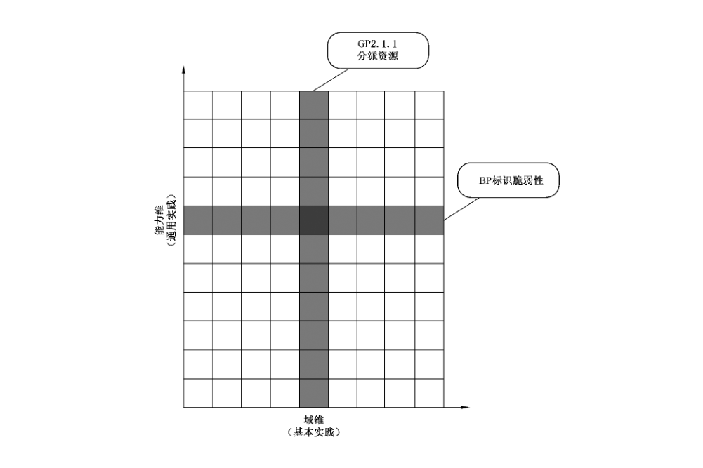
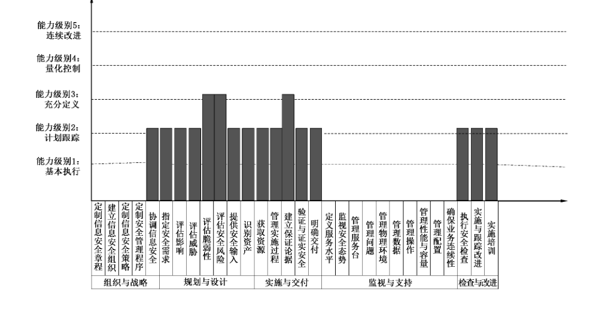

# GB/T 30271-2013 信息安全技术 信息安全服务能力评估准则

> 来源：[GB/T 30271-2013 国家标准详情](https://openstd.samr.gov.cn/bzgk/std/newGbInfo?hcno=2D074CCC97F45A564E423AB0EE76D730)；封面发布日期：2013-12-31；实施日期：2014-07-15。
> PDF SHA-256：0c9552a91dc0479693ca72ec4ad403de93a3e9cd4f8f92ba592b32e5c2be0ff0。
> 转写说明：逐页对照官方 PDF 的全部 68 页图像，校正正文、表格、图示和参考文献；省略封面、目录、页眉、页脚、页码及封底印刷信息，合并跨页内容。正式引用请核对官方原件。

> 转写核验注：原版 5.1.4.4 的基本实践清单编号存在跳号；5.2.2.3 写作“影响新引起”，5.2.4.3 写作“本过程原”，5.4.6.6.1 写作“加密盒授权”，5.4.6.7.1 写作“组织对设备和介质的非授权访问”；参考文献［19］的题名和［22］的“Systemsand”亦按原版保留。上述原版表述未作改写。

## 前言

本标准按照GB/T 1.1—2009给出的规则起草。

本标准由全国信息安全标准化技术委员会（SAC/TC 260）提出并归口。

本标准主要起草单位：中国信息安全测评中心、北京江南博仁科技有限公司、北京中天安信息技术服务有限公司。

本标准主要起草人：张利、佟鑫、李斌、班晓芳、王琰、刘作康、任育波、吴慎夕。

## 引言

本标准是对提供信息安全服务的组织进行能力评估，在编制过程中考虑到国内环境与信息安全行业的实际情况，同时结合 GB/T 20261—2006、ISO/IEC 20000—2011、COBIT 4.1、NIST SP800 系列等国际或区域标准制定而成。

## 1 范围

本标准规定了服务过程模型和信息安全服务商的服务能力的评估准则。

本标准适用于对信息安全服务提供商的能力进行评估，也适用于服务提供商对于自身能力的改善提供指导。

## 2 规范性引用文件

下列文件对于本文件的应用是必不可少的。凡是注日期的引用文件，仅注日期的版本适用于本文件。凡是不注日期的引用文件，其最新版本（包括所有的修改单）适用于本文件。

- GB/T 20984—2007 信息安全风险评估规范

- GB/T 25069 —2010 信息安全技术 术语

- GB/T 30283 信息安全技术 信息安全服务 分类

## 3 术语、定义和缩略语

### 3.1 术语和定义

GB/T 25069—2010界定的以及下列术语和定义适用于本文件。

#### 3.1.1 能力等级 ability level

流程领域内流程改善达到的程度。

> 注：能力等级由流程领域内适当的特定及一般执行方法所定义。

#### 3.1.2 基本实践 base practices

系统工程过程中应存在的性质，只有当所有这些性质完全实现后，才可说满足了这个过程域的要求。

> 注：一个过程域由基本实践（BP）组成。

#### 3.1.3 能力成熟度模型 capability maturity model

有关组织的服务或开发过程中各个发展阶段的定义、实现、质量控制和改善的模型化描述。

> 注：模型专注于改善组织的流程，包含一个或多个有效流程的必要元素，并且描述由特定的、不成熟的流程到有组织的、成熟的流程的品质改善与效率的成熟模型。

#### 3.1.4 信息安全服务 information security service

面向组织或个人的各类信息安全保障需求，由服务提供方按照服务协议所执行的一个信息安全过程或任务。

> 注：通常是基于信息安全技术、产品或管理体系的，通过外包的形式，由专业信息安全人员所提供的支持和帮助。

#### 3.1.5 信息安全服务提供方 information security service provider

按照服务协议，通过专业的信息安全人员提供信息安全服务的各类组织机构。

信息安全服务提供方在每项具体的服务中，其服务角色和服务职责应是明确的。如果服务内容仅涉及供需双方的，则服务提供方为乙方角色；在上述服务的基础上，就所涉及的问题，独立于有关各方提供评估、证明等服务并承担相关社会责任的，则服务提供方为第三方角色。服务角色与服务提供方的组织机构类型无关。

#### 3.1.6 信息安全服务能力 information safety service ability

信息安全服务提供方能够满足需求方规定和潜在需求的特征和特性的程度。

#### 3.1.7 信息安全服务需求方 information security service demander

有偿采购（或免费使用）外部所提供的信息安全服务，以满足信息系统安全保障需求，实现自身业务目标的组织（或个人用户）。

#### 3.1.8 信息安全服务能力级别 information safety service level

提供信息安全服务的组织在完成工程、服务项目时，执行组织已定义过程的能力成熟程度。

#### 3.1.9 过程 process

为了一个给定目的而执行的一系列活动。

> 注：过程包括活动定义、每个活动的输入输出定义以及控制活动执行的机制。

#### 3.1.10 过程域 process area

一组相关系统工程过程的性质，当这些性质全部实施后即能够达到过程域定义的目的。

#### 3.1.11 过程能力 process capability

遵循一个过程可达到的可量化范围。

> 注：一个组织的过程能力可帮助预见项目目标的能力。低能力级别组织的项目在达到预定的成本、进度、功能和质量目标上会有很大的变化。

#### 3.1.12 过程管理 process management

一系列用于预见、评价和控制过程执行的活动和基础设施。

> 注：过程管理意味着过程已定义好。注重过程管理含义是项目或组织需在计划、执行、评价、监控和校正活动中既要考虑产品相关因素，也要考虑过程相关因素。

#### 3.1.13 工作产品 work products

在执行任何过程中产生出的所有文档、报告、文件、数据等。

> 注：本标准按特定的基本实践列出其“典型的工作产品”，其目的在于对所需的基本实践范围可做进一步定义。列举的工作产品只是说明性的，目的在于反映组织机构和产品的范围，不是“强制”的产品。

### 3.2 缩略语

下列缩略语适用于本文件。

BP：基本实践（Base Practices）

CF：公共特征（Common Function）

GP：通用实践（Generic Practices）

PA：过程域（Process Area）

## 4 概述

### 4.1 信息安全服务过程概述

#### 4.1.1 信息安全服务过程模型

从组织信息安全治理角度，描述信息安全服务过程模型如图1所示。

组织战略是信息安全活动的基础，各信息安全活动涵盖在信息系统规划设计、实施交付、监视支持生命周期的各阶段，并通过有效的检查和改进机制，提升组织信息安全管理能力。

#### 4.1.2 组织战略

组织战略作为信息安全服务过程模型的中心环节，是本模型的重要组成并处于主导地位。信息安全服务提供者建立有效的、全面的安全制度和管理规定，全面覆盖规划设计、实施交付、监视支持、检查改进等各个环节，确保其符合本标准的相关要求。

#### 4.1.3 规划设计

从客户战略出发，以客户需求为中心，参考组织战略对其进行全面系统的规划设计，并建立业务战略、IT 战略和安全服务之间清晰的匹配和连接关系。规划设计阶段需要根据业务战略、运营模式及业务流程的特点确定所需要的业务服务组件，为安全服务的部署实施做好准备，以确保为最终客户提供满足其需求的服务。

#### 4.1.4 实施交付

在规划设计的基础上，建立管理体系，部署专用工具及服务解决方案。实施完成后根据其结果，依据本标准要求，实现服务与业务的有机结合。重点包括业务运营和IT运营，主要采用过程方法，对基础设施、服务流程、人员和业务连续性进行全面管理。

#### 4.1.5 监视支持

在交付过程中，应根据本标准要求，对业务运营和 IT 运营等交付措施过程进行记录。并确保交付记录的实时性、可追溯性、完整性以及可用性。还应根据客户的需求采用外包、供应商等形式在可控的情况下完善信息安全服务的交付过程。

#### 4.1.6 检查改进

检查与改进过程伴随着整个信息安全服务生命周期的始终。检查改进过程伴随着组织管理、规划设计、实施交付、监视支持的方方面面。通过对监视支持产生的记录进行详细的分析，并结合本标准的内容，对现有规章制度、规划设计、交付过程和支持手段进行改进和完善，且应采用可控制、可记录的手段来完成这一过程。

### 4.2 能力评定原则

#### 4.2.1 综合考虑原则

信息安全服务能力级别的划分应对组织的综合能力进行考察，它主要与组织的技术实力、信息安全服务能力等级以及其他要求有关。

#### 4.2.2 可裁剪原则

安全服务有多种类型，对不同类型的安全服务可进行适当的裁剪，同时可灵活定义新的服务类型。

参见 GB/T 30283。

#### 4.2.3 符合性原则

应遵从国家有关主管部门颁布的相关法律、法规、规章、制度、与相关网络与信息安全标准相一致。

#### 4.2.4 可操作性原则

应考虑国内安全服务商以及安全服务市场的实际情况，保证标准客观、实际、可操作性。

## 5 信息安全服务过程

### 5.1 D01 组织战略

#### 5.1.1 D01PA01 制定信息安全章程

##### 5.1.1.1 概述

信息安全章程是信息安全管理的方针，制定信息安全章程，需要明确安全管理目标、宗旨，确定并定义安全管理范围，符合相关法律法规要求，并建立适用性声明。信息安全章程应定期评审其合理性和适用性。

##### 5.1.1.2 目标

建立清晰的安全方针指导，并在整个组织中颁布实施，从而支持组织信息安全活动。

1） 编号说明：D表示过程；PA 表示过程域；BP 表示基本实践，分别按照相应的标号顺序依次编号。

##### 5.1.1.3 过程域注解

无。

##### 5.1.1.4 基本实践清单

基本实践清单包括：

a） BP010101 明确安全管理目的、宗旨；

b） BP010102定义安全边界和范围；

c） BP010103 遵从法规、合约与安全要求；

d） BP010104 建立适用性声明；

e） BP010105 管理层评审。

##### 5.1.1.5 BP010101 明确安全管理目的、宗旨

###### 5.1.1.5.1 描述

安全管理的宗旨、权力和职责应在章程中进行定义并获取认可。章程应：

a） 确定安全管理活动在组织中的地位；

b） 授权人员接触与开展工作相关的记录、人员和实物财产；

c） 规定安全管理活动的范围；

d） 证据以书面形式存在并批准；

e） 定期评价章程中所规定的宗旨、权力和职责是否足以使安全管理活动实现其目标。这种定期评价的结果应通报高级管理层。

###### 5.1.1.5.2 工作产品

信息安全管理章程。

##### 5.1.1.6 BP010102 定义安全管理范围

###### 5.1.1.6.1 描述

应根据组织目标与安全需求，结合业务特点、组织结构、位置、资产和技术，确定安全管理的边界与范围。

###### 5.1.1.6.2 工作产品

信息安全管理范围。

##### 5.1.1.7 BP010103 遵从法规、合约与安全要求

###### 5.1.1.7.1 描述

安全管理首先要求考虑区域法律、行业规章、机构规定、合同等方面的要求，并综合考虑系统的安全需求。

###### 5.1.1.7.2 工作产品

信息安全符合性规范。

##### 5.1.1.8 BP010104 建立适用性声明

###### 5.1.1.8.1 描述

应建立安全管理相关适用性声明。适用性声明应包括：

a） 选择的过程域目标和措施，以及选择的理由；

b） 当前实施的过程域目标和措施。

###### 5.1.1.8.2 工作产品

适用性声明。

##### 5.1.1.9 BP010105管理层评审

###### 5.1.1.9.1 描述

信息安全管理层机构应负责定期组织相关部门和相关人员对信息安全章程的合理性和适用性进行审定。对存在不足或需要改进的内容进行修订。

###### 5.1.1.9.2 工作产品

管理评审记录。

#### 5.1.2 D01PA02 建立信息安全组织

##### 5.1.2.1 概述

信息安全组织机构是信息安全管理的基础，需要得到组织机构最高管理层的承诺和支持，建立完善的信息安全组织结构。建立相应的岗位、职责和职权，建立完善的内部和外部沟通协作组织和机制，同组织机构内部和外部信息安全保障的所有相关方进行充分沟通、学习、交流和合作等。进一步将信息安全融至组织机构的整个环境和文化中，使信息安全真正满足安全策略和风险管理的要求，实现保障组织机构资产和使命的最终目的。

##### 5.1.2.2 目标

由安全组织执行安全管理程序，管理组织范围内的信息安全，并为组织业务目标提供合理保证。

##### 5.1.2.3 过程域注释

无。

##### 5.1.2.4 基本实践清单

基本实践清单包括：

a） BP010201 信息安全管理支持；

b） BP010202 岗位及人员设置；

c） BP010203 定义工作描述、角色资质、技能要求、人员培训要求；

d） BP010204制定人员选择、变更和终止程序。

##### 5.1.2.5 BP010201 信息安全管理支持

###### 5.1.2.5.1 描述

组织高级管理层通过清晰的指导、明确信息安全职责的分配和反馈，提供对安全的主动支持。

###### 5.1.2.5.2 工作产品

信息安全愿景。

##### 5.1.2.6 BP010202 岗位及人员设置

###### 5.1.2.6.1 描述

应成立指导和管理信息安全工作的委员会和领导小组，并设立信息安全管理工作的职能部门，应设立系统管理员、网络管理员，安全管理员等岗位，定义各个岗位的职责，并给出岗位要求。例如，采用关键岗位配备多人共同管理，配备专职的安全管理员，不可兼任等机制。

###### 5.1.2.6.2 工作产品

信息安全岗位设置原则。

##### 5.1.2.7 BP010203 定义工作描述、角色资质、技能要求、人员培训要求

###### 5.1.2.7.1 描述

安全管理组织应考虑工作描述、角色资质、技能要求、人员培训要求等事项。

###### 5.1.2.7.2 工作产品

工作产品包括：

a） 信息安全职责描述；

b） 人员技能需求；

c） 信息安全培训准则。

##### 5.1.2.8 BP010204 制定人员选择、变更和终止程序

###### 5.1.2.8.1 描述

安全管理负责人应在人员选择、变更和终止程序、保密协议等方面提供指导。

###### 5.1.2.8.2 工作产品

工作产品包括：

a） 保密协议；

b） 聘用流程；

c） 解雇流程。

#### 5.1.3 D01PA03 制定信息安全策略

##### 5.1.3.1 概述

制定安全策略目的在于通过考察业务目标与安全需求，考虑组织的策略、程序、制度、指南等多层次的管理流程与规范，保证业务目标的实现。

##### 5.1.3.2 目标

通过完善的安全策略管理体系，提供管理指导，保证信息安全，促进业务目标与安全需求的有效实现。

##### 5.1.3.3 过程域注解

无。

##### 5.1.3.4 基本实践清单

基本实践清单包括：

a） BP010301 制定安全策略；

b） BP010302 制定安全制度、规范与指南；

c） BP010303策略与程序文件维护、评估与更新。

##### 5.1.3.5 BP010301 制定安全策略

###### 5.1.3.5.1 描述

管理层应制定一个明确的安全策略方向，并通过在整个组织中发布和维护信息安全策略，表明自己对信息安全的支持和保护责任。

策略文档应由管理层批准，根据情况向所有员工公布传达。文档应说明管理人员承担的义务和责任，并制定组织的管理信息安全的步骤。

###### 5.1.3.5.2 工作产品

信息安全方针。

##### 5.1.3.6 BP010302 制定安全制度、规范与指南

###### 5.1.3.6.1 描述

依据组织的高层安全策略和系统安全策略，制定运营、操作管理程序框架，指导安全管理工作。

安全管理程序框架包括强制性制度、技术规范、实施指南等程序文件。

###### 5.1.3.6.2 工作产品

工作产品包括：

a） 信息安全策略；

b） 信息安全规范；

c） 信息安全指南。

##### 5.1.3.7 BP010303 策略与程序文件维护、评估与更新

###### 5.1.3.7.1 描述

应定期或在重大变更时对信息安全路线与实施（策略、控制目标、控制、过程、程序）进行独立审查、评估与更新。

应确保在发生影响最初风险评估的基础的变化（如发生重大安全事故、出现新的漏洞以及组织或技术基础结构发生变更）时，对策略进行相应的审查。还应进行以下预定的、阶段性的审查：

a） 检查策略的有效性，通过所记录的安全事故的性质、数量以及影响反映出来；

b） 控制措施的成本及其业务效率的影响；

c） 技术变化带来的影响。

###### 5.1.3.7.2 工作产品

评审与修订方法。

#### 5.1.4 D01PA04 制定安全管理程序

##### 5.1.4.1 概述

为了落实信息安全策略体系，维护系统的可用性与保护信息的机密性、完整性，组织需要建立和维护包括IT 安全角色和责任、策略、标准和程序的安全管理程序，包括进行安全监控、定期测试，纠正明确的安全脆弱性与事故。

##### 5.1.4.2 目标

落实信息安全策略，进行有效安全管理，通过最小化安全脆弱性和安全事件对业务影响，以保护IT资产。

##### 5.1.4.3 过程域注解

无。

##### 5.1.4.4 基本实践清单

制定安全管理程序的基本实践清单包括：

a） BP010401 管理IT安全；

b） BP010402 制定 IT 安全计划；

c） BP010403 身份管理；

d） BP010404 用户账户管理；

e） BP010405 安全性测试和监控；

f） BP010407 数据分类；

g） BP010408 访问权限集中管理；

h） BP010410 事件处理；

i） BP010412 可信任的路径；

j） BP010413 安全功能的保护；

k） BP010414密钥管理；

l） BP010415 恶意软件的预防、检测和纠正；

m）BP010416 网络安全；

n） BP010417 敏感数据交换。

##### 5.1.4.5 BP010401管理 IT安全

###### 5.1.4.5.1 描述

应确保最高的适当的组织机构来管理 IT 安全，并保证安全管理行为和业务需求一致性。

###### 5.1.4.5.2 工作产品

信息安全战略。

##### 5.1.4.6 BP010402 制定 IT 安全计划

###### 5.1.4.6.1 描述

将业务信息需求、IT配置、信息风险行动计划、信息安全文化转换为一个整体的IT 安全计划。通过将安全策略、程序以及在服务、人事、软件、硬件方面的投资，以使计划得以实施。

###### 5.1.4.6.2 工作产品

信息安全计划。

##### 5.1.4.7 BP010403身份管理

###### 5.1.4.7.1 描述

应唯一标识所有用户及在IT 系统中的行为，用户访问系统和数据的权限应符合已定义的、正式规定的业务需求和工作要求。

用户的权限由用户的管理者申请，系统的所有者批准，安全责任人员实施。通过使用有效的技术和程序来用于建立用户身份、完成身份认证、实施访问权限。

###### 5.1.4.7.2 工作产品

身份管理规范。

##### 5.1.4.8 BP010404 用户账户管理

###### 5.1.4.8.1 描述

保证用户账户管理者处理用户账户的申请、建立、发布、修改和关闭以及相关的用户特权。应建立一个描述数据和系统的所有者授予访问权限的批准程序，适用于管理员、内部用户、外部用户的正常、紧急情形。所有账户和相关权限应实施定期的管理评审。

###### 5.1.4.8.2 工作产品

账户管理规范。

##### 5.1.4.9 BP010405安全性测试、监控和报告

###### 5.1.4.9.1 描述

应保证主动地测试和监控IT 安全实施。IT安全性应定期检查，保证已批准的IT 安全水平得到维护，日志和监控功能应能够发现需要说明的例外和异常行为。根据业务需求，确定日志信息的访问权限。对计算机资源责任信息的逻辑访问（安全和其他日志文件）应基于最小特权或者“需要才能知道”的原则来准予。

IT 安全管理员应确保侵犯和安全活动被记入日志，任何即将来临的安全侵犯的迹象要立即报告给所有相关内部、外部人员，并及时采取行动。报告、评价有规律地适时逐步升级，以便确认和解决有关未授权活动。

###### 5.1.4.9.2 工作产品

工作产品包括：

a） 安全测试规范；

b） 日志管理规范；

c） 安全事件报告管理规范。

##### 5.1.4.10 BP010407 数据分类

###### 5.1.4.10.1 描述

应执行一个程序，确保所有的数据，按照数据分类的计划安排，由数据的所有者通过正式和明确的决策，根据敏感性进行分类。即使数据“不需要保护”，也需要一个正式决策以指明这样设计的理由。所有者应决定数据的布置与共享，也就是是否、何时进行程序和文件的维护、存档或删除。所有者批准和数据布置的证据应被维护。政策应被定义，以基于变化的敏感性，支持信息的重新分类。分类方案应包括管理机构之间信息交换的规范，要注意安全以及对有关法律的遵从性。

###### 5.1.4.10.2 工作产品

数据分类规范。

##### 5.1.4.11 BP010408 访问权限管理

###### 5.1.4.11.1 描述

应设置一个控制，确保用户身份识别和访问权限以及系统的身份和数据的拥有权以唯一和中心管理的方式被建立和管理，以此来获得全局访问控制的一致性和有效性。

机构的政策应确保在合适的地方执行控制，以提供操作的授权，并建立用户自己对系统声称的身份校验。这要求使用密码技术进行签名和校验操作。

###### 5.1.4.11.2 工作产品

工作产品包括：

a） 授权管理流程；

b） 权限定义规范；

c） 操作安全规范。

##### 5.1.4.12 BP010410 事件处理

###### 5.1.4.12.1 描述

应建立计算机安全事件处理规范，通过提供足够的专家意见和装备、迅速而安全的通讯设施的集中化平台，来处理安全事件。应建立事件管理的责任和程序，确保对安全事件适当、有效和及时的响应。

###### 5.1.4.12.2 工作产品

工作产品包括：

a） 应急响应预案；

b） 安全事件处置规范。

##### 5.1.4.13 BP010412 可信任的路径

###### 5.1.4.13.1 描述

机构政策应确保敏感交易数据只能通过可信任的路径来交换。敏感信息包括：安全管理信息、敏感交易数据、口令和密钥。为了实现这些，可信任的通道需要使用用户之间、用户和系统之间、系统和系统之间的加密来建立。

###### 5.1.4.13.2 工作产品

敏感信息管理规范。

##### 5.1.4.14 BP010413 安全功能的保护

###### 5.1.4.14.1 描述

应防止所有涉及硬件和软件安全的损害，以维持它们的完整性，并要防止密钥的泄露。另外，机构应对他们的安全设计保持一种低调的形象，但是安全不能基于对设计的保密。

###### 5.1.4.14.2 工作产品

完整性保护规范。

##### 5.1.4.15 BP010414密钥管理

###### 5.1.4.15.1 描述

管理层应定义并执行程序和协议，用于密钥的生成、更改、撤消、毁坏、分发、认证、存储、输入、使用和存档，确保密钥不被更改和未经授权的泄露。如果一个密钥危及安全，管理层应确保这个信息，通过认证撤消列表或其他类似的机制，传播到所有利益相关方。

###### 5.1.4.15.2 工作产品

密钥管理规范。

##### 5.1.4.16 BP010415 恶意软件的预防、检测和纠正

###### 5.1.4.16.1 描述

应建立一个适当的预防、检测和纠正控制措施以及出现时的响应和报告的框架。业务和IT管理层应确保建立一个跨越全机构的程序，避免信息系统和技术遭受计算机病毒的侵害。程序应结合病毒预防、检测、发生时的响应和报告。

###### 5.1.4.16.2 工作产品

恶意代码管理规范。

##### 5.1.4.17 BP010416 网络安全

###### 5.1.4.17.1 描述

确保采用了安全技术和相关管理程序（如防火墙、网络分段、入侵检测）用于授权访问和控制进出网络的信息流。

###### 5.1.4.17.2 工作产品

网络管理规范。

##### 5.1.4.18 BP010417 敏感数据交换

###### 5.1.4.18.1 描述

为了提供内容的真实性、提交验证、接收验证和数据源地抗抵赖性，应保证敏感数据仅通过可信路径或介质交换。

###### 5.1.4.18.2 工作产品

敏感数据保护规范。

#### 5.1.5 D01PA05 协调信息安全

##### 5.1.5.1 概述

协调安全的目的在于保证所有部门都有一种参与安全工程的意识。由于安全工程不能独立地取得成功，所以这种参与工作是至关重要的。这种协调性涉及保持安全组织、其他工程组织和外部组织之间的开放交流。多种机制可以用于在这些部门之间协调和沟通安全工程的决定和建议，包括备忘录、文档、电子邮件、会议和工作组。

##### 5.1.5.2 目标

项目组的所有成员都要具有并参与安全工程工作的意识，才能充分发挥他们的作用。

有关安全的决定和建议是相互沟通和协调一致的。

##### 5.1.5.3 过程域注解

本过程域保证安全是整个工程项目的一个完整部分。安全工程师应是所有主要设计队伍和工作组的一部分。在作出关键设计决定后的工程生命期早期就建立起安全工程与其他工程队伍间的联系是特别重要的。本过程域能够同等地用于开发和运行机构。

##### 5.1.5.4 基本实践清单

基本实践清单包括：

a） BP010501 定义安全工作协调目标和相互关系；

b） BP010502 识别出安全工程的机制；

c） BP010503 促进安全工程的一致性；

d） BP010504 用识别出的机制去协调有关安全的决定和建议。

##### 5.1.5.5 BP010501 定义协调目标

###### 5.1.5.5.1 描述

许多其他的组织也需要有一种参与安全工程的意识。与这些组织共享信息的目标是通过检查项目结构、信息需求和项目要求来决定的。建立与其他组织之间的联系和义务关系，成功的联系可有许多形式，但应被全体参与的部门所接受。

###### 5.1.5.5.2 工作产品

工作产品包括：

a） 信息共享协议：描述组织间共享信息的过程，标识参与部门、介质、格式，期望值和频率；

b） 工作组的成员关系和日程表：描述本组织的工作组，包括他们的隶属关系、成员的作用、目的、议程和后勤；

c） 组织标准：描述各工作组之间及用户之间沟通安全相关信息的过程和程序。

##### 5.1.5.6 BP010502 识别协调机制

###### 5.1.5.6.1 描述

有许多方法可以与其他组织共享安全工程的决定和建议。本活动识别在项目中协调安全的不同方法。

在同样一个项目上有多个安全组是常见的。这些情况下，所有的工作组都应为了一个共同的目标而工作，接口标识、安全机制选择、培训及开发工作都需要以某种方式进行，以保证每个安全组件放置在运行系统中时都能如愿工作。另外，安全工程的作用应得到所有其他工程组和工程机构的理解，以便使安全能完好地集成到系统中去。顾客也应认识有关安全的事情和工作，以便保证恰当地识别和提出要求。

###### 5.1.5.6.2 工作产品

工作产品包括：

a） 沟通计划：包括用于工作组成员之间以及与其他团体之间需要共享的信息、会议日期、过程和程序；

b） 通信基础设施的要求：标识工作组成员之间以及与其他团体之间共享信息需要的基础设施和标准；

c） 会议报告、报文、备忘录的模板：描述各种文档的格式，保证标准化和有效的工作。

##### 5.1.5.7 BP010503促进协调

###### 5.1.5.7.1 描述

成功的关系依赖于完善的促进。在具有不同优先级的不同组织之间进行沟通有可能会发生一些冲突。本基本实践确保争端以合适的富有成果的方式得到解决。

###### 5.1.5.7.2 工作产品

工作产品包括：

a） 冲突解决的程序：识别出有效解决组织中实体之间和实体内部冲突的方法；

b） 会议议程、目标、行动条目：描述会议中讨论的议题、强调需要阐述的目标和行动条目；

c） 行动条目的跟踪：识别工作和项目分解的计划，包括职责、时间表和优先级。

##### 5.1.5.8 BP010504 协调安全决定和建议

###### 5.1.5.8.1 描述

本基本实践的目的在于在各种安全工程组织、其他工程组织、外部实体及其他合适的部门中沟通安全决定和建议。

###### 5.1.5.8.2 工作产品

工作产品包括：

a） 决定：通过会议报告、备忘录、工作组会议纪要、电子邮件、安全指南或公告牌将有关安全的决定告诉有关工作组；

b）建议：通过会议报告、备忘录、工作组会议纪要、电子邮件、安全指南或公告牌将有关安全的建议通报给有关工作组。

### 5.2 D02 规划设计

#### 5.2.1 D02PA01 指定安全需求

##### 5.2.1.1 概述

指定安全需求的目的在于，明确地为系统识别出与安全相关的需求。指定安全需求涉及定义系统安全的基本原则，以此满足有关安全的所有法律、策略、组织要求。这些需求按照系统的目标运行安全的前后联系、组织的当前安全和系统环境，以及一系列被识别的安全目标来进行裁剪。与安全相关的需求集合被定义为系统安全的基线。

##### 5.2.1.2 目标

在所有部门，包括用户之间达成对安全需求的共同认识。

##### 5.2.1.3 过程域注解

本过程域包括定义整个信息系统中所有安全方面（例如物理的、功能的、程序的）的活动。本基本实践提出了安全需求如何被识别，并被提炼为与安全要求相关的、连贯的基线，以用于系统设计、开发、检验、运行和维护。在大多数的情况下，有必要考虑现有环境和与安全需求相关的因素。通过这一过程域所获得和产生的信息在整个项目中被收集、提炼、使用和更新，详见“提供安全输入”（D02PA06），以此提出顾客需求。

##### 5.2.1.4 基本实践清单

基本实践清单包括：

a） BP020101 获得对顾客安全需求的理解；

b） BP020102 识别出管理该系统的法律、策略、标准、外部影响和约束；

c） BP020103 识别出系统的用途，以此来决定安全上下文关系；

d） BP020104 收集系统运行的一个高层的面向安全的思想；

e） BP020105 收集定义系统安全的高层目标；

f） BP020106 定义一套确定在系统中实施保护措施的一致性陈述；

g） BP020107 达成特定的安全协议以满足顾客要求。

##### 5.2.1.5 BP020101 获得对用户安全需求的理解

###### 5.2.1.5.1 描述

本基本实践的目的在于，收集所有用于全面理解用户安全需求所需的信息。这些需求受到安全风险对用户重要性的影响。系统预期操作的目标环境也会影响用户与安全相关的需求。

###### 5.2.1.5.2 工作产品

用户安全需求的叙述：对用户所要求的安全的高层描述。

##### 5.2.1.6 BP020102 识别可用的法律、策略和约束

###### 5.2.1.6.1 描述

本基本实践的目的在于，收集所有对系统安全产生影响的外部影响。一个具有可适用性的决定应识别出支配系统目标环境的法律、规则、策略和商务标准。应执行全局和局部间优先权的决定。由系统用户对系统提出的安全需求应被标识并提出安全含意。

###### 5.2.1.6.2 工作产品

工作产品包括：

a） 安全约束：影响系统安全的法律、策略、规则和其他约束条件；

b） 安全轮廓：安全环境（威胁、组织策略）、安全目标（例如需对抗的威胁）、安全功能和保证需求；开发出满足目标需求的系统合理性。

##### 5.2.1.7 BP020103 识别系统安全关联性

###### 5.2.1.7.1 描述

本基本实践的目的在于识别出系统间的关系是如何影响安全的。它涉及了对系统（例如，情报、金融、医疗）用途的理解。任务的处理和运行概要作为安全因素加以评估。对系统遭受到的，或可能的威胁，在这一阶段有深入理解。评估性能和功能需求对安全可能产生的影响。就安全含意而言，运行的约束条件也要受到检查。

定义的系统安全边界，环境可能也包括与其他组织或系统的接口。接口部件被确定为位于安全边界的内侧或外侧。

组织的许多外部因素也影响组织安全需求的变化程度。这些因素包括策略上的倾向性和策略重点的改变、技术开发、经济影响、全局性事件以及信息战。由于这些因素没有一个是静态的，它们需要监视和定期地评估这些变化潜在的影响。

###### 5.2.1.7.2 工作产品

识别系统安全关联性的工作产品包括：

a） 预期的威胁环境：对系统资产的已知或假定的威胁，包括威胁作用力（专门技术、可用资源、动机）、攻击（方法、可开发的脆弱性、机会）、资产；

b） 评估目标：描述被评估的系统或产品的安全特性（类型、预期的应用、通用特性、使用限制）。

##### 5.2.1.8 BP020104 收集系统运行的安全思想

###### 5.2.1.8.1 描述

本基本实践的目的在于开发一个高层的、面向安全的规划思想，包括任务、职责信息流、资产、资源、人员保护以及物理保护。这一描述应包括对规划如何都能在系统要求约束条件内实施的讨论。系统的这一思想在运行安全概念中典型地被提了出来，而且应包括一个有关体系结构、过程和环境的高层的安全思想。与系统开发环境有关的要求也要在这一阶段进行收集。

###### 5.2.1.8.2 工作产品

收集系统运行的安全思想的工作产品包括：

a） 运行安全概念：系统高层的、面向安全的思想（任务、职责、资产、信息流、过程）；

b） 概念性安全体系结构。

##### 5.2.1.9 BP020105 收集安全的高层目标

###### 5.2.1.9.1 描述

本基本实践的目的在于，识别出在运行环境中怎样提供足够的安全才能为该系统满足其安全目标。

###### 5.2.1.9.2 工作产品

收集安全的高层目标的工作产品包括：

a） 运行/环境的安全策略：支配资产怎样在一个组织的内部和外部进行管理、保护和发布的规则、指令和实施；

b） 系统安全策略：支配资产怎样被系统或产品进行管理、保护和发布的规则、指令和实施。

##### 5.2.1.10 BP020106 定义安全相关需求

###### 5.2.1.10.1 描述

本基本实践的目的在于定义与系统的安全相关的需求。这一实施应确保每个需求与可适用的策略、法律、标准、安全需求以及系统的约束条件协调一致。这些需求应完全地定义出系统的安全需求，包括那些通过非技术手段提供的需求。通常有必要定义或确定目标的逻辑或物理边界，以确保所有的方面都被提到。这些需求应与系统目标建立映射关系或发生关联。与安全相关的需求应被清楚地、简明地陈述，而且彼此不应发生矛盾。无论何时，安全都应将对系统功能和性能的任何影响降到最小。与安全相关的需求应为在目标环境中对系统安全的评价提供一个基础。

###### 5.2.1.10.2 工作产品

定义安全相关需求的工作产品包括：

a） 与安全相关的需求：直接影响系统的安全运行，或强迫与某一特殊安全策略的一致性需求；

b） 可跟踪模型：将安全需求映射成为必需条件、解决方法（例如，体系结构、设计、实现）、测试和测试结果。

##### 5.2.1.11 BP020107 达成安全协议

###### 5.2.1.11.1 描述

本基本实践的目的在于，在系统的安全需求中所有适用部分与特定安全之间达成协议。在未被识别的特殊用户，而不是一个通用用户组的情况下，特定安全要满足目标设置。特定的安全应是完整地、一致地反映对策略、法律和用户需求的管理。问题应被识别并修改直到达成协议。

###### 5.2.1.11.2 工作产品

达成安全协议的工作产品包括：

a） 被审定的安全目标：陈述需对抗的已识别的威胁，和/或遵从已识别的安全策略（已被顾客认可）的计划；

b） 与安全相关的需求基线：在特定的重要阶段，被所有的适用部分（特别是顾客）认可的，与安全相关的最低要求。

#### 5.2.2 D02PA02评估影响

##### 5.2.2.1 概述

评估影响的目的在于识别对该系统有关系的影响，并对发生影响的可能性进行评估。影响可能是有形的，例如税收或财政罚款的丢失，或可能是无形的，例如声誉和信誉的损失。

##### 5.2.2.2 目标

对该系统风险的安全影响进行标识和特征化。

##### 5.2.2.3 过程域注解

影响是意外事件的后果，对系统资产产生影响，可由故意行为或偶然原因引起。这一后果可能毁灭某些资产，危及该IT 系统以及丧失机密性、完整性、可用性、可记录性、可鉴别性或可靠性。间接后果可以包括财政损失，市场份额或公司形象的损失。对影响是被允许在意外事件的结果与防止这些意外事件所需安全措施费用之间达成平衡。应对发生意外事件的频率予以考虑。特别重要的是，即使每一次影响新引起的损失并不大，但长期积累的众多意外事件的影响总和则可造成严重损失。影响的评估是评估风险和选择安全措施的要素。

本过程域所产生的影响信息在本过程域中，与来自 D02PA03 的威胁信息和来自 D02PA04 的脆弱性信息一起使用。当涉及与收集威胁、脆弱性和影响信息有关的活动被综合成单个 PA后，它们是相互依存的。目的在于寻找认为是有足够风险的威胁、脆弱性和影响的组合，以证明新采取的措施是合理的。因此，对影响的搜索应通过现有相应的威胁和脆弱性进行一定延伸。

由于影响要经历变化，应定期进行监视，以保证由本过程域产生的理解始终得到维持。

##### 5.2.2.4 基本实践清单

评估影响的基本实践清单主要包括：

a） BP020201 对系统中起关键作用的运行、商务或任务的影响进行识别、分析和优先级排列；

b） BP020202 对支持系统的关键性运行能力或安全目标的系统资产进行识别和特征化；

c） BP020203 选择用于评估的影响度量标准；

d） BP020204 对选择的用于评估的度量标准及其转换因子（如有要求）之间的关系进行标识；

e） BP020205 标识和特征化影响；

f） BP020206 监视所有影响中的不断变化。

##### 5.2.2.5 BP020201对影响进行优先级排列

###### 5.2.2.5.1 描述

对运行、商务或任务指令进行识别、分析和优先级排列。商务战略的影响也应予以考虑。它们可能影响和缓解该组织可能遭受的影响。其次，它们可能影响在其他基本实践和过程域中对风险的顺序。

因此重要的是当其测试潜在影响时要对这些影响因素进行分解。基本实践与 D02PA01 “指定安全需求”的工作有关。

###### 5.2.2.5.2 工作产品

对影响进行优先级排列的工作产品主要包括：

a） 系统优先级清单和影响修改者；

b） 系统能力轮廓：描述系统能力及其对系统目标的重要性。

##### 5.2.2.6 BP020202 识别系统资产

###### 5.2.2.6.1 描述

对支持系统的安全目标或关键性能力（运行，商务或任务功能）所必需的系统资源和数据进行识别。

通过对给定环境中提供这种支持的每项资产的意义进行评估，来对每项资产进行定义。

###### 5.2.2.6.2 工作产品

工作产品包括：

a） 产品资产分析：包含产品资产及系统运行意义的识别；

b） 系统资产分析：包含系统资产及系统运行意义的识别。

##### 5.2.2.7 BP020203选择影响的度量标准

###### 5.2.2.7.1 描述

许多度量标准可用来测量事件的影响。预先确定哪种度量标准适合用于考虑中的特殊系统是有好处的。

###### 5.2.2.7.2 工作产品

选择影响的度量标准。

##### 5.2.2.8 BP020204 表示度量标准关系

###### 5.2.2.8.1 描述

某些影响可能需要使用不同度量标准进行评估。不同度量标准之间的关系应建立起来以保证在整个影响评估中对所有暴露均保持一致性方法。在某些情况下，将需要把各种度量标准方法组合起来，以使能够产生出单一的统一结果。因此需要建立起一种可以产生统一结果的方法。这种方法通常将随系统而变化。当使用量化的度量标准时，也需要建立起规则用来在合并阶段指导量化因子的组合。

###### 5.2.2.8.2 工作产品

工作产品包括：

a） 影响度量标准关系清单：描述度量标准之间的关系；

b） 影响度量标准组合规则：描述组合影响度量标准的规则。

##### 5.2.2.9 BP020205 识别和特征化影响

###### 5.2.2.9.1 描述

利用多重度量标准或统一度量标准的合适方法对意外事件的意外影响进行识别和特征化。

###### 5.2.2.9.2 工作产品

暴露影响清单：潜在影响及其相关度量的清单。

##### 5.2.2.10 BP020206 监视影响

###### 5.2.2.10.1 描述

适用于任何位置和状态的影响都是动态的。新的影响可以变得与此相关。因此重要的是监视现有影响并有规律地检查潜在的新影响。本基本实践与 D04PA02 中的通用性监视活动紧密相连。

###### 5.2.2.10.2 工作产品

工作产品包括：

a） 影响监视报告：描述监视影响的结果；

b） 影响变化报告：描述影响的变化情况。

#### 5.2.3 D02PA03 评估威胁

##### 5.2.3.1 概述

评估威胁过程域的目的在于识别安全威胁及其性质和特征。

##### 5.2.3.2 目标

对系统安全的威胁进行标识和特征化。

##### 5.2.3.3 过程域注解

许多方法和方法论可用于进行威胁评估。确定使用哪一种方法论的重要考虑因素是该方法论如何与被选定的风险评估过程中其他部分所使用的方法论进行衔接和工作。

本过程域产生的威胁信息被安排在本过程域中，与来自 D02PA04 的脆弱性信息和来自 D02PA02的影响信息一起使用。当这些涉及收集威胁、脆弱性和影响信息的工作已组合成单独的PA时，它们是相互依存的。其目的在于寻找被认为是足够危险的威胁、脆弱性和影响的组合，从而证明相应行动的合理性。因此，搜索威胁就根据现有的相应脆弱性和影响进行某些延伸。

由于威胁可能发生变化，因此应定期地对其进行监视，以保证由本过程域所产生的安全理解始终得到维持。

##### 5.2.3.4 基本实践清单

基本实践清单包括：

a） BP020301 识别由自然因素所引起的适当威胁；

b） BP020302 识别由人为因素所引起的适当威胁，偶然的或故意的；

c） BP020303 识别在一特定环境中合适的测量块和适用范围；

d） BP020304 评估由人为因素引起的威胁影响的能力和动机；

e） BP020305 评估威胁事件出现的可能性；

f） BP020306 监视威胁频谱的变化以及威胁特征的变化。

##### 5.2.3.5 BP020301 识别自然威胁

###### 5.2.3.5.1 描述

由自然原因引起的威胁，包括地震、海啸和台风。不过，并非有威胁的所有自然灾害都会在所有地方发生。例如，在大量内陆中心地带就不可能出现台风。因此，重要的是识别出在一特定地方到底会发生哪一种具有威胁的自然灾害。

###### 5.2.3.5.2 工作产品

合适的自然威胁表：保存自然威胁特征和可能性的表格。

##### 5.2.3.6 BP020302识别人为威胁

###### 5.2.3.6.1 描述

人为原因引起的威胁基本上有两种类型：一是由偶然原因引起的威胁；二是由故意行为引起的威胁。某些人为威胁在目标环境中并不适用，这些应在分析中通过进一步的思考后予以取消。

###### 5.2.3.6.2 工作产品

工作产品包括：

a） 威胁概要描述：对威胁如何工作的描述；

b） 威胁严重性测定：对威胁可能影响程度的度量。

##### 5.2.3.7 BP020303识别威胁的测量块

###### 5.2.3.7.1 描述

大量的自然和人为威胁都有其与之相关的测量块。关于地震的 Richter 换算法就是一例。在大多数情况下，测量块的整体范围并不适用于特定位置。因此，对可能在特定位置中出现预期的事件，应根据具体情况建立最大和最小测量块范围。

###### 5.2.3.7.2 工作产品

工作产品是与测量块和位置范围有关的威胁表。

##### 5.2.3.8 BP020304 评估影响威胁的效力

###### 5.2.3.8.1 描述

本过程域集中确定对系统进行成功攻击的潜在的人类敌对势力的能力和效力。能力指的是攻击者的敌对知识（例如，他们拥有知识、经过训练）。效力则是一个有能力的敌手能够进行攻击的可能性（例如，他们拥有攻击的手段）。

###### 5.2.3.8.2 工作产品

工作产品是威胁影响的效力评估和描述。

##### 5.2.3.9 BP020305 评估威胁的可能性

###### 5.2.3.9.1 描述

对威胁事件如何发生的可能性进行评估。在对从自然事件发生概率到个别的故障行为或偶然事件进行评估中需要考虑多种因素。考虑诸多因素并对其进行计算或测量，度量标准应是需要的、一致的。

###### 5.2.3.9.2 工作产品

威胁事件可能性评估报告。

##### 5.2.3.10 BP020306 监视威胁及其特征

###### 5.2.3.10.1 描述

适合于任何位置和状态的威胁频谱都是动态的。新的威胁可能变得相关，而现有威胁的特征也可能发生变化。因此重要的是有规律地对现有威胁及其特征进行监视，并检查新的威胁。本基本实践与D04PA02 监视威胁、脆弱性、影响和环境变化的一般化监视活动紧密相连。

###### 5.2.3.10.2 工作产品

工作产品包括：

a） 威胁监视报告：描述威胁监视活动结果的文档；

b） 威胁变化报告：描述威胁分布情况变化的文档。

#### 5.2.4 D02PA04 评估脆弱性

##### 5.2.4.1 概述

评估安全脆弱性的目的在于识别和特征化系统的安全脆弱性。本过程域包括分析系统资产、定义特殊的脆弱性以及提供对整个系统脆弱性的评估。

与安全风险和脆弱性评估有关的术语，在许多不同上下文环境中用起来是不同的。就用途而言，“脆弱性”指的是可被开发利用（而不是那些原本就有安全漏洞和程序缺陷的易被威胁所攻击）的系统的一个方面。这些脆弱性与任何特殊的威胁或攻击形成并不相干。评估活动在系统生命期内任何时间都可进行，以支持在已知环境中对开发、维护和运行系统做出决策。

##### 5.2.4.2 目标

获得对一确定环境中系统安全脆弱性的理解。

##### 5.2.4.3 过程域注解

与本过程原有关的分析和实施通常是“书面研究”。通过常用工具和技术发现系统脆弱性是另一种补充方法，但不能代替其他脆弱性分析技术。这些常用技术可看作是一种特殊的脆弱性分析形式。这种分析方法，在重要的系统升级后试图证实安全脆弱性，或在两个系统互联后对其安全脆弱性进行识别时可能是有用的。在某些情况下，为了证实系统安全态势并增加对现在安全脆弱性的理解和体会，需要进行主动的脆弱性分析。有时称之为渗透测试的主动脆弱性分析是一个过程，安全工程师在这一过程中尝试推翻该系统的安全特性。安全工程师是以与用户具有相同约束条件下开展工作的，但假定他们可以使用全部的设计和实现文档。攻击安全的这一过程并非无止境地进行下去，而必然受到时间和费用的制约。

由本过程域产生的脆弱性信息打算在本过程域中，与来自 D02PA03 的威胁信息和来自 D02PA02的影响信息一起使用。当与收集威胁、脆弱性和影响信息有关的活动，综合成单独的PA 时，这些 PA是互相依存的。其目的在于寻找认为是足够危险的威胁、脆弱性和影响的组合方式，以证明所采取措施的合理性。因此，搜索脆弱性的工作应根据现有相应威胁和影响情况进行某些延伸。由于脆弱性要经历变化，它们应定期受到监视，以保证由本过程域产生的理解始终得到维持。

##### 5.2.4.4 基本实践清单

基本实践清单包括：

a） BP020401 选择对一给定环境中的系统脆弱性进行识别和特征化的方法、技术和标准；

b） BP020402 识别系统安全脆弱性；

c） BP020403 收集与脆弱性性质有关的数据；

d） BP020404 评估系统脆弱性并将特定脆弱性及各种特定脆弱性的组合结果进行综合；

e） BP020405 监视可用的脆弱性的变化及其特征的变化。

##### 5.2.4.5 BP020401选择脆弱性分析方法

###### 5.2.4.5.1 描述

本基本实践包括定义对系统建立安全脆弱性的方法，这种方法允许对安全脆弱性进行识别和特征化。这些可以包括一个对基于威胁及其可能性、运行功能、安全需求或提供的其他相关领域的脆弱性进行分类和优先级排列的方案。识别这些分析的深度和广度，允许安全工程师和用户确定目标系统是否为本方案的一部分。所有分析应在预先安排和指定时间内，在一个已知的并记录有配置的框架内进行。

该种分析的方法论应包括预期结果。分析的特定目标应陈述清楚。

###### 5.2.4.5.2 工作产品

工作产品包括：

a） 脆弱性分析方法：标识寻找和提出系统安全脆弱性的方法，包括分析、报告和跟踪过程；

b） 脆弱性分析格式：描述脆弱性分析结果的格式，保证方法的特征化；

c） 攻击方法论和工作原理：包括执行攻击测试的目标和方法；

d） 攻击过程：执行攻击测试的详细步骤；

e） 攻击规划：包括资源、时间安排和攻击方法论的描述；

f） 渗透研究：以识别未知脆弱性为目标的攻击概要分析和方案；

g） 攻击概要：描述将要进行的特定攻击。

##### 5.2.4.6 BP020402 识别脆弱性

###### 5.2.4.6.1 描述

系统脆弱性可以在系统的安全和非安全的相关部分被发现。许多情况下，支持与安全机制相关的安全功能和工作的非安全机制，被发现具有可利用的脆弱性。BP020401 中研究过的攻击概要方法论应延伸到对脆弱性的证实。所有发现的系统脆弱性应予以记录。

###### 5.2.4.6.2 工作产品

工作产品包括：

a） 描述系统经受各种攻击的脆弱性清单；

b） 包括攻击测试结果（例如脆弱性）的渗透轮廓。

##### 5.2.4.7 BP020403 收集脆弱性数据

###### 5.2.4.7.1 描述

脆弱性具有自身的性质。本基本实践打算将与这些性质相关的数据收集起来。在某种情况下，脆弱性的测量单位可能与 BP020303“识别攻击的测量单位”中有关威胁的测量单位相同。由于脆弱性易于被利用，因此脆弱性存在的可能性应予识别，其数据应被收集。

###### 5.2.4.7.2 工作产品

脆弱性性质表：保存产品或系统脆弱性特征的表格。

##### 5.2.4.8 BP020404 合成系统脆弱性

###### 5.2.4.8.1 描述

分析那些脆弱性或脆弱性的总和会对系统造成问题。所有分析应识别出该脆弱性的特征，例如脆弱性被开发的可能性以及成功开发脆弱性的概率。提出合成脆弱性的建议也可以包括在分析结果之中。

###### 5.2.4.8.2 工作产品

工作产品包括：

a） 脆弱性评估报告：包括对系统造成问题的脆弱性的定性或定量的描述，这些问题是攻击的可能性、攻击成功的可能性及攻击产生的影响；

b） 攻击报告：对已发现的脆弱性、被开发的潜在可能性和推荐的处置方法的分析过程和结果进行书面总结。

##### 5.2.4.9 BP020405 监视脆弱性及其特征

###### 5.2.4.9.1 描述

适合于任何位置和状态的脆弱性频谱都是动态的。新的脆弱性变得与之相关，而现有脆弱性的特征可能发生变化。因此，重要的是有规律地监视现有脆弱性及其特征并检查新的脆弱性。本基本实践与 D04PA02监视威胁、脆弱性、影响、风险和环境变化的一般性监视活动紧密相连。

###### 5.2.4.9.2 工作产品

工作产品包括：

a） 脆弱性监视报告：描述脆弱性监视活动结果的文档；

b） 脆弱性变化报告：描述新的或已变化的脆弱性文档。

#### 5.2.5 D02PA05 评估安全风险

##### 5.2.5.1 概述

评估安全风险的目的在于识别出一给定环境中涉及对某一系统有依赖关系的安全风险。这一过程域着重于确定一些风险，这些风险是基于对运行能力和可用资源在抗威胁方面脆弱程度的已有理解上的。这一工作特别涉及对出现暴露的可能性进行识别和评估。“暴露”一词指的是可能对系统造成重大伤害的威胁、脆弱性和影响的组合。在系统生命期的任何时候都可进行这一系列活动，以便支持在一已知环境中开发、维护和运行该系统有关的决策。

##### 5.2.5.2 目标

获得对在一给定环境中运行该系统相关的安全风险的理解。

##### 5.2.5.3 过程域注解

安全风险多为将会出现不希望事件的影响的可能性。当其论及与费用和进度有关的项目风险时，安全风险特别涉及对某一系统的资产和能力的影响。

风险总是包括一种依赖于某一特定情况而变化的不确定因素。这就意味着安全风险只能在某一限度内被预测。此外，对某一特定风险进行的评估也会具有相关的不确定性，例如，不希望事件并不一定出现。因此，很多因素都具有不确定性，例如对与风险有关的预测的准确性就不确定。在许多情况下，这些不确定性可以很大。这就使得安全的规划和调整非常困难。

可以降低与特定情况相关的不确定性的任何措施都具有相当重要性。有鉴于此，保证是重要的。因为它间接地降低了该系统的风险。

由本过程域产生的风险信息，取决于来自 D02PA03的威胁信息，来自 D02PA04 的脆弱性信息和来自 D02PA02 的影响信息。当涉及收集威胁、脆弱性和影响信息的活动分别组合成单独的PA 时，它们是互相依存的。其目标在于寻找认为是足够危险的威胁、脆弱性和影响的组合，从而证明相应行动的合理性。这一信息形成了在 D02PA01 中定义安全需要的基础以及由 D02PA06 提供的安全输入。

由于风险环境要经历变化，因此应对其进行定期监视，以保证由本过程域生成的风险理解始终得到以维持。

##### 5.2.5.4 实施清单

实施清单包括：

a） BP020501 选择用于分析、评估和比较给定环境中系统安全风险所依据的方法、技术和准则；

b） BP020502 识别威胁/脆弱性/影响三组合（暴露）；

c） BP020503 评估与出现暴露相关的风险；

d） BP020504 评估与该暴露风险相关的总体不确定性；

e） BP020505 排列风险的优先顺序；

f） BP020506 监视风险频谱及其特征的不断变化。

##### 5.2.5.5 BP020501 选择风险分析方法

###### 5.2.5.5.1 描述

选择用于分析、评估和比较给定环境中系统安全风险所依据的方法、技术和准则。

本基本实践包括定义用于识别给定环境中系统安全风险的方法，这种方法允许对安全风险进行分析、评估和比较。它应包括一个对风险进行分类和分级的方案，其依据是威胁、运行作用、已建立的系统脆弱性、潜在损失、安全需求等相关问题。

###### 5.2.5.5.2 工作产品

工作产品包括：

a） 风险评估方法：描述对风险进行识别和特征化的方法；

b） 风险评估格式：描述风险归档和跟踪的格式，包括风险的描述、重要性和相关性。

##### 5.2.5.6 BP020502 识别暴露

###### 5.2.5.6.1 描述

识别威胁/脆弱性/影响三组合（暴露）。识别该暴露的目的在于认识这些威胁和脆弱性的利害关系，进而识别出现威胁和脆弱性造成的影响。这些暴露将是在选择系统保护措施中应予以考虑的。

###### 5.2.5.6.2 工作产品

系统暴露清单：描述该系统的所有暴露。

##### 5.2.5.7 BP020503 识别暴露的风险

###### 5.2.5.7.1 描述

评估与每个暴露有关的风险。识别出现一个暴露出现的可能性。

###### 5.2.5.7.2 工作产品

工作产品包括：

a） 暴露风险清单；

b） 暴露优先级表。

##### 5.2.5.8 BP020504 评估总体不确定性

###### 5.2.5.8.1 描述

每种风险都有与之相关的不确定性。总体风险不确定性是在 D04PA02 中已被标识的威胁、脆弱性和影响及其特征不确性的积累。D02PA03“评估出现威胁事件的可能性”；D02PA04 收集与脆弱性性质有关的数据；以及 D02PA02评估出现暴露的影响。本基本实践与“D03PA03建立保证论据”密切相关，因为保证能用于修改，从而在某种输入下降低不确定性。

###### 5.2.5.8.2 工作产品

暴露与不确定性有关的风险。

##### 5.2.5.9 BP020505风险优先级排列

###### 5.2.5.9.1 描述

已经被识别的风险应以组织优先权，风险出现的可能性，与这些因素相关的不确定性和可用财力为依据进行排序。风险可以被减轻、避免、转移或接受，也可以使用这些措施的组合。“减轻”这一措施能够对付威胁、脆弱性、影响或风险本身。安全措施的选择要适当考虑到 D02PA01“指定安全需求”中的要求，商务优先级和整个系统体系结构。

###### 5.2.5.9.2 工作产品

工作产品包括：

a） 风险优先级清单；

b） 安全措施需求清单；

c） 优先顺序的关系。

##### 5.2.5.10 BP020506 监视风险及其特征

###### 5.2.5.10.1 描述

监视风险频谱变化和风险特征的变化。

应用于任何位置和状态的风险频谱都是动态的。新的风险可能关联进来，而现有风险也可能发生变化。因此，监视现有风险及其特征，有规律地检查新的风险是十分重要的。本基本实践与 D04PA02“监视威胁、脆弱性、影响、风险和环境变化”中一般性监视活动紧密相联。

###### 5.2.5.10.2 工作产品

工作产品包括：

a） 风险监视报告；

b） 风险变化报告：描述系统的运行能力以及对该系统目标的重要性。

#### 5.2.6 D02PA06 提供安全输入

##### 5.2.6.1 概述

提供安全输入的目的在于为系统的规划者、设计者、实施者或用户提供他们所需的安全信息。这些信息包括安全体系结构、设计或实施选择以及安全指南。输入是被开发、分析并加以提供的。同时与基于 D02PA01“指定安全需求”中定义的安全需求中的适当组织机构成员协调一致。

##### 5.2.6.2 目标

所有具有安全意义的系统问题都应受到检查，并按照安全目标的要求予以解决。

所有项目组成员都要理解安全问题，以使他们各司其职。

解决方法反映出所提供的安全输入。

##### 5.2.6.3 过程域注解

本过程域提供支持系统设计和实施活动的安全输入。焦点是关于安全如何成为系统开发的一个完整部分，而且是无止境的。每项基本实践都来自利用整个工程组织的输入，产生出安全特定结果，再把那些结果传回给整个工程组织。这些识别出的过程适用于新设备的开发或对现有设备的运行和维护。

这一过程域包括适用于开发（设计者和实现者）和运行（用户和管理员）的安全输入。另外，通过把设计和实现安全活动结合为单个过程域，强调这些活动虽然非常近似，但处于不同的抽象层。可选择的解决办法涉及的范围是从整个系统的体系结构到单个组成部分。安全要求的某些方面会对系统的开发环境而不是系统本身产生影响。

这一过程域中所有的基本实践都可重复进行，并且都发生在整个系统生命期中的多个点。

##### 5.2.6.4 基本实践清单

基本实践清单包括：

a） BP020601 同设计者、开发者和用户一起，确保相应的部分对安全输入要求有一个共同的理解；

b） BP020602 决定作出有科学依据的工程选择所需的安全约束和考虑的因素；

c） BP020603 标识出与安全相关的工程问题替换解决方法；

d） BP020604 利用安全约束和考虑因素对工程的比较方案进行分析并区分优先级；

e） BP020605 向其他工程组提供安全相关的指南；

f） BP020606 向运行系统的用户和管理员提供与安全相关的指南。

##### 5.2.6.5 BP020601 理解安全输入要求

###### 5.2.6.5.1 描述

同设计者、开发者和用户一起，确保相应部门对安全输入具有一个共同的理解。安全工程与其他科目相协调，才能确定安全输入的类型有助于那些科目。安全输入包括任何种类的、应被其他科目所考虑的、与安全相关的指南、设计、文档或思想。输入可以为多种形式包括文档、备忘录、电子邮件、培训和咨询。

这样的输入基于 D02PA01“指定安全需求”中确定的需求。例如，一套安全规则可能需要由软件工程师来开发。同系统相比，某些输入与环境则更有关系。

###### 5.2.6.5.2 工作产品

工作产品包括：

a） 安全工程和其他科目间的协议：定义安全工程将如何把输入提供给其他科目（例如，文档、备忘录、培训、咨询）；

b） 所需输入描述：对提供安全输入的每种机制的标准化定义。

##### 5.2.6.6 BP020602 确定安全约束和考虑

###### 5.2.6.6.1 描述

本基本实践的目的在于确定作出有科学依据的工程选择所需的所有安全约束和考虑。安全工程组进行分析以决定在需求、设计、实现、配置和文档方面的任何安全限制和考虑。约束可在系统生命期内的所有时间进行标识。它们也可在许多不同的抽象层上进行标识。注意这些约束或是肯定（总是如此）或是否定（绝不如此）。

###### 5.2.6.6.2 工作产品

工作产品包括：

a） 安全设计标准：对整个系统或产品设计作决定时所需的安全约束和考虑；

b） 安全实施原则：用于系统或产品实现（例如，使用特定机制、编码标准）的安全限制和考虑；

c） 文档要求：对支持安全要求所需的特定文档（例如，管理员手册、用户手册、特定设计文件）的标识。

##### 5.2.6.7 BP020603识别安全选项

###### 5.2.6.7.1 描述

本基本实践的目的在于识别出与安全相关的工程问题的解决办法选项。这一过程是反复进行的，把与安全相关的要求转化到实现中。这些解决办法可以多种形式提供，如体系结构、模型和原型。本基本实践涉及与安全相关的需要进行分解、分析和重组，直到识别出有效的解决办法。

###### 5.2.6.7.2 工作产品

工作产品包括：

a） 系统体系结构的安全思想：以能满足安全要求的方式，从理论层次上描述系统体系结构中各关键元素间的关系；

b） 安全设计文件：包括系统资产和信息流的细节，以及具有强制性安全或与安全相关的系统功能的描述；

c） 安全模型：对系统强制性安全策略的一个形式上的说明文献，应识别控制一个系统如何管理、保护和发布信息的一套规则和实施；这些规则有时也以精确的数学术语来表示；

d） 安全体系结构：集中于系统体系结构的安全方面，描述与系统安全有关的规则、基本概念、功能和服务；

e） 信任分析（防护关系和依赖性）：描述安全服务和机制间如何相互关联，并如何相互协调，以产生对整个系统行之有效的安全保证；确定补充防护措施所需的区域。

##### 5.2.6.8 BP020604 分析工程选项的安全性

###### 5.2.6.8.1 描述

本基本实践的目的在于分析和区分工程选项的优先级。当决定安全约束和考虑后（BP020602），利用识别的安全约束和考虑，设计组可以评估每个工程选项并提出对工程组的建议。安全工程组同样应考虑其他工程组的工程指南。

这些工程选项不受所标识的安全选项的限制（BP020603），但也可以包括来自其他科目的选项。

###### 5.2.6.8.2 工作产品

工作产品包括：

a） 比较研究结果和建议；

b） 端端比较研究结果：整个产品、系统或过程的生命期中各种选择的结果，集中于安全要求已被降低以满足其他目标（例如，成本、功能性）的区域。

##### 5.2.6.9 BP020605 提供安全工程指南

###### 5.2.6.9.1 描述

本基本实践的目的在于，开发出与安全相关的指南，并把它提供给工程组。安全工程指南被工程组用于作出有关体系结构、设计和实现选择决定。

###### 5.2.6.9.2 工作产品

工作产品包括：

a） 体系结构建议：包括能支持可满足安全要求的系统体系结构的约束和开发规则；

b） 设计建议：包括指导系统设计的规则或约束；

c） 实现建议：包括指导系统实现的规则或约束；

d） 安全体系结构建议：包括定义系统安全特性的规则或约束；

e） 保护的哲学：对如何强化安全，包括自动的、物理的、个人的以及管理机制的高层次描述；

f） 设计标准、哲学、规则：关于系统如何设计的约束（例如，最少的特权、隔离安全控制）；

g） 编码标准：关于系统如何实现的约束。

##### 5.2.6.10 BP020606 提供运行安全指南

###### 5.2.6.10.1 描述

本基本实践的目的在于，开发与安全相关的指南并提供给系统用户和管理员。本运行指南告诉用户和管理员在以安全模式进行安装、配置、运行和淘汰系统时应做些什么。为确保这一可能性，运行安全指南的开发应在生命期内提早开始。

###### 5.2.6.10.2 工作产品

工作产品包括：

a） 管理员手册：描述系统管理员以安全模式安装、配置、运行和淘汰系统的功能和特权；

b） 用户手册：描述使用户使用的指南以及系统提供的安全机制；

c） 安全轮廓：安全环境（威胁、组织策略）；安全目标（例如被对抗的威胁）；安全功能和保证需求；开发能满足目标需求的系统合理性；

d） 系统配置指令：确保运行能满足安全目标的系统配置指令。

#### 5.2.7 D02PA07 识别资产

##### 5.2.7.1 BP020701 资产分类

###### 5.2.7.1.1 描述

机密性、完整性和可用性是评价资产的三个安全属性。风险评估中资产的价值不是以资产的经济价值来衡量，而是由资产在这三个安全属性上的达成程度或者其安全属性未达成时所造成的影响程度来决定的。安全属性达成程度的不同将使资产具有不同的价值，而资产面临的威胁、存在的脆弱性、以及已采用的安全措施都将对资产安全属性的达成程度产生影响。为此，有必要对组织中的资产进行识别。

在一个组织中，资产有多种表现形式；同样的两个资产也因属于不同的信息系统而重要性不同，而且对于提供多种业务的组织，其支持业务持续运行的系统数量可能更多。这时首先需要将信息系统及相关的资产进行恰当的分类，以此为基础进行下一步的风险评估。在实际工作中，具体的资产分类方法可以根据具体的评估对象和要求，由评估者灵活把握。根据资产的表现形式，可将资产分为数据、软件、硬件、文档、服务、人员等类型。GB/T 20984—2007中列出了一种资产分类方法，见表1。

**表1 一种基于表现形式的资产分类方法**

| 分类 | 示 例 |
| --- | --- |
| 数据 | 保存在信息媒介上的各种数据资料，包括源代码、数据库数据、系统文档、运行管理规程、计划、报告、用户手册等 |
| 软件 | 系统软件：操作系统、语句包、工具软件、各种库等； 应用软件：外部购买的应用软件，外包开发的应用软件等； 源程序：各种共享源代码、自行或合作开发的各种代码等 |
| 硬件 | 网络设备：路由器、网关、交换机等； 计算机设备：大型机、小型机、服务器、工作站、台式计算机、移动计算机等； 存储设备：磁带机、磁盘阵列、磁带、光盘、软盘、移动硬盘等； 传输线路：光纤、双绞线等； 保障设备：动力保障设备（UPS、变电设备等）、空调、保险柜、文件柜、门禁、消防设施等； 安全保障设备：防火墙、入侵检测系统、身份验证等； 其他：打印机、复印机、扫描仪、传真机等 |
| 服务 | 办公服务：为提高效率而开发的管理信息系统（MIS），包括各种内部配置管理、文件流转管理等服务； 网络服务：各种网络设备、设施提供的网络连接服务； 信息服务：对外依赖该系统开展的各类服务 |
| 文档 | 纸质的各种文件，如传真、电报、财务报告、发展计划等 |
| 人员 | 掌握重要信息和核心业务的人员，如主机维护主管、网络维护主管及应用项目经理等 |
| 其他 | 企业形象、客户关系等 |

###### 5.2.7.1.2 工作产品

资产清单。

##### 5.2.7.2 BP020702 资产赋值

###### 5.2.7.2.1 描述

对资产的赋值不仅要考虑资产的经济价值，更重要的是要考虑资产的安全状况对于系统或组织的重要性，由资产在其三个安全属性上的达成程度决定。为确保资产赋值时的一致性和准确性，组织应建立资产价值的评价尺度，以指导资产赋值。

资产赋值的过程也就是对资产在机密性、完整性和可用性上的达成程度进行分析，并在此基础上得出综合结果的过程。达成程度可由安全属性缺失时造成的影响来表示，这种影响可能造成某些资产的损害以至危及信息系统，还可能导致经济效益、市场份额、组织形象的损失。

###### 5.2.7.2.2 工作产品

资产赋值。

### 5.3 D03 实施交付

#### 5.3.1 D03PA01 获取资源

##### 5.3.1.1 概述

组织应根据财务要求，获取实施所需要的各种资源，包括外购软件、硬件，甚至服务，并维持供应商关系。

##### 5.3.1.2 目标

满足实施要求，并获取有效支持。

##### 5.3.1.3 过程域注释

无。

##### 5.3.1.4 基本实践清单

基本实践清单包括：

a） BP030101 确定资源清单；

b） BP030102自行开发；

c） BP030103产品采购；

d） BP030104 获取服务；

e） BP030105 管理供应商。

##### 5.3.1.5 BP030101确定资源清单

###### 5.3.1.5.1 描述

制定详细的实施所需要的资源清单。

###### 5.3.1.5.2 工作产品

工作产品包括：

a） 软件资源；

b） 硬件资源；

c） 服务资源。

##### 5.3.1.6 BP030102 自行开发

###### 5.3.1.6.1 描述

组织的开发应遵循信息安全要求，具备代码安全编制规范，确保代码质量，并执行测试。

###### 5.3.1.6.2 工作产品

工作产品包括：

a） 代码安全规范；

b） 代码安全测试；

c） 测试报告。

##### 5.3.1.7 BP030103 采购产品

###### 5.3.1.7.1 描述

明确外购产品，包括软件、硬件等的具体需求，根据组织采购要求进行采购。

###### 5.3.1.7.2 工作产品

工作产品包括：

a） 产品采购清单；

b）（可能）招标书；

c） 采购记录；

d） 产品服务协议；

e）合同。

##### 5.3.1.8 BP030104 获取服务

###### 5.3.1.8.1 描述

获取外部服务支持，包括人力的，或基础设施服务提供的（例如，灾难恢复资源）。

###### 5.3.1.8.2 工作产品

工作产品包括：

a） 外部服务清单；

b） 服务协议；

c）合同。

##### 5.3.1.9 BP030105 管理供应商

###### 5.3.1.9.1 描述

选择供应商以满足产品的目标，决定最能补充本组织能力的供应商特征，识别合格的候选者。

###### 5.3.1.9.2 工作产品

工作产品包括：

a） 供应商的要求；

b） 选定的供应商；

c） 供应商协调记录。

#### 5.3.2 D03PA02 管理实施过程

##### 5.3.2.1 概述

通过制定实施方面的管理制度、过程控制方法和行为准则，授权专门的部门或人员负责工程实施过程的管理，确保正式的执行工程过程。

##### 5.3.2.2 目标

保证按照预期设计进行实施。

##### 5.3.2.3 过程域注释

无。

##### 5.3.2.4 基本实践清单

基本实践清单包括：

a） BP030201 制定方案；

b） BP030202 控制变更；

c） BP030203 管理进度；

d） BP030204管理报告。

##### 5.3.2.5 BP030201 制定方案

###### 5.3.2.5.1 描述

工程实施方案应详细说明安全过程各个阶段的建设目标、工作内容、施工人员、任务分工、进度安排、产品选型、产品采购、资金投入等情况，并给出每一项的依据和理由，分析每项工作的作用、意义和局限性，明确实施各方的工作关系，责权和协调协同机制。

###### 5.3.2.5.2 工作产品

工作产品包括：

a） 实施方案；

b） 资源清单；

c） 沟通与协调机制；

d） 任务分工。

##### 5.3.2.6 BP030202 控制变更

###### 5.3.2.6.1 描述

通过有效的控制项目变更，确保实施进度，规避风险。

###### 5.3.2.6.2 工作产品

工作产品包括：

a） 项目变更管理办法；

b） 变更记录；

c） 变更实施记录。

##### 5.3.2.7 BP030203 管理进度

###### 5.3.2.7.1 描述

根据实施进度进行跟踪和调整，确保实施有序。

###### 5.3.2.7.2 工作产品

工作产品包括：

a） 实施进度跟踪表；

b） 进度调整记录。

##### 5.3.2.8 BP030204 管理报告

###### 5.3.2.8.1 描述

集中管理实施过程中的各种报告。

###### 5.3.2.8.2 工作产品

工作产品包括：

a） 问题报告；

b）建议。

#### 5.3.3 D03PA03 建立保证论据

##### 5.3.3.1 概述

建立保证论据的目的在于清楚地告诉用户，其安全需求已获满足。一个保证论据是一系列陈述性的保证目标。这些目标，是由多个来源和等级的保证证据构成的。本过程包括对与需求有关的保证进行识别和定义；证据的产生和分别活动；支持保证需求所需的附加证据。此外，对这些活动所生成的证据进行收集、打包并准备随时递交。

##### 5.3.3.2 目标

工作产品和过程清晰地向顾客提供已满足其安全需求的证据。

##### 5.3.3.3 过程域注解

建立一个保证证据有关的活动，包括管理标识、封装和提交安全保证证据。

##### 5.3.3.4 基本实践清单

基本实践清单包括：

a） BP030301 识别安全保证目标；

b） BP030302 定义实现所有保证目标的一个安全保证策略；

c） BP030303 识别并控制安全保证证据；

d） BP030304 对安全保证证据进行分析；

e） BP030305 提供一个已证明顾客的安全需求得到满足的安全保证论据。

##### 5.3.3.5 BP030301 识别保证目标

###### 5.3.3.5.1 描述

一个由用户确定的保证目标，标识了在该系统中所需的机密性等级。系统安全保证目标指定了强制性的系统安全策略的机密性等级。该目标的充分性由开发者、集成者、顾客和签名授权者确定。

新的和经修改的安全保证目标的标识要保持与所有内部和外部工程组织（例如，顾客、系统安全认证者、签名授权者、用户）的安全相关性团体协调一致。

为反映变化，应更新安全保证目标。需求对安全保证目标进行修改的例子包括顾客，系统安全认证者、签名授权和用户的可接受风险程度变化，或需求以及时需求的解释变化。

安全保证目标应清晰地沟通。如有必要应给出合适的解释。

###### 5.3.3.5.2 工作产品

安全保证目标的陈述：对系统安全特性中用户所需的机密性等级进行识别。

##### 5.3.3.6 BP030302定义保证策略

###### 5.3.3.6.1 描述

安全保证策略的目的在于规划并确保正确地强制性地实现安全目标。通过实现安全保证策略所产生的证据应（向系统签名授权者）提供一个可接受的机密性等级，此等级安全的测量足以管理安全风险。

通过开发并颁布安全保证策略，获得对保证的相关活动进行有效管理。早期对需求相关的保证进行的识别和定义产生必要的支持证据是必要的。通过不断外部协调，理解和监视顾客保证需求的满意程度，确保高质量组合保证要求。

###### 5.3.3.6.2 工作产品

安全保证策略：对满足用户安全保证目标的规划进行描述并标识应负责的责任方。

##### 5.3.3.7 BP030303 控制保证证据

###### 5.3.3.7.1 描述

安全保证证据与所有安全工程过程域相结合，识别收集不同层面证据。该证据受到控制，以确保现有工作产品的可用性和与安全保证目标的关联性。

###### 5.3.3.7.2 工作产品

安全保证证据仓库（例如数据、工程笔记本、测试结果、证据日志记录）：存储开发、测试和使用期间产生的所有证据，可以采用数据库、工程笔记、测试结果或证据日志记录的形式。

##### 5.3.3.8 BP030304分析证据

###### 5.3.3.8.1 描述

引入保证证据分析，为收集起来的满足安全目标进而满足用户的安全需求的证据提供了可信性。

保证证据的分析决定了系统安全工程和安全验证过程是否充分和足够完善，因而是否可以结论为实现的安全机制和安全特性是令人满意的。此外，对保证证据的分析，保证了工程产品相对于基线系统是完善和正确的。当保证证据不充分或不足够的情况下，本分析可能导致对支持安全目标的系统、安全工作产品和过程进行必要的修订。

###### 5.3.3.8.2 工作产品

保证证据分析结果：识别和概述论据仓库中证据的强弱程度。

##### 5.3.3.9 BP030305 提供保证论据

###### 5.3.3.9.1 描述

开发出一个完整的被证明与安全目标相一致的安全保证论据，并使其提供给用户。保证论据是多层抽象中获得的保证论据的组合所支持的一系列陈述性保证目标。为了满足安全目标，应对提交证据中的缺陷和安全保证目标中的缺陷进行复查。

###### 5.3.3.9.2 工作产品

具有支持证据的保证论据：由各种保证论据支持的一系列结构化的保证目标。

#### 5.3.4 D03PA04 验证和证实安全

##### 5.3.4.1 概述

验证和证实安全的目的在于确保解决安全问题的办法被验证和证实。通过观察、演示、分析和测试，依照安全需求、体系结构和设计确认解决方案。依照用户的运行安全需求证实解决方案。

##### 5.3.4.2 目标

解决方案应满足安全需求，满足用户运行安全需求。

##### 5.3.4.3 过程域注解

本过程域是系统验证和证实的重要部分，可在所有的抽象层上进行。解决方案包括从运行概念到体系结构到实现的所有方面，并跨越包括环境和过程的整个信息系统。

为了获得有价值的目标结果，验证和证实工作组应不同于工程组；不过，这个组可以和工程组并行工作。验证和证实的结果可在解决方案的生命期内的任何时间反馈给整个工程组。验证和证实有时也与正确性和有效性的概念相关联。

##### 5.3.4.4 基本实践清单

基本实践清单包括：

a） BP030401 识别待验证和证实的解决方案；

b） BP030402 定义验证和证实每种解决方案的方法和严密等级；

c） BP030403 验证解决方案实现了与上一抽象层相关的要求；

d） BP030404 通过显示解决办法满足了与上一抽象层相关的需求，并最终满足用户的运行安全需求，来证实解决方案；

e） BP030405 为其他工程组收集验证和证实的结果。

##### 5.3.4.5 BP030401识别验证和证实的目标

###### 5.3.4.5.1 描述

本基本实践的目的在于，分别识别出验证和证实的目标。验证证明了解决方案被正确地实施，而证实则证明了解决方案是有效的。它也涉及与整个生命期内所有工程组的协调。

###### 5.3.4.5.2 工作产品

验证和证实计划：验证和证实工作的定义（包括资源、时间表、验证和证实的工作产品）。

##### 5.3.4.6 BP030402 定义验证和证实方法

###### 5.3.4.6.1 描述

本基本实践的目的在于，定义验证和证实每种解决方案的方法和严密等级。识别这种方法涉及选择每个需求如何得到验证和证实。严密等级应指示出验证和证实的审查到底有多严格，而且要受到D03PA03“建立保证论据”中保证策略输出的影响。例如，某些项目只对一致性需求进行简单地审查，而另一些则可能要求非常严密的检查。

这一方法论还应包括一种可跟踪保持从顾客的运行安全需求到安全需要，到解决办法，到验证和证实结果的方法。

###### 5.3.4.6.2 工作产品

工作产品包括：

a） 测试、分析、演示和观察计划：待使用的验证和证实方法（例如，测试、分析）和严密等级（例如非正规或正规的方法）的定义；

b） 测试过程：定义测试每种解决办法时所采取的步骤；

c） 跟踪方法：描述被跟踪的是什么样的验证和证实结果才能满足顾客的安全需求和需要。

##### 5.3.4.7 BP030403 执行验证

###### 5.3.4.7.1 描述

本基本实践的目的在于，通过显示解决办法实现了与上一抽象层相关的要求，包括作为 D03PA03“建立保证论据”所识别的保证需要，从而验证解决办法是正确的。有许多验证需求的方法，包括测试、分析、观察和演示。所用的方法在 D02PA05中标识。个人需求和整个系统都要受到检测。

###### 5.3.4.7.2 工作产品

工作产品包括：

a） 来自测试、分析、演示和观察得出的原始数据：验证解决办法满足要求的过程中所采取的任何方法所得出的结果；

b） 问题报告：在验证解决办法满足要求过程中发现的矛盾。

##### 5.3.4.8 BP030404执行证实

###### 5.3.4.8.1 描述

本基本实践的目的在于证实解决办法满足与上一抽象层关联的需要。证实表明解决办法有效地满足了这些需要。有许多种方法可以用来证实这些需要已被满足，包括在一个运行着的，或有代表性的测试环境中测试解决办法。所使用的方法在 D02PA05中被标识。

###### 5.3.4.8.2 工作产品

工作产品包括：

a） 问题报告：在证实解决办法满足安全需要的过程中发现的问题；

b） 不能满足的解决办法：解决办法不能满足安全需要的范围；

c） 无效的解决办法：不能满足用户安全需要的解决办法。

##### 5.3.4.9 BP030405 提供验证和证实的结果

###### 5.3.4.9.1 描述

本基本实践的目的在于收集并提供验证和证实的结果。验证和证实的结果应以某种易被理解和使用的方式所提供。所有结果应被跟踪，以使从需要到解决办法，到测试结果的可跟踪性不被丢失。

###### 5.3.4.9.2 工作产品

工作产品包括：

a） 测试结果：测试结论文档；

b） 可跟踪模型：将安全需求映射到解决办法（例如体系结构、设计、实现）到测试和测试结果。

#### 5.3.5 D03PA05确保交付

##### 5.3.5.1 概述

组织根据定义的系统交付清单，执行测试和验收，并使系统维护人员具备相应的技能，保证在信息系统运行之前正常交付。

##### 5.3.5.2 目标

保证信息系统正常稳定运行。

##### 5.3.5.3 过程域注释

##### 5.3.5.4 基本实践清单

基本实践清单包括：

a） BP030501 制定交付清单；

b） BP030502执行测试；

c） BP030503 执行验收。

##### 5.3.5.5 BP030501 制定交付清单

###### 5.3.5.5.1 描述

信息系统交接时应对运行维护人员进行系统使用培训，并提交如系统使用白皮书、系统FAQ等说明文档，以确保系统运行。

###### 5.3.5.5.2 工作产品

工作产品包括：

a） 设计文档；

b） 开发文档；

c） 配置文档；

d） 应急预案；

e） 产品资料；

f）维护文档。

##### 5.3.5.6 BP030502 执行测试

###### 5.3.5.6.1 描述

在信息系统交付验收时，应测试系统的安全功能和安全性能是否能满足预定要求。应检查在质量管理、用户操作培训、试运行和应急响应以及售后服务体系等方面的情况。

###### 5.3.5.6.2 工作产品

工作产品包括：

a） 测试方案；

b） 测试报告。

##### 5.3.5.7 BP030503 执行验收

###### 5.3.5.7.1 描述

依据系统验收标准，严格交付验收过程。

###### 5.3.5.7.2 工作产品

工作产品包括：

a） 验收方案；

b） 验收报告。

### 5.4 D04 监视支持

#### 5.4.1 D04PA01 定义服务水平

##### 5.4.1.1 概述

组织应对所需服务的有效沟通能够通过书面的定义和服务水平协议来约束，并及时监控与报告达到的服务水平，保证运维服务可满足相关业务需求。

##### 5.4.1.2 目标

保证关键服务和业务策略的一致性。

##### 5.4.1.3 过程域注解

无。

##### 5.4.1.4 基本实践清单

基本实践清单包括：

a） BP040101 定义服务水平管理框架；

b） BP040102 定义服务水平协议；

c） BP040103 定义运营服务水平协议；

d） BP040104 监控、报告、评审服务水平协议的执行。

##### 5.4.1.5 BP040101 定义服务水平管理框架

###### 5.4.1.5.1 描述

以服务特征和业务需求为基础，定义服务及其框架，在用户与服务提供者间提供正式的服务水平管理程序。通过该框架维护对业务需求、优先级、公共设计理解的持续一致性。

###### 5.4.1.5.2 工作产品

工作产品包括：

a） 服务需求；

b） 人物和责任；

c） 服务定义。

##### 5.4.1.6 BP040102定义服务水平协议

###### 5.4.1.6.1 描述

基于客户需求和IT 容量，为所有关键的服务定义并签署服务水平协议。协议应当包括：客户承诺、服务支持需求、衡量服务水平定性或定量的标准、角色与责任、服务监督等，需要考虑可用性、可靠性、性能、增长能力、支持的水平、安全的要求等。

###### 5.4.1.6.2 工作产品

服务级别协议。

##### 5.4.1.7 BP040103定义运营服务水平协议

###### 5.4.1.7.1 描述

定义运营服务水平协议，详细说明有针对性的技术流程，以说明技术上如何交付这些服务，以便最好的支持服务水平协议。

###### 5.4.1.7.2 工作产品

运营服务协议。

##### 5.4.1.8 BP040104 监控、报告、评审服务水平协议的执行

###### 5.4.1.8.1 描述

定期或持续监控服务水平绩效的标准，并及时报告给相关客户，审核服务水平协议的有效性、适当性以满足需求的变化。

###### 5.4.1.8.2 工作产品

服务报告。

#### 5.4.2 D04PA02 监视安全态势

##### 5.4.2.1 概述

监视安全态势的目的在于保证识别出并报告所有的安全违规、已尝试过的违规或能够潜在地导出安全违规的错误。监视外部和内部环境可能影响系统安全的所有因素。

##### 5.4.2.2 目标

目标包括：

a） 探测和跟踪与内部和外部安全有关的事件；

b） 根据安全策略，进行突发事件响应；

c） 根据安全目标，识别并处理安全态势运行的变更。

##### 5.4.2.3 过程域注解

安全态势表明系统及其环境已准备好处理目前的威胁、脆弱性和对系统及其资源的任何影响。本过程域因而涉及 D02PA04“确定安全脆弱性”和 D02PA05“评估运行安全风险”中的工作。对内部及外部环境收集的数据进行分析的方法是：根据上下文联系和它们与其他数据的相关性进行分析，这里的其他数据可能是有问题的事件出现之前、同时或之后导出的另外的数据。本过程域提出了系统准备的目标环境和开发系统的环境。任何特殊的系统应与影响整体安全的现有系统一起工作，因此这些现有系统应包括在监视之中。

##### 5.4.2.4 基本实践清单

基本实践清单包括：

a） BP040201 分析事件记录，以确定事件的原因，它如何发生以及将来可能出现的事件；

b） BP040202 监视威胁、脆弱性、影响、风险和环境方面的变化；

c） BP040203 识别与安全相关的突发事件；

d） BP040204 监视安全措施的性能和功能的有效性；

e） BP040205 检查系统的安全状态以识别必要的变更；

f） BP040206 管理对相关安全突发事件的响应；

g） BP040207 保证与安全监视有关的记录数据得到适当的保护。

##### 5.4.2.5 BP040201分析事件记录

###### 5.4.2.5.1 描述

分析事件记录，以确定一个事件的原因，它如何发生以及将来可能的事件。检测安全相关性信息的历史和事件记录（包括日志记录）。通过多条记录中的相关事件所用元素，应能识别出感兴趣的事件。

多条事件记录然后可以融合为一条事件记录。

###### 5.4.2.5.2 工作产品

工作产品包括：

a） 描述每个事件：识别出每个探测到的事件的来源、影响和重要性；

b） 建立日志记录和来源：从各种来源生成安全相关事件的记录；

c） 事件标识参数：描述事件是否由系统的各个部分进行收集；

d） 列出所有目前的单个日志记录报警状态：标识根据单个日志记录采取行动的所有要求；

e） 列出所有目前的单个事件报警状态：找出根据事件采取行动的所有要求，这些事件由多个日志记录形成；

f） 定期报告已出现的所有报警状态：将从多个系统得到的报警列表进行综合处理并作初步分析；

g） 日志分析和归纳：对最近出现的报警进行分析并报告基本流量的结果。

##### 5.4.2.6 BP040202 监视变化

###### 5.4.2.6.1 描述

监视威胁、脆弱性、影响、风险和环境方面的变化。查找可能影响当前安全状态有效性的任何变化，不管这种影响是正面的还是负面的。

任何系统实现的安全应与威胁、脆弱性、影响和风险相关联，因为它们与系统的内部和外部环境有关。这些因素没有一个是静态的，而变化既影响有效性，也影响适应性。应监视所有因素的变化，并分析这些变化以评估它们对安全有效性的意义。

###### 5.4.2.6.2 工作产品

工作产品包括：

a） 变化报告：识别出任何可能影响系统安全状态的内部或外部变化；

b） 对变化的意义进行定期评估：对安全状态的变化进行分析，确定它们的影响和作出响应的需要。

##### 5.4.2.7 BP040203识别安全突发事件

###### 5.4.2.7.1 描述

确定是否发生了一个有关安全的突发事件，识别出事件详细情况并且必要时提出报告。有关安全的突发事件可利用历史事件的数据、系统配置数据、完整性工具和其他系统信息诊断出来。由于某些突发事件会经过一个长周期时间后才出现，因此这种分析可能涉及与前系统状态进行比较。

###### 5.4.2.7.2 工作产品

工作产品包括：

a） 突发事件清单和定义：识别出共同的安全突发事件并进行易于识别的描述；

b） 突发事件响应指南：描述对出现安全突发事件的恰当响应；

c） 突发事件报告：描述出现了什么突发事件及其全部相关详细情况，包括突发事件的来源、任何形式的危险、应采取的响应和需要进一步采取的行动；

d） 探测到的每个入侵事件有关的报告：描述探测到的每个入侵事件并提供全部相关详细情况，包括突发事件的来源、任何形式的危险、采取的响应和需要进一步采取的行动；

e） 周期性的突发事件的综述：提供最近的安全突发事件的概述，指出趋势，要求更为安全的区域以及降低安全可能节约的经费。

##### 5.4.2.8 BP040204 监视安全防护措施

###### 5.4.2.8.1 描述

监视安全防护措施的性能和功能有效性。检测安全防护措施的执行情况，以便识别出安全防护措施执行中的变化。

###### 5.4.2.8.2 工作产品

工作产品包括：

a） 定期安全防护状态：描述现有安全防护措施的状态，目的在于探测出可能的错误配置或其他问题；

b） 定期安全防护措施状态综述：提供一份现有安全防护措施的状态综述，指出趋势、需要改进的地方和降低安全可能节约的经费。

##### 5.4.2.9 BP040205 检查安全态势

###### 5.4.2.9.1 描述

一个系统的安全态势要经受基于威胁环境、运行要求和系统配置出现的变化。本基本实践在于复查实施安全的理由，并根据其他的规则检查需要安全的地方。

###### 5.4.2.9.2 工作产品

工作产品包括：

a） 安全检查：包括描述当前安全风险环境，现有的安全态势和对这两者是否兼容进行的分析；

b） 风险容忍检查：由适当的正式授权机构提供报告，以表明运行该系统有关的风险是可以接受的。

##### 5.4.2.10 BP040206 管理安全突发事件响应

###### 5.4.2.10.1 描述

在许多情况中，系统的连续可用性是非常关键的。由于许多事件不能预防，因而对破坏的响应能力是至关重要的。应急计划要求识别出系统失效的最长时间；识别出系统正常工作的基本元素；识别出并开发一个可恢复策略和计划；测试这个计划；维护这个计划。

在某些情况中，应急措施可能包括对突发事件的响应和与敌方代理（例如病毒、黑客等）的对抗。

###### 5.4.2.10.2 工作产品

工作产品包括：

a） 系统恢复优先级清单：包括对系统功能在突发事件引起失效时的保护和恢复顺序的描述；

b） 测试时间表：包括系统周期性测试的日期，以保证与安全有关的功能和过程是可运行的和成熟的；

c） 测试结果：描述周期性测试的结果以及为保持系统安全应采取的行动；

d） 维护时间表：包括对所有系统维护（指更新和预防）的日期，典型情况是与测试时间表结合起来；

e） 突发事件报告：描述出现了什么样的突发事件及其全部的相关详细情况，包括突发事件的来源、任何形式的危害防护措施、采取的响应和进一步要求的行动；

f） 定期检查：描述系统安全的定期检查期间执行的过程，包括谁参与了检查、作了什么检查和包含什么结果；

g） 应急计划：标识系统失效的最长可接受时间、系统运行的基本元素、系统恢复的策略及计划、重新开始的状态的管理以及计划的测试及维护过程。

##### 5.4.2.11 BP040207保护安全监视的记录数据

###### 5.4.2.11.1 描述

如果监视活动的成果不可信任，那么监视活动就没有价值。监视活动包括封存和归档相关的日志、审计报告和相关分析结果。

###### 5.4.2.11.2 工作产品

工作产品包括：

a） 列出全部归档的日志和相应的保存周期：标识出与安全监视有关的活动应存储，以及什么时候进行处理；

b） 应提交归档的日志的定期现场检查结果：描述任何损失的报告并标识出恰当的响应；

c） 归档日志的使用：识别归档日志的使用者，包括访问时间、目的及任何注解；

d） 定期检查随机选择的归档日志的有效性和可利用性结果：分析随机选取的日志并确定它们是否完整、正确和有用，以保证对系统安全的充分监视。

#### 5.4.3 D04PA03 管理服务台

##### 5.4.3.1 概述

及时有效地响应用户的查询和问题，需要一个很好的设计和执行服务台和紧急事件的管理程序。

包括：设定服务台功能，登记、逐步升级事件等。

##### 5.4.3.2 目标

通过保障对最终用户的查询、问题和事件的解决和分析，使系统与应用有效使用。

##### 5.4.3.3 过程域注解

无。

##### 5.4.3.4 基本实践清单

基本实践清单包括：

a） BP040301 建立服务台；

b） BP040302 登记、沟通、分发、分析用户请求；

c） BP040303趋势分析。

##### 5.4.3.5 BP040301 建立服务台

###### 5.4.3.5.1 描述

建立服务台功能与操作程序，以登记、沟通、分发、分析用户请求，报告事件，根据服务水平协议分类与优先级排序，通过服务台和系统服务质量衡量用户满意度。

###### 5.4.3.5.2 工作产品

服务台流程。

##### 5.4.3.6 BP040302 登记、沟通、分发、分析用户请求

###### 5.4.3.6.1 描述

登记、沟通、分发、分析用户请求，报告事件，根据服务水平协议分类与优先级排序，通过服务台和系统服务质量衡量用户满意度。

###### 5.4.3.6.2 工作产品

工作产品包括：

a） 服务请求优先级规范；

b） 满意度调查；

c） 服务请求分类。

##### 5.4.3.7 BP040303 趋势分析

###### 5.4.3.7.1 描述

产生服务台的行为报告，使管理者能够衡量服务绩效、服务响应时间、分析趋势和复发的问题，使服务得到持续的改进。

###### 5.4.3.7.2 工作产品

服务报告分析。

#### 5.4.4 D04PA04 管理问题

##### 5.4.4.1 概述

有效的问题管理需要识别和分类问题，分析问题根本起因并解决问题。问题管理流程也包括改进建议的制定，问题记录的维护和纠正操作状态的审阅。一个有效的问题管理流程能最大化系统的可用性，改善服务水平，减少成本和提高客户的便利和满意度。

##### 5.4.4.2 目标

确保最终用户对服务提供和服务水平的满意度，减少处理和服务交付的过失和返工。

##### 5.4.4.3 过程域注解

无。

##### 5.4.4.4 基本实践清单

基本实践清单包括：

a） BP040401 标识和分类问题；

b） BP040402追踪和解决问题；

c） BP040403综合管理变更、配置和问题。

##### 5.4.4.5 BP040401 标识和分类问题

###### 5.4.4.5.1 描述

应确定问题的类别、影响力、紧急性、优先级，并关联到角色或责任。

###### 5.4.4.5.2 工作产品

问题分类规范。

##### 5.4.4.6 BP040402 追踪和解决问题

###### 5.4.4.6.1 描述

问题管理系统应提供追踪、分析、确定所有被报告的问题起因等充分审计的设施，考虑所有相关配置项目、未解决的突出问题和事件、已知和被怀疑的错误等。问题应被监控、报告，并通过变更请求的优先级考虑纳入解决过程中。

###### 5.4.4.6.2 工作产品

问题处理报告。

##### 5.4.4.7 BP040403 综合管理变更、配置和问题

###### 5.4.4.7.1 描述

为保证问题和事件的有效管理，综合变更、配置和问题管理的相关程序。在必要时，改进程序以使问题减到最小。

###### 5.4.4.7.2 工作产品

问题管理分析。

#### 5.4.5 D04PA05 管理物理环境

##### 5.4.5.1 概述

计算机设备和人员的保护需要良好设计和良好管理的基础设施，管理物理环境的流程包括定义物理地点的需求，选择适当的设施，设计有效的流程来监控环境因素以及管理物理访问，物理环境的有效管理减少了由于计算机设备和人员侵害而引起的业务中断。

##### 5.4.5.2 目标

保护计算机资产和业务数据，减少业务中断的风险。

##### 5.4.5.3 过程域注解

无。

##### 5.4.5.4 基本实践清单

基本实践清单包括：

a） BP040501 制定物理安全措施；

b） BP040502 控制物理访问；

c） BP040503管理物理设施。

##### 5.4.5.5 BP040501 制定物理安全措施

###### 5.4.5.5.1 描述

为IT设备选择适当物理场所，考虑自然灾害/相关法规要求，定义和实施符合业务需求的物理安全措施，包括部署安全边界、安全区域、关键设备的位置、装运和接收区域、场所监控等。

###### 5.4.5.5.2 工作产品

物理安全措施。

##### 5.4.5.6 BP040502 控制物理访问

###### 5.4.5.6.1 描述

定义和实施根据业务需求授予、限制和取消对场所、区域访问的程序，包括紧急事件，应提供正当理由、授权、记录和监控对场所、区域的访问。安装专业设备和装置监测和控制环境。

###### 5.4.5.6.2 工作产品

物理访问控制。

##### 5.4.5.7 BP040503 管理物理设施

###### 5.4.5.7.1 描述

管理物理设施，包括电力和通信设施，以符合法规、技术、业务需求和健康安全指南。

###### 5.4.5.7.2 工作产品

物理设施管理。

#### 5.4.6 D04PA06 管理数据

##### 5.4.6.1 概述

有效的数据管理需要识别数据需求，数据管理程序应包括建立有效的管理程序、管理介质库、数据备份与恢复、介质的适当处理等，确保业务数据的质量、时效性和有效性。

##### 5.4.6.2 目标

优化信息的使用，确保在必要时数据的可用性。

##### 5.4.6.3 过程域注解

无。

##### 5.4.6.4 基本实践清单

基本实践清单包括：

a） BP040601 定义数据管理的业务需求和安全需求；

b） BP040602建立数据存储和保留程序；

c） BP040603 建立介质库管理和备份与恢复系统。

##### 5.4.6.5 BP040601 定义数据管理的业务需求和安全需求

###### 5.4.6.5.1 描述

建立计划保证所有预期处理的业务被接收、业务数据被处理、业务输出被交付。建立计划应用于敏感信息的接收、物理存储、处理、输出等物理记录、数据传输、数据异地存储的安全需求。

###### 5.4.6.5.2 工作产品

数据管理规范。

##### 5.4.6.6 BP040602 建立数据存储和保留程序

###### 5.4.6.6.1 描述

建立数据存储和保留程序，以使数据保持可访问性和可用性。根据成本、恢复需求、持续完整性和安全性需求，建立文件、数据、档案、程序、报告及其加密盒授权数据的存储和保留计划和程序。

###### 5.4.6.6.2 工作产品

数据存储管理程序。

##### 5.4.6.7 BP040603 建立介质库管理和备份与恢复系统

###### 5.4.6.7.1 描述

定义和实施维护本地介质的目录程序，组织对设备和介质的非授权访问。确保介质程序的完整性和可用性。

为系统、数据、文档的备份和恢复，定义和实施符合业务需求和持续性计划的程序，测试介质备份和恢复过程。

###### 5.4.6.7.2 工作产品

工作产品包括：

a） 介质管理程序；

b） 备份和恢复管理程序。

#### 5.4.7 D04PA07 管理操作

##### 5.4.7.1 概述

完整、准确地处理数据，需要数据处理流程的有效管理和硬件的认真维护，这个流程包括定义操作规程来有效管理预处理、敏感信息输出的保护、基础设施的性能监控和确保硬件的预防性维护。

有效的运营操作管理能够保证维护数据的完整性，减少业务中断和 IT 运营成本。

##### 5.4.7.2 目标

维护数据的完整性，保证IT 基础设施能够抵御错误或故障，以及能从错误或故障中安全恢复。

##### 5.4.7.3 过程域注解

无。

##### 5.4.7.4 基本实践清单

基本实践清单包括：

a） BP040701 建立运营程序和指令；

b） BP040702 调度作业；

c） BP040703 监控 IT 基础设施；

d） BP040704保护敏感资产。

##### 5.4.7.5 BP040701建立运营程序和指令

###### 5.4.7.5.1 描述

为IT运营定义、实施、维护标准程序，保证操作者熟悉、移交相关任务，确保运营的持续性。

###### 5.4.7.5.2 工作产品

运营流程，包括交接班、运营活动的移交、状态更新、运营问题、升级流程、当前职责等。

##### 5.4.7.6 BP040702调度作业

###### 5.4.7.6.1 描述

依据有效的序列组织作业、进程和任务调度，提高吞吐量和利用率以符合业务需求。最初的计划和改变的计划应被授权，与标准作业偏离的程序应被适当识别、调查和批准。

###### 5.4.7.6.2 工作产品

任务管理规范。

##### 5.4.7.7 BP040703 监控 IT 基础设施

###### 5.4.7.7.1 描述

定义和实施监控 IT 基础设施和事件的程序，保证充分地按时间排序的信息被保存在运营日志中，使能够恢复、审查、测试运营的时间序列及运营支持的行为。

###### 5.4.7.7.2 工作产品

监控规范。

##### 5.4.7.8 BP040704 保护敏感资产

###### 5.4.7.8.1 描述

建立适当物理安全措施，记录实际使用中的IT敏感资产。定义和实施保证基础设施的预防性维护机制，减少失效或硬件退化的频率和影响的程序。

###### 5.4.7.8.2 工作产品

敏感资产保护规范。

#### 5.4.8 D04PA08 管理性能与容量

##### 5.4.8.1 概述

应组织并周期性检查现有IT 资源的性能与容量，并基于流量负载、存储和应急需求，分析与预测未来需求。

##### 5.4.8.2 目标

优化IT 基础架构的性能、资源、容量以响应业务的需求。

##### 5.4.8.3 过程域注解

无。

##### 5.4.8.4 基本实践清单

基本实践清单包括：

a） BP040801 计划性能和容量；

b） BP040802 监控和报告资源性能和容量；

c） BP040803维护和调整当前性能和容量。

##### 5.4.8.5 BP040801 计划性能和容量

###### 5.4.8.5.1 描述

建立一个IT 资源性能和容量的计划流程，以保障服务水平协议的执行，根据当前的性能与容量预测IT 资源的性能、容量和吞吐量。

###### 5.4.8.5.2 工作产品

性能和容量计划。

##### 5.4.8.6 BP040802 监控和报告资源性能和容量

###### 5.4.8.6.1 描述

持续的监控 IT 资源性能和容量，为决策提供支持。

###### 5.4.8.6.2 工作产品

性能监控报告。

##### 5.4.8.7 BP040803维护和调整当前性能和容量

###### 5.4.8.7.1 描述

评估当前资源的性能和容量是否能够满足已达成协议服务水平的交付要求，进行维护和调整，保证服务有效性。

###### 5.4.8.7.2 工作产品

性能改进。

#### 5.4.9 D04PA09 管理配置

##### 5.4.9.1 概述

确保硬件和软件配置的完整性，需要建立和维护一个准确和完整的配置库，这个过程包括收集初始的配置信息，建立基线，校验和审计配置信息，更新配置库。有效的配置管理促进更高的系统利用率，减少问题，快速解决问题。

##### 5.4.9.2 目标

目标包括：

a） 建立全部配置项目的中心配置库；

b） 识别及维护配置项目；

c） 检查配置数据的完整性。

##### 5.4.9.3 过程域注解

无。

##### 5.4.9.4 基本实践清单

基本实践清单包括：

a） BP040901 建立配置库和安全基线；

b） BP040902 标识与维护配置项；

c） BP040903检查与保证配置项的完整性。

##### 5.4.9.5 BP040901 建立配置库和安全基线

###### 5.4.9.5.1 描述

确保中心配置库包括所有配置项的相关信息，包括硬件、软件、应用软件、中间件、参数、文档、程序，以及运行、访问和使用系统和服务的工具。建立命名、版本控制、检查点的规则与信息。

###### 5.4.9.5.2 工作产品

配置基线。

##### 5.4.9.6 BP040902 标识与维护配置项

###### 5.4.9.6.1 描述

采取适当的程序，确定配置项及其属性，记录新的、修改的、删除的配置项，确定和维护配置库中配置项的关系，防止包含未授权的软件。

###### 5.4.9.6.2 工作产品

配置管理规范。

##### 5.4.9.7 BP040903 检查与保证配置项的完整性

###### 5.4.9.7.1 描述

采用适当的机制与工具，确保检查、验证、审核、确认配置状态的完整性。

###### 5.4.9.7.2 工作产品

配置完整性检查规范。

#### 5.4.10 D04PA10确保业务连续性

##### 5.4.10.1 概述

通过业务持续性管理过程的实施，综合使用预防及恢复控制，把因灾难或安全故障（例如，来自于天灾、意外、设备故障及故意破坏行动）而造成的业务中断降低到可接受的程度。

应分析灾难、安全故障及业务中断的影响。应开发和实施持续性计划以保证业务过程能够在所需的时间范围内恢复。应经常修改和实践这些计划，使之最终变成所有其他管理过程的不可分割的一部分。

##### 5.4.10.2 目标

防止业务过程中断，保护关键业务流程不会受信息系统重大失效或自然灾害的影响，并确保及时恢复。确保如果发生IT 服务中断对业务影响最小。

##### 5.4.10.3 过程域注解

无。

##### 5.4.10.4 基本实践清单

基本实践清单包括：

a） BP041001 建立 IT 连续性框架；

b） BP041002 测试、维护 IT 连续性计划；

c） BP041003培训、分发IT连续性计划。

##### 5.4.10.5 BP041001 建立 IT连续性框架

###### 5.4.10.5.1 描述

IT 连续性框架支持客户业务的持续性管理。包括服务提供角色、责任、任务。

###### 5.4.10.5.2 工作产品

业务连续性管理准则。

##### 5.4.10.6 BP041002 测试、维护 IT连续性计划

###### 5.4.10.6.1 描述

定期或持续测试、评审IT连续性计划的适当性与有效性，确保IT连续性计划保持最新版本并持续反映业务真实需求。

###### 5.4.10.6.2 工作产品

工作产品包括：

a） 业务连续性计划；

b） 计划评审与修订；

c） 计划演练。

##### 5.4.10.7 BP041003 培训、分发IT 连续性计划

###### 5.4.10.7.1 描述

确保所有相关部门与角色接受正式培训，明确角色、责任与操作流程。

###### 5.4.10.7.2 工作产品

工作产品包括：

a） 计划培训；

b） 计划管理。

### 5.5 D05 检查改进

#### 5.5.1 D05PA01 执行安全检查

##### 5.5.1.1 概述

组织应定期采取自检查、外部审计等方式，确保系统安全。

##### 5.5.1.2 目标

保持动态安全过程，并达到合规要求。

##### 5.5.1.3 过程域注释

##### 5.5.1.4 基本实践清单

基本实践清单包括：

a） BP050101 建立检查机制；

b） BP050102 制定检查计划；

c） BP050103实施安全检查。

##### 5.5.1.5 BP050101建立检查机制

###### 5.5.1.5.1 描述

通过建立检查和审计机制，有序开展信息安全检查工作。

###### 5.5.1.5.2 工作产品

工作产品包括：

a） 信息安全检查机制；

b） 审计准则。

##### 5.5.1.6 BP050102 制定检查计划

###### 5.5.1.6.1 描述

组织应制定全面的检查计划。

###### 5.5.1.6.2 工作产品

检查计划。

##### 5.5.1.7 BP050103 实施安全检查

###### 5.5.1.7.1 描述

采取访谈、测试、核查等方式，分析安全状态，验证安全水平，并对检查结果进行跟踪。

###### 5.5.1.7.2 工作产品

工作产品包括：

a） 检查方案；

b） 检查报告；

c） 加固方案。

#### 5.5.2 D05PA02实施与跟踪改进

##### 5.5.2.1 概述

对安全管理相关程序建立评估总结、持续改进的机制。

##### 5.5.2.2 目标

确保安全管理程序的适用性范围与持续改进。

##### 5.5.2.3 过程域注解

无。

##### 5.5.2.4 基本实践清单

基本实践清单包括：

a） BP050201 实施改进；

b） BP050202 跟踪改进。

##### 5.5.2.5 BP050201 实施改进

###### 5.5.2.5.1 描述

根据监视、检查，以及运行过程中的问题或事件，采取修补、修订的方式对安全技术和管理能力进行有效改进。

###### 5.5.2.5.2 工作产品

工作产品包括：

a） 改进准则；

b） 改进计划；

c） 评审记录；

d） 修订记录；

e） 改进记录。

##### 5.5.2.6 BP050202 跟踪改进

###### 5.5.2.6.1 描述

提供安全管理程序的跟踪评估、持续改进机制。

###### 5.5.2.6.2 工作产品

工作产品包括：

a） 跟踪计划；

b） 改进效果验证。

#### 5.5.3 D05PA03 实施培训

##### 5.5.3.1 概述

要确保这些只可能从员工得到的至关重要的资源的有效应用，应先识别组织内对知识和技能的要求，以及特定项目的或组织的要求（诸如那些与紧急项目或技术、新产品、过程和政策有关的要求）。

所需的技能和知识可以通过在组织内进行培训，和及时地从组织外部来源中获得。可获得技术和知识的外部来源包括用户资源、临时雇员、新雇员、顾问和次承包商。

##### 5.5.3.2 目标

确保项目和组织拥有必要的知识和技能来达到项目和组织的目标。

##### 5.5.3.3 过程域注解

对所需技能与知识的选择或外部来源，经常取决于是否具备培训的专门技术，项目进度和商务目标。成功的培训程序来自一个组织的承诺。另外，它们以一种优化学习过程的方法来管理，而且为满足组织的新要求，它们是可重复的、可评估的和容易改变的。培训不限于“教室”：它包括许多支持技能增进和知识建立的手段。当培训不能达到培训资源的进度或有效性时，就得要寻求所需技能和知识的外部来源。

##### 5.5.3.4 基本实践清单

下列清单包括了构成良好系统工程基础元素的那些基本实践：

a） BP050301 以项目的要求、组织的战略计划和现有的雇员技能情况为指导，识别组织在技能与知识方面所需的改进；

b） BP050302 评价和选择通过培训或其他资源获取的知识或技能的适当模式；

c） BP050303 确保适当的技能和知识对系统工程活动是适用的；

d） BP050304根据已识别的培训要求准备培训材料；

e） BP050305 培训人员要具备执行赋予他们的角色的技能与知识；

f） BP050306 评估培训的有效性以满足所识别的培训要求；

g） BP050307 维护培训和经验的记录；

h） BP050308 在可访问的数据仓库中维护培训材料。

##### 5.5.3.5 BP050301 识别培训需求

###### 5.5.3.5.1 描述

这一基本实践确定了组织在技能与知识方面所需的改进。利用从现有的程序、组织的战略计划和现有雇员技能的综合得来的输入，确定这些要求。项目输入有助于识别那些可以通过培训或以其他方式获得的技能与知识来弥补现有不足。利用组织的战略计划来帮助识别正出现的新技术，现有的技能水平则用来评估当前的能力。

对技能与知识要求的识别还应确定能够巩固达到的规模效率的培训，和能够通过在组织内使用共同的工具来增加沟通。在组织的系统工程过程中和在为特定项目进行剪裁的过程中，都应提供培训。

###### 5.5.3.5.2 工作产品

工作产品包括：

a） 培训要求；

b） 项目所需技能和知识。

##### 5.5.3.6 BP050302 选择知识或技能的获取模式

###### 5.5.3.6.1 描述

本基本实践的目的是确保所选择的方法是最佳的，以使得所需的技能和知识对项目及时有效。分析项目和组织要求，并使用“分析候选解决办法”过程域的方法，在一些选取项中进行选择，这些选取项如咨询、分包合同、从识别的专家处获得的知识、或培训。

###### 5.5.3.6.2 工作产品

所需技能或知识的调查。

##### 5.5.3.7 BP050303确保技能和知识的可用性

###### 5.5.3.7.1 描述

本基本实践列出了全部的技能与知识的获取法，而这些技能与知识应适用于项目系统工程活动。

通过认真的评估与准备，可以制定并执行计划以便所要求的全部知识和技能都适用，这里的知识和技能包括：功能的工程技能，应用问题域知识，人际关系，有关多种科目的技能，与过程有关的技能。所需的技能识别之后，利用对知识或技能获取的合适模式评估选择最有效的解决方法。

###### 5.5.3.7.2 工作产品

工作产品包括：

a） 技能范畴所需的技能类型评价；

b） 项目知识获取计划；

c） 培训计划；

d） 已识别的和可用的专家名单。

##### 5.5.3.8 BP050304 准备培训材料

###### 5.5.3.8.1 描述

为每一个正在开发且由组织内部人员促进的组织编制培训材料，或为每一个正在实现的组织获取培训材料。

###### 5.5.3.8.2 工作产品

工作产品包括：

a） 课程描述和要求；

b）培训材料。

##### 5.5.3.9 BP050305培训人员

###### 5.5.3.9.1 描述

要根据培训计划和编制的材料进行人员培训。

###### 5.5.3.9.2 工作产品

经过培训的人员。

##### 5.5.3.10 BP050306 评估培训有效性

###### 5.5.3.10.1 描述

培训的一个关键方面是确定其有效性。评估有效性的方法应与培训计划编制和培训材料的拟定同时列出；在有些情况下，这些方法应是培训材料的一个完整部分。应及时报告有效性评估的结果，以便对培训做出相应调整。

###### 5.5.3.10.2 工作产品

工作产品包括：

a） 培训有效性分析；

b）培训调整与改进。

##### 5.5.3.11 BP050307 维护培训记录

###### 5.5.3.11.1 描述

维护记录以追踪每个学员已接受培训的情况，以及学员的技能和能力。

###### 5.5.3.11.2 工作产品

工作产品包括：

a） 培训记录；

b） 经验记录。

##### 5.5.3.12 BP050308 维护培训材料

###### 5.5.3.12.1 描述

在一个数据仓库中维护课件材料以供学员今后访问，并且在课程材料变动时可供跟踪。

###### 5.5.3.12.2 工作产品

工作产品包括：

a） 基线培训材料；

b） 对培训材料的修改。

## 6 信息安全服务能力级别

### 6.1 概述

本章包含了可应用于所有过程的通用实践。这些通用实践可在过程评定中用于确定任何过程的能力。通用实践依据公共特征中的过程域进行分级，按照增量方式评定，高的级别必先满足低级别的组件要求。

通用实践划分为如下的能力级别，每个级别包含了几个公共特征如下：

- 能力级别1：基本执行。

- 能力级别2：计划跟踪。

- 能力级别 3：充分定义。

- 能力级别4：量化控制。

- 能力级别5：连续改进。

摘要描述包括了一个公共特征目标的简明看法。每个级别分解为一系列的包含通用实践的过程域。

### 6.2 能力级别1 基本执行

#### 6.2.1 摘要描述

执行了过程域的基本实践，但没有严格地计划和跟踪基本实践的执行，仅依靠个人的知识和努力。过程域的工作产品证实基本实践的执行。组织中的个别人认识到应执行一些活动，有需要时都会认为需要且同意执行此活动。

#### 6.2.2 公共特征列表

本能力级别包括以下公共特征：

<ol type="a">
<li>CF 1.1 执行基本实践，此公共特征的通用实施只是保证过程域的基本实施以某种方式执行。然而，所产生的工作产品的一致性、性能和质量会因已有的控制的特别本质而存在极大的差异。
<ol>
<li>GP 1.1.1执行过程：执行一个实现过程域的基本实践的过程，从而为用户提供工作产品和/或服务。</li>
</ol>
</li>
</ol>

### 6.3 能力级别2 计划跟踪

#### 6.3.1 摘要描述

计划和跟踪过程域中基本实践的执行。依据既定的规程验证执行过程。工作产品与特定的标准和要求相符。使用度量标准来跟踪过程域的执行，使组织能够根据实际执行情况管理活动。与能力级别1 基本执行的主要差别是计划和管理过程的执行。

#### 6.3.2 公共特征列表

本能力级别包括以下公共特征：

<ol type="a">
<li>CF 2.1 计划执行，此通用实践引入了第一级的可测量的成熟度（例如一个计划）。它的目的是建立在供应商组织机构中所使用的基准能力。此计划并不必成为组织机构的标准化过程，但它们应适用于特定人员组（例如评估小组、网络小组和威胁分析小组）。
<ol>
<li>GP2.1.1 分派资源：为执行过程域提供充分的资源（包括时间、工具和人）。</li>
<li>GP2.1.2分配责任：为开发工作产品和/或提供过程域服务分配责任。</li>
<li>GP2.1.3 文档化过程：将过程域执行的方法形成标准化和/或程序化文档。</li>
<li>GP2.1.4 提供工具：为支持过程域的执行提供适当的工具。</li>
<li>GP2.1.5保证培训：保证过程域执行人员获得适当的过程执行方面的培训。</li>
<li>GP2.1.6 规划过程：计划过程域的执行。</li>
</ol>
</li>
<li>CF 2.2规范执行，一旦建立一套基准文档，组织机构应提供其实现级别2所对应实施的相关证据。
<ol>
<li>GP 2.2.1使用计划、标准和流程：在执行过程域中，使用文档化的计划，标准和/或程序。</li>
<li>GP 2.2.2进行配置过程：将过程域工作产品适当的置于版本控制和/或配置过程下。</li>
</ol>
</li>
<li>CF 2.3验证执行，本通用实践是级别2行动的确认和验证。
<ol>
<li>GP 2.3.1 验证过程符合性：验证过程与可用标准和/或程序的符合性。</li>
<li>GP 2.3.2审计工作产品：验证工作产品与可适用的标准和/或需求的一致性。</li>
</ol>
</li>
<li>CF 2.4 跟踪执行，本通用实践是用于搜集过程相关的测量，以此作为建立一个标准化的过程能力的基础。修正行动用于精炼当前过程以确保创建最有效的标准。
<ol>
<li>GP 2.4.1使用测量跟踪：适用测量跟踪过程域的状态。</li>
<li>GP 2.4.2采取修正措施：当过程与计划间有重大差别时适当地采取修正措施。</li>
</ol>
</li>
</ol>

### 6.4 能力级别3 充分定义

#### 6.4.1 摘要描述

根据经认可和裁剪的标准并文档化而充分定义的过程来执行基本实践。与能力级别2计划跟踪主要区别是使用组织范围的标准的过程来计划和管理过程。

#### 6.4.2 公共特征列表

本能力级别包括以下公共特征：

<ol type="a">
<li>CF 3.1定义标准的过程，此公共特征的通用实践注重于组织标准过程的制度化。制度化过程的起因和基础可能是一个或多个相似过程在特定项目中的成功应用。一个组织机构的标准过程可能需要裁剪以适合特定环境的使用，所以如何进行裁剪也应考虑。因此，为组织提出了标准过程的文档和为满足特定用途对标准过程进行裁剪。这些通用过程形成了执行已定义过程的基础。
<ol>
<li>GP 3.1.1 过程标准化：为组织文档化一个过程或过程族，描述了如何实现过程域的基本实践。</li>
<li>GP 3.1.2 裁剪标准过程：裁剪组织机构的标准过程族以建立一个满足专门用途的特定需要的定义过程。</li>
</ol>
</li>
<li>CF 3.2 执行既定的过程，此公共特征的这些通用实践注重于充分定义过程的可重复执行。因此它们解决了针对缺陷的制度化过程的使用、过程结果和工作产品的复查审阅，并解决了过程执行及其结果数据的使用。这些通用实践构成了协调过程行动的重要基础。
<ol>
<li>GP 3.2.1使用充分定义的过程：在过程域的实施中使用充分定义的过程。</li>
<li>GP 3.2.2 执行缺陷复查：对过程域的相应工作产品进行缺陷复查。</li>
<li>GP 3.2.3使用充分定义的数据：使用执行已定义过程的数据。</li>
</ol>
</li>
<li>CF 3.3 协调安全实践
<ol>
<li>GP 3.3.1执行组内协调：在一个过程域行动组内的协调沟通。</li>
<li>GP 3.3.2执行组间协调：协调组织内不同组间的协调沟通。</li>
<li>GP 3.3.3执行外部协调：协调同外部组之间的协调沟通。</li>
</ol>
</li>
</ol>

### 6.5 能力级别4 量化控制

#### 6.5.1 摘要描述

收集和分析详细的执行情况的衡量。这将量化理解过程能力并获得改进能力以预计执行情况。建立流程绩效的量化目标，量化目标应基于客户、最终使用者、组织和流程执行者的需要，并以该目标为管理流程的准则。客观地管理执行情况，同时量化地了解工作产品的质量。与能力级别3充分定义主要区别是量化地理解和控制既定的过程。

#### 6.5.2 公共特征列表

本能力级别包括以下公共特征：

<ol type="a">
<li>CF 4.1 建立可度量的质量目标，此公共特征的通用实践注重于就组织过程开发的工作产品而言建立可测量目标。因此这个公共特征提出了质量目标的建立。这些通用实践为客观地执行过程提供了相应的基础。
<ol>
<li>GP 4.1.1建立质量目标：为组织标准过程族的工作产品建立可测量的质量目标。</li>
</ol>
</li>
<li>CF 4.2客观的管理执行情况，此公共特征的通用实践注重于确定过程能力的量化测量并使用量化测量来进行过程。这个公共特征提出了确定量化过程能力和以量化测量作为修正行动的基础。这些通用实践构成了获得持续改进能力的必要基础。
<ol>
<li>GP 4.2.1确定过程能力：量化地确定已定义过程的过程能力。</li>
<li>GP 4.2.2使用过程能力：当过程未按过程能力执行时，适当地采取修正行动。</li>
</ol>
</li>
</ol>

### 6.6 能力级别5 连续改进

#### 6.6.1 摘要描述

根据组织的业务目标，为过程有效和高效建立量化的执行目标。通过来自执行既定过程以及领先的创新思想和技术的量化反馈，专注于持续改善流程绩效，使根据这些目标的连续过程改进成为可能。

建立组织量化流程改善目标，且持续修改以反映经营目标的变动，以及用作管理流程改善的准则。与能力级别4量化控制主要区别是根据量化理解这些过程变更的影响和原因，连续地细化和改进既定过程和标准过程，以改善流程绩效，达成已建立的量化流程改善目标。

#### 6.6.2 公共特征列表

本能力级别包括以下公共特征：

<ol type="a">
<li>CF 5.1 改进组织的能力，此公共特征的通用实践注重于在整个组织范围内对标准过程的使用进行比较和在这些不同使用之间进行比较。当这些过程被使用时，寻找改进标准过程的机会，分析产生的缺陷以识别对标准过程的其他可能改进。因此，这个公共特征对过程的有效性建立了目标、标识对标准过程的改进以及分析对标准过程的可能变更。这些通用实践构成了改进过程有效性的必要基础。
<ol>
<li>GP 5.1.1 建立过程有效性目标：根据组织的业务目标和当前过程能力，为改进标准过程族的过程有效性建立量化目标。</li>
<li>GP 5.1.2持续改进标准过程：通过改变组织机构的标准过程持续地改进过程，从而提高其有效性。</li>
</ol>
</li>
<li>CF 5.2 改进过程的有效性，此公共特征的通用实践注重于制定处于受控改进的连续状态下的标准过程。
<ol>
<li>GP 5.2.1 执行因果分析：执行缺陷的因果分析。</li>
<li>GP 5.2.2减少差错起因：有选择的减少已定义过程中缺陷产生的原因。</li>
<li>GP 5.2.3持续改进已定义过程：通过改变已定义过程来连续地改进过程实施，以提高其有效性。</li>
</ol>
</li>
</ol>

## 7 信息安全服务能力评定

本标准的架构设计是为了能够确定安全服务组织在整个安全服务范围的过程成熟度。架构的目标是要清楚地区分安全服务过程的基本特征与管理和制度化特征。

首先，需要确定信息安全服务类型。在整个信息系统生命周期中，根据信息安全过程中各活动，可定义多种信息安全服务类型，见GB/T 30283；其次，为了确保区分，能力级别评定有两个维度，成为“域”和“能力”描述如下。

信息安全服务能力评定有两个维度，“域”和“能力”。域维度由所有共同定义安全服务的实践组成，这些实践称作“基本实践”。

能力维度表示指明信息安全服务过程的管理和规范化能力的实践。这些实践称作“通用实践”，应用于广泛范围的域。通用实践表示作为进行基本实践的一部分应执行的活动见图2。图3给出了某机构风险评估服务能力评估示例。

## 参考文献

- ［1］ GB 17859—1999 计算机信息系统 安全保护等级划分准则

- ［2］ GB/T 20261—2006 信息技术 系统安全工程 能力成熟度模型

- ［3］ GB/T 20274（所有部分）信息安全技术 信息系统安全保障评估框架

- ［4］ GB/Z 20985—2007 信息技术 安全技术 信息安全事件管理指南

- ［5］ GB/Z 20986—2007 信息安全技术 信息安全事件分类分级指南

- ［6］ GB/T 20988—2007 信息安全技术 信息系统灾难恢复规范

- ［7］ GB/T 22080—2008 信息技术 安全技术 信息安全管理体系 要求

- ［8］ GB/T 22081—2008 信息技术 安全技术 信息安全管理实用规则

- ［9］ GB/T 22239—2008 信息安全技术 信息系统安全等级保护基本要求

- ［10］ GB/T 24363—2009 信息安全技术 信息安全应急响应计划规范

- ［11］ ISO/IEC 15504 Information technology—Process assessment

- ［12］ ISO/IEC 20000-1:2011 Information technology—Service management—Part 1: Service management system requirements

- ［13］ ISO/IEC 20000-2:2012 Information technology—Service management—Part 2: Guidance on the application of service management systems

- ［14］ ISO/IEC 27003:2010 Information technology—Security techniques—Information security management system implementation guidance

- ［15］ ISO/IEC 27004:2009 Information technology—Security techniques—Information security management—Measurement

- ［16］ ISO/IEC 27005:2011 Information technology—Security techniques—Information security risk management

- ［17］ ISO/IEC 27006:2011 Information technology—Security techniques—Requirements for bodies providing audit and certification of information security management systems

- ［18］ ISO/IEC 27007:2011 Information technology—Security techniques—Guidelines for information security management systems auditing

- ［19］ NIST Special Publication 800-18. Guide for Developing. Security Plans for Information.

- ［20］ NIST Special Publication 800-26. Security Self—Assessment Guide for Information Technology

- ［21］ NIST Special Publication 800-30. Risk Management Guide for Information Technology Systems

- ［22］ NIST Special Publication 800-53. Security and Privacy Controls for Federal Information Systemsand Organizations
