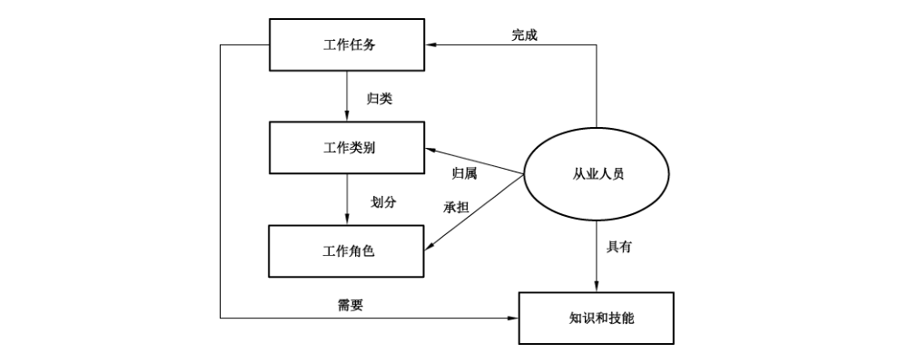

# GB/T 42446-2023 信息安全技术 网络安全从业人员能力基本要求

> 来源：[GB/T 42446-2023 国家标准详情](https://openstd.samr.gov.cn/bzgk/std/newGbInfo?hcno=AD7E0F02219B63653BF850759A1030C4)；封面发布日期：2023-03-17；实施日期：2023-10-01。
> PDF SHA-256：76df72c77f1c9d331ca8e92532ff70bf9fdab7403c13c6b73e2c27b5d59e66b4。
> 转写说明：按官方 PDF 全部 22 页的页面图像核对正文、图表和附录；省略封面、目录、页眉、页脚和页码，合并跨页内容。正式引用请核对原 PDF。

## 前言

本文件按照 GB/T 1.1—2020《标准化工作导则 第1部分：标准化文件的结构和起草规则》的规定起草。

请注意本文件的某些内容可能涉及专利。本文件的发布机构不承担识别专利的责任。

本文件由全国信息安全标准化技术委员会（SAC/TC 260）提出并归口。

本文件起草单位：中国电子技术标准化研究院、中国信息安全测评中心、中国网络安全审查技术与认证中心、北京时代新威信息技术有限公司、国家计算机网络应急技术处理协调中心、三六零安全科技股份有限公司、中电长城网际系统应用有限公司、深信服科技股份有限公司、北京交通大学、北京邮电大学、西安电子科技大学、北京航空航天大学、上海交通大学、西安邮电大学、中国移动通信集团有限公司、国家工业信息安全发展研究中心、国家计算机网络应急技术处理协调中心北京分中心、中国交通通信信息中心、中国科学院信息工程研究所、公安部第三研究所、华为技术有限公司、蚂蚁科技集团股份有限公司、北京天融信网络安全技术有限公司、西安交大捷普网络科技有限公司、长扬科技（北京）股份有限公司、广东省信息安全测评中心、国网新疆电力有限公司电力科学研究院、上海观安信息技术股份有限公司、沈阳东软系统集成工程有限公司、北京神州绿盟科技集团股份有限公司、北京安信天行科技有限公司、粤港澳大湾区精准医学研究院、深圳开源互联网安全技术有限公司。

本文件主要起草人：王惠莅、上官晓丽、王秉政、王新杰、张晓菲、尤其、陈世俊、王庆、何宛馨、潘文博、王星、闵京华、张彬哲、张记卫、付夏冰、刘吉强、王伟、李超、陆天波、马文平、刘建伟、伍前红、范博、张东举、石岩、孟魁、张勇、贵重、赵红、邱勤、陈雪鸿、陈亮、谢江、杜渐、邵萌、白晓媛、李跃忠、杨剑、刘玉岭、马晓欢、何建峰、汪义舟、崔顺艳、李艳杰、邹振婉、路娜、梁世伟、安亚鹏、唐川、宋荆汉、何晓霞。

## 1 范围

本文件确立了网络安全从业人员分类，规定了各类从业人员具备的知识和技能要求。

本文件适用于各类组织对网络安全从业人员的使用、培养、评价、管理等。

## 2 规范性引用文件

下列文件中的内容通过文中的规范性引用而构成本文件必不可少的条款。其中，注日期的引用文件，仅该日期对应的版本适用于本文件；不注日期的引用文件，其最新版本（包括所有的修改单）适用于本文件。

- GB/T 25069—2022 信息安全技术 术语

## 3 术语和定义

GB/T 25069—2022界定的以及下列术语和定义适用于本文件。

### 3.1 网络安全从业人员 cybersecurity workforce

从事网络安全工作，承担相应网络安全职责，并具有相应网络安全知识和技能的人员。

### 3.2 知识 knowledge

通过经验或教育获取的事实、信息、真理、原理或者领悟。

［来源：GB/T 27203—2016,2.56］

### 3.3 技能 skill

通过教育、培训、经验或其他方式完成任务的一种才能。

### 3.4 能力 competence

综合运用知识和技能达到预期目的的本领。

［来源：ISO/IEC 28000:2022,3.10］

## 4 通则

### 4.1 组成要素及其关系

网络安全从业人员完成工作任务需要具备相应的能力。工作任务是指为了实现组织的相关目标，需要执行的与网络安全有关的一个或一组工作活动和/或工作内容。工作类别是指将相似的一组网络安全工作任务，或某一阶段需要完成的工作任务归类在一起，得到的不同的网络安全工作种类。工作角色是指执行一项或多项网络安全工作任务的行为和责任。工作类别中的工作任务需要由承担不同工作角色的网络安全从业人员来完成，从业人员应具有完成工作任务所需要的知识和技能。知识体系应按照附录A构建，技能体系应按照附录B构建，完成工作任务所需具备的知识和技能见附录C。从业人员、工作任务、工作类别、工作角色、知识和技能之间关系如图1所示。

图 1 表明：工作任务归类为工作类别，工作类别划分为工作角色；从业人员归属工作类别、承担工作角色并完成工作任务，具备任务所需的知识和技能。

### 4.2 工作类别和工作角色

工作类别分为5类，包括网络安全管理、网络安全建设、网络安全运营、网络安全审计和评估以及网络安全科研教育，工作类别及工作任务见表1。

**表1 工作类别及工作任务**

| 序号 | 工作类别 | 承担的工作任务 |
| --- | --- | --- |
| 1 | 网络安全管理 | 网络安全需求分析；网络安全规划和管理；网络数据安全保护；个人信息保护；密码技术应用；网络安全咨询 |
| 2 | 网络安全建设 | 网络安全需求分析；网络安全架构设计；网络安全开发；供应链安全管理；网络安全集成实施；网络数据安全保护；个人信息保护；密码技术应用 |
| 3 | 网络安全运营 | 网络安全运维；网络安全监测和分析；网络安全应急管理；网络数据安全保护；个人信息保护；密码技术应用 |
| 4 | 网络安全审计和评估 | 网络安全审计；网络安全测试；网络安全评估；网络安全认证；电子数据取证 |
| 5 | 网络安全科研教育 | 网络安全研究；网络安全培训和评价 |

从业人员应具备完成其所承担工作角色所赋予的工作任务所需的知识和技能。当一种工作类别中的全部工作任务由一个工作角色承担时，被赋予这个工作角色的从业人员应满足完成该工作类别全部工作任务所具备的知识和技能要求。当一种工作类别的工作任务由多个工作角色承担时，根据所承担的工作任务情况，被赋予工作角色的从业人员应具备完成相应工作任务所需的知识和技能。

注1：工作岗位是组织根据自身实际情况对工作角色的落实，一个工作岗位可落实一个或多个工作角色，一个工作角色可被一个或多个岗位落实，落实相同工作角色的工作岗位在不同组织中的岗位名称可能不同，组织按其设置的工作岗位分配从业人员的工作。

注2：本文件不对掌握知识和技能的程度提出要求，组织可根据实际业务情况规定。

第5章给出了网络安全从业人员完成工作任务应具备的通用知识和通用技能要求，所有类别的从业人员都应具备。第6章给出了承担相应工作类别的从业人员应具备的基本专业知识和技能要求，当从业人员只承担工作类别中的部分工作任务时，从业人员应具备该工作类别中相对应的知识和技能，不必具备所有的知识和技能。因不同组织对工作角色的划分存在不同，附录D给出了一种典型工作角色分类示例。附录E给出了工作类别、工作角色与国家网络安全职业设置的映射关系。

### 4.3 工作任务

网络安全主要工作任务及任务描述见表2。

**表2 网络安全主要工作任务及任务描述**

| 序号 | 工作任务 | 工作任务描述 |
| --- | --- | --- |
| 1 | 网络安全规划和管理 | 指导、制定、监督和执行网络安全战略规划、策略制度和体制机制。综合协调相关人员，采取各类网络安全控制措施，降低并缓解系统安全风险 |
| 2 | 网络数据安全保护 | 针对网络数据收集、存储、使用、加工、传输、提供、公开等环节，采取措施保障网络数据安全 |
| 3 | 个人信息保护 | 针对个人信息收集、存储、使用、加工、传输、提供、公开、删除等环节，采取措施保障个人信息安全 |
| 4 | 密码技术应用 | 运用密码技术，进行信息系统安全密码保障的架构设计、系统集成、检测评估、运维管理、密码咨询等 |
| 5 | 网络安全需求分析 | 依据法律法规、政策标准及业务流程要求，开展符合性需求分析、业务所依赖的信息通信技术（ICT）持续运行需求分析、数据安全需求分析等，定期或在遇到重大网络安全事件时对组织网络安全需求进行复审 |
| 6 | 网络安全架构设计 | 依据网络安全需求分析、ICT 基础设施现状、组织环境和业务特点等，从物理环境、通信网络、计算环境、区域边界等方面进行网络安全架构设计，形成网络安全架构实施方案 |
| 7 | 网络安全开发 | 实现软件、硬件安全架构及功能开发，并对其进行测试、更新和维护 |
| 8 | 供应链安全管理 | 运用供应链安全管理的方法、工具和技术，控制供应链安全风险，管理供应商及网络安全和信息化相关产品和服务的采购 |
| 9 | 网络安全集成实施 | 网络安全项目管理，信息系统安全集成过程中软硬件设备与系统的安装、调试、测试、配置、故障处理和工程实施，以及配合验收交付 |
| 10 | 网络安全运维 | 利用网络安全技术/工具，根据网络安全相关标准和制度流程，操作、运行、维护和管理信息系统 |
| 11 | 网络安全监测和分析 | 利用相关技术、工具和情报信息等对目标系统进行安全监测、分析和预警，并提出应对威胁的措施和改进建议 |
| 12 | 网络安全应急管理 | 组织编制网络安全事件应急预案，实施网络安全应急演练，在应对突发/重大网络安全事件时，采取必要的应急处置措施将信息系统和业务恢复到正常状态，并进行事件溯源和调查取证 |
| 13 | 网络安全审计 | 依据审计依据，在规定的审计范围内，监督和评价网络安全控制措施的设计有效性和执行有效性，确定被审计对象满足审计依据的程度，并提出网络安全工作改进的意见和建议 |
| 14 | 网络安全测试 | 对目标系统的脆弱性和防御机制有效性进行验证，发现安全问题并提出改进建议；根据测试依据，识别并测试系统和产品的安全性 |
| 15 | 网络安全评估 | 评估信息系统、业务及相关网络数据等的符合性和面临的网络安全风险，对风险进行识别、分析、评价，提出改进建议 |
| 16 | 网络安全认证 | 对网络安全管理体系、服务、产品等开展认证与审核 |
| 17 | 电子数据取证 | 对电子数据进行提取、固定、恢复、分析等工作 |
| 18 | 网络安全咨询 | 根据组织的安全目标，提供安全规划、设计、实施、运维、管理等方面的政策法规和技术咨询服务 |
| 19 | 网络安全研究 | 研究网络空间安全涉及的学科理论基础和方法论，研究网络安全新兴技术及应用、产业发展趋势，以及网络安全法律法规、政策、标准等 |
| 20 | 网络安全培训和评价 | 开展网络安全培训方案和相关课程的设计、开发和持续改进，实施授课等培训活动，开展评价活动，例如：理论知识考试、技能操作考核、业绩评审、竞赛选拔等 |

## 5 通用知识和技能要求

### 5.1 通用知识要求

网络安全从业人员应具备网络安全基础（知识领域代码：K01）相关知识。涉及具体行业或领域的，还应具备相关的专项领域知识（知识领域代码：K10）。

### 5.2 通用技能要求

网络安全从业人员应具备以下技能：

a） 能与组织内部和/或外部沟通与协调（技能代码：S01-001）；

b） 能理解组织业务，识别网络安全目标（技能代码：S01-002）；

c） 能建立和/或执行网络安全相关制度、策略或机制（技能代码：S01-003）；

d） 能理解和应用与组织网络安全目标相关的法律法规、政策和标准（技能代码：S01-004）。

## 6 专业知识和技能要求

### 6.1 网络安全管理类人员

#### 6.1.1 知识

网络安全管理类人员应至少具备网络安全管理（知识领域代码：K02）相关知识。

#### 6.1.2 技能

网络安全管理类人员应至少具备以下技能：

a） 能制定和实施网络安全规划（技能代码：S02-01-001）；

b） 能协调/提供网络安全保障资源（技能代码：S02-01-002）；

c） 能组织执行风险管理，预判安全风险趋势（技能代码：S02-01-003）；

d） 能组织建立和运行应急体系（技能代码：S02-01-004）；

e） 能组织建立、运行和评估网络安全防护体系（技能代码：S02-01-005）；

f） 能对网络数据安全、个人信息保护和密码管理等进行规划和管理（技能代码：S02-01-006）；

g） 能帮助用户识别和确定网络安全需求（技能代码：S02-18-001）；

h）能帮助用户进行网络安全方面的规划和设计（技能代码：S02-18-002）；

i） 能帮助用户建立网络安全管理体系、技术体系和应急体系（技能代码：S02-18-003）。

### 6.2 网络安全建设类人员

#### 6.2.1 知识

网络安全建设类人员应至少具备以下知识。

a） 数据安全知识（知识领域代码：K03）。

b） 网络安全建模技术知识（知识领域代码：K04）。

c） 密码技术与应用知识（知识领域代码：K09）。

d） 网络安全开发、测试及攻防技术知识（知识领域代码：K05）中的：

- 安全开发（知识代码：K05-001）；
- 系统安全工程（知识代码：K05-002）；
- 网络安全威胁和漏洞管理（知识代码：K05-003）；
- 安全测试、评估方法（知识代码：K05-004）。

#### 6.2.2 技能

网络安全建设类人员应至少具备以下技能：

a） 能识别网络安全保护对象，并分析其面临的安全风险（技能代码：S02-05-001）；

b） 能理解网络安全需求（技能代码：S02-06-001）；

c） 能设计网络安全架构（技能代码：S02-06-002）；

d） 能完成网络安全及信息化设备选型（技能代码：S02-06-003）；

e） 能用特定语言、常见安全框架与组件和软件安全开发方法进行安全编码（技能代码：S02-07-001）；

f） 能管理代码安全漏洞（技能代码：S02-07-002）；

g） 能设计和执行安全测试计划、方法和用例（技能代码：S02-07-003）；

h） 能识别供应链安全风险（技能代码：S02-08-001）；

i） 能实施供应链安全保护（技能代码：S02-08-002）；

j） 能对供应链安全实施风险评估（技能代码：S02-08-003）；

k） 能识别数据在不同环节、不同业务应用场景下面临的安全风险（技能代码：S02-02-001）；

l） 能运用数据安全工具、方法和技术保护数据安全（技能代码：S02-02-002）；

m） 能识别个人信息在不同环节面临的安全风险（技能代码：S02-03-001）；

n） 能运用个人信息保护工具、方法和技术保护个人信息（技能代码：S02-03-002）；

o） 能识别密码需求并编制密码应用方案（技能代码：S02-04-001）；

p） 能运用密码保护产品、方法和技术实施密码保护（技能代码：S02-04-002）；

q） 能完成网络安全及信息化产品部署、配置、调试及设置（技能代码：S02-09-001）；

r） 能使用测试工具和测试方法实施安全集成测试（技能代码：S02-09-002）；

s） 能诊断和解决系统集成过程中的异常问题（技能代码：S02-09-003）。

### 6.3 网络安全运营类人员

#### 6.3.1 知识

网络安全运营类人员应至少具备以下知识：

a） 数据安全知识（知识领域代码：K03）；

b） 网络产品原理与应用知识（知识领域代码：K06）；

c） 网络安全监测分析技术知识（知识领域代码：K07）；

d） 密码技术与应用知识（知识领域代码：K09）。

#### 6.3.2 技能

网络安全运营类人员应至少具备以下技能：

a） 能维护网络及网络设备的安全运行（技能代码：S02-10-001）；

b）能维护操作系统、服务器、存储设备及终端设备等的安全运行（技能代码：S02-10-002）；

c） 能完成应用系统、中间件的管理、维护和安全防护工作（技能代码：S02-10-003）；

d） 能完成数据库系统管理、维护和安全防护等（技能代码：S02-10-004）；

e） 能收集、整理、管理威胁信息（技能代码：S02-11-001）；

f） 能识别并评估可能危及组织和/或合作伙伴利益的网络威胁和事件（技能代码：S02-11-002）；

g） 能使用各类方法和工具进行网络安全监控分析（技能代码：S02-11-003）；

h） 能对网络威胁和安全事件进行跟踪响应和处置（技能代码：S02-12-001）；

i） 能运用数据安全工具、方法和技术保护数据安全（技能代码：S02-02-002）；

j） 能运用个人信息保护工具、方法和技术保护个人信息（技能代码：S02-03-002）；

k）能运用密码保护产品、方法和技术实施密码保护（技能代码：S02-04-002）；

l） 能编制网络安全事件应急预案（技能代码：S02-12-002）；

m）能完成网络安全事件发现、研判和信息报送（技能代码：S02-12-003）；

n） 能利用常见安全技术手段，对网络安全事件进行威胁抑制、入侵排查、追踪溯源（技能代码：S02-12-004）；

o） 能依据应急预案开展应急演练（技能代码：S02-12-005）。

### 6.4 网络安全审计和评估类人员

#### 6.4.1 知识

网络安全审计和评估类人员应至少具备以下知识。

a） 数据安全知识（知识领域代码：K03）。

b） 网络安全开发、测试及攻防技术知识（知识领域代码：K05）。

c） 网络产品原理与应用知识（知识领域代码：K06）。

d） 调查取证技术知识（知识领域代码：K08）。

e） 密码技术与应用知识（知识领域代码：K09）。

f） 网络安全管理知识（知识领域代码：K02）中的：

- 网络安全审计方法和技术（知识代码：K02-004）；
- 网络安全认证认可（知识代码：K02-005）。

#### 6.4.2 技能

网络安全审计和评估类人员应至少具备以下技能：

a） 能完成脆弱性测试和渗透性测试（技能代码：S02-13-001）；

b） 能对被测系统提出修复防护建议（技能代码：S02-13-002）；

c） 能识别资产、威胁、脆弱性和已有安全控制措施（技能代码：S02-14-001）；

d） 能使用各类评估相关工具和方法分析并评价安全风险（技能代码：S02-14-002）；

e） 能根据风险分析结果，提出风险处置建议，并编制评估报告（技能代码：S02-14-003）；

f） 能对数据安全开展风险评估，并提出整改建议（技能代码：S02-02-003）；

g） 能对个人信息保护工作进行符合性审查，并提出整改建议（技能代码：S02-03-003）；

h） 能对信息系统密码应用安全性进行评估并提出整改建议（技能代码：S02-04-003）；

i） 能评估和管理网络安全审计风险（技能代码：S02-15-001）；

j） 能管理、组织和实施审计（技能代码：S02-15-002）；

k） 能做出审计结论、提出审计建议、编制网络安全审计报告，并跟踪审计（技能代码：S02-15-003）；

l） 能对受审核方的信息进行收集和分析（技能代码：S02-16-001）；

m） 能按照审核准则编制审核计划（技能代码：S02-16-002）；

n） 能依据审核计划开展审核活动，发现不符合项并编制审核报告（技能代码：S02-16-003）；

o） 能使用各类取证方法和工具进行调查取证（技能代码：S02-17-001）；

p） 能完成电子数据恢复（技能代码：S02-17-002）；

q） 能完成电子数据证据的提取、固定和保护（技能代码：S02-17-003）；

r） 能完成电子数据证据的勘验、分析和归档（技能代码：S02-17-004）。

### 6.5 网络安全科研教育类人员

#### 6.5.1 知识

网络安全科研教育类人员应至少具备相关的专项领域知识（知识领域代码：K10）。

#### 6.5.2 技能

网络安全科研教育类人员应至少具备以下技能：

a） 能掌握国内外研究领域发展现状和趋势（技能代码：S02-19-001）；

b） 能运用相关知识，开展网络安全研究和创新，例如研究新技术及应用、法律法规、政策文件、标准等（技能代码：S02-19-002）；

c） 能开展网络安全学术交流（技能代码：S02-19-003）；

d） 能识别和分析网络安全职业培训需求（技能代码：S02-20-001）；

e） 能根据培训需求设计培训课程，实施网络安全培训，改进所培训的内容（技能代码：S02-20-002）；

f） 能对被培训人员掌握知识和技能的程度进行评价（技能代码：S02-20-003）。

## 附录 A（规范性）网络安全知识体系

网络安全知识体系及代码见表 A.1。

**表 A.1 网络安全知识体系**

| 序号 | 知识领域 | 知识代码 | 知识单元 | 知识描述 |
| --- | --- | --- | --- | --- |
| 1 | 网络安全基础 K01 | K01-001 | 网络安全概念及发展历程 | 信息安全概念、信息安全属性、信息安全视角、信息安全保障框架模型；网络安全发展历程、发展现状和发展趋势等；国内外网络安全产业发展情况等 |
| 2 | 网络安全基础 K01 | K01-002 | 网络安全管理基本知识 | 风险管理、供应链安全管理、运营管理、应急管理、业务连续性、管理体系、认证认可、漏洞管理等基本知识 |
| 3 | 网络安全基础 K01 | K01-003 | 网络安全技术基本知识 | 网络体系、通信技术、计算机组成原理、操作系统、密码学基础、PKI/CA 体系、身份鉴别、访问控制等基本知识 |
| 4 | 网络安全基础 K01 | K01-004 | 国内外网络安全法律法规和政策 | 国内外网络安全法律法规政策战略和监管机制等 |
| 5 | 网络安全基础 K01 | K01-005 | 国内外网络安全标准 | 国内、国外、国际网络安全标准 |
| 6 | 网络安全基础 K01 | K01-006 | 网络安全最佳实践 | 解决方案或者经验等 |
| 7 | 网络安全管理知识 K02 | K02-001 | 供应链安全管理 | 国内外供应链安全发展现状；供应链安全管理方法、技术及工具等 |
| 8 | 网络安全管理知识 K02 | K02-002 | 应急管理方法和技术 | 业务连续性，事件管理，应急预案编制、维护和演练等；操作系统、中间件、数据库等常用应急处置方法 |
| 9 | 网络安全管理知识 K02 | K02-003 | 网络安全风险管理 | 风险评估、风险处置等方法、技术和实施 |
| 10 | 网络安全管理知识 K02 | K02-004 | 网络安全审计方法和技术 | 通用审计准则和方法；网络安全审计准则、方法、审计技术、信息化项目管理等 |
| 11 | 网络安全管理知识 K02 | K02-005 | 网络安全认证认可 | 认证相关基本概念、认可相关基本概念、审核知识等 |
| 12 | 数据安全知识 K03 | K03-001 | 数据安全管理和技术 | 数据安全基本概念、数据安全技术、数据安全治理与保障等 |
| 13 | 数据安全知识 K03 | K03-002 | 个人信息保护管理和技术 | 个人信息保护政策，个人信息保护技术、工具等 |
| 14 | 网络安全建模技术知识 K04 | K04-001 | 系统建模理论和常用方法 | 数学基础、模型概念、建模原理、系统建模方法等 |
| 15 | 网络安全建模技术知识 K04 | K04-002 | 威胁建模理论和常用方法 | 威胁建模的作用、常用的威胁建模方法等 |
| 16 | 网络安全建模技术知识 K04 | K04-003 | 安全架构模型及设计方法 | 网络安全架构、系统安全架构模型及常用设计方法等 |
| 17 | 网络安全开发、测试及攻防技术知识 K05 | K05-001 | 安全开发 | 软件安全设计、代码实现安全、资源使用安全、配置管理安全、软件工程等 |
| 18 | 网络安全开发、测试及攻防技术知识 K05 | K05-002 | 系统安全工程 | 系统安全工程理论及实施等 |
| 19 | 网络安全开发、测试及攻防技术知识 K05 | K05-003 | 网络安全威胁和漏洞管理 | 威胁和漏洞概念，漏洞的发现、利用和提交等技术、方法和流程 |
| 20 | 网络安全开发、测试及攻防技术知识 K05 | K05-004 | 安全测试、评估方法 | 常用测试和评估方法，如黑盒测试、灰盒测试、白盒测试及压力测试等 |
| 21 | 网络安全开发、测试及攻防技术知识 K05 | K05-005 | 渗透测试方法和技术 | Web 安全、中间件、数据库等常见安全漏洞及利用方法，安全渗透测试知识，常用渗透测试工具等 |
| 22 | 网络安全开发、测试及攻防技术知识 K05 | K05-006 | 网络攻防技术 | 网络攻击原理、常见攻击方法、攻击技术和攻击后果，以及防御措施等 |
| 23 | 网络产品原理与应用知识 K06 | K06-001 | 备份/灾备方法与技术 | 系统和数据的备份/恢复、灾备方法与技术等 |
| 24 | 网络产品原理与应用知识 K06 | K06-002 | 网络设备功能及原理 | 交换机、路由器等网络设备工作原理、配置及网络架构设计相关知识 |
| 25 | 网络产品原理与应用知识 K06 | K06-003 | 网络安全产品功能及原理 | 网络安全产品原理及应用（防火墙、入侵检测、网闸、VPN 等）等 |
| 26 | 网络产品原理与应用知识 K06 | K06-004 | 操作系统安全原理及使用 | Windows 和 Linux/Unix 等主流操作系统、虚拟机和容器等常用安全技术、安全配置和安全加固 |
| 27 | 网络产品原理与应用知识 K06 | K06-005 | 中间件安全原理及使用 | 中间件功能原理（通信支持、应用支持、公共服务等）、安全配置及安全加固等 |
| 28 | 网络产品原理与应用知识 K06 | K06-006 | 数据库安全技术及使用 | 数据库安全防护技术及方法、安全配置和加固，包括数据库的加密、用户管理、备份还原、数据脱敏、审计等 |
| 29 | 网络安全监测分析技术知识 K07 | K07-001 | 网络安全监测方法和技术 | 流量监控、事件监控、容量监控等 |
| 30 | 网络安全监测分析技术知识 K07 | K07-002 | 网络安全分析方法和技术 | 网络流量分析、恶意代码、日志分析等 |
| 31 | 调查取证技术知识 K08 | K08-001 | 调查取证方法和技术 | 电子数据取证概念、取证模型、电子数据取证管理、电子数据证据的勘验和司法鉴定流程、电子数据取证相关技术等 |
| 32 | 密码技术与应用知识 K09 | K09-001 | 密码技术、密码产品及服务功能及原理 | 密码算法、协议、密钥管理等相关技术、工具、产品、服务及解决方案等 |
| 33 | 专项领域知识 K10 | K10-001 | 新技术新应用安全 | 云计算、大数据、物联网、人工智能、区块链、5G等 |
| 34 | 专项领域知识 K10 | K10-002 | 特定行业网络安全知识 | 电信、能源、金融、交通等行业特定的网络安全知识 |
| 35 | 专项领域知识 K10 | K10-003 | 本研究领域相关知识 | 本研究领域发展现状及趋势，基础理论、技术及工具使用方法等 |
| 36 | 专项领域知识 K10 | K10-004 | 所开发课程涉及的专业知识 | 所开发课程的相关理论、技术及工具使用方法等 |

## 附录 B（规范性）网络安全技能体系

网络安全技能体系及代码见表 B.1。

**表 B.1 网络安全技能体系**

| 技能类别 | 代码 | 技能描述 |
| --- | --- | --- |
| 通用技能 S01 | S01-001 | 能与组织内部和/或外部沟通与协调 |
| 通用技能 S01 | S01-002 | 能理解组织业务，识别网络安全目标 |
| 通用技能 S01 | S01-003 | 能建立和/或执行网络安全相关制度、策略或机制 |
| 通用技能 S01 | S01-004 | 能理解和应用与组织网络安全目标相关的法律法规、政策和标准 |
| 专业技能 S02 | — | — |
| 网络安全管理 S02-01 | S02-01-001 | 能制定和实施网络安全规划 |
| 网络安全管理 S02-01 | S02-01-002 | 能协调/提供网络安全保障资源 |
| 网络安全管理 S02-01 | S02-01-003 | 能组织执行风险管理，预判安全风险趋势 |
| 网络安全管理 S02-01 | S02-01-004 | 能组织建立和运行应急体系 |
| 网络安全管理 S02-01 | S02-01-005 | 能组织建立、运行和评估网络安全防护体系 |
| 网络安全管理 S02-01 | S02-01-006 | 能对网络数据安全、个人信息保护和密码管理等进行规划和管理 |
| 数据安全 S02-02 | S02-02-001 | 能识别数据在不同环节、不同业务应用场景下面临的安全风险 |
| 数据安全 S02-02 | S02-02-002 | 能运用数据安全工具、方法和技术保护数据安全 |
| 数据安全 S02-02 | S02-02-003 | 能对数据安全开展风险评估，并提出整改建议 |
| 个人信息保护 S02-03 | S02-03-001 | 能识别个人信息在不同环节面临的安全风险 |
| 个人信息保护 S02-03 | S02-03-002 | 能运用个人信息保护工具、方法和技术保护个人信息 |
| 个人信息保护 S02-03 | S02-03-003 | 能对个人信息保护工作进行符合性审查，并提出整改建议 |
| 密码管理 S02-04 | S02-04-001 | 能识别密码需求并编制密码应用方案 |
| 密码管理 S02-04 | S02-04-002 | 能运用密码保护产品、方法和技术实施密码保护 |
| 密码管理 S02-04 | S02-04-003 | 能对信息系统密码应用安全性进行评估并提出整改建议 |
| 网络安全需求分析 S02-05 | S02-05-001 | 能识别网络安全保护对象，并分析其面临的安全风险 |
| 网络安全架构设计 S02-06 | S02-06-001 | 能理解网络安全需求 |
| 网络安全架构设计 S02-06 | S02-06-002 | 能设计网络安全架构 |
| 网络安全架构设计 S02-06 | S02-06-003 | 能完成网络安全及信息化设备选型 |
| 网络安全开发 S02-07 | S02-07-001 | 能用特定语言、常见安全框架与组件和软件安全开发方法进行安全编码 |
| 网络安全开发 S02-07 | S02-07-002 | 能管理代码安全漏洞 |
| 网络安全开发 S02-07 | S02-07-003 | 能设计和执行安全测试计划、方法和用例 |
| 供应链安全 S02-08 | S02-08-001 | 能识别供应链安全风险 |
| 供应链安全 S02-08 | S02-08-002 | 能实施供应链安全保护 |
| 供应链安全 S02-08 | S02-08-003 | 能对供应链安全实施风险评估 |
| 网络安全集成 S02-09 | S02-09-001 | 能完成网络安全及信息化产品部署、配置、调试及设置 |
| 网络安全集成 S02-09 | S02-09-002 | 能使用测试工具和测试方法实施安全集成测试 |
| 网络安全集成 S02-09 | S02-09-003 | 能诊断和解决系统集成过程中的异常问题 |
| 网络安全运维 S02-10 | S02-10-001 | 能维护网络及网络设备的安全运行 |
| 网络安全运维 S02-10 | S02-10-002 | 能维护操作系统、服务器、存储设备及终端设备等的安全运行 |
| 网络安全运维 S02-10 | S02-10-003 | 能完成应用系统、中间件的管理、维护和安全防护工作 |
| 网络安全运维 S02-10 | S02-10-004 | 能完成数据库系统管理、维护和安全防护等 |
| 网络安全监测和分析 S02-11 | S02-11-001 | 能收集、整理、管理威胁信息 |
| 网络安全监测和分析 S02-11 | S02-11-002 | 能识别并评估可能危及组织和/或合作伙伴利益的网络威胁和事件 |
| 网络安全监测和分析 S02-11 | S02-11-003 | 能使用各类方法和工具进行网络安全监控分析 |
| 网络安全应急 S02-12 | S02-12-001 | 能对网络威胁和安全事件进行跟踪响应和处置 |
| 网络安全应急 S02-12 | S02-12-002 | 能编制网络安全事件应急预案 |
| 网络安全应急 S02-12 | S02-12-003 | 能完成网络安全事件发现、研判和信息报送 |
| 网络安全应急 S02-12 | S02-12-004 | 能利用常见安全技术手段，对网络安全事件进行威胁抑制、入侵排查、追踪溯源 |
| 网络安全应急 S02-12 | S02-12-005 | 能依据应急预案开展应急演练 |
| 网络安全测试 S02-13 | S02-13-001 | 能完成脆弱性测试和渗透性测试 |
| 网络安全测试 S02-13 | S02-13-002 | 能对被测系统提出修复防护建议 |
| 网络安全评估 S02-14 | S02-14-001 | 能识别资产、威胁、脆弱性和已有安全控制措施 |
| 网络安全评估 S02-14 | S02-14-002 | 能使用各类评估相关工具和方法分析并评价安全风险 |
| 网络安全评估 S02-14 | S02-14-003 | 能根据风险分析结果，提出风险处置建议，并编制评估报告 |
| 网络安全审计 S02-15 | S02-15-001 | 能评估和管理网络安全审计风险 |
| 网络安全审计 S02-15 | S02-15-002 | 能管理、组织和实施审计 |
| 网络安全审计 S02-15 | S02-15-003 | 能做出审计结论、提出审计建议、编制网络安全审计报告，并跟踪审计 |
| 网络安全认证 S02-16 | S02-16-001 | 能对受审核方的信息进行收集和分析 |
| 网络安全认证 S02-16 | S02-16-002 | 能按照审核准则编制审核计划 |
| 网络安全认证 S02-16 | S02-16-003 | 能依据审核计划开展审核活动，发现不符合项并编制审核报告 |
| 电子数据取证 S02-17 | S02-17-001 | 能使用各类取证方法和工具进行调查取证 |
| 电子数据取证 S02-17 | S02-17-002 | 能完成电子数据恢复 |
| 电子数据取证 S02-17 | S02-17-003 | 能完成电子数据证据的提取、固定和保护 |
| 电子数据取证 S02-17 | S02-17-004 | 能完成电子数据证据的勘验、分析和归档 |
| 网络安全咨询 S02-18 | S02-18-001 | 能帮助用户识别和确定网络安全需求 |
| 网络安全咨询 S02-18 | S02-18-002 | 能帮助用户进行网络安全方面的规划和设计 |
| 网络安全咨询 S02-18 | S02-18-003 | 能帮助用户建立网络安全管理体系、技术体系和应急体系 |
| 网络安全科研 S02-19 | S02-19-001 | 能掌握国内外研究领域发展现状和趋势 |
| 网络安全科研 S02-19 | S02-19-002 | 能运用相关知识，开展网络安全研究和创新，例如研究新技术及应用、法律法规、政策文件、标准等 |
| 网络安全科研 S02-19 | S02-19-003 | 能开展网络安全学术交流 |
| 网络安全培训和评价 S02-20 | S02-20-001 | 能识别和分析网络安全职业培训需求 |
| 网络安全培训和评价 S02-20 | S02-20-002 | 能根据培训需求设计培训课程，实施网络安全培训，改进所培训的内容 |
| 网络安全培训和评价 S02-20 | S02-20-003 | 能对被培训人员掌握知识和技能的程度进行评价 |

## 附录 C（资料性）完成工作任务所需的知识和技能

承担某项工作任务的网络安全从业人员所需具备的知识和技能参见表 C.1，组织可根据实际业务情况调整。

**表 C.1 完成工作任务所需的知识和技能**

| 序号 | 工作任务 | 对应相关知识 | 对应相关技能 |
| --- | --- | --- | --- |
| 1 | 网络安全规划和管理 | K01-001、K01-002、K01-003、K01-004、K01-005、K01-006、K02-001、K02-002、K02-003、K02-004、K02-005 | S01-001、S01-002、S01-003、S01-004、S02-01-001、S02-01-002、S02-01-003、S02-01-004、S02-01-005、S02-01-006 |
| 2 | 网络数据安全保护 | K01-001、K01-002、K01-003、K01-004、K01-005、K01-006、K03-001 | S01-001、S01-002、S01-003、S01-004、S02-02-001、S02-02-002、S02-02-003 |
| 3 | 个人信息保护 | K01-001、K01-002、K01-003、K01-004、K01-005、K01-006、K03-002 | S01-001、S01-002、S01-003、S01-004、S02-03-001、S02-03-002、S02-03-003 |
| 4 | 密码技术应用 | K01-001、K01-002、K01-003、K01-004、K01-005、K01-006、K09-001 | S01-001、S01-002、S01-003、S01-004、S02-04-001、S02-04-002、S02-04-003 |
| 5 | 网络安全需求分析 | K01-001、K01-002、K01-003、K01-004、K01-005、K01-006、K04-001、K06-003、K10-001、K10-002 | S01-001、S01-002、S01-003、S01-004、S02-05-001 |
| 6 | 网络安全架构设计 | K01-001、K01-002、K01-003、K01-004、K01-005、K01-006、K04-002、K04-003、K05-003、K05-006、K10-001、K10-002 | S01-001、S01-002、S01-003、S01-004、S02-06-001、S02-06-002、S02-06-003 |
| 7 | 网络安全开发 | K01-001、K01-002、K01-003、K01-004、K01-005、K01-006、K04-002、K05-001、K05-002、K05-003、K05-004、K10-001、K10-002 | S01-001、S01-002、S01-003、S01-004、S02-07-001、S02-07-002、S02-07-003 |
| 8 | 供应链安全管理 | K01-001、K01-002、K01-003、K01-004、K01-005、K01-006、K02-001、K10-001、K10-002 | S01-001、S01-002、S01-003、S01-004、S02-08-001、S02-08-002、S02-08-003 |
| 9 | 网络安全集成实施 | K01-001、K01-002、K01-003、K01-004、K01-005、K01-006、K05-002、K05-003、K05-004、K10-001、K10-002 | S01-001、S01-002、S01-003、S01-004、S02-09-001、S02-09-002、S02-09-003 |
| 10 | 网络安全运维 | K01-001、K01-002、K01-003、K01-004、K01-005、K01-006、K05-003、K05-006、K06-001、K06-002、K06-003、K06-004、K06-005、K06-006、K07-001、K07-002、K10-001、K10-002 | S01-001、S01-002、S01-003、S01-004、S02-10-001、S02-10-002、S02-10-003、S02-10-004 |
| 11 | 网络安全监测和分析 | K01-001、K01-002、K01-003、K01-004、K01-005、K01-006、K02-002、K05-003、K05-005、K05-006、K06-002、K06-003、K07-001、K07-002、K10-001、K10-002 | S01-001、S01-002、S01-003、S01-004、S02-11-001、S02-11-002、S02-11-003 |
| 12 | 网络安全应急管理 | K01-001、K01-002、K01-003、K01-004、K01-005、K01-006、K02-002、K05-003、K05-005、K05-006、K06-001、K07-001、K07-002、K08-001、K10-001、K10-002 | S01-001、S01-002、S01-003、S01-004、S02-12-001、S02-12-002、S02-12-003、S02-12-004、S02-12-005 |
| 13 | 网络安全审计 | K01-001、K01-002、K01-003、K01-004、K01-005、K01-006、K02-004、K10-001、K10-002 | S01-001、S01-002、S01-003、S01-004、S02-15-001、S02-15-002、S02-15-003 |
| 14 | 网络安全测试 | K01-001、K01-002、K01-003、K01-004、K01-005、K01-006、K02-003、K05-003、K05-004、K05-005、K07-002、K10-001、K10-002 | S01-001、S01-002、S01-003、S01-004、S02-13-001、S02-13-002 |
| 15 | 网络安全评估 | K01-001、K01-002、K01-003、K01-004、K01-005、K01-006、K02-003、K05-003、K05-005、K07-002、K10-001、K10-002 | S01-001、S01-002、S01-003、S01-004、S02-14-001、S02-14-002、S02-14-003 |
| 16 | 网络安全认证 | K01-001、K01-002、K01-003、K01-004、K01-005、K01-006、K02-003、K02-005、K10-001、K10-002 | S01-001、S01-002、S01-003、S01-004、S02-16-001、S02-16-002、S02-16-003 |
| 17 | 电子数据取证 | K01-001、K01-002、K01-003、K01-004、K01-005、K01-006、K08-001、K10-001、K10-002 | S01-001、S01-002、S01-003、S01-004、S02-17-001、S02-17-002、S02-17-003、S02-17-004 |
| 18 | 网络安全咨询 | K01-001、K01-002、K01-003、K01-004、K01-005、K01-006、K10-001、K10-002 | S01-001、S01-002、S01-003、S01-004、S02-18-001、S02-18-002、S02-18-003 |
| 19 | 网络安全研究 | K01-001、K01-002、K01-003、K01-004、K01-005、K01-006、K10-001、K10-002、K10-003 | S01-001、S01-002、S01-003、S01-004、S02-19-001、S02-19-002、S02-19-003 |
| 20 | 网络安全培训和评价 | K01-001、K01-002、K01-003、K01-004、K01-005、K01-006、K10-001、K10-002、K10-004 | S01-001、S01-002、S01-003、S01-004、S02-20-001、S02-20-002、S02-20-003 |

## 附录 D（资料性）工作角色分类示例

可将工作类别进一步划分为工作角色，表 D.1 给出了一种工作角色分类的示例。

**表 D.1 工作角色和工作任务对应关系**

| 序号 | 工作角色 | 工作任务 |
| --- | --- | --- |
| 1 | 网络安全管理人员 | 网络安全需求分析；网络安全规划和管理 |
| 2 | 数据安全保护人员 | 网络安全需求分析；网络数据安全保护 |
| 3 | 个人信息保护人员 | 网络安全需求分析；个人信息保护 |
| 4 | 密码应用人员 | 网络安全需求分析；密码技术应用 |
| 5 | 网络安全咨询人员 | 网络安全咨询 |
| 6 | 网络安全架构设计人员 | 网络安全需求分析；网络安全架构设计 |
| 7 | 网络安全开发集成人员 | 网络安全需求分析；网络安全开发；供应链安全管理；网络安全集成实施 |
| 8 | 网络安全运维人员 | 网络安全运维 |
| 9 | 网络安全监测分析人员 | 网络安全监测和分析 |
| 10 | 网络安全应急管理人员 | 网络安全应急管理 |
| 11 | 网络安全审计人员 | 网络安全审计 |
| 12 | 电子数据取证人员 | 电子数据取证 |
| 13 | 网络安全测评人员 | 网络安全测试；网络安全评估 |
| 14 | 网络安全防护人员 | 网络安全集成实施；网络安全运维；网络安全测试 |
| 15 | 网络安全认证人员 | 网络安全认证 |
| 16 | 网络安全科学研究人员 | 网络安全科学研究 |
| 17 | 网络安全培训人员 | 网络安全培训和评价 |
| 18 | 其他 |  |

## 附录 E（资料性）工作类别、工作角色与国家职业相关映射关系

国家职业分类中，涉及网络安全职业的共有 5 类，本文件中网络安全从业人员分类与国家网络安全职业分类映射关系见表 E.1。

**表 E.1 网络安全从业人员分类与国家网络安全职业分类映射关系**

| 序号 | 国家网络安全职业分类 | 映射的工作类别 | 映射的工作角色 |
| --- | --- | --- | --- |
| 1 | 2-02-10-07 信息安全工程技术人员 | 网络安全管理；网络安全建设；网络安全科研教育 | — |
| 2 | 4-04-04-02 网络与信息安全管理员 | 网络安全运营 | — |
| 3 | 4-04-04-02 网络与信息安全管理员，数据安全工种 | — | 数据安全保护人员 |
| 4 | 4-04-04-04 信息安全测试员 | — | 网络安全测评人员 |
| 5 | 4-04-05-08 电子数据取证分析师 | — | 电子数据取证人员 |
| 6 | 4-07-05-06 密码技术应用员 | — | 密码应用人员 |

## 参考文献

- ［1］ GB/T 6565—2015 职业分类与代码
- ［2］ GB/T 20988—2007 信息安全技术 信息系统灾难恢复规范
- ［3］ GB/T 22081—2016 信息技术 安全技术 信息安全控制实践指南
- ［4］ GB/T 27023—2016 合格评定 用于人员认证的人员能力词汇
- ［5］ GB/Z 32916—2016 信息技术 安全技术 信息安全控制措施审核员指南
- ［6］ GB/T 32924—2016 信息安全技术 网络安全预警指南
- ［7］ GB/T 35273—2020 信息安全技术 个人信息安全规范
- ［8］ GB/T 35288—2017 信息安全技术 电子认证服务机构从业人员岗位技能规范
- ［9］ GB/T 37696—2019 信息技术服务 从业人员能力评价要求
- ［10］ ISO 28000:2022 Security and resilience—Security management systems—Requirements
- ［11］ 中华人民共和国电子签名法（2004年8月28日第十届全国人民代表大会常务委员会第十一次会议通过）
- ［12］ 中华人民共和国网络安全法（2016年11月7日第十二届全国人民代表大会常务委员会第二十四次会议通过）
- ［13］ 中华人民共和国密码法（2019年10月26日第十三届全国人民代表大会常务委员会第十四次会议通过）
- ［14］ 中华人民共和国数据安全法（2021年6月10日第十三届全国人民代表大会常务委员会第二十九次会议通过）
- ［15］ 中华人民共和国个人信息保护法（2021年8月20日第十三届全国人大常委会第三十次会议通过）
- ［16］ 关键信息基础设施安全保护条例（2021年4月27日国务院第133次常务会议通过，中华人民共和国国务院令第745号）
- ［17］ 关于加强网络安全学科建设和人才培养的意见（中网办发文〔2016〕4号）
- ［18］ NIST SP800-181:2017 National Initiative for Cybersecurity Education (NICE) Cybersecurity Workforce Framework
