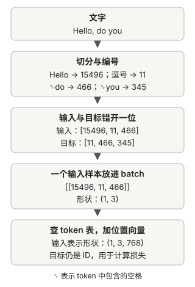

# 文字怎样变成模型的输入

上一章把语言模型的任务缩成了“根据前文预测下一 token”。这一章沿着 `Hello, do you`，看文字怎样变成编号、训练题目和模型能计算的向量。

## 从字符串开始：模型需要怎样的数据

神经网络内部进行数值计算，不能直接拿字符串参与矩阵运算。首先需要确定把文字切成什么单位，再把每个单位编号。

每个切出的单位叫 token。它可以是字符、完整单词、词的一部分或标点。本章用配套 GPT-2 分词器的 `Hello, do you` 作主线：先看怎样切分和编号，再制作预测题目，最后把编号换成可训练的向量。



图中的 `768` 是这套 GPT-2 小模型配置的向量长度；先把它理解成“每个位置用 768 个数字表示”，后面会解释这张数字表。

## 先决定切多大：token 的粒度

同一段文字有多种切法。以下只是示意，不代表真实分词器的输出：

| 粒度 | `Hello` 的切分示例 | 主要取舍 |
| --- | --- | --- |
| 字符 | `H, e, l, l, o` | 基础单位少，但序列较长 |
| 完整单词 | `Hello` | 序列较短，但要收录很多不同单词 |
| 单词片段 | `Hel, lo` | 在词表大小与序列长度之间折中 |

<strong>直接按原始字符处理是可行的。</strong>也可以把文本转成 UTF-8 字节，使用 0～255 的字节值。选择更大的片段，是为了让常见文本能用较少的 token 表示，并控制词表规模。

同样，把整个 `Hello, do you` 当作一个 token 也可行。但如果把所有短语和句子都分别收录，组合数量会迅速增长。切成可复用的小单位，能表示词表里没有直接收录的整句话。

序列长度会影响模型处理文本的计算量，注意力尤其需要比较不同位置。在同样的 token 数上限下，较紧凑的切分通常也能容纳更多文字。所以切分粒度不是在争论“字和词谁更正确”，而是在<strong>词表大小、序列长度和可复用性</strong>之间做取舍。

## 再给每块文字编号：词表

确定切分单位后，需要一张“token → ID”的对应表，这就是词表。编码时从文字查 ID，解码时反过来从 ID 还原文字。

配套 GPT-2 分词器对 `Hello, do you` 的切分和编号如下；这些 ID 来自[第二章 notebook](https://github.com/rasbt/LLMs-from-scratch/blob/f49cad747931fe6af0a7d2802cd480d1c1a0ec8e/ch02/01_main-chapter-code/ch02.ipynb)：

| token 文字 | ID |
| --- | ---: |
| `Hello` | 15496 |
| `,` | 11 |
| ` do`（开头含空格） | 466 |
| ` you`（开头含空格） | 345 |

所以原文编码得到 `[15496, 11, 466, 345]`。空格没有消失，而是包含在后面两个 token 中；这使解码能够还原相应文字。

<strong>ID 只识别 token，不表示大小或语义。</strong> 编号 466 不意味着某个词比编号 345 更重要。还要区分三个步骤：切分决定每个单位多大，词表约定 ID，向量提供模型计算使用的数值表示。

使用训练好的模型时，必须沿用配套的词表和分词规则，不能给每句话临时重新编号。仓库先演示的正则分词器只是教学实现，会丢弃部分空白并在解码时重新组织空格；后面才换成配套 GPT-2 分词器。

## 有限的词表怎样处理陌生词

如果词表中只有 `learning` 和 `English`，输入 `learning French` 时就查不到 `French`。

一个简单办法是增加未知词标记 `<|unk|>`。所有查不到的词都映射到它。这样程序可以继续，但不同内容会失去区别：

```text
learning French
→ [learning 的 ID, 未知词 ID]

learning German
→ [learning 的 ID, 未知词 ID]
```

更灵活的办法是：<strong>没有完整单词，就用词表中已有的小片段表示它。</strong>例如，词表没有 `learning`，却有 `learn` 和 `ing`，就可以用两个 ID 表示。

第二章采用的 BPE（字节对编码）会从较小的单位出发，在构建分词器时统计相邻单位的频率，把常见组合逐步合并。哪些片段成为 token 由数据和合并规则决定，不要求它们恰好是语法中的词根或词缀。

仓库通过 `tiktoken.get_encoding("gpt2")` 使用已有的 GPT-2 分词器。这里加载的是已经确定的规则；给它新文本编码，并不会重新训练分词器或修改词表。

GPT-2 使用字节级 BPE，基础单位覆盖所有字节，因此陌生单词也能用更小的单位表示，不需要把普通文本中的未知单词替换为 `<|unk|>`。一个 token 可能包含空格，也可能只覆盖一个汉字的部分 UTF-8 字节，所以不能假设“一个 token 就是一个字”。

### 多篇文章之间也需要边界

除了普通文字，词表还可以包含特殊 token。第二章介绍 `<|endoftext|>`，可以把不同文章分隔开：

```text
第一篇文章 <|endoftext|> 第二篇文章
```

模型在训练中学习这个标记与文本边界的关系。标记本身不会自动阻断注意力；生成程序是否在遇到它时停止，也要由代码设置。未知词标记、文本结束标记是两种不同用途，并非每个分词器都需要相同的特殊 token。

## 文本变成 ID 后，怎样制作训练题目

用刚才的四个 ID，取前三个作为输入，目标向右错开一位：

```text
输入：[15496, 11, 466]
对应：Hello, do

目标：[11, 466, 345]
对应：, do you
```

这一组样本包含三个预测任务：

| 当前允许参考的前文 | 目标 token |
| --- | --- |
| `Hello` | `,` |
| `Hello,` | ` do` |
| `Hello, do` | ` you` |

答案来自原文，不需要人工另外标注。三个输入位置可以一起计算，但后面的因果遮罩会限制每个位置只能利用自己和前面的内容。特别是第三个输入位置看不到目标 ID `345`；把数组错开一位本身并不能阻止偷看，第三章才实现这种限制。

## 长文章怎样切成许多样本：滑动窗口

输入不能无限长，所以程序按窗口从原文取样。窗口长度叫 `max_length`，每次把起点右移多少个 token 叫 `stride`。输入和目标始终错开一位。

对 `Hello, do you` 设置 `max_length=2`、`stride=1`：

```text
样本 A
输入：[15496, 11]
目标：[11, 466]

样本 B
输入：[11, 466]
目标：[466, 345]
```

两个窗口有重叠，但每个样本都保留了自己的下一 token 目标。再从第三个 ID 开始，输入虽然还能取到 `[466, 345]`，原文却没有更后面的 token，无法得到完整目标。

若把 `stride` 改为 2，这段很短的文本就只得到样本 A。它改变的是样本起点，目标右移一位的规则不变。取样还没有更新模型参数，只是在准备练习题。

## 把样本一起交给模型：batch

一组一起计算的样本叫 batch（批次）。将主线例子中的一个三 token 输入放进 batch，得到：

```text
输入：[[15496, 11, 466]]
目标：[[11, 466, 345]]
```

输入形状为 `(1, 3)`，表示一个样本、每个样本三个 token。如果放入两个同样长度的样本，形状就变成 `(2, 3)`。每一行是独立样本，没有拼成一条更长的句子。PyTorch 用张量（tensor）保存这类带形状的数字数组，训练程序对一批样本的预测汇总损失，再更新参数。

仓库用 `Dataset` 按索引提供输入与目标，`DataLoader` 再从中取样，组成可以逐批读取的 batch。按批处理方便硬件并行计算；读取顺序和最后不足一批的处理方式，放在本章末尾的补充说明中。

## 从编号到可训练的表示：token embedding

假设词表中“我、喝、茶”的 ID 分别是 0、1、2。我们再准备一张表，每个 token 占一行，每行有两个数字：

```text
ID 0 → [ 0.2, -0.1]
ID 1 → [ 0.5,  0.3]
ID 2 → [-0.4,  0.8]
```

这张小表只用于演示查表，不是 GPT-2 的真实词表。给定 ID 2，就查出 `[-0.4, 0.8]`。这一组数字叫<strong>向量</strong>；有两个数字，就称为二维向量。这里的“维度”先理解为数组长度即可，不必想象几何空间。

这张表叫 embedding 表。它有多少行，取决于词表大小；每行有几个数字，取决于模型选择的向量长度。实际初始值随机生成，不会恰好等于上面的示意数字。

<strong>ID 是固定的查找索引，embedding 表里的浮点数则是模型参数，可以在训练中调整。</strong>模型由此获得一种可以学习的表示，而不是把人为安排的 ID 大小当作含义。每一列通常没有预先指定的“人物”“饮料”等含义，多个数值共同起作用。

查表前后的形状如下。假设每个向量有 4 个数字：

```text
输入 ID 形状：(2, 3)
2 个样本，每个有 3 个 ID

token 向量形状：(2, 3, 4)
每个 ID 换成长度为 4 的向量
```

维度 4 是我们为模型选定的表示长度，和句子长短不是一回事。同一张表在同一次计算中，对同一个 ID 总是返回同一个向量。因此，这一步尚未把 token 所处的位置或周围内容结合进去。

## 加入顺序信息：位置 embedding

“我喝茶”和“茶很好”中的“茶”，单纯查 token 表会得到同一个向量。模型还需要一种显式的位置表示。

第二章采用的方法是再建一张位置表：位置 0 对应一个向量，位置 1 对应另一个向量，依此类推。把两张表查出的结果逐元素相加：

```text
输入向量 = token 向量 + 当前的位置向量
```

例如，以下都是示意数字：

```text
“茶”的 token 向量：[0.4, 0.7]
位置 0 的向量：    [0.1, 0.2]
相加后的输入：    [0.5, 0.9]
```

相加不会把两个二维向量拼成四维向量，结果仍然有两个数字。位置表也属于可训练参数；这种可学习的绝对位置表示是本章采用的方案，并非所有语言模型都用同一种位置编码。

对形状为 `(2, 3, 4)` 的 token 向量，位置编号是 `[0, 1, 2]`，查得的位置向量形状为 `(3, 4)`。PyTorch 会把这组位置向量用于两个样本，相加后形状仍然是 `(2, 3, 4)`。

<strong>目标通常仍保留为 ID，用来计算预测损失，不需要在这里变成 embedding。</strong>

回到 `Hello, do` 的三个输入 ID，放进一个 batch 后，输入形状是 `(1, 3)`。如果采用本仓库 GPT-2 小模型的向量长度 `768`，查 token 和位置 embedding 并相加后，形状就是 `(1, 3, 768)`；第三章的注意力将从这三个位置的表示中取信息。

## 补充：读取顺序和最后一个 batch

`shuffle=True` 打乱样本的读取顺序，不打乱一句话内部的 token。`drop_last=True` 丢弃最后不足一整批的样本，设为 `False` 则保留它们。这些设置影响怎样组织练习，不改变分词、查表或目标错位的规则。
