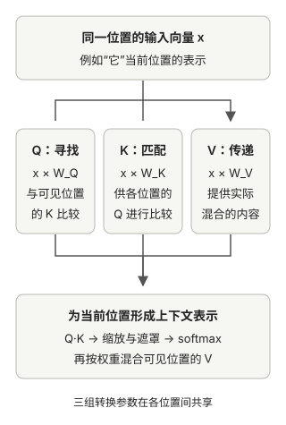
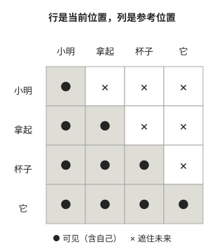

# 注意力如何利用上下文

上一章的 token 和位置向量还没有结合本次输入的前后关系。注意力让每个位置从允许参考的文字中取得信息；这一章看它怎样比较、分配权重和混合内容。

## 为什么单独表示一个 token 不够

token 向量相当于从表里按编号取出一组数字；位置向量补充了“它在第几个位置”。但是，这两张表不会因为句子不同，就自动把前后词语的关系写进某个 token 的向量。下面用“小明拿起杯子，然后把它放在桌上”说明，暂时把其中的词语当作独立 token；真实分词器未必这样切分。

例如，处理“它”时，前文的“杯子”比单看“它”更有助于理解当前句子。换成“小明拿起书，然后把它放在桌上”，“它”可能需要从“书”取得信息。<strong>模型需要一种办法，让当前位置根据本次输入，从自己和前文取回有用的信息。</strong>

注意力就是这种办法。它不直接输出“它指的是杯子”，而是为“它”形成一个结合了上下文的新表示，通常叫<strong>上下文向量</strong>，供后续预测使用。

## 最简单的想法：从可参考的位置各取一些信息

为了只看清计算思路，先把句子简化成“小明 | 拿起 | 杯子 | 它”。处理“它”时，前面三个位置和“它”自己都可以被参考。假设这次分到的份量是：

```text
小明： 5%
拿起：15%
杯子：70%
它：  10%
```

模型按这些份量，把各位置提供的数字信息混合起来，得到“它”的上下文向量。这就是<strong>加权求和</strong>：份量大的位置，对结果影响更大。每个位置都可以有自己的份量分配；换一句话，分配结果也可以变化。

上面的百分比只是讲解用的数字。特别要注意：<strong>“杯子 70%”是这次信息混合时的份量，不是“它有 70% 的概率指向杯子”，也不是模型最终给下一个 token 的概率。</strong>注意力能帮助模型利用信息，但一张注意力表不能直接当作完整的语义解释。

到这里，问题从“怎样混合信息”变成了“这些份量从哪里来”。

## 先算匹配分数，再分配份量

模型会让当前位置与可参考的位置逐个比较。例如，处理“它”时，分别比较“它”与“小明”“拿起”“杯子”以及“它”自己。每次比较得到一个<strong>匹配分数</strong>。分数越高，通常意味着在这次计算中更容易分到较多的参考份量。

计算机不会直接比较汉字的意思。它比较的是由这些 token 转换出的数字向量。最基本的比较方式叫<strong>点积</strong>：对应位置的数字相乘，再把乘积相加。你可以先把它当作“由两组数字算出一个匹配分数”的规则，不需要记公式。

分数还不是百分比。模型通过 <strong>softmax</strong> 把一组分数变成非负、总和为 100% 的份量。于是整个过程是：

```text
比较当前位置和可参考位置
↓
得到匹配分数
↓
转成参考份量
↓
按份量混合信息
```

这里的“匹配”是模型中的数值关系，不保证等同于人的直觉。第三章先用<strong>没有可训练参数的简化注意力</strong>演示这个三步过程，再引入可学习的 Q、K、V；如果跳过简化版，很容易误以为三个字母本来就懂语言。

## Q、K、V：把“找什么”和“给什么”分开

直接拿第二章的输入向量互相比较，能展示注意力的基本想法，但不够灵活。实际的<strong>自注意力</strong>让同一句中的每个位置，分别从自己的输入向量产生三种表示：



| 名称 | 要解决的问题 | 在本例中的角色 |
| --- | --- | --- |
| Q（Query） | 我正在寻找什么信息？ | 用“它”的 Q 发起匹配 |
| K（Key） | 别人如何判断我是否值得参考？ | 用各位置的 K 与“它”的 Q 比较 |
| V（Value） | 如果参考我，我能提供什么信息？ | 按分到的份量取各位置的 V |

因此，不是“Q 就是注意力大小”，也不是“K 已经给出了是否相关的结论”。<strong>Q 与 K 比较之后才得到分数，分数转换后才有参考份量；V 是按这些份量实际取回的信息。</strong>比如“它”的 Q 像一张写着需求的便签，“杯子”的 K 像便于匹配的索引，V 才是实际交出的数字内容；便签本身不会替你完成匹配。

用一个只保留“杯子”和“它”两个可参考位置的小计算，把这三步连起来。下面的 Q、K、V 都是假设的单个数字，真实模型使用向量：

```text
“它”的 Q = 1
“杯子”的 K = 2，“它”的 K = 0
比较后，两个匹配分数分别是 1×2=2、1×0=0
softmax 把 [2, 0] 变成约 [88%, 12%]

“杯子”的 V = 4，“它”的 V = 1
混合结果约为 88%×4 + 12%×1 = 3.64
```

这里的 2 和 0 决定<strong>参考谁多少</strong>，4 和 1 是<strong>被取回并混合的内容</strong>；结果 3.64 只是新表示中的一个示意数字，不是下一个 token 的分数。实际处理整句话时，也会给“小明”“拿起”等其他允许的位置计算份量。

为什么不直接把 K 当作要取回的信息？因为“适合用来匹配的表示”和“值得传递的内容”可以不同。Q、K、V 分开后，模型就有机会分别学会这几种用途。

图中的 `W_Q`、`W_K`、`W_V` 就是这三组可训练参数。同一组转换参数用于不同位置，但各位置的输入不同，算出的 Q、K、V 也可以不同。

本章实现还会在 Q 与 K 的点积后做一次<strong>缩放</strong>：向量维度较大时，点积可能变得很大，softmax 就容易把份量推向极端，像所有位置都在争抢一个麦克风。缩放是让数值更平稳的固定计算，不是另一套需要学习的 Q、K、V。

## 谁教模型把“杯子”看得更重

程序没有一条规则写着“它指向杯子”，训练文本通常也没有逐句标出注意力应该怎样分配。那模型如何学到有用的匹配方式？答案要回到第一章的训练目标：<strong>预测下一个 token。</strong>

模型先算 Q、K、V，利用注意力从当前位置及此前位置取信息，经过后续计算，给下一个 token 打分。训练程序把这个预测与原文答案比较，得到损失。如果某种参数变化让预测更好、损失更小，反向传播和优化器就会推动相关参数朝那个方向调整。这个反馈也会影响产生 Q、K、V 的参数。

```text
参数影响 Q、K、V
→ 影响参考份量与取回的信息
→ 影响最终预测
→ 预测损失反过来推动参数调整
```

所以模型学到的是<strong>一套随输入变化的匹配与取信息的方法</strong>，不是把“杯子永远占 70%”写进参数。普通使用模型时，训练好的参数保持不变；每次输入不同，现场算出的 Q、K、V 和参考份量仍可能不同。

需要谨慎的是：预测损失只评价最终预测，并不直接奖励某个头“正确理解代词”。某个位置是否得到高注意力，也不能单独证明模型作出了哪种语义判断。

## 为什么还要遮住未来

第二章为了提高效率，把一段文本中的多个预测任务放在一起。处理“拿起”这个位置时，目标是预测后面的“杯子”。如果注意力允许它直接参考未来的“杯子”，模型就相当于偷看了答案。

但真正生成时，未来内容尚未出现。因此 GPT 为每个位置设一条固定规则：只能参考自己和自己前面的内容。这叫<strong>因果遮罩</strong>。



例如“拿起”这一行只能参考“小明”和“拿起”；最后一行“它”则能参考这四个位置。图外若还有后文“放在、桌上”，处理“它”时仍不可见。

仓库在 softmax <strong>之前</strong>把未来位置的匹配分数设为负无穷，转成份量后这些位置就得到 0。它与“哪个前文位置比较相关”是两种不同的事：<strong>遮罩决定谁有资格被参考；Q 与 K 的匹配决定在有资格的位置之间怎样分配份量。</strong>遮罩是架构给定的规则，不需要从训练数据中学出来。

## 为什么同时使用多个注意力头

到目前为止，只讲了一套匹配和取信息的过程。<strong>多头注意力</strong>让模型对同一段输入并行做多套这样的计算；每套使用不同的可训练参数，可能算出不同的参考份量、取回不同的信息。随后模型把这些结果组合起来。

处理“它”时，一套计算可能更多利用“杯子”，另一套可能更多利用句中的动作关系。这只是可能的结果，<strong>代码不会指定哪个头必须负责指代、哪个头必须负责动作</strong>，不同头也未必分工清晰。

无论有几个头，因果遮罩对每个头都有效。多头增加了可用的计算方式，不会允许模型读取未来答案。

此外，输入通常按 batch 处理。batch 中的每句话各自计算注意力，不会让一句话中的“它”跑去参考另一条样本里的词。

回到第二章 `Hello, do` 的三个输入 ID：它们的向量形状是 `(1, 3, 768)`，依次表示一个样本、三个位置、每个位置 768 个数字。处理第三个位置 ` do` 时，因果注意力可以从 `Hello`、`,` 和 ` do` 取信息，却看不到目标 ` you`。仓库的[注意力实现](https://github.com/rasbt/LLMs-from-scratch/blob/f49cad747931fe6af0a7d2802cd480d1c1a0ec8e/ch03/01_main-chapter-code/ch03.ipynb)把每个位置转换成 Q、K、V，再由各注意力头为这三个可见位置分配份量；后续层用更新后的第三个位置去预测 ` you`。

## 补充：训练时的随机丢弃

第三章还引入 <strong>dropout</strong>：训练时随机暂时丢掉一些已算出的注意力份量，减少模型过度依赖个别连接的风险。被丢掉的是这一轮训练中的连接，不是永久删除 token；保留下来的份量会相应缩放，所以 dropout 后的数字不一定仍加起来等于 100%。正常生成时关闭 dropout。

因果遮罩限制可见范围，dropout 则在训练时暂时丢弃部分原本允许的连接。第四章将把注意力放进完整 GPT，看混合后的信息怎样变成下一 token 的分数。
