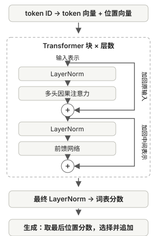

# 把注意力组装成完整的 GPT

注意力已经能混合上下文信息，接下来要把这些表示加工成下一 token 的候选分数。先看完整 GPT 的结构，再逐个拆解前馈网络、残差连接、归一化与输出层。



## 注意力取回了信息，但还没有给出答案

沿用“小明拿起杯子，然后把它放在桌上”的例子，假设其中每个词语各是一个 token。当前输入到“它”为止时，注意力会让“它”从自己和允许参考的前文中取信息，例如从“杯子”和“拿起”等位置取得不同份量的信息，再混合成一组新的数字。

这组数字是供模型继续使用的表示，<strong>并不是答案“放在”</strong>。注意力完成的是信息交流；要预测接下来写什么，还需要加工这些信息，并把结果转换成词表中各个候选 token 的分数。

模型一次会处理输入中的<strong>每个位置</strong>；直到生成下一 token 时，程序才只取最后位置的预测。

## 前馈网络：加工已经取得的信息

处理“它”时，注意力已经从前文收集了信息。<strong>前馈网络</strong>接着对这个位置的数字继续计算，学习如何重新组合信息，使它有助于后面的预测。

两者分工可以这样理解：

| 部件 | 做什么 |
| --- | --- |
| 注意力 | 从其他允许参考的位置取得信息 |
| 前馈网络 | 加工当前位置已有的信息 |

前馈网络这一环节不会重新读取其他位置。它分别处理“小明”“杯子”“它”等位置的向量，在同一个块里使用同一套参数；输入不同，处理结果也会不同。注意力像在桌上摊开资料，前馈网络像各自整理手中的笔记；真正处理的始终是数字。

本书的前馈网络先把向量转换成更长的一组数字，在中间加入一次非线性变换，再转换回原来的长度。

### 为什么中间需要非线性变换

如果一个数先乘 2，再乘 3，效果等于直接乘 6。虽然多了一步，规则却没有变得更灵活。连续的线性变换也有类似性质，可以合并成一次线性变换。

所以模型在中间加入<strong>激活函数</strong>，让不同范围的数值受到不同程度的处理，打破这种可直接合并的限制。本书使用的激活函数叫 <strong>GELU</strong>，它是一种平滑的非线性变换。

这里的“保留或抑制信息”始终发生在数字上。模型中并没有一个预先标注为“杯子”的开关。不同数字如何对预测有用，需要通过训练逐渐形成。

## 残差连接：让原来的表示也参与结果

注意力和前馈网络都会转换输入。但当前位置原有的信息也可能有用，因此模型给原输入留了一条直接通向结果的路径。这就是<strong>残差连接</strong>。

继续看“它”：

```text
原表示
+ 注意力这次取回的信息
= 交给后面的表示
```

这是数字向量相加，不是把“它”和“杯子”两个词拼在一起。用演示数字看：

```text
原输入：  [10, 20]
处理结果：[ 2,  3]
相加后：  [12, 23]
```

可以把这一层的处理结果理解成在原有表示上的调整量。调整量也可以为负；如果它接近零，原输入就基本原样通过。

```text
[10, 20] + [0, 0] = [10, 20]
```

这样，模型不必让每一层都重新学一遍如何保留原输入。残差路径也让训练时的梯度更直接地传播，有助于多层模型的训练。

但相加仍会改变结果，所以残差连接不保证原信息永远不受影响。在一个 Transformer 块中，注意力和前馈网络外面各有一次残差连接，分别加回该步骤自己的输入。

## LayerNorm：为什么要整理数字的尺度

向量经过多次转换和相加，数值尺度可能发生变化。<strong>LayerNorm（层归一化）</strong>在每个位置内部整理这组数字，使进入后续部件的尺度更稳定。

一个自然的疑问是：如果一组数字一起变大，计算规则又没变，为什么还要调整？因为后续计算会使用数字的实际大小，不只看谁排在前面。这里直接看 LayerNorm 要处理的对象：假设“它”在某一层的向量只有两个数字。

```text
第一次算出的向量：[10, 20]
另一种尺度的向量：[100, 200]
```

第二组虽然只是第一组放大十倍，直接交给后续计算时却可能产生差别。LayerNorm 会对<strong>每个位置自己的向量</strong>求均值，再按这组数字的波动程度调整。暂时忽略计算中的极小稳定项，以及后面的可训练调整，上面两组数都会变成约 `[-1, 1]`：它们的相对形状相同，送往下一步时就有相近的尺度。

实际向量远不止两个数字，不同位置的数值模式也未必相同。LayerNorm 之后还有可训练的缩放和偏移，让模型决定适合后续计算的尺度。它不是把所有 token 变成同一组数，也不是直接改动注意力的参考份量；它整理的是送进注意力或前馈网络之前的表示。

## 把这些部件放进一个 Transformer 块

回到开头的结构图，一个块包含两段处理：先对输入做 LayerNorm，再做多头因果注意力，然后加回该段原输入；接着对中间表示做 LayerNorm，再交给前馈网络，最后加回该段的中间表示。

图中右侧两条绕行支路就是残差路径。归一化和处理都发生在主分支上，相加时保留的是各自进入这段处理前的表示。因此“它”先补充前文信息，再在这个基础上加工自己的表示。

训练时，输入 embedding 之后、块内处理分支及注意力权重中还会使用 dropout；图中省略了这些随机丢弃步骤，生成时将其关闭。

## 为什么把多个块接起来

GPT 会将前一个 Transformer 块的输出，交给后一个块继续处理。每个块都有自己的可训练参数。

第一个块中，“杯子”的表示有机会结合前面的“小明拿起”。后一个块处理“它”时，可以参考已经更新过的“杯子”表示。每一层都能在前面形成的表示上，继续组合和处理信息。

这不意味着我们能事先规定“第一层理解词义、第二层理解语法、第三层理解指代”。这些层具体形成什么计算方式，由训练共同决定。前文中“杯子”和“它”的关系只是帮助理解信息流动的例子，模型里没有一本写好的“杯子指代手册”。

这里还要分清<strong>层数</strong>和<strong>头数</strong>：多个层是前后依次处理，多个注意力头是在同一个注意力模块中并行收集信息。

## 输出层：把内部表示变成候选分数

经过所有 Transformer 块后，模型还会做一次最终的 LayerNorm，再交给<strong>输出层</strong>。输出层会为输入中的每个位置、词表里的每个候选 token 计算一个分数，这些原始分数叫 <strong>logits</strong>。

假设输入是：

> 小明拿起杯子，然后把它

模型用最后一个位置“它”处理后的表示，为后续候选项打分。假设某个已经训练好的模型得到如下结果，数字仅作示意：

```text
放在：8 分
递给：6 分
天气：1 分
……词表中的其他 token 也各有一个分数
```

原始分数还不是概率；需要概率时，可以通过 softmax 转换。只想找最高分候选时，直接比较原始分数即可。

要区分两个用途：<strong>注意力分数决定从当前位置及此前各位置取多少信息；输出层分数决定下一个 token 的候选项有多合适。</strong>前者针对上下文位置，后者针对词表条目。

沿用第二章的实际分词例子：`Hello, do` 对应输入 `[15496, 11, 466]`，经过 embedding 和多个 Transformer 块后，三个位置各有一个长度为 `768` 的表示。仓库的 [GPT 实现](https://github.com/rasbt/LLMs-from-scratch/blob/f49cad747931fe6af0a7d2802cd480d1c1a0ec8e/ch04/01_main-chapter-code/gpt.py)再用输出层为每个位置的 `50257` 个词表条目打分，于是 logits 形状为 `(1, 3, 50257)`。最后一个位置的这组分数可用于选择下一 token；在原文对应的训练样本中，要比较的目标 ID 是 `345`，即 ` you`。第五章会用这组分数和目标解释损失。

## 训练与生成：同一个模型，怎样使用预测结果

第二章已经准备好错开一位的目标。训练时，将每个位置的输出分数与对应目标比较，计算损失并更新参数；生成时，已有前文是确定的，只取最后位置的分数选择下一 token。

| | 训练 | 生成 |
| --- | --- | --- |
| 是否有原文目标 | 有 | 没有 |
| 使用哪些位置的预测 | 各位置一起算损失 | 最后位置选下一项 |
| 参数是否更新 | 优化器更新 | 普通生成保持不变 |

因果遮罩在两种情况下都限制可见前文。原文目标仅用于算损失，不会提前交给相应位置。第五章将把训练中的比较和更新展开。

## 生成程序怎样把文字接下去

模型负责打分，生成程序负责选择和追加。第四章使用最简单的策略：<strong>每次选分数最高的 token</strong>，也叫贪心选择。

```text
输入“小明……把它”
→ 模型给出分数，程序选出“放在”
→ 输入变成“小明……把它放在”
→ 再算下一项的分数，继续追加
```

这个策略只选择当前一步的最高分，并不保证整段文字最终最好。带随机性的采样、温度等策略会在第 5 章讨论。

第四章的简单生成循环按设定的最大新增 token 数停止，不会自动判断句意是否完整。第一章提过“遇到结束标记就停”，那需要生成程序另外加入检查；第五章会实现这个选项。

## 上下文长度与生成长度是两回事

模型一次能直接参考多少 token，叫<strong>上下文长度</strong>。第四章的简单生成程序在输入过长时，只把最新的一段交给模型。

例如，上下文长度设为 4，当前有 6 个 token：

```text
完整文字：
小明 | 拿起 | 杯子 | 然后 | 把 | 它

本次窗口：
杯子 | 然后 | 把 | 它
```

生成“放在”后，下一次输入变为：

```text
然后 | 把 | 它 | 放在
```

“杯子”仍保存在程序保存的完整文字中，但已经不在这一轮直接交给模型的窗口里。先前内容可能通过已生成的文字留下间接影响，模型却无法直接回看被截掉的原文细节。

| 长度设置 | 控制什么 |
| --- | --- |
| 上下文长度 | 每次计算最多直接参考多少个 token |
| 最大生成长度 | 本次循环最多新增多少个 token |

所以程序可以用较短的窗口逐步生成很长的文字，却不能保证始终利用最早的细节。“百万上下文”通常就是指上下文窗口能容纳约百万 token，不等于百万汉字，也不等于一次能输出百万 token。具体模型如何约束输入与输出长度，要看它自身的规定；能放入长文本也不保证所有细节都能被准确利用。

## 结构搭好了，还需要训练参数

到这里，GPT 的完整处理过程已经连通：

```text
文字 → token ID
↓
token 向量与位置向量相加
↓
多个 Transformer 块
↓
最终 LayerNorm → 词表分数
↓
选择下一 token，追加后继续
```

还要分清两类设置：

| 类型 | 例子 | 作用 |
| --- | --- | --- |
| 模型配置 | 层数、头数、向量长度、上下文长度 | 决定模型结构和规模 |
| 可训练参数 | embedding 表、Q/K/V 转换、前馈网络和输出层里的数值等 | 决定这套结构实际怎样处理输入 |

训练通常在给定配置下调整参数，不会因为一次预测出错，就自动增减层数或注意力头。

新建 GPT 的许多参数是随机初始化的：它虽然能算分数、输出文字，却通常还不能写出有意义的内容。

## 对照源码

本章对应教材第4章的[代码与材料](https://github.com/rasbt/LLMs-from-scratch/blob/f49cad747931fe6af0a7d2802cd480d1c1a0ec8e/ch04/01_main-chapter-code/gpt.py)，固定版本为 `f49cad747931`。教材、模型和示意数字的范围见[系列导读](/llms-from-scratch#代码范围与阅读方式)。
