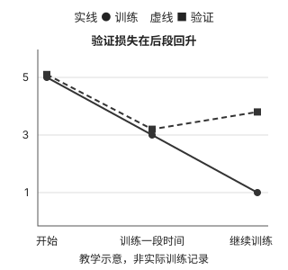

# 让 GPT 从预测错误中学习

上一章的 GPT 已经能输出候选分数，但随机参数还不会写出像样的文字。这一章把预测与原文比较，沿着损失、梯度和参数更新理解模型怎样学习。

## 怎样判断一次预测的好坏

新建的 GPT 能给下一个 token 打分，但参数尚未学过语言。假设训练文本里有一句（为便于理解，暂时把各词语当成 token）：

> 小明拿起杯子，然后把它放在桌上。

训练样本让模型看到“小明拿起杯子，然后把它”，这一次原文中的后续答案是“放在”。模型会给词表中每个候选 token 打分；把这些分数转换成概率后，可以比较它给原文答案分配了多少概率。

| 候选内容 | 模型 A | 模型 B |
| --- | ---: | ---: |
| 放在（本次答案） | 20% | 70% |
| 递给 | 50% | 10% |
| 其他候选项合计 | 30% | 20% |

对<strong>这条训练样本</strong>来说，模型 B 的预测更好，因为它给“放在”分配的概率更高。训练时不只记录“最终是否选中了正确项”：即使两个模型都把“放在”排在第一，给它 40% 和 80% 也不一样。

原文在这里提供了可用于比较的答案，不意味着“递给”在其他语境里永远不合理。模型会在大量不同文本上学习各种可能的续写。

## 损失：把预测质量变成训练信号

模型需要一个数值来衡量“这次预测与原文答案有多不一致”，这个数值叫<strong>损失</strong>。第五章使用<strong>交叉熵损失</strong>。当前只需把握方向：

```text
给本次正确答案的概率越高 → 损失越低
给本次正确答案的概率越低 → 损失越高
```

交叉熵利用的是模型对正确答案的预测概率，<strong>不是 token ID 之间的数字距离</strong>。如果“放在”的 ID 是 100，ID 为 101 的另一个 token 并不会因为编号相邻，就天然比 ID 为 900 的 token 更接近正确答案。

沿用第二至四章的 `Hello, do`：最后位置输出 `50257` 个 logits，本次原文目标是 ` you`，ID 为 `345`。假如模型给这个目标分配 `20%` 概率，单看这一位置的交叉熵约为 `1.61`；若分配 `70%`，就约为 `0.36`。这两个概率是教学假设，不是仓库模型的实际预测。

这两个损失数值来自 `损失 = −ln(p)`，其中 `p` 是本次目标 token 的预测概率，`ln` 是自然对数：`−ln(0.2) ≈ 1.61`，`−ln(0.7) ≈ 0.36`。训练会对各位置和整个 batch 的有效目标汇总损失。

第二章已经把一段文字整理成输入和错开一位的目标。对输入中的每个位置，模型都会预测下一项；程序将这些位置以及一个 batch 中的损失汇总，得到本次训练更新所依据的损失。目标不是在模型预测时递给它看的小抄，只在<strong>算损失时</strong>用来核对。

本章还介绍<strong>困惑度</strong>（perplexity）。它是将平均交叉熵换一种尺度表达的指标。一个直观的特例是：如果模型在每一步都把正确答案的概率给成 1/4，相应的困惑度就是 4，可以粗略理解为“每一步仿佛在四个等可能选项中选择”。困惑度越低通常表示在同一评价数据上预测越好，但它不是错误率，也不能直接说明生成的文章有多通顺。比较不同分词方式得到的困惑度时还应格外小心，因为“每一步”对应的 token 单位变了。

损失和困惑度解决了“怎样衡量”，还没解决“怎样改进”。

## 从损失到参数更新

训练的核心是反复取一批文本，让模型预测，再根据预测损失调整参数。

“各参数如何变化会影响损失”的计算结果叫<strong>梯度</strong>。反向传播从最终损失沿着计算过程往回求梯度；优化器根据梯度调整参数。损失本身不会自动修改模型，而反向传播负责算调整依据，优化器负责真正更新。

被更新的可能包括 embedding 表、注意力中的转换参数、前馈网络和输出层中的参数。它们在训练中共同变化，没有一条程序规则直接规定“看到‘它’就关注‘杯子’”。如果某些参数变化有助于在许多样本上减少预测损失，训练才可能逐渐保留这种变化。

<strong>学习率</strong>控制每次更新的幅度。太大可能让调整过猛，太小则可能进展缓慢。学习率是训练设置，不是模型学到的某个词义。

在仓库的[训练循环](https://github.com/rasbt/LLMs-from-scratch/blob/f49cad747931fe6af0a7d2802cd480d1c1a0ec8e/ch05/01_main-chapter-code/gpt_train.py)中，一次按批取数据、计算损失并更新参数，算一个训练步（step）。把训练集的所有批次处理一遍，叫一轮（epoch）；多轮训练会让模型继续使用已更新的参数练习。

把刚才的输入和目标放进一个 batch，主线代码中的一步可以读作：

```text
输入：[15496, 11, 466]
目标：[11, 466, 345]
→ 清空上一步的梯度
→ 模型输出 logits
  形状：(1, 3, 50257)
→ 用三个位置的目标 ID 计算交叉熵损失
→ 反向传播求本步梯度
→ 优化器根据梯度更新参数
```

代码先调用 `optimizer.zero_grad()` 清空旧梯度，再通过 `loss.backward()` 和 `optimizer.step()` 完成反向传播与更新。分词得到的 ID 和目标 ID 不会被优化器改动，变化的是模型中的可训练参数。

前向计算和反向传播是训练的主要计算负担，训练还需要保存梯度与中间结果，因此通常比只做生成更耗计算资源与内存。普通生成不执行反向传播和参数更新。

## 怎样知道模型学会了，而不是只记住原文

仓库为演示训练，只使用英文短篇小说《The Verdict》。这足以看见损失下降，却远远不足以训练出成熟语言模型。如果模型反复练习同一篇文章，可能越来越会续写那篇文章，却仍不擅长处理没练过的文字。只看训练损失下降，无法区分“学到可迁移规律”和“记住练习材料”；把题库背熟不等于会做新题。

因此，先把原始文本分成两部分：

| 数据 | 用途 | 会根据它更新参数吗 |
| --- | --- | --- |
| 训练集 | 提供练习题，计算训练损失 | 会 |
| 验证集 | 检查对未参与训练的文本预测如何 | 不会 |

第二章的滑动窗口会产生相互重叠的样本。<strong>先划分原始文本，再分别制作窗口样本</strong>，有助于避免几乎相同的窗口同时出现在训练集和验证集中。

训练期间定期观察两边的损失。下图用三组假设数值，画出训练越来越好、验证先改善后变差的情况：



<strong>过拟合</strong>指模型越来越适应训练材料，却不能同样好地处理新材料。验证损失上升是警示，不是单凭这两个数字就能诊断所有原因。评估时只计算损失，不用验证数据反向传播或更新参数。

仓库实际观察到：训练损失继续下降时，验证损失可能开始变差，这是这个小语料实验中的过拟合信号。它还会定期生成一段示例文字，让人直观看输出；但一段看似通顺的样例并不足以证明模型整体表现好，还需结合未参与训练的数据。

## 训练之外，如何使用预测

一次训练会改变参数，普通生成则使用已经得到的参数。生成时，对 `Hello, do` 只读取最后位置的 logits，再决定接哪个 token；这里没有目标 ID，也不执行反向传播。

模型打分之后还需要选择策略。策略不同，即使同一模型收到相同提示，也可能生成不同结果。

## 生成策略：模型打分，程序做选择

假设模型在“小明拿起杯子，然后把它”之后给出这些概率：

| 候选 | 概率 |
| --- | ---: |
| 放在 | 70% |
| 递给 | 20% |
| 举起 | 10% |

第四章的简单方法总选最高分，这叫<strong>贪心选择</strong>，本例每次都会选“放在”。另一种方法是<strong>随机采样</strong>：按这些概率抽取，大多数时候仍选“放在”，但也可能选“递给”或“举起”。

一旦选出不同 token，下一轮输入就变了，模型会重新打分，后续文字也可能渐渐分开。所以即使模型参数和提示相同，只要使用随机采样，多次生成也可能不同。

第五章给随机采样增加两个常用控制：

| 生成设置 | 控制什么 |
| --- | --- |
| `temperature`（温度） | 让候选之间的选择倾向更集中或更分散 |
| `top_k` | 只允许分数最高的 k 个候选参与选择 |

低温使高分候选更占优势；高温让较低分候选更容易被抽到，也可能增加跑题风险。在仓库的[增强版生成函数](https://github.com/rasbt/LLMs-from-scratch/blob/f49cad747931fe6af0a7d2802cd480d1c1a0ec8e/ch05/01_main-chapter-code/gpt_generate.py)中，`temperature=0` 表示直接选最高分，不进行随机采样。`top_k=2` 则先排除第三名及以后的候选，再在留下的范围内选择。

```text
模型根据当前上下文给所有候选打分
→ top-k 限制可选名单
→ 温度调整名单中的抽样倾向
→ 选出一个 token，追加到上下文
→ 下一轮重新计算
```

它们是<strong>生成设置</strong>，不是训练得到的模型权重。更改设置通常无需重训模型，但也不能让模型凭空获得没有学会的能力。此外，增强版生成程序可以在遇到约定的结束 token 时停止；没有启用这项判断时，就按最大新增 token 数结束。相同提示产生不同结果，也可能因为实际上下文、模型版本或其他生成设置不同，不能一概归因于采样。

## 怎样保存训练成果

训练结束后，模型的主要成果是已经调整好的<strong>权重</strong>，也就是分布在各层里的许多数字。保存权重，就是把这些数字写进文件，以后再加载。

```text
按照相同结构创建模型
→ 加载训练好的权重
→ 使用配套的分词器处理文字
→ 运行生成程序
```

如果只是以后做生成，关键是结构配置、权重和配套分词器。如果希望从中断处继续训练，通常还要保存优化器状态及训练进度等，才能更接近原来的训练状态。

保存或加载权重不会改变模型结构；加载训练好的权重，是把已有结构内原先随机或旧的数字换成训练后的数字。

## 为什么别人的预训练权重不能随意塞进模型

第五章还演示将已有的 GPT-2 权重加载进本书实现的 GPT。前面的短篇小说只是教学实验；若想看到更像样的续写，就使用别人已在更大语料上训练好的参数。这是两条不同的路径：

```text
教学训练
随机参数
→ 用短篇小说练习训练流程

后续任务
已有的 GPT-2 预训练权重
→ 第六章分类微调
或第七章指令微调
```

第六、七章都不接着使用短篇小说练出的权重；第七章也不沿用第六章改过的分类模型。

加载外部权重的关键前提是：<strong>权重必须和结构中的对应位置、形状及含义匹配。</strong>文件中一组数字属于注意力的哪一层、哪个转换，需要正确映射；不同实现采用的名称和数字排列方式也可能不同。

从概念上，运行一个模型需要：

| 内容 | 作用 |
| --- | --- |
| 模型结构代码 | 规定计算步骤及各层怎样连接 |
| 模型配置 | 指定层数、头数、向量长度等结构尺寸 |
| 权重 | 为各层提供训练好的数字 |
| 分词器与词表 | 规定文字怎样变成模型认识的 token ID |
| 运行程序 | 执行计算，并决定如何选择、追加 token |

PyTorch 执行的是<strong>模型代码所规定的计算</strong>，权重是这些计算使用的数据。PyTorch 不能只拿到一份任意权重文件，就自动推断模型怎样运行。已有框架若实现了某个模型结构，就可以按配置创建它并加载兼容权重；不兼容的权重可能需要转换，甚至无法用于该结构。能在同一环境运行多个模型，也不等于它们的权重可以互换。

还要注意，<strong>搭出 GPT 结构</strong>与<strong>拥有训练好的 GPT-2 能力</strong>是两回事。只有装入配套的预训练权重，模型才得到那批权重中学到的能力；这不是在自己机器上重新完成了 GPT-2 的预训练。

## 对照源码

本章对应教材第5章的[代码与材料](https://github.com/rasbt/LLMs-from-scratch/blob/f49cad747931fe6af0a7d2802cd480d1c1a0ec8e/ch05/01_main-chapter-code/gpt_train.py)，固定版本为 `f49cad747931`。教材、模型和示意数字的范围见[系列导读](/llms-from-scratch#代码范围与阅读方式)。
