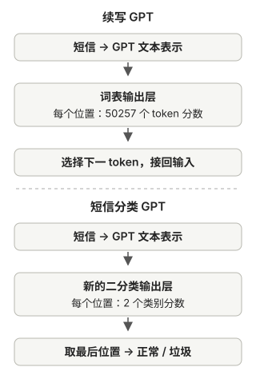

# 把 GPT 微调成短信分类器

第五章介绍了训练和加载预训练权重。现在从预训练 GPT-2 出发，把“继续写短信”的任务改成“为整条短信选一个类别”，看数据、输出层和训练范围需要怎样变化。



## 先弄清任务：续写与分类要的答案不同

假设输入是一条短信（这里用中文示意，仓库实际使用英文短信）：

> 恭喜中奖，点击链接领取奖品。

第五章的 GPT 会继续预测下一个 token，像是在替短信续写。而分类任务要的是整条短信的<strong>一个标签</strong>：

```text
“今晚七点一起吃饭吗？”         → 正常短信
“恭喜中奖，点击链接领奖！”     → 垃圾短信
```

两种任务都要理解输入文字，却在“什么算答案”上不同：

| 任务 | 输入 | 要得到的结果 |
| --- | --- | --- |
| 预训练时的续写 | 一段已有文字 | 每个位置的下一个 token |
| 本章的分类 | 一整条短信 | 这条短信的类别 |

所以第六章不是让模型写得更长，而是让它在一个预先确定的类别集合里作选择。

## 为什么要从预训练 GPT 开始

本章从第五章介绍过的<strong>已有 GPT-2 预训练权重</strong>出发，不使用我们在短篇小说上练出的教学模型。GPT-2 已经在大量文本上练习过续写，它内部的向量、注意力和其他参数形成了一些处理语言的方式。本章希望利用这些已有能力，再让模型适应“判断短信类别”这个任务。这种继续训练叫<strong>微调</strong>。

为什么不直接输入“请判断这是不是垃圾短信”，继续使用原模型续写？因为本书加载的 GPT-2 基础模型主要经过续写预训练，<strong>不保证稳定遵循分类指令</strong>。第七章才会专门讨论怎样用指令与理想回答训练模型。

这并不意味着所有现成语言模型都不能通过提示完成分类，只是本章选择一个输出固定、容易训练和评估的专用分类方案。

## 分类答案从哪里来：带标签的短信

预训练时，原文自然提供了“下一个 token”的答案。分类时，文字本身不能自动告诉程序它是正常还是垃圾短信，因此需要准备<strong>带标签的样本</strong>：

```text
短信内容                         类别
“今晚七点一起吃饭吗？”         正常
“恭喜中奖，点击链接领奖！”     垃圾
```

本章固定两类，给它们约定编号，例如：

```text
0 → 正常短信
1 → 垃圾短信
```

这些编号只是标签 ID，和 token ID 一样没有大小上的语义。训练样本提供的正确类别，让程序能衡量模型分类得怎样。

使用时也必须保持同一个编号约定。<strong>不能在训练后把屏幕上的“正常 / 垃圾”临时改名为“诈骗 / 广告”，就认为模型学会了新任务。</strong>那样只是改变显示文字，参数仍按照旧标签训练。

## 准备数据：类别比例和数据划分

数据还存在<strong>类别不均衡</strong>：正常短信多于垃圾短信。如果有 900 条正常、100 条垃圾，一个永远回答“正常”的模型也有 90% 准确率，却完全没学会识别垃圾短信。

本章从数量较多的正常短信中抽取一部分，使两类样本数量相同，然后划分数据。这能避免“闭眼全猜正常”在教学实验中拿高分，但会改变原始短信的类别比例。三份数据各有用途：

| 数据集 | 用途 | 是否据此更新参数 |
| --- | --- | --- |
| 训练集 | 让模型练习分类 | 是 |
| 验证集 | 在训练期间检查表现、观察调整效果 | 否 |
| 测试集 | 在训练与选择完成后检查未见过的样本 | 否 |

这种平衡数据有助于教学实验，但<strong>平衡后的测试准确率不等于真实短信环境中的效果</strong>，因为真实环境的类别比例和短信内容可能不同。

## 换掉输出层：从词表分数变成类别分数

原来的 GPT 输出层对整个词表打分，目的是挑选下一个 token。本章只需要“正常”和“垃圾”两个分数，因此把原来的输出层换成一个<strong>分类输出层</strong>。不是要求模型在五万多个 token 里找出“垃圾”这个词，而是明确给这项任务设置两个出口：

```text
短信
↓
预训练 GPT 的文本处理部分
↓
分类输出层
├─ 正常短信分数
└─ 垃圾短信分数
```

例如某条短信可能得到：

```text
正常：1.2 分
垃圾：3.8 分
```

程序选分数更高的类别。这是帮助理解的示意分数，它们本身不是概率；需要概率时可以另外转换。

新分类输出层刚创建时，还没学会怎样判断垃圾短信。预训练 GPT 的前面部分提供已有的文字表示，带标签样本则帮助分类层学会把这些表示用于当前任务。

## 填充长度后，为什么取最后一个位置

短信先用配套分词器转成 ID。为了把长短不同的短信组成 batch，本章按统一长度截断长短信，并在短短信末尾填充特殊 ID。GPT 换了输出层后，仍为每个位置算出两个类别分数，但整条短信只有一个标签，需要选一个位置参与分类损失。

因果注意力规定：每个位置只能参考自己和前面的位置。假设短信被切成四个 token，随后填充到六个位置：

```text
真实文字（前四个位置）：
恭喜 | 你 | 中奖 | 了

补到六个位置：
恭喜 | 你 | 中奖 | 了
| [填充] | [填充] ← 取这里
```

第一个位置只见过“恭喜”；最后一个真实文字位置见过整条短信；位置 6 虽然是填充，也可以通过注意力参考前面的真实文字。所以本章取<strong>填充后序列最后位置</strong>的两个分数，和整条短信的标签比较。填充符本身没有“这条短信是垃圾”的含义，模型必须通过训练学会利用前面的内容。

这个位置<strong>有机会</strong>利用所有此前内容，不代表它必然已经正确理解整条短信；仍要靠训练和评估验证效果。选择填充后的最后位置只是本章实现的简化方案，并非所有分类模型都这样做。

这与生成时“取最后位置”的动作相似，目的却不同：<strong>生成要选下一 token；分类要选整条短信的类别。</strong>

## 到底微调哪些参数

模型现在有预训练参数和新分类输出层的参数。理论上可以只训练新输出层，也可以更新更多原有参数。本章做了一个具体选择：

1. 先冻结预训练模型的大部分参数，让它们在分类训练中不变。
2. 用可训练的新分类输出层替换原输出层。
3. 让最后一个 Transformer 块和最终的 LayerNorm 也参与更新。

“冻结”不是删除这些层；短信仍会经过它们计算，只是本次优化器不会改变它们的数字。最后一块和最终 LayerNorm 靠近分类输出，允许它们一起适应新任务。

这样既保留了多数预训练成果，也给新任务留下调整空间。这里的冻结范围是本章的教学选择，不是所有分类微调都必须照做。

## 损失负责学习，准确率负责检查

训练时，模型对短信给出两个类别分数，程序再与样本中的正确标签比较，计算<strong>分类损失</strong>。和第五章一样，损失提供可用于反向传播的训练信号；优化器据此更新那些没有被冻结的参数。

<strong>准确率</strong>则统计最终分对了多少条短信，例如 100 条里分对 90 条，就是 90%。为什么不直接用准确率训练？因为“选对 / 选错”只在分数名次翻转时才变化；损失还能反映正确类别的分数是否逐渐改善，便于通过梯度调整参数。仅看准确率也可能隐藏问题：

- 类别数量不均衡时，“总猜多数类”也可能得到高准确率。
- 准确率只看最后选对与否，看不出模型对正确类别的分数变化。

因此本章用损失训练，同时观察训练集、验证集上的损失和准确率，最后使用测试集检查未见过的短信。真正部署到某种具体短信流时，还需要按该环境的类别分布和误判代价做评估。

## 训练好以后，用户实际怎样使用

用户提供一条新短信，程序用与训练时相同的分词规则和长度处理方式准备输入，运行模型，读取最后位置的两个分数，再按训练时固定的编号映射返回类别：

```text
新短信
→ token ID 与长度处理
→ 分类模型给出“正常 / 垃圾”两个分数
→ 选分数更高的类别
→ 返回一个标签
```

这里不会像第五章那样把选出的 token 接回输入、继续生成文章。这个模型版本原先对词表打分的输出层已被分类输出层替换，直接输出的是类别分数。

## 为什么它有用，也为什么它受限制

这种模型适合<strong>类别事先确定、需要反复处理同一类任务</strong>的场景。输出范围固定，方便比较、统计和评估。

局限同样明确：本章模型学的是“正常 / 垃圾”。如果业务需要改成“诈骗 / 广告”，需要重新约定标签，准备相应样本并训练；如果还要“正常”，就需要相应的第三类及匹配的输出层。具体类别是否互斥，也必须在设计任务时先确定。

## 评估延伸：误拦与漏判怎样分别衡量

例如，在一个<strong>假设的、未经平衡处理</strong>的 1000 条短信测试集中，有 900 条正常、100 条垃圾。模型把其中 80 条垃圾判对，漏掉 20 条；又把 45 条正常短信误判为垃圾。结果可以这样看：

| 实际类别 | 判为垃圾 | 判为正常 |
| --- | ---: | ---: |
| 垃圾（100 条） | 80 | 20 |
| 正常（900 条） | 45 | 855 |

准确率是 `(80+855)/1000=93.5%`，但 45 条正常短信被错误拦截。把“垃圾”当作需要找出的类别，<strong>精确率</strong>是 `80/(80+45)=64%`，表示判为垃圾的短信中有多少确实是垃圾；<strong>召回率</strong>是 `80/(80+20)=80%`，表示实际垃圾短信中找出了多少。两项指标分别暴露不同的误判问题，还需要按场景判断哪种误判代价更高。这些数字仅用于解释指标，不是仓库模型的成绩；仓库主线代码报告的是平衡数据上的损失和准确率。

## 对照源码

本章对应教材第6章的[代码与材料](https://github.com/rasbt/LLMs-from-scratch/blob/f49cad747931fe6af0a7d2802cd480d1c1a0ec8e/ch06/01_main-chapter-code/gpt_class_finetune.py)，固定版本为 `f49cad747931`。教材、模型和示意数字的范围见[系列导读](/llms-from-scratch#代码范围与阅读方式)。
