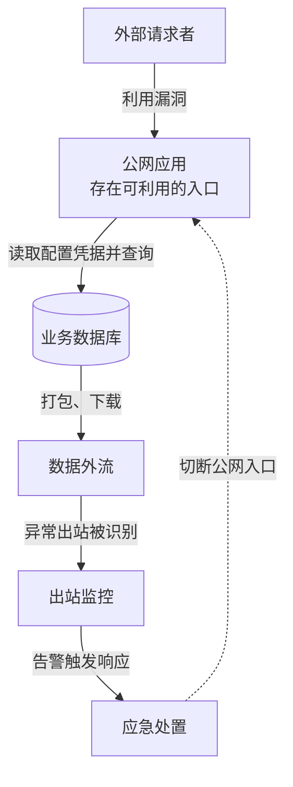

import Tabs from '@theme/Tabs';
import TabItem from '@theme/TabItem';
import CodeBlock from '@theme/CodeBlock';
import TOCInline from '@theme/TOCInline';

UI 组件与交互效果、TypeScript 风格、Markdown 与 MDX 功能、图表表达、命名及文档 front matter 的具体规范。选择展示效果前，先确定读者要解决的问题；实现后用实际页面验证。

## UI 组件与交互效果

新增或修改网站交互效果时，优先使用 Chakra UI。先检查仓库已有封装及当前安装版本提供的组件，能满足需求时直接复用或组合，不重复手写弹层定位、焦点管理、键盘导航、外部点击关闭等通用行为，也不为同类需求另引一套 UI 库。

- 菜单、抽屉、对话框、标签页和折叠内容，优先使用 Menu、Drawer、Dialog、Tabs、Accordion 或 Collapsible。
- 悬浮说明按内容选择 Tooltip、HoverCard 或 Popover；包含链接、按钮的内容使用可交互浮层。必要信息必须支持键盘和移动端点击访问，不能只依赖 hover。
- 普通正文继续使用 Markdown，保留 Docusaurus 已有的提示块、代码块和标题锚点。正文需要额外交互时，在 MDX 中复用基于 Chakra 的组件；重复需求再提取轻量封装。
- 图表、图片预览等专业功能继续使用现有 ECharts、PhotoSwipe 等方案。简单静态排版和装饰效果可保留 CSS，不要求为迁移而重写现有页面。Chakra 无法满足需求时，说明具体限制后采用最小补充实现。
- 复用 `src/theme/Root.tsx` 的 Provider 和 `src/components/ui/system.ts` 的主题配置，沿用站点字体、间距及 `--ifm-*` 配色。新增通用主题配置集中维护，不在页面重复创建 Provider，不开启影响正文的全局样式重置。
- 完成后在浏览器检查桌面与移动端、浅色与深色，以及相关的 hover、焦点、选中和禁用状态。涉及弹层时检查键盘操作、关闭后的焦点恢复、滚动与边缘遮挡，并运行与改动相称的类型检查和构建。

### 界面密度与视觉层级

后续新增和调整界面，默认采用轻量、紧凑、克制的呈现方式。先确定主要阅读内容和必要操作，再安排辅助信息；通过稳定对齐、明确层级和适当间距提高信息密度。正文中的辅助组件应融入文章，首屏应能进入主要内容。

- **先减层级，再调字号。** 合并同一任务的切换栏，删去重复标题、操作文字和说明。简单关联、状态与统计优先使用信息行或列表；卡片用于确有独立边界的内容，避免外框、卡片、徽标逐层嵌套。
- **默认展示摘要，按需展开细节。** 辅助模块先给出简短入口和关键数量，列表、证据与长说明逐步展开；会影响当前判断的版本替代、异常或失效提示保持可见。展开更多内容时结合分页、局部滚动和明确的收起入口控制高度，检查展开后的首屏占用。
- **字号服从信息角色。** 正文内的辅助列表以 11.5–12px 为起点，编号与名称通过字重、颜色和对齐区分，元信息再弱化一级。该范围用于辅助信息区，正文、表单和主要操作分别按阅读与触控需要设置。缩小文字时同步检查对比度、行高和点击范围；空间仍不足时调整结构与分批展示。
- **同类内容按行对齐。** 桌面端将编号、名称、关系与操作组织为稳定列；手机端允许名称换行，保留完整含义。重要名称和版本不依赖截断、悬浮提示或猜测才能读懂，避免把每个字段都拆成独立卡片或一行。
- **装饰只承担必要含义。** 优先使用中性色、细分隔线和少量字重变化，颜色或小标记用于区分状态与关系。边框、底色、圆角和阴影按边界需要添加；组件内的链接装饰应与交互层级一致，检查正文全局样式是否造成整行下划线、额外留白或重复强调。
- **密度与操作一起验收。** 检查文字与按钮的实际边界，预留间距，避免标签、长编号和依据入口重叠。紧凑布局仍须保留原生链接、键盘焦点、选中和禁用状态；不要使用会让可交互元素失去焦点能力的布局方式。

### 正文中的关联与交互图谱

关联信息优先出现在读者正在阅读的对象旁边，提供当前对象的摘要、列表和页内图谱，再提供完整查询入口。跨文章复用同一组件与数据模型，按当前页面及精确版本匹配，避免逐篇手写关系。

- 列表便于扫描与核对，图谱用于解释关系结构；两者共享对象、方向和证据。切换视图或从图中查看依据时，定位到对应内容并保持可操作的焦点。
- 页内图谱默认围绕当前对象展示一层、少量直接关联，支持分组查看和继续查询。结合正文宽度安排紧凑节点与横向分支；手机重排时保留完整名称、方向和关系含义。完整网络通过独立入口查看，避免将全部节点压入正文后整体缩放。
- 文件关联以原文支持的关系为依据，目录分类用于检索。名称、版本、引用、提及和替代分别表达；未注年份的引用保留原样，缺少关系不代表不存在。名称缺失时从明确对应的原文提取，不借用其他年份版本补齐。

### 截图与细节验收

1. **先看实际页面，再判断完成。** 使用真实内容检查收起、展开列表、图谱与证据等状态，同时查看正文首屏位置和组件局部。以完整信息需要的高度、重复层级和操作步骤评估布局，不能只凭代码或局部美化判断。
2. **检查边界内容。** 覆盖长名称、长编号、未注年份、缺少阅读页、空关系和较多条目；在桌面与窄屏、明暗主题中核对换行、对齐、对比度、滚动与横向溢出。
3. **实际操作关键路径。** 用键盘和点击验证展开、切换、分页、链接跳转及证据定位。检查收起后的焦点、跨页状态重置、按钮间距和禁用状态，视觉紧凑不能以交互失效为代价。
4. **修改后重新截图核对。** 确认浏览器运行最新编译结果，查看截图本身，再完成与改动相称的检查。交付保留能说明最终效果的截图；已经通过的检查，仅在新修改、失败或未解决问题需要时重跑。

### 浏览器会话复用

- 使用 Playwright、browser-use 等工具前，先检查已有会话，优先复用本项目的浏览器实例。只有会话不可用或确实需要隔离状态时才新建实例，不为每个页面、检查步骤或截图单独启动浏览器。
- 同一轮页面检查使用固定会话，通过页面跳转、标签页和调整视口完成不同页面、屏幕尺寸及主题的验证。使用 Playwright CLI 时持续传入同一个 `--session` 名称。
- 检查结束后关闭本次创建的多余标签页与会话；需要继续调试时最多保留一个本项目会话，否则全部关闭。只清理能确认由本任务创建的实例，不批量结束 Chrome 进程，不关闭用户或其他任务的浏览器。

## Markdown 与 MDX 功能

本节覆盖 [Docusaurus Markdown Features](https://docusaurus.io/docs/markdown-features) 总览及全部专项功能，以本站 `docusaurus.config.ts` 和实际依赖为准。文档正文优先复用 Docusaurus 自带组件；应用界面的交互继续遵循上面的 Chakra UI 规范。

示例先展示实际效果，源码默认折叠，点击“查看源码”即可展开。本页通过 front matter 显式启用 MDX，以便直接展示可操作的组件。

### 文件格式与 React 组件

本站已设置 `markdown.format: 'detect'`：`.md` 按 CommonMark 解析，`.mdx` 按 MDX 解析。普通文字、列表、表格、引用、代码块、提示块、公式和 Mermaid 使用 `.md` 即可；需要 `import`、JSX、React 组件或表达式时，新页面使用 `.mdx`。

下面的标签由 React 表达式生成：

<span style={{display: 'inline-block', padding: '0.25rem 0.75rem', borderRadius: '0.5rem', background: 'var(--ifm-color-emphasis-200)', color: 'var(--ifm-font-color-base)'}}>{['Markdown', 'React'].join(' + ')}</span>

<details>
<summary>查看源码</summary>

```mdx
<span style={{display: 'inline-block', padding: '0.25rem 0.75rem', borderRadius: '0.5rem', background: 'var(--ifm-color-emphasis-200)', color: 'var(--ifm-font-color-base)'}}>{['Markdown', 'React'].join(' + ')}</span>
```

</details>

已有 `.md` 需要使用 MDX 时，可在原 front matter 中增加以下配置，保留已有路径、slug 等字段；不要直接在 CommonMark 正文粘贴组件示例：

```yaml
mdx:
  format: mdx
```

- MDX 使用 JSX 语法，如 `className`、对象形式的 `style`；正文中的字面量 `{`、`<` 按需转义或放进代码块。
- 组件通过 `@theme/...` 或 `@site/src/components/...` 导入；复杂逻辑放到独立组件，不堆在文章里。重复使用的全局映射维护于 `src/theme/MDXComponents/index.tsx`。
- 复用正文片段时使用 `_` 开头的文件名，避免生成独立文档页面；MDX 可导入片段并作为组件使用。React 页面渲染导入的文档时，用 `@theme/MDXContent` 保留主题组件映射。
- 不把普通围栏代码块当作 JSX 执行环境。外部源码作为文本导入需要相应 loader，不能假设官网示例中的 `raw-loader` 已在本站配置。

参考：[MDX and React](https://docusaurus.io/docs/markdown-features/react)。

### 标签页 Tabs

正文按操作系统、编程语言或等价方案切换展示时，使用 `@theme/Tabs` 和 `@theme/TabItem`；内容有先后依赖时保留顺序展示，不放进互斥标签页。

点击切换平台，查看复制快捷键：

<Tabs defaultValue="macos" groupId="operating-system">
  <TabItem value="macos" label="macOS">

    复制选中的内容：按 **⌘ + C**。

  </TabItem>
  <TabItem value="linux" label="Linux">

    复制选中的内容：按 **Ctrl + C**。

  </TabItem>
</Tabs>

<details>
<summary>查看源码</summary>

```mdx
import Tabs from '@theme/Tabs';
import TabItem from '@theme/TabItem';

<Tabs defaultValue="macos" groupId="operating-system">
  <TabItem value="macos" label="macOS">

    复制选中的内容：按 **⌘ + C**。

  </TabItem>
  <TabItem value="linux" label="Linux">

    复制选中的内容：按 **Ctrl + C**。

  </TabItem>
</Tabs>
```

</details>

组件与内部 Markdown 之间保留空行。

- 同一组的 `value` 不重复；非空的 `defaultValue` 应匹配已有项，不指定时默认显示第一项，`defaultValue={null}` 可不预选。
- 同类选择需要跨组同步时复用 `groupId`，该选择会保存在本地；无关标签组使用不同标识或不设置。
- 需要链接指定选项时使用 `queryString="os"`；它只选择标签，不负责滚动定位。
- 默认所有标签内容参与构建渲染；仅在确有需要时使用 `lazy`，并检查未激活内容的可发现性。
- 多语言代码示例可在各 `TabItem` 内放代码块，无需另写切换组件。

参考：[Tabs](https://docusaurus.io/docs/markdown-features/tabs)。

### 代码块

代码块可显示文件标题、行号和重点行。下面的第二行为重点行：

```ts title="example.ts" showLineNumbers {2}
const site = 'FEEI.CN';
console.log(site);
```

<details>
<summary>查看源码</summary>

````md
```ts title="example.ts" showLineNumbers {2}
const site = 'FEEI.CN';
console.log(site);
```
````

</details>

`CodeBlock` 也可以展示表达式生成的字符串：

<CodeBlock language="json" title="动态生成的 JSON">{JSON.stringify({site: 'FEEI.CN', markdown: true}, null, 2)}</CodeBlock>

<details>
<summary>查看动态代码块源码</summary>

```mdx
import CodeBlock from '@theme/CodeBlock';

<CodeBlock language="json" title="动态生成的 JSON">{JSON.stringify({site: 'FEEI.CN', markdown: true}, null, 2)}</CodeBlock>
```

</details>

- `title` 用于文件名或代码用途，`showLineNumbers` 显示行号，`{2,4-6}` 高亮指定行。也可在支持注释的语言中使用 `highlight-next-line` 或成对的 `highlight-start`、`highlight-end` 注释。
- 语法高亮依赖 Prism 已加载的语言；需要额外语言时在 `themeConfig.prism.additionalLanguages` 统一配置并验证。
- MDX 动态字符串用 `@theme/CodeBlock`，普通围栏中的表达式只会原样显示。
- 本站未启用交互代码编辑器 `@docusaurus/theme-live-codeblock` 和命令转换插件 `@docusaurus/remark-plugin-npm2yarn`；`live`、`npm2yarn` 标记不代表功能已可用。确需使用时再安装、配置和验证。

参考：[Code blocks](https://docusaurus.io/docs/markdown-features/code-blocks)。

### 提示块、引用与折叠

补充说明、操作提示和风险提示使用 `note`、`tip`、`info`、`warning`、`danger`，按内容选择类型，避免整篇连续堆叠提示块。

提示块的实际效果：

:::note[补充说明]

记录理解正文所需的补充信息。

:::

:::tip[操作提示]

先验证本地效果，再进行后续操作。

:::

:::info[相关信息]

提供版本、环境或背景信息。

:::

:::warning[注意事项]

说明操作前需要检查的条件。

:::

:::danger[风险提示]

说明可能造成严重后果的操作。

:::

引用与折叠的实际效果：

> 本站已设置 `markdown.format: 'detect'`。
>
> —— 本页“文件格式与 React 组件”

<details>
<summary>查看补充说明</summary>

这里可以写 **Markdown**、列表和代码块。

- 折叠内容默认收起。
- 点击标题或通过键盘展开，可查看补充信息。

</details>

<details>
<summary>查看提示块与折叠源码</summary>

```md
:::tip[操作提示]

先验证本地效果，再进行后续操作。

:::
```

```html
<details>
<summary>查看补充说明</summary>

这里可以写 **Markdown**、列表和代码块。

</details>
```

</details>

开始和结束标记与内容之间保留空行。引用原话使用 `>` 并标注出处；长篇补充内容可用原生折叠结构，关键结论和必做步骤直接展示。`summary` 保持单行，内部 Markdown 前后留空行。

参考：[Admonitions](https://docusaurus.io/docs/markdown-features/admonitions)、[Markdown 总览中的引用与折叠](https://docusaurus.io/docs/markdown-features#details)。

### 标题、锚点与目录

下面的内联目录从本页实际标题生成，点击可跳到相应功能：

<TOCInline toc={toc.filter(item => ['标签页-tabs', '代码块', '数学公式', 'mermaid-图表'].includes(item.id))} minHeadingLevel={3} maxHeadingLevel={3} />

#### 锚点演示 {/* #markdown-anchor-demo */}

这个标题使用固定 ID。[点击跳转到这个标题](#markdown-anchor-demo)，可在地址栏看到对应锚点。

<details>
<summary>查看源码</summary>

```mdx
import TOCInline from '@theme/TOCInline';

<TOCInline toc={toc} />

#### 锚点演示 {/* #markdown-anchor-demo */}

[跳转到这个标题](#markdown-anchor-demo)
```

</details>

- 正文从二级标题开始，按语义递进，不为排版跳级。默认页内目录显示二级和三级标题；需要调整时在页面 front matter 设置 `toc_min_heading_level`、`toc_max_heading_level`，需要隐藏时使用 `hide_table_of_contents: true`。
- 标题通常自动生成锚点；被其他页面长期引用的标题可显式固定 ID，且同一页面内不得重复。CommonMark 使用 `## 安装步骤 <!-- #installation -->`，MDX 使用 `## 安装步骤 {/* #installation */}`；链接使用 `[安装步骤](#installation)`。
- MDX 正文需要内联目录时，导入 `TOCInline` 并使用 `<TOCInline toc={toc} />`；不要手工复制自动目录。调整内联目录层级使用组件的 `minHeadingLevel`、`maxHeadingLevel`。

参考：[Headings and Table of contents](https://docusaurus.io/docs/markdown-features/toc)。

### 资源与文档链接

图片与文件链接的实际效果，使用本站已有图标：

<div style={{boxSizing: 'content-box', width: 64, padding: 12, borderRadius: 8, background: '#fff'}}>

</div>

[打开图标文件](https://feei.cn/img/feei-icon.svg) · [跳转到仓库结构文档](./仓库结构.md)

<details>
<summary>查看源码</summary>

```mdx
<div style={{boxSizing: 'content-box', width: 64, padding: 12, borderRadius: 8, background: '#fff'}}>

</div>

[打开图标文件](https://feei.cn/img/feei-icon.svg) · [跳转到仓库结构文档](./仓库结构.md)
```

</details>

- 图片优先使用 Markdown 图片语法并提供准确的替代文本，图注放在 title；文件下载使用普通 Markdown 链接。MDX 中需要组件化控制时才使用图片导入、SVG 组件或 JSX 媒体元素。
- 本站静态媒体的位置和 URL 遵循 [仓库结构](./仓库结构.md)；`static/` 媒体使用 `https://feei.cn/...` 完整地址，不照搬官网示例另建资源布局。第三方包内资源保持标准 import。
- 同一 docs 插件内引用文档，优先使用带 `.md` 或 `.mdx` 扩展名的相对文件链接，构建时会转换成目标页面 URL；也可明确使用稳定 slug。无扩展名的相对 URL 按发布后的页面地址解析，不按源文件目录解析。
- 移动文档或调整标题时检查入链、相对路径和历史锚点；不把构建生成目录作为链接目标。

参考：[Assets](https://docusaurus.io/docs/markdown-features/assets)、[Markdown links](https://docusaurus.io/docs/markdown-features/links)。

### 数学公式

本站已启用 `remark-math`、`rehype-katex` 和 KaTeX 样式，Markdown 与 MDX 均可使用。

实际效果，行内公式 $E = mc^2$，独立公式如下：

$$
E = mc^2
$$

<details>
<summary>查看源码</summary>

```md
行内公式 $E = mc^2$。

$$
E = mc^2
$$
```

</details>

金额等普通美元符号按需转义为 `\$`，避免被解释为公式；长公式检查移动端可读性。插件配置集中放在 `docusaurus.config.ts`，KaTeX 样式由 `src/css/custom.css` 导入。

KaTeX 样式与 `rehype-katex` 实际使用的渲染版本保持一致，避免 HTML 与 CSS 不匹配。升级时用 `npm ls katex rehype-katex` 核对，并检查分式、根号、上下标与中文公式的实际效果。

参考：[Math Equations](https://docusaurus.io/docs/markdown-features/math-equations)。

### Mermaid 图表

图表用于回答文字不容易直观说明的关系问题。动手前先写出一句话：读者看完这张图，应当看清什么？例如“攻击者怎样把一个入口扩大为数据访问”“同一人如何冒用三个审批身份”“撤销权限后哪条异步路径仍在执行”。

只有几步顺序操作时，继续使用列表；只是核对日期、参数或方案差异时，优先使用时间线或表格。不要为了用上新效果给每篇文章配图，也不要把正文逐条装进方框。

#### 先理解原文，再设计图

把文字转成图之前，先读完整个相关章节，判断作者希望解释的是责任、层级、因果、交互还是反馈。用一句话概括读者看完应当理解什么，再从原文提取对象和关系；不要先选流程图，再把段落逐条填进框中。

图应保留原文的解释重点。原文在讲“风险信息怎样进入公司决策”，就应连接团队、会议、规划、资源和整改，不自行扩写成一套通用审批流程。压缩节点文字时，把角色名单、例子和适用条件留在邻近正文中，不丢失责任主体、关键关系或事实边界。

布局本身要表达含义：上下位置可以表示授权或要求的逐层细化，并列位置可以表示协作，侧边可以承载独立监督，回路可以表示信息反馈。必须让文字和箭头说明这些含义，不能让位置制造原文不存在的行政隶属、先后次序或因果关系。

[安全组织](/security-organization) 的三张图说明同一篇文章也应按不同问题设计：

| 原文要解释什么 | 图怎样帮助理解 | 避免的误读 |
| --- | --- | --- |
| 谁决策、谁担责、谁支持、谁监督 | 决策授权在上，业务与安全协作并列，独立监督在侧 | 把业务部门画成安全团队下属，或把三道防线画成三道技术防护 |
| 原则怎样落到日常操作并留下证据 | 从方针、办法到规范、记录逐层展开，核验反馈放在侧边 | 把制度目录画成无差别的流水线 |
| 风险怎样进入公司决策并得到资源 | 连接风险会、委员会、年度规划和执行团队，保留进展回报 | 把月度、季度、年度画成必须依次等待的审批环节 |

这些是内容与布局的对应示例，不是每张图都要套用的模板。先确认关系表达正确，再精简标签、处理连线和调整样式。

#### 按问题选择图型

| 需要看清的问题 | 优先表达 | 重点保留 |
|---|---|---|
| 系统如何连接，攻击、数据或权限沿什么路径扩展 | 带分组的流程图 `flowchart` | 对象、访问条件、信任边界、分支与反馈 |
| 谁在什么时候向谁发出请求、响应或通知 | 时序图 `sequenceDiagram` | 参与方、消息顺序、并发与返回 |
| 一个对象在什么条件下改变状态 | 状态图 `stateDiagram-v2` | 状态、转换条件与终止条件 |
| 类型或数据实体之间是什么结构关系 | 类图 `classDiagram` 或 ER 图 `erDiagram` | 类型关系，或实体、关联与基数 |
| 只有日期次序、清单或几种方案的差异 | 列表、时间线或表格 | 时间、事实、比较维度 |
| 数值怎样变化，比例或分布有什么差异 | ECharts；简单静态图可用 XY 图 | 数据来源、单位、范围与比较基准 |

流程图适合呈现路径与结构，时序图适合呈现参与方交互；不要只因文章按时间叙述就选时序图。先确定需要表达的关系，再选择本站能保留这些关系的图型。

#### 先确定节点、连线与边界

1. **列出对象与起止范围。** 区分人、身份、系统、数据与状态，明确图从哪个入口开始、到哪个结果结束。节点用具体对象或状态命名，如“业务数据库”“等待审批”，不要用“第一步”“后续影响”等空泛标签代替。
2. **先连主线，再补必要分支。** 找出通向结果的关键路径，再加入实际存在的条件、并行路径、汇合与反馈。把不改变理解的细节留在正文中；不要为让图显得丰富而补造分支。
3. **给箭头写清含义。** 用“读取配置凭据”“以应用账号查询”“提交授权”“返回执行结果”等动作说明两端关系。区分请求方向与数据返回方向；时间先后本身不能作为因果连线的依据。箭头都写成“然后”“下一步”，通常说明内容更适合列表。
4. **用分组表达真实边界。** 按网络、系统、组织、权限范围或阶段分组，并在标题写明是哪种边界。分组不是装饰框；跨越边界的关键连线应说明利用条件、凭据或授权依据。同一对象尽量复用节点 ID，避免把同一攻击者重复画成多个独立参与方。
5. **区分实际发生、理论可能与待核验。** 图里的节点和连线同样需要事实依据。未触发的漏洞利用、未证明的横向移动和推测的影响，不得直接接入已确认的攻击主线。确需展示时，标明“理论路径”或“待核验”，并在正文提供依据或限制。

同一事件用一张总图完整展示其关键过程，包括材料能够支持的入口、扩展、结果，以及发现与处置。保留让事件得以发生的分支和反向作用；材料没有说明的环节不补齐。一篇文章确有其他独立问题时可以另画专图，不把同一事件按段落拆成多张互不相连的图。

例如，银行事件里需要区分“创建人、验证人、授权人是三个业务角色”和“同一攻击者掌握了三种身份”。应让同一攻击者掌握的凭据分叉到三个角色，并保留正常审批链，而不是把攻击者画成顺序经过三个审批框。应急通信被继续读取，也要画回攻击者，才能看见处置失效的反馈路径。

#### 布局、文字与视觉

- 先排主线，再摆分支和注释，最后调整样式。上下流向优先用于纵向过程，左右流向适合较短的横向关系；结合正文宽度决定，不机械固定方向。主线需要反复折返才能读懂时，先调整结构和分组。
- 主线的位置和阅读方向应稳定，监督、回报和修订等辅助关系尽量在侧边或外围表达。自动布局把反馈分支排在起点前面、回线遮挡主线或把短图拉成多屏长图时，应重新设计布局；不要只更换方向、缩小字号或继续堆框。
- 一个节点表达一个主要对象或状态。节点正文尽量短，必要时使用 `<br/>` 主动换行；日期、漏洞编号和证据只放影响理解的部分，完整细节放正文或图注。避免把一段话塞进节点，再靠缩小字号容纳。
- 同一张图里的实线、虚线和颜色保持一致含义，并在图注中解释。不要同时用同一种虚线表示“未确认”“数据回传”和“应急处置”。颜色之外，文字与线型也应能区分含义。
- 配色、字体、边框和通用间距由主题统一维护，不在每篇文章重复定义样式。现有 `main`、`note`、`response` 类可分别强调主线、辅助条件和处置；按含义使用，避免给所有节点上色。需要新增通用语义颜色时，先扩展主题并检查深浅色对比度。
- 宽图保留可读字号，通过图内横向滚动查看，不通过压缩整张图或拆断同一过程适配手机。新渲染器已提供可聚焦的滚动区域。事件图需在回退到原渲染器后仍保留字号时，使用 `.incident-diagram` 外层，配置对应图类型的 `useMaxWidth: false`，并在图注提示可横向滚动；CommonMark 使用 `class`、`tabindex`，MDX 使用 `className`、`tabIndex`。
- 图放在首次解释该关系的段落附近。图前说明要回答的问题，图后解释需要特别注意的边、颜色与证据限制，不再逐节点复述整张图。

#### 示例：把事件过程与处置反馈连起来

下面是说明画法的假设案例，不对应某次真实事件。它要回答：一个公网漏洞怎样扩大为数据外流，处置又在哪里切断原有路径？图可横向滚动。



蓝色突出被突破的应用与数据外流，绿色表示检测与处置；虚线只表示处置对原有入口的切断。节点与连线文字同时表达这些含义。

<details>
<summary>查看源码</summary>

````md

````

</details>

#### 何时使用手工 SVG

普通关系图优先使用 Mermaid。只有空间位置本身承担重要含义，且自动布局在简化节点和关系后仍无法清楚表达时，才采用手工排布的 SVG。选择依据是是否更容易理解原文，不是某种工具天然更好看；不要为绕过布局问题引入新的图表库。

静态图直接在文章中维护：普通关系图使用 Mermaid 围栏，需要精确空间排布时在 MDX 中内联 SVG。不为单张图或单篇文章新增专用 React 组件，也不为静态节点、连线或文案建立组件参数；只有确需交互且能服务多篇文章的通用能力，才考虑复用或建设图表组件。

内联 SVG 的文字、节点和连线保持可编辑，不把整张图导出为截图。同类图的样式集中维护在共享 CSS，使用站点字体和主题变量适配深浅色，提供标题、说明和必要图注；箭头及无障碍 ID 使用文章与图名作为前缀，保证同页唯一。图宽以正文区域为目标，手机保留可读字号并在图内滚动，滚动区支持键盘且不撑宽整页。

#### 本站渲染与兼容

Markdown 和 MDX 直接使用 `mermaid` 围栏，无需导入 React 组件，也无需逐篇添加启用标记。

- 使用 `@docusaurus/theme-mermaid` 官方集成，版本与 `@docusaurus/core` 保持一致；在 `docusaurus.config.ts` 保持 `markdown.mermaid: true` 和 `themes: ['@docusaurus/theme-mermaid']`。明暗主题由对应渲染器适配，字体与配色在 `src/theme/Mermaid/styles.module.css` 集中维护。
- `src/theme/Mermaid/` 自动选择渲染器。支持的流程图、状态图、时序图、类图、ER 图和 XY 图默认使用按需加载的 `beautiful-mermaid`；其他图类型、未兼容语法或渲染失败的图自动使用原 Mermaid 渲染器。保留原渲染器时，在围栏内容首行写 `%% renderer: mermaid`；旧的 `%% renderer: beautiful-mermaid` 试用标记不再需要。
- 新渲染器统一布局间距，能够识别现有布局配置外壳；不要假定原 Mermaid 的每项布局参数都会生效。含额外主题、标题等 front matter 或 `%%{init}%%` 指令的图继续使用原渲染器，避免丢失配置。`accTitle`、`accDescr` 保留为 SVG 无障碍标题与说明，同页多图的样式及箭头 ID 必须隔离。
- 时序图的 `box` 分组等语法会触发回退。希望统一使用新效果时，可改成能表达相同关系的带分组流程图；保留角色、交互与边界，不为兼容新渲染器删减含义。图型转换后重新核对节点、连线和说明，不能只检查是否出现新配色。
- Mermaid 核心依赖与 `beautiful-mermaid` 均以 `package.json` 中固定版本为准。升级时验证实际使用的语法、主题、交互和回退，不依赖上游宽松版本范围自动获得兼容性。

#### 图表验收

1. **原意与关系正确。** 对照原文确认图回答了原来的问题，没有换成另一套通用流程。不看正文也能识别图的对象和主要关系；有过程的图还应能识别起点、主线与结果。箭头有明确含义，分支、汇合和反馈有依据，位置、分组名称与边界不制造额外含义。转换图型或渲染器后，核对重要对象、连线、角色与证据限制是否保留。
2. **实际可读。** 在浏览器检查桌面、手机及深浅色，确认中文、换行、组标题、箭头和边界完整。初始视野应能看到入口或主线，不能只显示大片空白或辅助连线。宽图的左右两端都能到达，滚动区支持键盘操作，整页不横向溢出；不能仅凭源码或构建成功判断画得合适。
3. **行为可靠。** 涉及多图、折叠内容或交互时，检查样式隔离、箭头引用、折叠展开与链接操作；明确实际使用的渲染器，确认回退后仍保留重要信息。
4. **检查与改动相称。** 修改文档先运行 `npm run check:docs`；新增或调整渲染器、组件和配置时，再运行相关回归测试、类型检查与构建。保留必要截图，发布前说明已验证的范围。

语法参考 [Docusaurus Mermaid 文档](https://docusaurus.io/docs/markdown-features/diagrams)，事实与审校遵循[我的写作原则](./我的写作原则.md)。

### Head 元数据

本页的实际标题为“网站开发规范”，可在浏览器标签看到；页面摘要来自 front matter 的 `description`。折叠源码里的 `noindex` 仅作为示例展示，不应用到本页。

<details>
<summary>查看页面元数据源码</summary>

```mdx
<head>
  <meta name="robots" content="noindex, follow" />
</head>
```

</details>

页面标题、摘要、关键词和分享图优先使用 front matter 的 `title`、`description`、`keywords`、`image`，字段要求见下文。Docusaurus 自动生成相关元数据，不为普通 SEO 重复手写标签。

确需补充 front matter 未覆盖的页面元数据时，在 MDX 中使用 `<head>`。页面级标签只影响该页；全站级标签统一维护在 `docusaurus.config.ts`。不随意覆盖 canonical、字符编码或已有分享元数据。

参考：[Head metadata](https://docusaurus.io/docs/markdown-features/head-metadata)。

### Markdown 插件与验证

扩展 Markdown 语法时先检查现有能力。`remarkPlugins` 处理 Markdown 语法树，`rehypePlugins` 处理 HTML 语法树；必须早于 Docusaurus 默认转换时使用 `beforeDefaultRemarkPlugins`、`beforeDefaultRehypePlugins`，保持插件顺序明确。

本站已配置静态媒体转换、公式和合规引用等处理，统一在 `docusaurus.config.ts` 维护；新增插件保留现有链路，不为单篇文章重复建立渲染流程。

本页的公式与 Mermaid 图就是插件转换后的实际效果；插件本身没有独立的界面组件。

修改正文后运行 `npm run check:docs`；修改 MDX 组件、插件、依赖或渲染配置后运行相应类型检查和构建。新增交互还应检查键盘操作、移动端及明暗主题。文档中标为需要额外配置的能力，完成安装和实际验证后才能标为本站已支持。

参考：[MDX Plugins](https://docusaurus.io/docs/markdown-features/plugins)。

## TypeScript

严格模式。延续现有配置和主题文件风格：

- 2 空格缩进，保留分号。
- 尽量保持小函数、单一职责。
- React 主题覆盖应尽量小而明确，放在 `src/theme/<组件名>/` 下。

## 文档 front matter

每个 Markdown 文档必须保留 front matter，例如：

```md
---
slug: /health
icon: apple-whole
description: 健康是一套长期系统，目标是在可持续前提下改善身体、情绪、关系和生活质量。
---
```

### `slug`

文件名使用中文，`slug` 使用 `/` 开头的简短英文路径，例如 `slug: /cybersecurity-law`。**slug 必须稳定**——一旦发布不应随意变更。

历史攻击事件的单篇案例，文件名与标题使用“年份-事件名”，例如 `2026-币安热钱包63亿美金被盗安全事件分析.md`。年份以可核验的事件时间为依据；跨年事件可使用年份区间，尚不清楚发生时间时不拿文件修改时间或发布日期代替。章节入口与跨年份汇总页不加单一事件年份。重命名时保留已有 `slug`、首次发布日期，并核对相对链接和自动侧边栏。

事件按年份倒序排列，越近的放在越上面：使用年份负数作为 `sidebar_position`，例如 2026 年为 `-2026`；跨年案例按已记录的最近事件年份排序。年份未确认的案例暂保留原名，排在已知年份案例之后，不编造日期或排序年份。

### `icon`

根据主体内容设置合理的 `icon`。图标系统使用 `src/components/ItsHoverIcon/icons/` 下的 ItsHover 图标，或 `src/components/ItsHoverIcon/index.tsx` 中 `ICON_ALIASES` 已注册的别名。

**新增或修改 `icon` 前需先确认对应图标真实存在**，避免使用未注册的 Lucide 名称导致侧边栏图标缺失。

独立发布的 Markdown/MDX 页面均设置图标，包括法规、标准、面试题、诗词与每日记录。文件名以 `_` 开头的引用片段不设置图标。

图标来源为 [Its Hover](https://www.itshover.com/icons)。优先复用本地已安装图标；官网展示某个图标不代表本仓库已经安装。名称以本地文件名为准，不推测名称或强行添加 `-icon` 后缀。

按读者识别的主题选择图标，保持同类页面一致：

| 页面主题 | 优先图标 |
| --- | --- |
| 法规与制度正文 | `file-description-icon` |
| 标准与检查清单 | `unordered-list-icon` |
| 认证与资质 | `rosette-discount-check-icon` |
| 历史事件、每日记录与阶段复盘 | `history-circle-icon` |
| 文学原文与阅读 | `book-icon` |
| 写作规则 | `pen-icon` |
| 团队与领导力 | `users-group-icon` |
| 隐私、权限与加密 | `lock-icon` |
| 漏洞研究 | `bug-icon` |
| 评测与统计 | `chart-histogram-icon` |
| 开发与配置规则 | `code-icon` |

`shield-check` 用于防护、合规总入口和安全保证，`target-icon` 用于目标与实战检验；不要覆盖所有安全文章或方法文章。栏目入口可以根据主题使用更具体的图标，如跨境使用 `globe-icon`、基础设施使用 `router-icon`。

图标由人工核对其存在性、引用片段边界，以及与页面主题的一致性。

### `description`（必须）

所有新文档必须在 front matter 中携带 `description`。用途：站点 SEO、社交分享卡片的 OG/Twitter 摘要。要求：

- 长度 ≤ 160 字（中文按字符计，英文按词计）。
- 高度概括本文的核心结论或核心问题，不复述标题。
- 避免「本文介绍」「本文探讨」「通过 X 阐述 Y」这类废话开头。
- 直接陈述价值主张，使用与正文相同的判断语气。
- 多个并列要点时用顿号或分号分隔，不要写成段落。

### `published_at`（可选）

需要进入首页近期更新或 RSS 的内容填写首次公开发布日期：

```yaml
published_at: '2026-09-16'
```

使用真实有效的 `YYYY-MM-DD` 日期。发布后保持不变，后续修改不改变首次发布日期。不要使用文件修改时间、Git 提交时间或整理日期替代首次发布日期。历史内容只有在能确认原始发表日期时才补齐；未知日期不猜测。日常记录可以使用记录日期。

### 最后更新时间（自动获取）

最后更新时间由 `docMtimePlugin` 从文件当前路径的 Git 提交记录生成 `updatedAt`，文章操作菜单和首页近期更新共用这份数据，不在 front matter 手工维护 `updated_at`。该时间表示文件发生过修改，不代表全文重新经过事实核验。缺少 Git 历史时不显示更新时间，也不使用检出或复制产生的文件时间替代。

复核日期字段 `last_reviewed` 已停用：新文档不填写，修改文档不更新，质量检查不再要求或校验它。旧文档中已有的字段不再被功能代码读取，可在后续编辑时删除，不将其改名为更新时间。

### `image`（可选）

文档有配图时填写 `image`，取正文中第一张图的相对路径（相对于 `static/`）。无图文档不写 `image`，让社交分享回退到站点默认 OG 图。

### `sidebar_badge: { text: '演讲' }`

带 `演讲` 徽标的文章属于**历史快照，不修改正文**。需更新观点时应复制为新文件后再编辑，原文件保留不动。

### 网站幕后分组

给 AI 协作助手使用的工作规则统一放在 `docs/05-吴飞飞/01-关于/关于FEEI.CN/SKILL/`；定时任务提示词、共用执行约定和任务入口放在同级 `定时任务/`。侧栏使用目录分类；定时任务目录下的文档统一使用 `sidebar_badge: { text: 'GitHub Action' }` 标记执行平台，SKILL 页面不重复添加分类徽标。维护者更新规则文档时需遵循本文档的全部规范。
