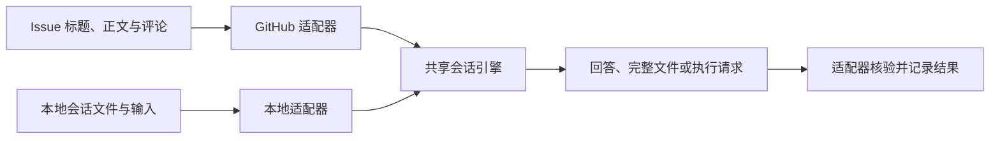

---
sidebar_badge:
  text: GitHub Action
slug: /automation-tasks
title: 自动化运行
icon: code-icon
description: GitHub Actions 的任务入口、调度、运行状态、成果交付、审阅与故障恢复；任务方法由对应 SKILL 维护。
sidebar_position: 2
---

任务方法统一在 SKILL 中维护，GitHub Actions 负责触发时间、启用开关、运行环境、权限和固定交付步骤。下表提供任务与运行入口，实际调度以各 workflow 为准。需要人工执行同类任务时，读取对应 SKILL，并按本次请求确定输入与交付方式。

| 任务 | 北京时间 | 交付 |
| --- | --- | --- |
| [安全事件研究复盘](./SKILL/安全事件分析.md) | WEEKLY MO 09:00 | Issue |
| [FEEI.CN 知识库治理](./SKILL/知识库治理.md) | WEEKLY SA 10:00 | Issue |
| [AI 安全前沿研究流水线](./SKILL/AI安全前沿研究.md) | DAILY 08:00 | Issue |
| [AI 编程与研发提效](./SKILL/AI编程与研发提效.md) | WEEKLY TH 09:00 | Issue |
| [安全架构与防御创新](./SKILL/安全架构与防御研究.md) | WEEKLY TU 09:00 | Issue |
| [个人健康趋势研究](./SKILL/个人健康趋势分析.md) | WEEKLY MO 10:00 | 公开 Issue |
| [更新体重壁纸](./SKILL/体重壁纸数据整理.md) | WEEKLY SU 09:00 | 公开 Issue |
| [港股热门新股提醒](./SKILL/港股新股跟踪.md) | DAILY 08:00,12:00,16:00,20:00 | Issue |
| [每日个人记录](./SKILL/每日个人记录.md) | DAILY 07:45 创建、23:15 刷新 | 公开 Issue |
| [每日阅读精选](./SKILL/阅读精选.md) | DAILY 07:40 | 公开 Issue |
| [每周阅读回访](./SKILL/阅读回访.md) | WEEKLY SU 20:30 | 公开 Issue |

[Actions 失败诊断](./SKILL/Actions故障诊断.md)使用只读调查流程，每 6 小时巡检全部 workflow 的近 7 天 main 运行，亦可手动指定运行。Codex 自主读取日志、源码和相关历史并提出解决方案，独立发布 job 校验后写回诊断 Issue；不自动修复或重跑。其执行时间与权限由 `actions-failure-diagnosis.yml` 维护；模型调用复用公共执行器，不经过研究写作循环。

执行器先校验任务 ID、提示词与启用状态，再执行任务，核对结构化结果和真实交付文件。`completed` 表示本次任务产物满足要求，`no_update` 表示已检查但没有实质更新，`blocked` 表示缺少核心数据、能力或权限。workflow 触发、job 成功和任务成果达标是不同状态。

各任务使用独立 `AUTOMATION_*` 仓库变量，可分别暂停；提示词读取与结果验证由 `scripts/automation_tasks.py` 完成。运行结果包含提示词摘要、实际执行 commit、触发 commit、来源与核验摘要，记录数据截止时间及历史去重依据。无更新时不发 Issue，仍保留摘要和30天 Actions 附件。知识库治理与研究稿使用“待审阅”标签，生成壁纸等可直接使用的成果使用“已交付”。研究文章仍须确认具体版本后才能写入，定时启用不等于自动发布。

定时触发可能延迟；执行器检出最新 main，分别记录触发和执行版本。港股提醒只在按当前配置推算的最近时段后45分钟内开始，交付前再检查截止时间；过期只留调度检查附件，不发过时提醒。此推算不代表 GitHub 的原始排队时长；手动运行不受该窗口限制。

[共用执行约定](./SKILL/自动化执行约定.md) · [GitHub Actions](https://github.com/FeeiCN/FEEI.CN/actions)

「网站幕后 → SKILL」维护任务方法和共用执行约定；「网站幕后 → 自动化运行」提供任务索引、运行入口与排障说明。workflow 引用对应 SKILL，避免另存一份任务提示词。

## 执行配置

仓库自动化按执行方式分为两类：数据同步、构建、部署和配置检查等确定性任务直接运行固定脚本；需要模型判断的任务通过 `scripts/codex_runner.py` 调用 Codex。公共执行器提供 Python 函数和命令行入口，统一模型连接、临时会话、权限参数、执行时限、日志与输出校验，不负责创建 Issue、提交代码或重试业务流程。调用方式依据 [OpenAI 非交互执行文档](https://learn.chatgpt.com/docs/non-interactive-mode)。

任务脚本只处理各自的输入、过程与交付：`run_automation_task.py` 编排单次任务或研究审稿循环，`codex_actions_diagnosis.py` 准备调查对象与发布报告，`history_life_journey.py` 维护历史旅程状态，`conversation.py` 组织连续对话与结构化文件版本，`issue_conversation.py` 适配 GitHub、核验审批并固定交付，`scheduled_issue_review.py` 提供旧稿兼容与来源、历史读取，`translate_text.py` 处理翻译和缓存；Issue Driver 调用共享会话引擎生成结果，由独立 job 执行已批准版本。任务输出可以是 Markdown 或各自的 JSON schema，不要求统一正文格式。

权限由可信脚本和 workflow 显式传入，执行器默认仓库只读并隐藏模型与 GitHub 凭证环境变量。失败诊断单独允许模型工具使用只读 GitHub 令牌；研究任务的 `output/` 写入范围、定时内容审阅的目录范围、普通获批修改的工作区权限分别保留。公共执行器不授予 GitHub API 写权限，也不替代本人确认、版本绑定和发布步骤。

公共执行器每隔约 30 秒报告阶段、耗时、日志字节数和最近观察到日志变化的时间，不因没有日志就判定模型停滞。超时或收到取消信号时，先终止进程组，宽限后强制清理仍存活的工具进程。原始 stdout/stderr 留在 runner 临时目录，不自动上传或直接展示到运行摘要；研究日志按阶段和 attempt 命名，避免重试覆盖第一次证据。

每次调用将执行 commit、触发 commit、提示词哈希、权限哈希、CLI 版本、模型名、阶段、attempt、状态、耗时和运行链接写入 runner 临时目录的 `codex-executions/`。这些固定字段的摘要在成功或失败后均上传为 30 天附件；不包含提示词、端点、凭证、正文和原始日志。Actions 摘要同步展示阶段状态，业务报告发布仍要求调查或生成 job 成功。

CLI 版本集中固定在 `scripts/codex_runner.py` 的 `CODEX_VERSION`，各 workflow 用 `python3 scripts/codex_runner.py install` 安装同一版本。升级时先修改该版本，再运行执行器验收。线上调用必须提供模型名、端点与连接凭证，并匹配已验证的 CLI 版本；配置缺失或版本不符时立即失败，不回退到用户默认配置。

非零退出、超时、空输出和不符合 schema 的结果均使本次调用失败。公共执行器不自行重试；研究任务仅对审稿超时重试一次，复用相同稿件和审稿输入，并为后续最坏情况下的修订、复核保留预算。余额不足、连续两次超时或非超时错误不重试；全部尝试都计入原有 90 分钟总预算并写入 `phase_runs`，重试不重复交付。稿件和审稿意见仍按版本保留，不把未复核稿标成完成。

[Codex 执行器验收](https://github.com/FeeiCN/FEEI.CN/actions/workflows/codex-runner-check.yml)仅允许本人从 main 手动触发。它先运行生命周期、预算和兼容测试，再检查真实文件与网络权限，最后让模型实际读取 AGENTS、写入 output，并尝试修改受保护文件；由固定脚本复核实际文件状态。该入口不发布业务报告，结果与失败证据保存在 Actions；新版本通过后，再选真实任务核对完整交付链路。

模型名使用仓库 Variable `OPENAI_MODEL`，当前设为 `gpt-6-astra`；连接凭证与端点继续使用 Secrets：`OPENAI_API_KEY`、`OPENAI_BASE_URL`。不在文档或日志中保存凭证。模型任务执行时不提供 GitHub 写入令牌；模型完成后由固定交付步骤创建审阅 Issue，不自动改文章。

执行器使用独立权限配置：仓库只读，`output/` 可写，允许研究所需的外网访问。每次模型任务运行先在同一配置下实际验证这三项；不能只设置 `web_search` 就假定模型连接具备浏览能力。

研究文章任务采用有明确目标和停止条件的写作循环：先形成写作简报与完整初稿，再独立调用模型审稿，必要时最多修订两轮，每版修订后重新复核。审稿核对事实、逻辑、可读性和重要内容是否保留，意见包含具体位置、问题、修改方向及验收条件。初稿达标即停止；可选的风格偏好不触发反复润色；存在关键问题、时间预算用尽或修改停滞时不标为完成。研究写作总预算为90分钟，包含研究、写稿、审稿和修订；单次任务预算为30分钟，阶段时限由固定执行器与共用执行约定维护。

目标、简报、各版正文与审稿意见保存在 `output/writing/`，随研究结果作为30天 Actions 附件保存；Issue 交付最后通过模型复核的完整待审稿，仍须本人确认具体版本才写入网站。这是由 `scripts/run_automation_task.py` 顺序控制的执行循环，不依赖交互会话的 `/goal` 状态；新的 Actions 运行通过 Issue 历史延续上下文。阶段提示词集中在[共用执行约定](./SKILL/自动化执行约定.md)，其他任务继续单次执行。

健康趋势、体重壁纸和每日个人记录也交付到当前公开仓库的 Issue，用户已明确授权公开这些任务成果，不再需要私人仓库或专用令牌。壁纸只通过 Actions 附件提供 PNG、SVG 下载，需登录 GitHub，保留30天；过期或运行被删除后需重新生成，不长期存图，不上传 Release、网站或其他图床，Issue 不提供内嵌预览。跨 job 的临时交付包保留1天，供下载的纯图片附件保留30天。壁纸交付仅需 Contents 读取、Issues 写入及核验来源所需的 Actions 读取权限；模型执行仍为仓库只读。公开交付不自动发布网站文章，也不上传原始健康数据分片和无关缓存。

每项任务的 `AUTOMATION_*` 变量设为 `true` 后允许执行。手动运行与定时运行读取同一份 SKILL 或检查说明、使用相同权限；验证不能仅检查 workflow 是否触发，还应打开对应运行及成果，核对来源、数据日期、交付正文和实际附件。

所有任务 checkout 到 `$GITHUB_WORKSPACE/feei.cn`，命令默认工作目录为 `feei.cn`；模型执行显式传入 `codex exec --cd "$GITHUB_WORKSPACE/feei.cn"`，并核对 Git 根目录。壁纸模型只准备带日期、单位和来源的 `output/wallpaper-data.json`，由 `scripts/render_weight_wallpaper.py` 统一渲染，版式不随每轮生成变化。

Mac mini 的资产、港股与健康导出使用独立 job，手动选择 all 时依次执行，单项失败不取消其他项。健康导出先探测 Health Auto Export 服务，仅在服务不可用时检查 iPhone 并尝试恢复；若设备锁定妨碍恢复，仍需本人解锁。大模型用量按来源报告成功、跳过或失败；已配置来源失败会使任务失败，同时保留其他来源成功导出的数据。

## 手机睡眠评分归档

手机 Shortcut 每天创建“睡眠评分”Issue 后，由「睡眠评分议题归档」自动解析 OCR 并保存到现有 `/data/sleep-score/YYYY/MM/DD.json`；日期取 Issue 创建时间的北京时间自然日。同一天多次提交时，创建时间较新的 Issue 覆盖当天旧评分及细节，原始输入全部留档；重跑较旧 Issue 不会把数据改回。该流程不调用模型或操作手机。它保留评分分项、就寝信息与手表关机提示，校验总分和分项合计，再持久化、更新趋势索引、核对线上数据，最后在原 Issue 回复实际 URL 并关闭。解析失败、版本过期和线上未核验时保留 Issue 供修正或重试，每小时补处理未归档记录。

新数据与原始 OCR 存在服务器，部署不会覆盖该目录，Git 中历史仅作初始化种子。每日个人记录和健康趋势研究自动取得评分与质量提示，和 v5 健康日索引按日期关联，缺失的睡眠阶段和精确时长不补造。格式与合并规则见[健康数据存储规范](./SKILL/健康数据存储规范.md)。

## 阅读输入与成长回访

每日阅读精选直接在 Issue 正文交付一篇完整作品：中文给完整原文，其他语言默认给完整中文译文并标注 AI 翻译，同时保留作者、出处、许可、粗估阅读时间、简短推荐理由和一个读后问题。只选已核验允许转载和翻译的开放授权或公版作品，免费可读不等于允许转载；全文不能由简介、链接或附件替代。选材兼顾长期主题与陌生领域，不只追 AI、安全和投资热点；优先实际打开全文、可直接阅读的来源，按原文和核心问题与历史去重。模型写入 `output/reading-content.json`，程序核对全文文件、授权类型与来源后直接展开正文，过长时不截断。没有合适新材料时静默。

每周阅读回访读取精选议题与本人的真实反馈，追踪一个理解或应用问题，以及本人明确同意的一个小尝试。两项任务在准备和原 Issue 讨论时均提供关联任务历史，跨运行通过 Issue 延续；检索缺口如实保留。没有本人反馈且历史完整时，程序直接跳过模型并保持静默；历史读取不完整时不能声称没有反馈。推荐、收藏、阅读时长和机器人总结都不代表读完、理解或成长。

可在原 Issue 自然回复“这里没懂”“这个观点不成立”“读完了，我想到……”。助手先讨论原文与本人问题，不自动安排练习、记为已掌握或写入网站。后续选材读取这些反馈，保留探索空间；长期规则变更与网站发布仍需单独确认。启用变量分别为 `AUTOMATION_DAILY_READING_SELECTION` 和 `AUTOMATION_WEEKLY_READING_REVIEW`。

## 在原 Issue 中审阅与写入

[历史人物一生决策](./SKILL/历史人物决策.md)使用独立的持续会话流程：一个人物保留一个 Issue，由本人自然回复推进，正文维护当前位置与章节索引，评论保存完整故事、选择原话、分析和恢复进度。默认可承接朱元璋避乱与投军的已有讨论；每幕允许多轮追问，决定后与真实历史对照，之后沿真实经历继续。暂停、回看和背景补充不推进章节；没有回复时等待。该类议题由专用 workflow 处理，旅程中的认可与继续不会进入文章审批和网站写入。

新 Issue 标题直接使用成果主题，不带“自动任务”、completed 等执行状态或运行时间；任务分类和交付状态使用 label。

一个 Issue 对应一个持续任务会话，创建时的标题和正文是初始目标，后续评论是继续讨论。自动任务的报告也可在原 Issue 继续，不必复制到新 Issue。助手保留历次纠正、当前完整稿、待处理意见和实际执行结果；普通追问可以先回答，再继续修改或确认同一稿件。每轮恢复会话并直接生成回答或修订，不先运行独立意图分类模型。

共享核心在 `scripts/conversation.py`，负责上下文、模型调用、结构化结果、稿件版本、状态更新与展示；GitHub 适配器在 `scripts/issue_conversation.py`，负责来源核验、会话恢复、固定写入和结果评论。workflow 只编排四类 job：turn 只读生成，apply 将完整版本提交任务分支并创建待审 PR，regenerate 只调度固定壁纸任务，publish 写回 Issue。跨 job 使用本轮不可变 artifact ID 传递产物，模型不持有 GitHub 写权限。旧报告和封存计划继续兼容读取；旧意图分类、模型审阅调用和独立写入入口已移除。两种适配器通过同一个状态更新函数推进稿件、待处理意见与执行回执。

本地可用 `python3 scripts/conversation.py --session output/local-session.json --message '继续讨论的问题'` 复用同一引擎；重复使用同一 session 文件即可延续目标与稿件。该入口保存结构化文件与确认结果，实际写入仍由本地会话执行器处理，不调度或评论 GitHub；它不代表已经接入 Codex 应用的原生会话存储。
| 操作 | 在 Issue 中发送 |
| --- | --- |
| 提问、比较或讨论 | 直接提问，助手先回答，不强制生成文章 |
| 审阅、修改或优化 | “第二段讲得不清楚，补个例子” |
| 重新规划写入 | 直接说明希望完善的文章或位置 |
| 首次确认但尚无待审版本 | “整理后写入网站”，先生成完整文件并创建待审 PR，再审阅具体版本 |
| 原报告已封存逐文件完整稿 | “可以，写入”，核验该版本并创建待审 PR，无需重复贴稿 |
| 确认具体版本写入 | 在 PR 的 Files changed 中审阅具体版本，确认后合并；Issue 中的确认只交付 PR |
| 使用固定模板重做体重壁纸 | 在原壁纸 Issue 说明“数据同步了，再做一次”等；完成后回复本议题下载链接 |
| 暂停 | “先放一放”；以后发新意见可恢复 |

例如，先评论“补读官方根因报告，重新组织因果图，并融入现有文章”，助手形成完整修订文件后由固定程序创建待审 PR，在 Issue 回复变更摘要与链接。本人在 PR 中审阅差异并确认合并；Issue 中的“写入”“确认”保留兼容，只用于交付待审 PR，不直接发布。“不错”“可以”等普通认可仍不触发文件写入。存在歧义时只澄清必要的问题，直接用自然语言说明即可。

助手在审阅阶段只读仓库，联网核对必要材料，生成包含 front matter、正文、图和引用的完整文件；固定程序验证后提交 PR，评论只展示变更摘要、验证结果与链接。普通问答使用 `codex:discussing`，完整稿待确认使用 `codex:plan-ready`，确实缺少必需事实时使用 `codex:paused` 并说明需要什么。资料不足时先询问缺失事实；日记尤其不能用客观线索替本人补出经历。壁纸重做由单独的固定调度 job 触发原工作流，仅此 job 获得 Actions 写入权限，不让模型自由触发 workflow。准备和交付前均核验机器人任务来源、本人最新请求及其摘要；请求变化或已交付时停止。此入口使用现有模板，不修改绘图脚本，临时附件不能用作网站长期图片。

批准绑定当前目标、本人完整请求和具体稿件，未处理的修改意见不能被后来的“写入”覆盖。标签更新不影响请求身份；main 的无关提交不影响稿件版本，目标文件变化则停止写入并要求重新审阅。执行阶段只允许修改计划列出的 `docs/`、`blog/`、`static/media/` 文本文件和 `.github/workflows/` 下直接的 workflow 文件；脚本核对文件与已批准版本逐字一致，再经过文档检查和无警告构建，由 workflow 提交任务分支并创建待审 PR，根据 workflow 实际结果回复变更摘要、PR 链接与验证状态；不直接推送 main 或自动合并，Issue 留到 PR 合并后关闭，不把模型执行时尚未构建的描述当作最终交付状态。脚本、组件、原始健康数据及其他计划外内容不能通过此入口写入。

原始数据同步继续使用 `scripts/workflow_delivery.py` 生成结果回执；Issue 文件修订由会话适配器回复 PR 差异链接与验证结果。数据同步的文章地址来自本次构建的路由与站点地图，日记和行车记录链接到已存在的对应日记录，阅读、健康、财务与 AI 用量链接到数据看板。回执同时保留提交、文件和运行记录；未找到页面时只给文件入口，不猜测网址。Issue 结果评论与 Actions 摘要使用同一份回执。安全工程同步给目标仓库入口，部署任务单独报告执行结果；提交或同步成功均不代表已经核验线上内容。壁纸仍只提供有保留期限的 Actions 附件下载。

每轮读取原目标、当前请求、全部本人评论、机器人回执、当前完整稿和已处理记录，档案中的 source_issue 保存原始标题与完整正文，包括每日记录的自动数据区块。当前稿全文进入模型上下文，最近消息可节选，完整档案保存在 output/conversation/context.json；同任务历史最多检索100个议题，对最近10个读取全部本人和机器人评论，并记录读取缺口。旧意见用于理解当前要求，旧审批不自动批准新稿。来源是仓库与 Issue 中可核验的记录，不包含其他本地或 ChatGPT 会话的记忆。

普通讨论不会直接写入。首次报告若已展示逐文件完整稿，交付程序会将目标文件、main 基线和稿件哈希封存在正文中；本人请求继续处理即可核验并创建待审 PR，不再复制全文索要第二次确认；发布在 PR 中确认合并。后续修订稿评论优先于原报告，原报告、本人意见或目标文件变化后仍需核对新版本。封存文本由固定程序逐字写入任务分支，模型不再参与改稿；同版本重试复用其开放 PR，PR 变化或关闭时停止。尚无完整文件或只有研究正文时，先整理逐文件版本并创建 PR，再由本人审阅和确认合并；先前的认可不能批准之后才生成的内容。旧报告和评论仍按当前自然语言流程读取。创建 PR 不代表已合并或发布，应分别核对 PR、合并提交与部署运行。既有原始数据自动同步保持原流程，不纳入文件修订的 PR 审阅要求。来源无法验证的历史机器人 Issue 会说明阻塞原因，不仅凭标题或标记放行。

### 异常后如何继续

- 审阅失败或资料不足时，先查看运行日志并补充缺失事实，再直接说明希望继续处理的内容；没有完整待审稿时，明确要求写入也只会先整理待审内容，不会直接写入。
- 若会话模型或结果校验失败，不会执行写入；稍后直接继续说明要求即可。
- 本人意见、Issue 正文、完整待审稿或相关 main 文件发生变化后，应重新审阅完整版本，再确认本版写入。
- 已批准的写入失败时，可以直接回复“继续”或“重试”；原批准请求、稿件和目标文件仍一致且没有新修改意见时，沿用同一版本执行。目标文件已与批准稿一致时不重复提交。模型生成失败不形成批准；稿件变化后重新确认。提交成功但部署失败时核对并恢复部署。

验证连续会话时，在同一 Issue 中依次完成讨论、修订、追问、确认写入和重复运行检查；评论、提交与部署结果分别核对。

## 每日个人记录的运行阶段

每天北京时间 07:45 先用固定脚本创建当天 Issue，再执行个人记录线索采集；白天每小时补检查缺失交付，已有记录不重复创建。自动线索和折叠数据快照写入正文固定区块，保留本人填写区域与旧评论；北京时间 23:15 刷新同一 Issue 的自动数据区块，23:45 与次日 00:15 对缺失或延迟来源补检查；次日补检查仍使用前一天日期。

采集与数据核对见每日个人记录，成稿见日记写作。固定脚本与 workflow 继续负责创建、去重、刷新和延迟补检查。
